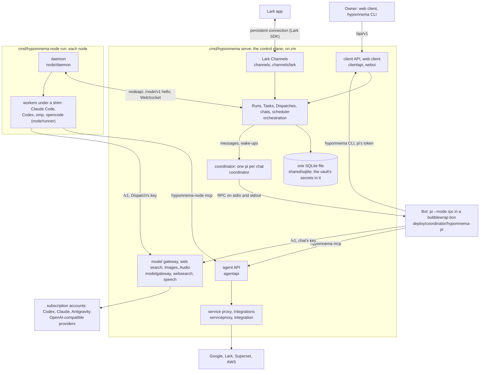
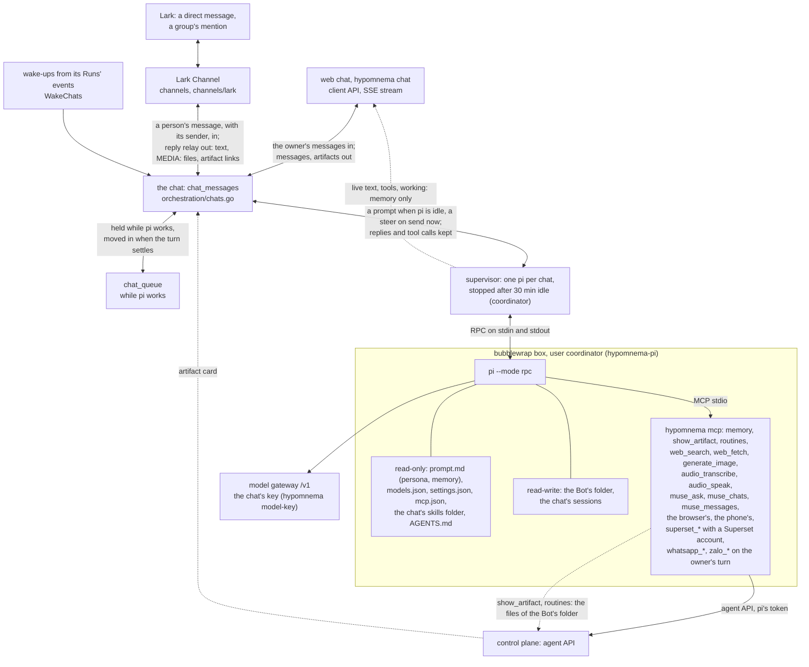
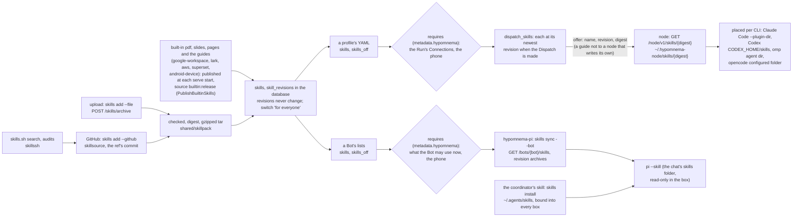
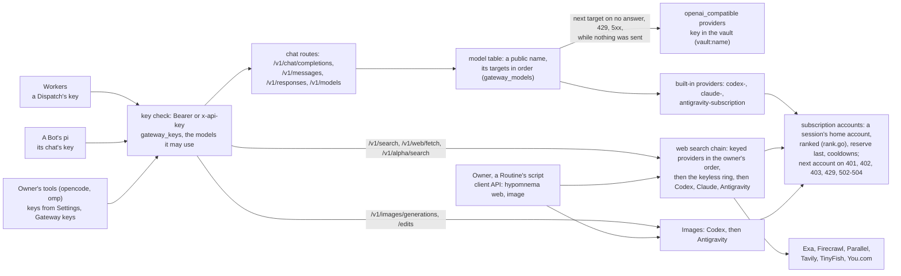
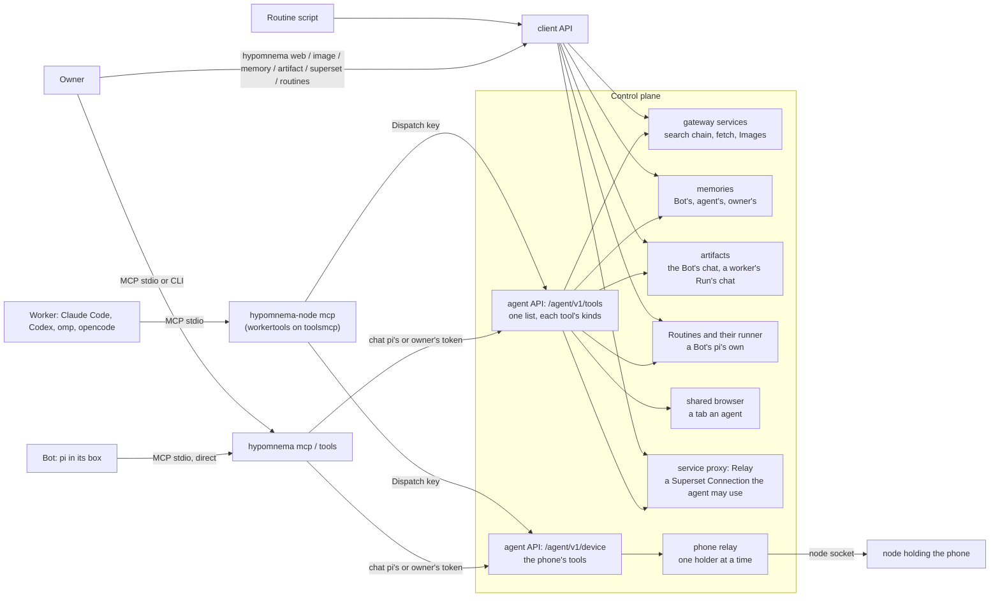

# Hypomnema architecture

This page states what is implemented today, and nothing else. The target is in [docs/vision.md](docs/vision.md);
planned work is in GitHub issues and never appears here as a fact. Update this page in the change that makes a
statement true or false.

## Binaries

The two binaries and what talks to them, as `serve` wires them (`internal/controlplane/controlplane.go`) and the node
runs them (`internal/node`); each box names its package.



| Binary | Commands | What it does today |
|---|---|---|
| `cmd/hypomnema` (control plane) | On the server: `migrate`, `serve`, `version`, `nodes`, `machines`, `accounts`, `tokens`, `users`, `secrets`, `gateway`; without the database: `files serve`, `update`, `tool`; over the client API: `login`, `whoami`, `run`, `runs`, `tasks`, `questions`, `answer`, `chat`, `chats`, `bots`, `setup`, `routines`, `memory`, `artifact`, `integrations`, `hosts`, `approvals`, `channels`, `profiles`, `providers`, `repos`, `models`, `skills`, `web`, `image`, `browser`, `superset`, `pi-models`, `model-key` (`hypomnema help` lists each one's subcommands) | `migrate` brings the database schema up to the binary's version; `serve` refuses any other schema, then serves `/livez`, `/readyz`, the node API, the client API, the model gateway and the web client, and runs the scheduler loop; the other commands are the owner's and the coordinators' (below) |
| `cmd/hypomnema-node` (node) | `install`, `init`, `check`, `run`, `service`, `tool`, `shim`, `mcp`, `version` | `install --url` puts the node on the machine (below); `init --url --token-file` writes the node's configuration; `check` says hello once and lists the CLIs it found; `run` runs the daemon with a runner per runtime (Claude Code, Codex, and ACP for omp and opencode); `tool` runs an integration's tool through its launcher (below); `service` prints a systemd user unit; `shim` runs one worker and `mcp` serves its tools (both started for a worker, not by hand) |

Configuration comes from the environment: `HYPOMNEMA_HTTP_ADDR` (default `127.0.0.1:8080`),
`HYPOMNEMA_DATABASE_PATH` (required, absolute), `HYPOMNEMA_LOG_LEVEL`, `HYPOMNEMA_LOG_FORMAT` (`json` or `text`),
and the vault's root keys: `HYPOMNEMA_VAULT_KEYS` (a comma-separated list of `id:base64` entries of 32 bytes) with
`HYPOMNEMA_VAULT_ACTIVE_KEY_ID`, set together or not at all.
Which runtime and model workers use is stored, as profiles (below), and which model a Bot uses in the Bot, not
configured.
`HYPOMNEMA_COORDINATOR_COMMAND` (a JSON array) starts pi for a chat id appended to it; unset, chats keep their
messages and nothing answers. `HYPOMNEMA_BOT_FILES_COMMAND` (a JSON array, `sudo -n -u coordinator
/usr/local/bin/hypomnema files serve --root <the Bots' folders>`) reads a Bot's folder for the Files panel and for
the files a Bot sends into a Lark chat; unset, the panel shows only the Tasks' worktrees and a Bot's files are not
sent. `HYPOMNEMA_ROUTINE_COMMAND` (a JSON array) runs a script Routine for
the Bot's id and the Routine's id appended to it; unset, a script Routine's run fails and says so.
`HYPOMNEMA_CHAT_RM_COMMAND` (a JSON array, `sudo -n -u coordinator /usr/local/bin/hypomnema-chat-rm`) removes a
deleted chat's files of pi for the chat's id appended to it (issue #484); unset, they stay and the deletion says so.
`HYPOMNEMA_PPROF_ADDR` (unset by default) serves Go's profiles (`net/http/pprof`, under `/debug/pprof/`) on a
listener and mux of their own, never on `HYPOMNEMA_HTTP_ADDR` (issue #586, as Coder's `--pprof-address`); only a
loopback `host:port` such as `127.0.0.1:6060` is taken, anything else stops the start. A profiler that cannot
listen is logged and the control plane serves without it, as Coder's does.
The web search providers' keys are vault secrets named `web-search-<provider>` and `web-search-<provider>-<n>`;
which providers are on and the keyed ones' order are set on Settings → Gateway → Web search and stored (see "Web
search and fetch"). The audio providers' keys are vault secrets named `speech-<provider>` and
`speech-<provider>-<n>` (see "Audio").

How a message reaches a Bot's pi and its reply comes back (`internal/controlplane/coordinator`,
`orchestration/chats.go` and `chatqueue.go`, `internal/controlplane/channels`, `deploy/coordinator/hypomnema-pi`).



The coordinator (`internal/controlplane/coordinator`, issue #41 PR 3): `serve` runs one `pi --mode rpc` per chat
that has something for pi, as the chat's Bot (`--bot`, and `--group` for a Lark group's chat) with the chat's model
(`--provider`, `--model`, `--thinking`),
and stops it after 30 min idle by closing its stdin; it starts again with the same session id. pi's own retries are off. Owner
messages and wake-ups go as one `prompt` when pi is idle and are marked delivered once pi accepted them. An owner
message written while pi works, from the web, the CLI or Lark, or while others still wait, goes into the chat's
queue (`chat_queue`, issue #497, after OpenMausBot's `server/channel-queue.ts`): off the transcript until the turn
settles, when the supervisor moves the queue into the chat in order and sends it with the wake-ups. Wake-ups also
wait for the turn. The owner may remove a queued message or send it now, which moves it into the chat and goes to
pi at once as a `steer` (read after the running tool calls, before the next model call). The chat's stream sends the
whole queue as a `queue` frame when it opens and whenever it changes. The supervisor makes a pass (wake the chats
of their Runs' new events, deliver, stop idle pi) every 5 s and on each commit signal. A pass with nothing to do
commits nothing, so it does not wake itself (issue #586). It keeps a signal that came during its pass, unlike the
scheduler's `Loop`: a pass waits on pi, and an owner's message or pi's own rows committed meanwhile go at once.
pi's activity is kept and relayed as Omnara does (issue #41 PR 4): each assistant `message_end` is kept as
the coordinator's message with its text and thinking as parts, and each finished tool call as a `tool` message with
its arguments and result (at most 16 KiB). Text as pi writes it, tools starting and ending, and working or idle go to
the chat's watchers from memory only and are never stored. A reply that ends in an error is followed by a `failed`
row. `abort` stops pi's turn and marks it as stopped by the owner (issue #267, after OpenMausBot's
`server/person-stops.ts`): while marked, the `message_end` whose `stopReason` is `error` or `aborted` keeps its text
and a `stopped` row ("Stopped") in one write instead of a failure, and a turn that ends with neither gets the row at
`agent_settled`, where the mark clears. A turn that a restart cuts continues by itself (issue #716, after Hermes's
interrupted-turn markers, `tui_gateway/turn_marker.py` and `session_auto_continue.py`): pi's `agent_start` marks the
chat in the store as that pi process's (`chats.turn_started_at`, `turn_token`, `turn_attempts`, migration 112) and
`agent_settled` clears the mark, as does a pi that exits while the control plane runs; each pi clears only a mark
with its own token, so an old pi's exit never clears the turn of the chat's next pi (Hermes's compare-and-swap
clear). A pi the control plane stops keeps it. As the supervisor starts, a chat whose mark is at most 15 minutes old
and was continued fewer than 2 times gets the line "Restarted for an update; continuing." (a `system` row of kind
`continued`, given to pi, which pi reads as "the control plane restarted for an update and cut your previous turn …
check the current state before redoing anything, then finish the task"; it is no turn input of its own, so a turn
that was the owner's stays his for `OwnerTurn`), one attempt more and its mark from now; any other mark is cleared
with the line "A restart cut this turn; send a message to continue." (kind `cut`, not given to pi). A `continued`
line an earlier start wrote and pi never had is voided (marked delivered) whenever a later start writes a line
for the chat or holds the cut turns. The partial transcript stays as kept; both lines reach a Channel's chat as a
message of their own. A start that finds marks is recorded (`restart_boots`); when it is the third of starts no
more than 5 minutes apart (Hermes's restart-loop guard, `gateway/restart_loop_guard.py`), nothing is continued, the
marks stay and every undelivered `continued` line is voided. The supervisor lists the chats whose pi works on a
turn (`WorkingChats`), which the control socket gives `hypomnema update`, and while an update runs
(`selfupdate.Updating`, below) it starts no pi and gives an idle pi no new turn (compactions included); a running
turn goes on, and what is written waits for the update to end. A pi start holds the supervisor's lock from its last look for
the update until pi has its token, and the update is marked under that same lock (`BeginUpdate`, below): a start
that looked before the update began finishes first, and none starts after. Whether the control plane stops is read from `Run`'s context, not the one pi
reads with (a pi a compaction started reads with its own). An owner message may carry files (issue #343): each is kept on the
message (`chat_messages.attachments`, a JSON array of name, path, size and type; migration 64) and must be a file of
`attachments/<chat id>/` in the Bot's folder. pi gets the text and a line a file with that path, relative to the Bot's
folder, which is pi's working directory in its box (the launcher's `--chdir`) and against which pi's tools resolve a
relative path, after OpenMausBot's `pathForFile` and Orca's attachment paths. A Lark message carries none. A
client may choose a chat's id (`POST /chats` `id`, issue #357, after t3code's `newThreadId()` before the thread
exists): it must have the shape the server makes (`cht_` and 26 characters of a-z and 2-7, `platform.IsID`) and not be
taken (409). Before a chat with that id is made, the folder calls the attachments use (tree, folders, uploads, delete)
take `bot`, naming the Bot whose folder `bot` is; once the chat is made, `bot` must be its Bot (409). A chat has
its own model and effort (issue #369, as a t3code thread, an Orca session and an Omnigent session do;
`chats.provider`, `model`, `effort`, migration 66, each NULL for its Bot's): `POST /chats` takes them and `PATCH
/chats/{id}` changes them, a field given replacing the chat's and an empty one giving it back to the Bot; the model is
checked as a Bot's is (one pi can reach, its provider found), the effort is one of the gateway's levels (`none` to
`max`). The Bot keeps its own as the default. What the chat runs with is its own, and its Bot's for the rest: a pi
that starts gets it as its flags (`none` is pi's `--thinking off`); a running pi gets a change before the chat's next
prompt that starts a turn, without a restart, by pi's RPC `set_model` and `set_thinking_level` (pi
`docs/rpc-commands.md`), the chat's gateway key made again first for a new model. A pi that refuses is stopped, and
the next pi starts with the chat's choice. pi's own default, when neither names a model, is had only at start. A
Lark message to the chat runs with the chat's choice too. How full a chat's context window is (issue #384) is pi's
own report: on each `turn_end` and `compaction_end` the supervisor sends pi `get_session_stats`, as Orca's
`refreshUsage` does, keeps its `contextUsage` with the chat (`chats.context_tokens`, `context_window`,
`context_percent`, migration 68; the window NULL before pi first reported one, the tokens and the share NULL right
after a compaction until pi's next answer) and, when it changed, sends the chat's watchers a `usage` frame; `GET
/chats/{id}` carries it as `context_usage`. `POST /chats/{id}/compact` (owner only, 202) sends pi `compact`, starting
pi when none runs, as OpenMausBot runs its compaction as a turn: the chat reads working until it ends, a message sent
meanwhile waits, `abort` stops it with a `stopped` row, a failure ends in a `failed` row ("pi's compaction failed:
…"), and a chat whose pi works is refused (409), as pi aborts a running turn to compact. pi's compaction settings are
its own (reserve 16384, keep 20000). A compaction pi runs by itself that fails (above all "Context overflow recovery
failed…", when a request stays too large after pi compacted and tried again once) is kept as a `failed` row with
pi's own text, as pi's interactive mode shows it; pi then ends the turn and the chat stops working (issue #675).
pi counts an image as about 1,200 tokens whatever its bytes, so every chat's pi is given an extension,
`deploy/coordinator/pi-image-eviction.mts` (`--extension`, installed root-owned in `/usr/local/lib/hypomnema/`), that
on pi's `context` event, before each model call, sends the oldest tool-result images as `[image removed to save
context]` once the request's images pass 24,000,000 bytes of base64: in batches of 8, kept evicted for the session so
the cached prefix holds, never the newest 3 tool images nor an image a person sent, and only in the request, not the
session (Hermes's send-path eviction, `agent/image_eviction_policy.py`; issue #675). On
the server pi runs as the `coordinator` user through `deploy/coordinator/`: a root-owned launcher (`hypomnema-pi`,
a clean environment, only a chat id, a Bot's id and model flags, pi's own token on the first line of stdin), a
second one for a Routine's script (`hypomnema-routine`, below), a third that removes a deleted chat's `run/<chat>`
and `sessions/<chat>` (`hypomnema-chat-rm`, accepting only a chat id of the shape the control plane makes; issue
#484), one sudoers rule limited to the three, the instructions
every Bot gets, pi's version with its lockfile (`package.json`, which Dependabot updates; the setup installs it with
`npm ci`), and the setup script the owner runs with sudo. Each pi, and each Routine's script, runs in a bubblewrap box
with a token of its own (issues #260 and #211, see Bots).
Logs are JSON on stdout; `serve` stops on SIGINT or SIGTERM and lets requests in flight finish. `/readyz` answers 503
with `Retry-After` while the database does not answer.

The database ([decision](docs/decisions/2026-11-07-sqlite.md)) is one SQLite file opened by `internal/shared/sqlite`:
one connection, WAL, `synchronous=FULL`, pragmas read back after opening; its directory is made 0700 and a new file
0600, and an existing file that group or others can access, or that another user owns, is refused (Linux).

Migrations are goose SQL files embedded in the binary (`internal/controlplane/orchestration/migrations`); the schema
holds Runs, Tasks, Task dependencies, Dispatches, Conversations, receipts, Dispatch effects and resources, account
cooldowns, questions, the event log, nodes, accounts and client tokens, and the vault's secrets, which only the vault touches. `internal/controlplane/orchestration` is their only writer: named operations, each one `BEGIN IMMEDIATE`
transaction, every status change a guarded `UPDATE` checked against a transition table (`transitions.go`).

The life of a Run, from its creation to the report that wakes its chat (`orchestration` `scheduler.go`, `dispatch.go`,
`questions.go`, `chats.go`; `nodeapi`; `internal/node/daemon`, `runner`, `workertools`).

```mermaid
sequenceDiagram
    participant C as Owner or a Bot's pi
    participant CP as Control plane<br/>(clientapi, orchestration)
    participant N as Node daemon
    participant W as Worker
    participant G as Git host
    C->>CP: create a Run (repository, base branch), then Tasks with dependencies
    Note over CP: Loop, every 2 s and on each commit: a Task is ready when its dependencies succeeded.<br/>Schedule places it: among nodes that fit, prefer those without a recent expiry for the Task, then the most free capacity;<br/>an account or a gateway model; the Bot furthest below its guaranteed share goes first
    CP->>N: dispatch_offer (Task, repository, worktree, runtime, model, its gateway key, skills)
    N->>CP: accept (new epoch, 90 s lease)
    N->>N: fetch the skills, add the Task's worktree, start the shim
    N->>W: start the CLI with the first turn
    N->>CP: started, then heartbeats renewing the lease, transcript items
    opt the worker asks
        W->>N: ask (hypomnema-node mcp, bridge)
        N->>CP: question, to the coordinator or the owner
        CP-->>C: a wake-up in the chat (to the coordinator), or an open question (to the owner)
        C->>CP: answer (the first wins)
        CP->>N: answer
        N->>W: the answer to the waiting call
    end
    W->>G: push the branch, gh pr create
    W->>N: finish (summary, evidence, optional Gate)
    N->>CP: final report
    Note over CP: the Dispatch settles and its gateway key is revoked,<br/>the Task succeeds, fails, or is blocked by a Gate
    CP-->>C: a wake-up in the chat whose pi made the Run
    C->>CP: finish the Run
```

- Runs and Tasks: create a Run, create Tasks with dependencies, cancel or reopen a Task, follow one up, finish or
  cancel a Run. A Task becomes ready when all its dependencies succeeded; a failed or canceled Task blocks every
  Task downstream of it; reopening a failed Task resets its failure count and unblocks them.
- A follow-up (issue #666, `orchestration/followups.go`, migration 00101) asks more of a succeeded Task, or of one
  blocked at a Gate (issue #714), of an open Run whose worker's Conversation is still open: the note is kept in `task_follow_ups` (every one, in order, with
  who asked: the owner or the coordinator, by the token), the failure count is reset, and the Task goes from
  succeeded (or blocked) back to ready, the one transition from succeeded. A follow-up to a Task blocked at a Gate
  replaces the Gate: the Gate is canceled with the reason `superseded` (migration 00110), its `question.canceled`
  event names the follow-up, and the next Dispatch carries the note and no Gate, as Omnara cancels open questions
  on new input with the reason `superseded_by_input` (`commands_interactions.go:340-362`). Its next Dispatch continues the Conversation, and
  every Dispatch of the Task carries the newest note (`dispatches.follow_up_id`) until one that carries it
  succeeds, so a retry in a new Conversation or a handoff gets it too; the node puts it in the worker's first turn
  as it puts a resolved Gate. Without an open Conversation the follow-up is refused (409), and the error says to
  create a new Task from the branch `hyp/<task_id>`. Learned from Orca, whose finished worker gets a message "as a
  follow-up Task" (`skill-guides/orchestration.md`), Polly, which sends fixes "to the SAME implementer
  conversation", and omp's "Prefer messaging an existing agent" for follow-up work (`docs/tools/task.md`).
- Dispatches: the scheduler loop creates one for a ready Task (`orchestration/scheduler.go`, `createDispatch`), in a new Conversation or continuing the open one; a node
  accepts it (a new epoch and a 90 s lease), reports it started, renews the lease, reports effects (intent,
  then done) and resources, and reports the outcome. A lost lease or an exit without a report makes the
  outcome unknown and blocks the Task; a report from the same epoch or a reattach by the same node and process ends
  it, and so does the node's next hello (issue #590, after Omnara's daemon reconciliation): one of the node's
  Dispatches that may still run (`starting`, `running`, `unknown`, `stop_unknown`) that the node neither claims nor
  holds with a queued accept or final report ends `failed` (`lost`), and one it claims whose worker never started (no
  process) ends `failed` (`start_failed`) and is released instead of reattached. A node of an earlier release does
  not list what it holds, and nothing it does not claim is ended. A claim still the node's at its epoch is
  answered `retain` and its lease is renewed, even one that ran out while the control plane was down; a heartbeat
  never renews a lease that ran out (issue #833, after Omnara's registration, which ends by renewing the lease,
  `machine_daemon_runtime_store.go:218-233`). A node whose lease heartbeat is refused ends its session and says
  hello again, as Omnara's daemon registers again when its heartbeat is refused (`machinedaemon/client.go:147-170`):
  the hello renews the lease, or offers the reattach once the Dispatch was marked unknown; it sends no heartbeat for
  a Dispatch whose reattach is still queued. Nothing else ends an unknown Dispatch: no timer
  does, and `SettleUnknown` and `AbandonDispatch` in orchestration have no route or command. A cancel stops the Dispatch and cancels the Task only once
  the stop is confirmed. Worker errors, failed launches and lost Dispatches count toward a breaker of three with a
  back-off before each retry; rate limits cool the account (runtime, account) down on every node and are not counted; a login
  that is needed blocks the Task. Every node call carries a request id and is answered once (receipts).
- `Reap` applies the timers in `limits.go`: queued Dispatches expire after 5 min, lost leases and unconfirmed stops
  are marked, and stalls (15 min without progress), Dispatches past 4 h and open questions to the owner after 1 h,
  then daily, are returned as escalations. Three unclaimed Dispatches expiring on a node within 30 min mark it
  unavailable and raise `node_unavailable`, even if it holds running claims (issue #858, after Nezha's windowed
  offline rule and Kubernetes' unreachable taint). Nothing is killed.
- A worker that loops is judged from its transcript (issue #359, after OpenMausBot's runtime contract, OpenHands'
  `StuckDetector` and Gemini CLI's loop detection): progress for the stall timer is a tool result that succeeded.
  The same tool with the same input failing with the same text three times in a
  row stops the worker; once the stop is confirmed the Dispatch ends `failed` (`worker_error`, counted by the
  breaker) with "Stopped after 3 identical errors: <tool>: <error>" as its summary (`dispatches.stalled_reason`),
  not `canceled`. A Task whose last two Dispatches failed with tool results and not one success fails at once,
  "Stopped after 2 attempts without a successful tool call", instead of being retried.
- A Dispatch that settles `failed` with the same failure class as its Task's previous failed Dispatch, and the same
  unknown cause when it was unknown (read from its status event, since settling clears the column), raises an
  escalation of kind `repeated_failure` (issue [#856](https://github.com/kl3inIT/hypomnema/issues/856), after
  OpenClaw's Workboard repeated failures and Hermes's `BLOCK_RECURRENCE_LIMIT = 2`): its `reason` is the class (with
  `:<cause>`), `count` the failed Dispatches in a row for it and `dispatches` their ids, newest first. It wakes the
  Run's chat as every escalation does; the Task's retries and the breaker go on unchanged.
- What a Task and a Run used (issue #856): when a Dispatch settles, `dispatch_usage` (migration 00121) keeps the sums
  of the model gateway's requests sent on its keys (`gateway_keys.dispatch_id`): requests, tokens, `cost_micros`
  and `unpriced`, so they outlive the gateway's 31-day purge. `TaskUsage` and `RunUsage` add each Dispatch's from
  the request rows while they are kept or from the kept sums, whichever counts more requests (a stream recorded after
  the Dispatch settled still counts); a Dispatch that sent the gateway nothing adds the tokens its runtime reported
  in its result, with no cost. `GET /tasks/{id}` and `GET /runs/{id}` (the Run and each of its Tasks) carry it as
  `usage`; `hypomnema tasks show` and `runs show` print it as "used:", the Task's panel as "Used" and a chat's
  docked Run under its Tasks.
- Questions: a worker asks the coordinator or the owner. A `wait` question keeps the worker running, pauses its stall
  and duration timers, and its answer reaches the node in the heartbeat reply until the node acknowledges it. A
  Gate is a final report: the Dispatch ends `gated`, the Task is blocked until the answer, and the next Dispatch
  resumes the Conversation with the question and answer. The first answer wins; the coordinator answers only what
  is addressed to it and can forward a question to the owner. Open questions close when their Dispatch settles (a
  `wait` question) or their Task is canceled (a Gate); a Gate never expires, but a follow-up replaces it (below).
  A worker's options (`ask`, and `finish`'s Gate) are each a label or `{label, allows_text}`, so a "change first"
  carries what to change; every question with options ends with an "Other" that takes text (a worker's own "Other"
  is moved last and made to take text), so a worker gives at most 9 options of its own and more are refused for it
  to cut (issue #714, after Omnara's "Other" with `AllowsText`, `interaction_tools.go:66-72`;
  `internal/node/workertools`).

- Events: every change writes its events in the same transaction to one log with an increasing `seq`: Runs,
  Tasks and Dispatches with the status they left, Conversations closed, questions opened, answered, forwarded or
  canceled, and the reaper's escalations. Lease renewals, effects and resources are not events. With one
  writer, a later commit always has higher `seq` values, so a reader following `ListEvents` (cursor, limit up to
  500, `has_more`, filters by Run or Task) misses nothing. `Subscribe` wakes readers after each commit that changed
  a row with a signal that carries no data; a commit that changed nothing (SQLite's `total_changes()` the same
  before and after it, read in the transaction) signals no one (issue #586).

- Nodes and accounts: the owner adds a node, which mints a token shown once (only its SHA-256 is stored). A node
  has any number of tokens (`node_tokens`, after Omnara's `machine_daemon_tokens`): each has a name, is revoked on
  its own, never expires, and records its last use at most once an hour. At each connect the node reports its CLIs
  (path and version), its worktree root, and what it is: its version, OS, architecture, CPU count, memory, and the
  size of the volume that holds the worktree root. It is connected while heard from within 30 s (any node call
  counts). With each heartbeat it sends what it measured: CPU in use since the heartbeat before, memory in use, the
  worktree volume's use, the one-minute load average and, on a machine with NVIDIA GPUs, each GPU's use, memory,
  temperature and power (read with `nvidia-smi` once a heartbeat, after Beszel's agent); only the latest measurement is kept, with its time
  (`GET /nodes` shows it as `stats`). A node can be drained and resumed; once the reaper marks it unavailable, it
  stays so until its next hello or a resume. A removed node is kept as `deleted`: its tokens are revoked, it is no
  longer listed or placed on, and its name is free; one that still runs a Dispatch is not removed. Accounts (runtime, label, position, active or
  disabled) are kept here with no secret value. One the owner logged in on the control plane (below) also has the
  vendor's id of the account, its email and plan, the name of the vault secret holding its tokens, and how its
  refreshes went; placement leaves these alone, since no node holds their tokens.
- Machines created at a provider (issue #69, step 3; `orchestration/machines.go` keeps the record,
  `internal/controlplane/machines` calls the provider, after Omnara's `internal/machinepool`). One kind exists, `aws`
  (EC2); [setup](deploy/machines/aws.md).
  - A machine provider (`machine_providers`) has a name, a kind, where its key is (a vault secret, or a role of
    the AWS Integration, issue #331), a default region and size, a limit on machines (3 by default) and the options
    its kind takes. The vault refuses to delete a secret one names, and a provider with a machine that is not
    removed is not removed.
  - A node created at a provider records the provider, the provider's id for the machine, its region and size, and
    a machine state: `provisioning`, `ready`, `provision_failed`, `deleting`, `delete_failed`. A node the owner
    installed has none. `GET /nodes` shows it as `machine`.
  - Create: the region, the size and the public URL are checked first; then the node and its token are written in
    one transaction, refused at the provider's limit; then the provider is asked for one machine named after the
    node, with a first-boot script (cloud-init user data) that makes a `hypomnema` user without sudo, installs git, gcc and make (`build-essential`), unzip,
    Node.js 22 from nodejs.org (one archive, checked against its published checksum) and the Claude Code and Codex
    CLIs, and runs the install script of `GET /install/node.sh` with the token. The
    node's hello makes the machine `ready`. A refused create leaves the node `provision_failed` with the reason;
    so does no hello within 10 minutes, and a hello after that still makes it `ready`.
  - On AWS the instance is the newest Ubuntu 24.04 image of Canonical for the size's architecture, tagged with
    the provider's and the node's ids, with instance metadata readable only through IMDSv2 from the instance
    itself, because the script holds the token. A repeated create finds the instance by its tags, and the token's
    id is the request's client token, so one node never has two instances.
  - A machine that holds an Android emulator (issue #417, step 1a; `machines create --device android`, `device` in
    `POST /nodes`): its size is `c7i-flex.2xlarge` unless one is named, and at AWS a size outside the families
    with nested virtualization in AWS's user guide (C7i, C7i-flex, C8i, C8id, C8i-flex, M7i, M7i-flex, M8i, M8id,
    M8i-flex, R7i, R7iz, R8i, R8id, R8i-flex, X8i, I7i, I7ie) is refused before anything exists. The instance is
    asked for with `NestedVirtualization=enabled` and at least 40 GiB of disk. Its first-boot script also installs
    Xvfb, Mesa and the libraries the emulator loads, adds the `hypomnema` user to `kvm` before its manager starts,
    and installs the node with `--device android`, which sets `device` in its configuration. The node installs
    the emulator, the phone image and the AVD itself at the phone's first start (see "A phone, on a node that
    holds one").
  - Remove (`nodes rm`, `DELETE /nodes/{node_id}`): the node is drained and its tokens revoked, the machine is
    destroyed at the provider, and only then is the node `deleted`. A failed destroy leaves it listed as
    `delete_failed` and is tried again after 30 s, doubling to an hour, until it works.
  - While the server runs, every 30 s a pass settles what is left between: a create that was cut short is looked
    up at the provider after 2 minutes and taken up or marked failed, a machine that never said hello is marked
    failed, and a due destroy is tried again. Nothing is created or destroyed without the owner asking.
  - Stop and start (`machines stop|start <node>`, `POST /nodes/{node_id}/stop` and `/start`, owner only): a
    machine that is ready and on is turned off at the provider and keeps its disk, as Coder's AWS template stops
    an instance instead of destroying it. A node that runs a Dispatch is refused. The machine's power is
    `stopping`, then `stopped`; a start makes it `starting` until the node says hello, and a node takes no work
    while its machine's power is set. A stop and a start leave the node's status, the owner's drain, as it was: a
    node the owner drained comes back drained, and only `nodes resume` makes it active, as Nomad's
    `upsertNodeTxn` retains a node's scheduling eligibility and a Kubernetes cordon (`spec.unschedulable`) outlasts
    a node's restart (issue #844). A stop or a start the provider did not carry out is asked again every
    pass, with the reason recorded. One power step runs for a machine at a time: a stop or start asked (by the
    owner or the phone) waits for the one in flight, and the pass leaves a machine whose step is in flight to the
    next pass and reads each other machine again before acting on it, as client-go's workqueue hands a key to one
    worker at a time (issue #538). A stopped machine still counts toward its provider's limit and can be removed.
  - `machines providers check <name>` proves the key works and lists the provider's machines that no node stands
    for; it runs when asked, not on a timer, and destroys nothing.
  - Not built: other providers, and delivering the Codex CLI's login to a new machine, which the owner still sets
    on it once; a git host's token reaches it with each Dispatch, and a Claude Code worker on it runs through the
    model gateway.
- A node updates itself (issue #69, after Nezha's agent, `cmd/agent/main.go`): the control plane names where
  the node's releases are at each hello (`HYPOMNEMA_NODE_RELEASE_URL`, the latest GitHub release by default), and
  its own version (issue #783, [research](docs/research/2026-11-17-node-update-interval.md), after Tailscale's
  `ClientVersion` and Coder's version header). A node of a released version that systemd runs looks there 30 s
  after it starts, then at a random interval of one to two days (`update_every_minutes` in its configuration sets
  another), and at once after a hello whose control plane runs a newer release than the node: the control plane
  restarts when it updates itself, so its nodes say hello again and take the release within minutes. While the
  control plane stays newer, the node looks again every 10 minutes; a hello naming the release it already looked
  for, as at each reconnect of a failing link, waits for that, and only a newer one looks at once. When the
  release is newer it
  downloads it, requires the SHA-256 its manifest names and the version the binary itself reports, as the install
  script does, renames it over its own binary and ends with a failure, which makes systemd start the new one.
  It does not end while a terminal is open, nor while a start of its phone is asked or under way, which it looks at
  again after the download and waits for (issue #545); workers are kept across the restart by their shims. A node
  built from a commit, a node not run by systemd, and one with `disable_auto_update` in its configuration keep
  their version.
- A terminal on a node, from the web (issue #116, [research](docs/research/2026-11-10-web-terminal.md); after
  Coder's reconnecting PTY, read for behaviour and not copied since it is AGPL, and Nezha's IOStream):
  - The node keeps shells by session id (`internal/node/terminal`): the node user's own shell on a pseudo-terminal
    (`creack/pty`), in the user's home, with `TERM=xterm-256color`. A shell outlives the connection watching it:
    its last 64 KiB of output go to a connection that attaches, a second connection takes a session over from the
    first, and a shell nobody watches for five minutes is ended. Linux and macOS only.
  - A node says at each hello whether it opens terminals (`nodes.terminal`): its build can, and its own
    configuration has not set `disable_terminal`, which the control plane cannot undo. It is on by default.
- A node says at each hello which device it holds and whether it can run it (issue #417): `device` is what its
  configuration names (`android`, set by `hypomnema-node install --device android`; none by default), and `kvm`
  whether its user can open `/dev/kvm` for reading and writing at that hello. The control plane keeps both on the
  node (`nodes.device`, `nodes.kvm`); `GET /nodes` and `nodes list` show them.
  - The owner asks for a ticket (`POST /nodes/{node_id}/terminal` with a session id; refused for a node that is
    not connected or opens no terminal), then opens the WebSocket `/api/v1/terminals/{ticket}`, which the ticket
    opens once within 30 s and only from the web client's own origin. There the page sends JSON, `{data}` for
    what is typed and `{height, width}` for a resize (2 to 500 rows, 2 to 1000 columns), and receives the shell's
    bytes in binary frames.
  - The control plane names a stream and asks the node on its socket (`terminal_open`); the node opens a second
    WebSocket (`/node/v1/terminal?stream=`) with its token and presents the stream; the two ends meet within
    10 s. The control plane only copies both ways, and passes the node's closing reason to the page.
  - Each terminal is logged when it opens and closes: the node, the session, who asked, from which address, how
    long it lasted. What is typed and shown is not recorded.
  - Not built: a command given in a link, several viewers of one shell, files, a shell for coordinators or
    workers, Windows.
- A chat's working folders, for the owner (issues #255 and #297; after Omnigent's resource routes and runner and
  Orca's file methods, read for behaviour): its Bot's own folder on the control plane's machine and the worktree of
  each Task of its Runs that has run (its newest Conversation's, on that Conversation's node). The owner reads and
  changes them.
  - `internal/shared/workspacefs` answers a question about a folder: a page of a directory (1000 entries by name,
    with an `after` cursor), a file (10 MiB, binary when its first 8 KiB hold a NUL or are not UTF-8, cut at a
    character), what changed (`git status --porcelain=v1 -z --untracked-files=all` without optional locks,
    `node_modules`, `.venv` and the like left out; untracked or added is created, deleted is deleted, else modified;
    line counts from `git diff --numstat HEAD`; 30 s), and a changed file at HEAD and now. A path is relative,
    without `..`, and refused when its links lead out of the folder. A read gives the file's SHA-256, and with `raw`
    its bytes whatever they are (10 MiB). It also changes a folder (`write.go`, after Orca's `writeIfUnchanged`): a
    write of at most 1 MiB replaces a file only while it still has the SHA-256 the write names (`changed` or
    `not_found` otherwise) or makes one where nothing is (`exists`), through a file beside it renamed over it; a
    folder is made where nothing is; a rename moves to where nothing is and not into itself; a delete is for good.
    The folder itself is never changed, a link never written through (a link is renamed or deleted as itself), and
    one change runs at a time in the process.
  - A Task's worktree: the control plane sends `files_request` on the node's socket and waits up to 35 s for the
    node's answer, which the node posts to `POST /node/v1/files?request=` since a file is larger than a socket
    message. The node answers only for a folder under its worktree root, not the root itself. A node that is not
    connected is not asked. A write whose request would not fit one socket message (1 MiB) is refused before it is
    sent, as a node closes a socket on a larger message.
  - A Bot's folder: the control plane's user cannot read the coordinator's home, so it runs `hypomnema files serve
    --root <bots>` as the coordinator for each question, one JSON request on stdin and one answer on stdout, through
    a second sudoers rule that `deploy/coordinator/setup-coordinator.sh` writes beside the launcher's.
  - `GET /api/v1/chats/{id}/workspaces` lists the folders (owner only), `.../workspaces/{bot|task id}/tree`, `/file`,
    `/changes` and `/diff` ask the machine that holds one; `PUT .../file` (with `expect_sha256`), `DELETE .../file`,
    `POST .../folders` and `POST .../move` change it; `GET .../raw` sends a file's bytes as an attachment of type
    `application/octet-stream` with `nosniff` and a sandboxing CSP, so that none is ever a page of this origin. A
    refusal keeps its words (a path refused or too large is 400, nothing there 404, no git, a changed file or a name
    taken 409, git failing or a machine offline 503).
- A browser every agent shares (issue #193, step 1 in issue #196,
  [research](docs/research/2026-11-12-embedded-browser.md); `internal/controlplane/browser`). Built so far: the
  engine on the control plane, an agent's calls to it, the tools in a worker's and a Bot's pi's hands, and the
  control plane's side of the owner watching a tab and taking control, and its tabs in a chat's pane in the web
  client. Not built: a node holding the browser instead.
  - It is one headless Chrome on the control plane's machine with one persistent profile, so a sign-in is made
    once and every agent has it, driven through agent-browser (Vercel Labs), as OpenMausBot's is. Each agent is an
    agent-browser session attached to that Chrome and pinned to a tab of its own
    (`--cdp`, `--pin-tab`); a worker's session is named after its Dispatch, and a chat's pi's after its chat
    (issue #260), so the pi that follows goes on in the same tab.
  - Both programs, agent-browser 0.42.0 and Chrome for Testing's full browser (157, run with `--headless=new`;
    not its headless shell, issue #540), are pinned by version, size and SHA-256 (`release.go`) and fetched at
    the first use into `HYPOMNEMA_BROWSER_DIR` (default: `browser` beside the database), which also holds the
    profile, agent-browser's sockets and the browser's identity: `tools/<name>/<version>/`, `profile/`, `home/`,
    `run/`, `identity/`. A file that does not match its pin is not installed. agent-browser is run with none of
    the control plane's environment but `PATH` (and `TZ`, below).
  - Chrome looks like Chrome to the sites it opens (issue #540; `identity.go`, `sidecar.go`, adapted from
    OpenMausBot's `server/browser/chrome/`). Before its first launch the binary is started once on a throwaway
    profile and asked by a page of its own on loopback what it is; its user agent with `HeadlessChrome` made
    `Chrome`, and its client hints (brands, full versions, platform), are kept in `identity/` for that binary.
    Chrome is not launched until that is read. It is launched with `--disable-blink-features=AutomationControlled`,
    that user agent, `--screen-info={1920x1080}` and `--lang`, through agent-browser's `AGENT_BROWSER_ARGS`
    (one a line, so the user agent's commas stay); and a DevTools connection of the control plane's own, the
    sidecar, attaches to every page, frame and worker paused at its start and gives it the same user agent with
    its client hints and languages (`Emulation`/`Network.setUserAgentOverride`) before it runs. The language is
    `HYPOMNEMA_BROWSER_LANG`, else the control plane's locale (`C` gives `en-US`); the time zone
    `HYPOMNEMA_BROWSER_TIMEZONE`, else its `TZ`, passed to agent-browser as `TZ`. A sidecar that cannot attach is
    logged as `browser.identity_failed` and tried again at the next check; the browser still browses.
  - Chrome is started by an agent's first call. A tab unused for 30 minutes is closed, and Chrome once it has had
    no tab for 5 minutes (T3 Code's rules); the sign-ins stay in the profile. Chrome found gone is started again,
    and the tabs it held are not used again. A Chrome left by an earlier control plane is closed at the first call.
  - A worker and a Bot's pi find the browser's tools on the agent API's `GET /agent/v1/tools` and call one on
    `POST /agent/v1/tools/call` (see "An agent's tools"; a Bot's since issue #536, step 4); `GET /agent/v1/browser/tools` and `POST /agent/v1/browser/call`
    (`{tool, arguments}`) still serve any agent the API knows, for a node of an earlier release; the answer is the tool's result as MCP has it, `content` and `isError`, and nothing
    of how the engine is set up. Which agent used which tool is logged, never the arguments.
  - The tools are 22 of agent-browser's `core` set: open, snapshot, click, fill, type, press, check, uncheck,
    select, scroll, back, forward, reload, the waits, screenshot, get text, URL and title, eval. Tabs, `close`,
    flows and `read` are not offered. A call keeps only the tool's own arguments: the ones agent-browser takes on
    every tool (`session`, `extraArgs`, `restore` and the like), a screenshot's path and `open`'s `headed` are
    dropped. `open` takes an http(s) address or `about:blank`; a bare host means https. Its description is
    agent-browser's with a paragraph of Hypomnema's after it (issue #704): the page is in the agent's own tab,
    which the owner sees and takes control of in the web client beside its chat, not in his own tab; a sign-in is
    made by the owner there and shared by every agent; no password is asked for in the chat.
  - Chrome keeps its sandbox. On a machine that blocks it (Ubuntu 23.10 and later) a call fails and says to run
    `deploy/browser/setup-browser.sh` once with sudo (and again when the pinned browser's path changes, as it did
    in issue #540), which writes an AppArmor profile and installs missing
    libraries (T3 Code's `t3 browser setup`, MIT, its license in `third_party/t3code/`).
    `HYPOMNEMA_BROWSER_SANDBOX=0` runs Chrome without the sandbox; nothing else does.
  - Every worker has the tools (issue #212), and every Bot's pi (issue #536, step 4, through `hypomnema mcp`, in
    its chat's tab), as T3 Code's and OpenMausBot's agents have theirs unless a setting turns them off;
    `HYPOMNEMA_BROWSER=0` on the control plane gives them to no agent. Every Dispatch gets a key
    to the agent API, also one whose Run was given no Connection: that key opens no account and says which worker
    asks. The runner writes the control plane's address and the key into the worker's bridge directory
    (`agent.json`), and the worker's MCP server (`internal/node/workertools`) calls the agent API itself, as
    OpenMausBot's stdio proxy calls its server: `tools/list` answers `ask`, `finish` and what the control plane
    lists for the worker on `GET /agent/v1/tools` (see "An agent's tools": `memory`, `show_artifact`, its gateway
    tools, Superset's when its Run was given a Superset account, and the browser's under agent-browser's names), so
    the list changes without a node release; any other
    tool's call is passed to `POST /agent/v1/tools/call` and its answer, a screenshot as image content, is passed
    back as it is.
    A control plane that cannot be reached leaves the worker `ask` and `finish`. A node of a release before issue
    #536 lists `GET /agent/v1/browser/tools` (the browser's and the gateway's) and defines `memory` itself; both
    routes and `POST /agent/v1/memory` stay for it. The tab is not closed when the Dispatch settles: the idle
    rules close it.
  - Who drives the browser (issue #219; `control.go`, after OpenMausBot's `server/browser/control.ts`): the
    agents, or the owner who took control. The profile is shared, so the owner holding any tab holds the whole
    browser: every agent's call is then answered, as a tool's result, that the browser is paused, a read included,
    and nothing reaches agent-browser. Taking control holds at once and lets an agent's running call end for up
    to 15 seconds; that call is answered as refused too. Control goes back to the agents at once when the owner
    hands it back (`releaseControl`), 2 minutes after the owner's last view went, however it went (the page
    closing it, as switching to another tab of the pane does, or a socket that dropped; a view opened meanwhile
    carries the hold on; issue #603, after OpenMausBot's phone, `server/routes/phone-screen.ts`), and 5 minutes
    after the owner's last input (OpenMausBot's limits).
  - The owner watches a tab (issue #219; `view.go`, `clientapi/browser.go`): an agent's, or the owner's own tab
    `owner`, which is made when it is first watched and is where a sign-in is made. `POST
    /api/v1/browser/tabs/{tab}/views` gives a ticket (owner only, once, 30 seconds), which opens the WebSocket
    `/api/v1/browser/views/{ticket}`, as a terminal's does. The control plane connects to that session's stream,
    which agent-browser serves on a loopback port named in `run/<session>.stream`, with `pacing=ack&maxFps=15`:
    a frame (JPEG, quality 70) goes to the page as a binary message, and up to 2 frames may be on their way to the
    page unacknowledged: the control plane acknowledges agent-browser's frame itself while the page has fewer,
    and otherwise when the page's `ack` comes for its oldest (issue #540, OpenMausBot's `FRAME_WINDOW`); a page
    that does not take a message within 10 seconds is disconnected. The JSON messages are T3 Code's: to the page
    `control` (`agent` or `you`), `viewport` and `url`; from it `takeControl`, `releaseControl`, `resize`,
    `mouse`, `wheel`, `key`, `navigate`, `history` and `reload`. The tab fills the pane it is watched in
    (`fill.go`, OpenMausBot's fill): `resize` gives it the pane's shape, at least 1280 CSS pixels wide and at most
    twice as tall as wide, through agent-browser's `agent_browser_set_viewport`, whoever drives; the last pane to
    change wins, and a tab nobody watches goes back to agent-browser's 1280×720. Mouse, wheel and keys go to the stream as agent-browser's
    `input_mouse` and `input_keyboard`, navigation runs as the session's own command, and all of them need
    control: without it they are dropped and the page is told again who controls. At most 4 views are open; a
    tab that is watched is not closed as idle. Each view and each take-over is logged
    (`clientapi.browser_view_opened`, `_closed`, `browser.taken`, `browser.released`) with who, which tab, from
    where and how long; frames and keys are not.
  - `GET /api/v1/browser` (owner only) and `hypomnema browser status` name the browser and its pinned version,
    say whether it is installed and running, whether the owner holds it, and list the tabs: whose each is (a worker's with its Dispatch, Task and
    Run), the chat it belongs to (`chat_id`, issue #557), its address and title as Chrome's own DevTools port lists them,
    and its page's icon (`favicon`, issue #703): a `data:` address of an image of 64 KiB at most, which the
    engine has the page read in a world of the engine's own beside the page's (`browser/favicon.go`, OpenClaw's
    script), once per site and in the background, so that a tab has its icon from the next list on. A tab's
    chat is named whichever agent opened it: a worker's is its Run's chat, when the Run has one; a Bot's pi's
    (`b-<chat>`) is that chat, with the chat's Bot (`bot_id`); the owner's own tab, a coordinator token's and a
    worker's of a Run with no chat belong to none.
  - Browser contexts of the control plane's own (issue #782, `browser/contexts.go`): `Engine.Page(key, cookies)`
    makes, once per key, a browser context in the running Chrome (`Target.createBrowserContext`,
    `disposeOnDetach: false`, as www222fff/muse2api's driver), sets its cookies (`Storage.setCookies`) and a tab
    in it (`Target.createTarget` with the context, attached flat on a DevTools connection of the engine's own), and
    gives its steps: navigate, evaluate (awaiting a promise, by value), insert text, click, Enter, and the
    context's cookies. Every step enters and leaves the owner's hold as an agent's call does: while he holds the
    browser none runs, and one running when he takes it answers `ErrHeld`, its result dropped. A tab that went
    away is made again in its context; a Chrome started again has none of the contexts, and the next `Page` makes
    a new one from the cookies given (`ErrPageGone` meanwhile). `DisposeContext` closes one. The owner's own path
    runs while he holds the browser, as his input does: `OpenOwnerTab` loads an address in his tab,
    `ProfileCookies` reads the shared profile's cookies of a domain and `ClearProfileCookies` removes them (set
    again expired). `EvaluateOwnerTab` runs a script in the owner's tab, in the page's own world, attached to it
    on a DevTools connection of its own (issue #798): it is the control plane's step there, refused with `ErrHeld`
    under the hold as a context's are, and `ErrNoSuchTab` with no owner's tab. The Muse pool is their one caller;
    no agent reaches a context, and none is listed as a tab.
  - In the web client (issue #226; `web/src/features/browser`) a tab of the browser is opened in a chat's pane
    from its "+" (issue #235, step 2, below), not from a page of its own: the owner's own tab, and the tabs of
    `GET /api/v1/browser`, read again every five seconds, whose `chat_id` is a chat of the pane, its Bot's and its
    workers' alike, each named by its page's title with a mark of whose it is (a Bot's tab carries its Bot's name).
    A tab of a pane's chat that is new since the list the pane saw before opens by itself beside the chat, where
    the phone opens (issue #528), or in the pane on a phone, once (issue #703, `workbench/follow-tabs.ts`): the
    tabs already there when the pane is first shown are left alone, and a tab the owner closed is not opened again
    until its agent closes it and opens a new one. Several new in one read (two chats of a pane, or a Bot and its
    worker) all open, in one change of the pane or grid (`openAllBeside`), the last in front. A Bot's call of `agent_browser_open` shows in the chat as a
    card under its work (`browser-tab-card.tsx`): the icon, title and address of the chat's Bot's tab as it is now,
    and "Open the tab", which opens it there too; once the tab is closed the card names the address it opened. A
    browser tab in front has a strip of the browser's tabs over it (`browser-strip.tsx`, as OpenClaw's
    `PanelTabStrip`, `workbench/strip.ts`): the owner's tab, then the tabs of the pane's chats and of the chats
    whose tab is open in the pane, each with its page's icon, title and whose it is; a click brings a tab open in
    the pane in front, or shows another in the place of the one shown. A pane's browser tab keeps the chat whose
    tabs its strip lists (`chat`), so that the owner's tab shown in place of a Bot's still lists the chat's. Panes
    of the grid that open a tab beside them in one update each build on the grid as kept now (`latestBench`), so
    that one does not undo the other's. The tab is shown as `BrowserView`, one piece that holds the address
    row, the control button and the picture. While the owner holds the browser the sidebar says so on every
    page, since every agent's browser tools wait meanwhile. It
    asks for a ticket at each connect, as the terminal page does; acknowledges a frame before painting it;
    paints on a canvas the size of the frame, fitted with `object-contain`, one decode at a time; and maps the
    pointer through the letterbox to the tab's own pixels. Moves and wheel steps are merged, one message a
    frame; a hidden text area holds the keys' focus, a key that types carries its text, Shift+Escape leaves the
    page, and a pasted or composed text goes as one key a character, since the control plane takes keys only.
    Control is taken only with the button; without it the page takes no input and the address row is off. A
    dropped view is tried again after half a second, doubled each time up to ten; a tab that is gone, and a
    control plane with no browser, say so. The stream stops while the page is hidden, unless the owner holds the
    browser. Adapted from T3 Code and OpenMausBot (`web/THIRD_PARTY_NOTICES.md`). On a phone a tap is a click and
    a drag scrolls; typing there is not done yet.
  - Others on the control plane's machine: agent-browser serves each session's stream, and a route that runs
    commands in it, on `127.0.0.1` with no key, and Chrome's DevTools port is on `127.0.0.1` too, as in T3 Code
    and OpenMausBot. Any user or program on that machine can reach them, and with them the signed-in browser.
    A page in the browser cannot: the gate below never opens those ports.
  - What the browser may reach is limited by a gate (issue #202; `internal/controlplane/browser/egress`, adapted
    from OpenMausBot's `server/browser/egress/`, Apache-2.0, its notice in `third_party/openmausbot/`). Chrome is
    launched with a SOCKS5 server inside the control plane, on a loopback port, as its proxy for every connection,
    loopback included, and is never started without it. The gate resolves each name itself, classes every address
    and connects only to the addresses it checked, so a redirect or a name that changes where it points reaches
    nothing else. The public internet passes. Cloud metadata, link-local and reserved addresses never pass.
    Loopback, the machine's own addresses and private networks (10/8, 100.64/10, 172.16/12, 192.168/16, fc00::/7)
    pass only where `HYPOMNEMA_BROWSER_ALLOW` lists them (`10.0.0.5`, `192.168.1.0/24`, `10.0.0.5:8080`,
    `[fd12::1]:443`, separated by commas; empty by default; a page opened as `localhost` needs its port listed, as
    `127.0.0.1:3000`, which covers `::1` too), and the control plane's own port, the gate's,
    Chrome's DevTools port and the sessions' stream ports never open on that machine. A refusal is logged as `browser.refused` with the host, the
    port and the reason; the agent sees Chrome's connection error.
- A phone, on a node that holds one (issue #417, steps 1b to 4; [research](docs/research/2026-11-14-android-device-for-agents.md);
  `internal/node/device`, `internal/controlplane/phone`, `internal/shared/devicetool`). Built so far: the node
  installs the Android emulator and a phone image, writes the AVD, starts and stops the phone when the owner asks
  and after an idle time, and says its state; the owner's API and CLI; the workers' tools on the phone; the owner
  watching the phone and taking it over from the web (below); stopping its idle machine. How the owner uses it:
  [deploy/machines/device.md](deploy/machines/device.md). A real boot from this code is checked on the trial machine, not in CI; the tools and the view are tested with fakes, not
  yet on a real phone.
  - Only a node whose configuration names `device: android` has a phone, and only on Linux x86_64, the one
    system Google publishes the emulator and the image for. Everything of it is in `device/` in the node's home.
  - Installed at the first start (`release.go`, `install.go`, after the browser's): platform-tools 37.0.1, the
    emulator 37.3.9 (the beta channel: 37.2.13 crashed on the owner's map app), the Android 14 Play image for
    x86_64 (revision 14, 1.5 GB), Android CLI 1.1.16919734 and scrcpy-server 3.3.4, each pinned by URL, size and
    SHA-256 and fetched by the node from Google and GitHub, never redistributed; the Android SDK's license
    applies to the SDK parts. A file is downloaded beside its place and checked first; one that does not match
    is deleted and nothing is installed. The .zip files unpack into an SDK's layout (`sdk/platform-tools`,
    `sdk/emulator`, `sdk/system-images/android-34/google_apis_playstore/x86_64`; a link is kept only when it
    points inside its archive), the two others into `bin/`. `installed.json` records each component's version
    and checksum as it is installed: an install that stopped takes up at the component it stopped in, the
    download of that one starting again whole. cmdline-tools, sdkmanager, avdmanager and Java are not installed.
  - The AVD is written without avdmanager (`avd.go`): `avd/phone.ini` and `avd/phone.avd/config.ini`. The
    config is the file avdmanager writes for a Pixel 6 with this image (`avd-config.ini`, embedded, with
    `PlayStore.enabled=no` as avdmanager writes it; the Play Store is still there), its name first and the proven
    settings last: 720×1280 at 320 dpi, 4 GB of RAM, an 8 GB data partition, a keyboard. A minimal config booted,
    but adb stayed unauthorized (trial machine, 2026-11-14). A file that is there is never written again: the
    folder holds the phone's disk, with the owner's sign-ins.
  - A start (`device.go`): `/dev/kvm` must be usable; then Xvfb on the first free display from `:99`
    (1280x1024x24, GLX), adb's server of the SDK started before the emulator with the node user's own
    `~/.android`, so its key exists for the Play image to authorize (HOME and `ANDROID_USER_HOME` are not
    changed: a trial with another HOME left adb unauthorized), then `emulator -avd phone -no-window -no-audio
    -no-boot-anim -gpu <mode> -memory 4096 -cores <half the CPUs, at least 2> -port 5554` with `DISPLAY`,
    `ANDROID_SDK_ROOT` and `ANDROID_AVD_HOME` set, and the default Quick Boot. The mode is `device_gpu` in the
    node's `config.json`, `host` when it is not set; `auto`, `software`, `lavapipe`, `swiftshader` and `swangle` are
    taken too (the emulator's modes that are not deprecated), on Xvfb still, and any other value fails the start
    with what it can be. Only `host` passed the trial's sign-in flow (deploy/machines/device.md, "The renderer"). The phone is running once `sys.boot_completed` is 1, within
    5 minutes; then the three animation scales are set to 0. Xvfb and the emulator run in process groups of their
    own, write to `run/xvfb.log` and `run/emulator.log`, and are recorded in `run/run.json`. A start that fails
    ends what it started, and the phone is `failed` with the reason (the emulator's last lines when it ended).
  - A stop: `adb emu kill`, which lets the emulator save its Quick Boot state, then SIGTERM to Xvfb; a group
    still there after 30 s is killed, and each adb call is given up after its own limit (the boot's 5 minutes, or
    30 s). One emulator a node. Starts and stops are carried out one at a time, and the latest asked wins: a stop
    calls off a start under way or not yet begun, and a start asked during a stop boots the phone after it.
  - The phone is stopped 15 minutes after its last use: its start, an agent's call, or the owner's view, for as long
    as one is open; using it over adb directly does not count. An emulator
    that ended by itself makes the phone `failed`; the node looks every minute.
  - A node that ends leaves the phone running, and the next node takes it back when `run.json` names a booted
    phone, as Orca takes an AVD that already runs (`android-avd-boot.ts`); what it names that is not one is
    ended. The browser instead closes a Chrome an earlier control plane left, because its tabs are agents' the
    new control plane does not know; the phone holds no agent's session, and a stop at shutdown could outlast the
    30 s systemd gives the node. A node does not update itself while its phone is asked to start, or is being
    installed or started.
  - The state is `absent` (not installed), `installing`, `stopped`, `starting`, `running` or `failed`, with the
    reason and each installed component's version. The node says it at hello (`device_state`) and in every
    heartbeat (`device`), and sends a heartbeat at once when it changes. The control plane keeps the last one in
    memory, by node, and stores none of it.
  - The control plane asks on the node's socket with `device_start` and `device_stop`, which carry nothing and
    are not answered; the state says what came of them. `GET /api/v1/device` (`hypomnema device status`) lists
    the nodes that hold a phone, with whether each is connected and can use KVM, the phone's state (left out for a
    node that is not connected or whose socket is closed, as when its machine stopped: issue #545) and what is
    installed. `POST /api/v1/nodes/{node_id}/device/start` and `/stop` (`hypomnema device start|stop <node>`, by
    name or id) are refused with 409 for a node without a phone and 503
    for one not connected, and answer 202. All three are the owner's only.
  - Agents' tools (step 2). The phone is given as the shared browser is (#212): every agent the browser's routes
    take, with no setting and no Connection (owner, 2026-11-15). The agent API has `GET /agent/v1/device/tools`
    and `POST /agent/v1/device/call` (`{tool, arguments}`), in the browser's shape; the tools are listed only while
    a node holds a phone, and a worker's tools server (`internal/node/workertools`) and a Bot's (`hypomnema mcp`,
    issue #536, step 4) list them after the one list's (`GET /agent/v1/tools`) and pass a call of a `device_*`
    tool there. They stay on their own routes rather than on the one list because a node of the release before
    step 4 lists both and would offer them twice. A Bot's pi calls as its chat (`b-<chat>`), so its last screen is
    its chat's own, as its browser tab is. Which agent used which tool is logged, with the call's
    `duration_ms`, never the arguments.
  - The tools (`internal/shared/devicetool`, run in `internal/node/device/tools.go`) are Android CLI's and adb's,
    as Google's android-cli skill drives a device (notice in `third_party/android-cli-plugin`; the syntax read
    from Android CLI 1.1.16919734's own help): `device_screen` is `adb exec-out screencap -p` (OpenMausBot),
    written whole to a file; with `boxes: true` it is
    `android screen capture --annotate` instead, a PNG with numbered boxes kept as the agent's last screen with
    boxes (Android CLI finds boxes only as it captures, so that is a capture of its own). Either is given to the
    agent as a JPEG of the same pixels at quality 75, as mobile-mcp gives its agent a screenshot (not scaled: the
    picture's pixels are a tap's coordinates); the answer crosses the control plane's public address, Tailscale
    Funnel, at a few hundred KB/s, and the Home screen's PNG was 690 KB against 38 KB (issue #578); `device_layout` is
    `android layout --flat`; `device_tap` takes `#N`, resolved against the agent's own last screen with boxes
    with `android screen resolve`
    and tapped with `adb shell input tap x y`, or `x,y`, or an Android CLI selector (`android input tap`);
    `device_swipe` is `adb shell input swipe` between two such points; `device_type` is `android input text
    [--submit] -- <text> <selector>`, the focused field by default, which types any language; when Android CLI
    answers `no_matches` for the focused field (one the view tree does not show, as the launcher's search while it
    asks "Always show keyboard here?"), text of `[A-Za-z0-9 _.,@-]` is typed with `adb shell input text` (spaces
    as `%s`, then `input keyevent 66` for submit), as Google's skill, Orca and OpenMausBot type, after what the
    field holds (issue #578); `device_key` is
    `adb shell input keyevent` with back 4, home 3, recents 187 and enter 66, as Orca and OpenMausBot press keys,
    since Android CLI's `input key` took 1.3 to 3.5 s a press (issue #584); `device_launch` is `adb shell monkey -p <package> -c
    android.intent.category.LAUNCHER 1` (Orca, OpenMausBot); `device_logcat` is `adb logcat -d -v threadtime -t
    N [*:<level>]` (Orca), with only the last lines holding a text when one is given; `device_location
    {latitude, longitude, altitude?}` sets the emulator's GPS as Appium sets an emulator's (notice in
    `third_party/appium-settings`; issue #851): each value rounded up to 5 decimals, latitude -90..90 and
    longitude -180..180 or refused, then `adb emu geo fix <lon> <lat> [<alt>]` sent twice, the second time with `,`
    for `.` (an emulator bug's workaround). Android CLI runs with
    `--no-metrics` and `--sdk` and `ANDROID_SDK_ROOT` set to the phone's SDK, against the adb server the phone
    started; a failure it prints as `Error:` with exit 0 is a failure.
  - The control plane passes a call on the socket of the node that holds the phone (`device_call`, with the
    agent's name, the tool and its arguments) and waits up to 8.5 minutes for the node's answer on
    `POST /node/v1/device`, as a `files_request` is answered: an MCP result, a screen as base64 JPEG, at most 16 MB.
    The node starts a stopped or failed phone first and waits for its boot; a phone not installed yet is installed
    in the background and the call says to come back. Each call puts the phone's idle stop off.
  - One holder at a time (`internal/controlplane/phone`, as OpenMausBot's phone proxy lets one turn hold the
    phone): a call waits until the call before it ended, and the node runs one call at a time as well. A box number
    is taken only from the agent's own last screen, and refused once another agent acted on the phone since that
    screen: the agent looks again (the issue's "never runs on another's half-done screen").
  - A call that finds the phone's node offline and its machine `stopped` starts the machine with the path of
    `hypomnema machines start` (`machines.Manager.Start`) and waits up to 2 minutes for the node's hello; one
    whose machine is `starting` waits the same. After that the call is refused (503) with "the phone is waking …
    try again in a minute", and the machine keeps starting. A node installed by the owner, or whose machine is on,
    is reported offline.
  - The phone's machine is stopped when it has been idle (`idle.go`; inference, for cost: no reference stops a
    whole machine for a device): every minute the control plane looks at the node that holds the phone, and stops
    its machine with the path of `hypomnema machines stop` (`machines.Manager.Stop`) once, for 30 minutes, the
    machine was one a provider made and on, its node connected and saying its phone `stopped`, `absent` or
    `failed`, with no agent's call running and no view open. The 30 minutes count from the first look that finds
    all of that; a call or a view, its start and its end, and a look that finds any of it otherwise, end the count. A stop that is refused (the node runs a Dispatch)
    or fails is logged as `phone.machine_stop_failed` and asked again at the next look; one that succeeded is
    `phone.machine_stopped`. The next call or view starts the machine again (above); a node the owner
    drained stays drained through both.
  - An agent is told of the phone when one is there: the node API marks an offer with `device: android`, and
    the phone's line of the "Tools" block, which a worker and a Bot get while a node holds the phone (issue #789),
    gives the rules that matter most: look before acting, act by box number, never sign in or pay. Its guide, `android-device` (`internal/controlplane/clientcli/skills/android-device`), is a built-in
    skill of the skills store that requires the phone (`device: android`, issue #536): every worker and Bot is
    given it while a node holds a phone, by the path every skill takes (see "Skills"); the guide says a Bot asks
    the owner in its chat, a worker with `ask`.
  - The owner's view and take-over (step 3), in the browser's shape. On the node (`view.go`, `stream.go`,
    `scrcpy.go`, `sps.go`) one scrcpy-server serves every view open, started with the first and ended with the last,
    as Orca runs its pane's (notice in `third_party/orca`): pushed to `/data/local/tmp`, an adb forward from a
    local port to its abstract socket, started with `app_process` at the pinned 3.3.4 with audio off, H.264, at most
    1280 pixels, 60 frames a second (serve-emu's cap) and 8 Mbps (`run/scrcpy.log`; a key frame every 10 s is
    scrcpy's own default), then its video socket, tried until the server's dummy byte, and its control socket. The stream is read as serve-emu documents scrcpy 3 (notice in `third_party/serve-emu`), and
    passed on as serve-emu passes it: each frame behind its 16-byte SEMU header, the codec's SPS and PPS kept and put
    before every key frame, a view that joins waits for the next key frame and the server is asked for one at once,
    and a view more than 24 frames behind drops frames until a key frame, asking for one. A size in a new SPS (the
    phone turned) is the touches' size from then. A view starts a phone that is not running and says its state as
    it changes; a stream that ended with a view open is started again once the phone runs.
  - The control plane asks the node on its socket (`device_view`) and the node opens a connection of its own to
    `GET /node/v1/device?stream=`, as a terminal's (#116): binary messages are frames, text messages the phone's
    `state`, the screen's `size` (`screen`) or why the stream did not start (`error`), and the owner's input goes
    the other way as serve-emu's messages: `touch` (down, move, up at a point from 0 to 1), `key` (Android's key
    code), `text` (split at 300 bytes), `back` (scrcpy's back-or-screen-on), `home`, `recents`, `power` and
    `reset-video`, written on scrcpy's control socket as Orca encodes them.
  - `POST /api/v1/device/views` (owner only) gives a ticket, which opens `/api/v1/device/views/{ticket}` once within
    30 seconds, as the browser's. A view of a phone whose node is offline and whose machine is stopped starts the
    machine as an agent's call does, says `state: waking` and waits for the node's hello for as long as it is open;
    a view whose node is offline while its machine is on (a node that restarts, for its update too) waits for its
    hello for 2 minutes, without a word, and the new node starts the phone (issue #545); a machine is started once
    for the calls and views that find it so. The page is told who controls (`control`) and is passed what the node
    says. Taking control, releasing it and its ends are the browser's rules, now in `internal/controlplane/ownerhold`
    which both use: while the owner holds the phone every agent's phone call is answered that the tools are paused, one running when control was taken included; input without control is
    dropped and the page told again; handing back gives the phone back at once, the last view going, however, after two minutes, and a
    hold with no input after five. At most 4 views; `GET /api/v1/device` says `held`. Each view is logged
    (`clientapi.phone_view_opened`, `_closed`, `phone.taken`, `phone.released`), frames and input never. A phone
    that cannot be shown closes the view with 4404 and its reason.
  - In the web client (`web/src/features/device`, adapted from T3 Code's Device panel, notice in
    `web/THIRD_PARTY_NOTICES.md`) the phone is a tab of a chat's pane, opened from its "+" while `GET /api/v1/device`
    lists a node with a phone, laid out as the browser's tab: a row with Back, Home, Recents and the control button,
    and the screen fitted under it. It asks for a ticket at each connect, decodes the frames with WebCodecs
    (`optimizeForLatency`), configured from the SPS of a key frame, and asks for a key frame when it has none. A
    pointer is one finger, its moves merged one a frame, at a point from 0 to 1 through the letterbox; a key with an
    Android code is that code, Escape is Back, a typed or pasted text is text, Shift+Escape leaves the screen. Control
    is taken only with the button. The owner types passwords here; agents never sign in. WebCodecs needs a secure
    page (HTTPS or this computer's own address), and a page without it says so. The sidebar says when the owner
    holds the phone.
  - Filming (issue #817, step 1 of 3 of agent-made demo videos; [research](docs/research/2026-11-18-agent-recorded-phone-demo-video.md)).
    An agent films the phone as a **take** (see the glossary) with `video_start {title, request_id}`, `video_say
    {take, text, tap?, chapter?}` right before each action, `video_stop {take}` and `video_status {take}`
    (`internal/shared/devicetool/video.go`, after autodemo's camera tools), and `video_list {state?}`, which the
    control plane answers alone: the calling agent's own takes (id, title, state, ended_by, start, length), the
    newest 20, as the owner's `GET /takes` restricted to the agent, never another's and never a file (issue #851). They are listed, routed and switched
    with the phone's tools: a worker's tools server and a Bot's `hypomnema mcp` pass every `device_*` and `video_*`
    name but `video_make` and `video_get` to the phone's routes (`devicetool.Routed`), and the phone family's switch
    `device_*` names them too (`agenttool.ToolFamilies`). The control plane's own `video_pause`, `video_resume` and
    `video_end` are never offered. A take records the phone's screen size (`screen`, from `wm size` at
    `video_start`, its override when one is set), the pixels a step's tap is in (issue #818).
  - The take holds the phone (`internal/controlplane/phone/lease.go`): `video_start` makes a lease of {take, agent
    key, work}, work being a worker's Dispatch or a Bot's turn (its chat's turn mark, `orchestration.ChatTurn`).
    While it lives another agent's phone calls are answered "The phone is filming for …" and reach no node;
    `video_say` and `video_stop` name the take, and one naming another is refused or, for a stop, answered with
    that take's state. A start retried with its request id answers the same take; a stop twice the same state.
    A take whose lease ends is recorded `finalizing` with its end at once, before the node answers, and the store
    never makes an ended take `recording` or `paused` again (a node's answer sent before the stop and kept after
    it), so `video_status` after a stop is never `recording` (issue #851).
    The phone's sweep (every few seconds) ends the take as `work_end` once the Dispatch is settled or its worker
    exited without a report, or the Bot's turn mark changed (it settled, was cut, or another turn began), as
    `phone_end` once the node says its phone is not running; a node that went offline is told at its next hello.
    A take the node still films at a hello that no lease holds (the control plane restarted) is ended `restart`.
    The owner's "Take control" first asks the node to pause the take and waits for its answer; "Hand back", or
    the hold's expiry, resumes it.
  - On the node (`internal/node/device/take.go`, `segment.go`, `video.go`) a take reads every packet of the one
    scrcpy stream before the views' fan-out, through an unbounded queue of its own to a writer goroutine, so a
    slow disk holds up no view and no packet is dropped; the stream stays open, and the phone up past its idle
    time, while a take runs. A segment starts on a key frame (the server is asked for one), at the take's start, at
    a resume, at a new SPS/PPS and when the stream starts again; it is written with bluenviron/mediacommon as
    MediaMTX writes its recordings (fragmented MP4, Annex B made AVCC, 90 kHz, a sample's duration the next
    PTS less its own, fragments flushed at 1 MiB) and, as it closes, muxed into a regular MP4 (mediacommon's
    `pmp4`, as MediaMTX's playback serves its recordings), its last frame lasting until the close. The timeline
    is the node's monotonic clock: a segment's origin is the arrival of its first key frame, a take's time is the
    finished segments' lengths and the time since the current origin, paused time left out; a line is stamped
    when it arrives, at the segment's start while it waits for its first frame. A take that never got a frame
    fails "no frame from the phone". A write that fails ends it `writer_error` (`disk_low` on a full disk), as
    does free disk under 400 MB at the start or before a segment, keeping the segments closed before. Its
    folder `takes/<id>/` under the phone's folder is 0700, its files 0600; `take.json` is written whole at each
    change, and a node that starts again ends a take it finds filmed as `restart`, removing the file of the
    segment that was being written.
  - Upload and storage (`internal/node/daemon/takes.go`, `internal/controlplane/nodeapi/takes.go`,
    `internal/controlplane/takes`). A node says at hello the takes it holds, and uploads each finished one, every
    segment then `take.json`, with `PUT /node/v1/takes/{take}/files/{name}`, its length and `X-Hypomnema-Sha256`,
    under a deadline of a minute and its size at 64 KiB/s, which the route sets for itself over the server's
    15 s; a file that fails is sent again whole at the next try (30 s, or at once after a hello). The take must be
    bound to the node's token; the file is streamed to a temporary file and renamed only when its length and
    sum match; the same file again with the same sum is answered again, another sum 409; a control plane with
    less than 400 MB free beside the file answers 507. The take is `available` once `take.json` and every
    segment it names arrived; the node then removes its copy. The control plane keeps takes in `takes/<id>/`
    beside its database, 0700 and 0600, until the owner deletes one, which removes its files and leaves a
    tombstone: a late upload is answered 410 and the node drops its copy, as it does when a hello names the take
    deleted.
  - The owner's (`clientapi/takes.go`, owner tokens only): `GET /takes`, `GET` and `DELETE /takes/{id}`,
    `GET /takes/{id}/segments/{file}` with Range requests (`http.ServeContent`), `GET /takes/{id}/archive` (a zip
    of the segments and `take.json`); `hypomnema takes list|get|download|delete`. An agent is told a take's id,
    title, state, length and steps, never a file. The phone's view says the take filmed (`take` messages), and
    the web's phone tab shows REC or PAUSED with its time and the last line said; a Bot's `video_start` shows a
    card in its chat that follows the take's state and opens it, once available, as a tab of the pane: the
    segments play one after the other on one timeline with a mark for each step and a hatched mark for each
    pause, the steps and chapters (autodemo's rule) seek, and it downloads and deletes (`web/src/features/takes`).
    A seek into a segment's still tail lands just before its last frame (`last_frame_ms`), as Chromium does not
    seek into a file's last sample.
  - Making a video of a take (issue #818, in three parts: the compose core; the revisions, runner, voice, captions
    and access; the Studio page and the take and video tabs). The control plane installs a pinned
    static ffmpeg and ffprobe (`internal/controlplane/videos/ffmpeg`, BtbN/FFmpeg-Builds' GPL build n9.0.2 for
    linux/amd64 and linux/arm64, as a node installs scrcpy-server): at start, in the background, unless
    `HYPOMNEMA_FFMPEG=0`, into `ffmpeg/` beside the database, the file's size and SHA-256 checked, ffmpeg, ffprobe
    and the license taken out into `<version>.tmp`, run there (`-filters` has `freezedetect`, `subtitles` and `ass`,
    `-encoders` `libx264` and `aac`), then renamed into `<version>/` and named by `current`; the build `current`
    named before stays in use until the new one passes, and is removed then. A failed install is logged and tried
    again at the next use. The programs are called by these absolute paths, never through PATH, and Be Vietnam Pro
    SemiBold (OFL, embedded; `third_party/be-vietnam-pro`) is written to `ffmpeg/fonts/` for the captions.
    `internal/controlplane/videos/compose` is aidemo's compose ported to Go (MIT, `third_party/aidemo`): a take's
    scenes are its steps, steps at the same time one scene, each from its step to the next (the last to the take's
    end), the first from the take's start with the span before its step a lead-in cut as an idle span; a take with
    no steps is refused. Motionless spans are what `freezedetect` finds in each segment (1.5 s, noise 0.003) and
    the still tail after a segment's `last_frame_ms`; a scene's spans, clipped to it but for its first and last
    300 ms and the 600 ms after its tap, are cut to their first 400 ms. The kept footage, cut from every segment it
    overlaps and scaled to 720×1280 (9:16) or 1280×720 (16:9) with "contain", is retimed to the scene's voice and
    300 ms within 0.5x-1.6x, its last frame held when still short and its tail trimmed when still long; a scene
    over a segment `freezedetect` fails on is kept whole, with a warning. A tap's ring, autodemo's ripple (MIT,
    `third_party/autodemo`), is drawn for 0.5 s from the tap's step, its point scaled from the screen's pixels
    to the video's; each scene's voice is padded to its scene's length, captions (an ASS file) burned in when
    given, and the MP4 (H.264, AAC, 30 fps) written in a work folder and renamed into place whole. Its tests make
    a take whose every frame carries its time and whose voices are tones (a fake speech), and measure each
    scene's cuts, retime, hold, ring and voice in the video; CI runs them on the pinned build. A take with taps
    and no `screen` (filmed before the node recorded it) is made without rings, with a warning.
  - Videos and revisions (`internal/controlplane/videos`, migration 00126). A **video** belongs to one take (one
    row of `videos`, its take unique); each make or change request adds an immutable **revision** (`video_revisions`:
    rev 1, 2, …, its parent, the lines, voice, captions and aspect it is made with, the provider, model and voice
    that spoke it, its length, warnings and state). States: `queued`, `voicing`, `composing`, `captioning`,
    then `review`; `approved` or `changes_requested` by the owner; `failed` with its stage and cause. At most one
    revision is approved: approving another moves it back to review; an approved revision is never changed, and
    a change request on one is refused. A make of a take with a video adds a revision with the latest one's lines
    (a retry of a failed one); requested_by and request_id make a make or change request safe to repeat. One
    **runner** goroutine makes the queued revisions one at a time, the oldest first, claiming each by a conditional
    update from `queued` to `voicing`; at its start a revision found `voicing`, `composing` or `captioning` is
    failed `interrupted` at that stage and its files removed, so no paid speech is asked again on its own. At most
    10 revisions wait; one has 20 minutes and does not start with less than 400 MB free. Voicing goes through
    `speech.Service` in Vietnamese (`vi`), one clip per scene: the first text-to-speech provider of the owner's
    order that is on and answers speaks the first scene and then every other one, with the voice asked or that
    provider's voice for videos (Settings → Gateway → Audio); a later failure fails the revision at `voicing`, with
    no voice of another provider mixed in. Clips are kept in `videos/.voice/` by the hash of their text, provider,
    model, voice and language (aidemo's voiceHash, ported) and reused by any later revision. Composing is
    `compose.Compose`; captioning transcribes each scene's clip with its words' times through the speech service,
    joins Soniox's tokens into words, moves them to the scene's place on the video and keeps them within it, cuts
    cues by aidemo's rules (2 lines of 38 characters, at most 12 words, 1-6 s, broken at a sentence end, a clause's
    punctuation or a conjunction; `videos/captions`, ported from src/captions.ts, scene by scene so no cue crosses
    one), writes them as an ASS file with one event for each stretch in which the spoken word is the same, that
    word in #FFD400 (demotape's highlight and word timing normalize, ported), and burns it in with the font of
    part 1 (`compose.Burn`). A scene with no word times fails the revision at `captioning`; with captions off the
    stage is skipped. While a revision is voiced, composed or captioned, it says how many of its scenes that
    stage has done (`progress {scenes_done, scenes_total}`, kept in memory as aidemo's job keeps its count, reset at
    each stage). The first frame is the revision's thumbnail. Everything is made in
    `videos/<video>/<rev>/.work/`, the thumbnail then the MP4 renamed into place only once whole; any failure
    removes the revision's folder. A video with a revision queued or being made is not deleted, nor is its take
    (409).
  - Access to videos: the owner's (`clientapi/videos.go`, owner tokens only): `GET /videos`, `POST /videos`
    `{take, title?, aspect?, captions?, voice?}` with an Idempotency-Key, `GET` and `DELETE /videos/{id}`, `POST
    /videos/{id}/revisions/{rev}/approve`, `POST /videos/{id}/revisions/{rev}/changes` `{lines?, note?}` with an
    Idempotency-Key (a note alone is kept and starts nothing; changed lines queue a new revision, the other lines'
    clips reused), `GET /videos/{id}/revisions/{rev}/video.mp4` with Range requests and `GET
    .../thumbnail.jpg`, in review, approved or changes_requested; `hypomnema videos list|get|make|request-changes|
    approve|delete|download`. An agent (a worker or a Bot's pi) has `video_make {take, request_id?}` and
    `video_get {video}` (`agentapi/videos.go`), listed and called on the control plane's tools route apart from
    the phone and its lease, for the takes it filmed only: the video's id, state, length, lines and the owner's
    latest note, never a file or a link. Settings → Gateway → Audio has a voice for videos for each provider
    (`PUT /gateway/audio/providers/{provider}/voice` `{voice}`, `hypomnema audio voice <provider> [voice]`; the
    column `voice` of `gateway_audio_providers`). The speech the runner asks is not recorded on a gateway key.
  - The Studio (issue #818, row 12): one owner listing of takes and videos, `GET /studio/items?kind=&state=&q=
    &cursor=&limit=` (`clientapi/studio.go`, owner tokens only), each a summary (kind, id, title, the Bot that
    filmed the take, created_at, length, state, a video's take and latest revision, a thumbnail URL), in the order
    (created_at desc, id, kind), the kind, the state group (`in_progress`, `review`, `approved`, `failed`, the last
    with changes_requested; an available take is in none) and the search of titles and Bots applied before the page
    is cut; a page (at most 100, 50 by default) goes on after the cursor of the last item, so an item made between
    pages is not read twice. A video's state, length and thumbnail are its latest revision's (the thumbnail the
    latest made one's). `GET /takes/{id}/thumbnail.jpg` is an available take's first frame, made from its first
    segment with the videos' ffmpeg the first time it is asked for and kept in the take's folder (503 while ffmpeg
    is not installed). The web client has Studio in Places (`web/src/features/studio`, route `/studio`), built like
    Machines: cards or a table, the kind and state chips, a search, "Show more" for the next page, read again every
    3 s while an item shown is in progress; a card shows the first frame, or a placeholder with REC or PAUSED while
    the take is filmed. `/studio/takes/:id` and `/studio/videos/:id` open a take's and a video's tab on a page of
    their own. A take's tab has Make video (voice, captions, 9:16 or 16:9, an Idempotency-Key), and Video once it
    has one; in a pane the video opens as a `video` tab beside the take's. A video's tab follows the revision being
    made, stage by stage and scene by scene, a failure with its stage, its cause and Make again; a made revision
    plays with its lines editable and a note, Approve and Request changes, a switch between revisions and the MP4's
    download.
- Chats (`orchestration/chats.go`, issue #41 PR 3, after Omnara;
  [research](docs/research/2026-11-09-chat-storage.md)): the owner's conversations with pi. Every message is kept
  (`owner`, `coordinator`, `tool`, `system`; replies and tools with JSON `parts`); owner messages and wake-ups wait
  for pi and are marked delivered one by one. A `system` row has a `kind` (migration 00054, issue #267, after
  t3code's typed timeline items): `wake` (it names its event), `failed` (pi's model call failed), `stopped` (the
  owner stopped the turn), `approval` (the owner answered an Approval asked in the chat), or `continued` and `cut`
  (a restart cut the turn and it continues, or not; issue #716, migration 112); the API sends it as
  `ChatMessage.kind`, and the web and Lark read it rather than the text. A
  Run records the chat whose pi created it (`runs.chat_id`); the API names that chat's Bot as `Run.bot` (issue #281),
  read by a join of `runs` with `chats` in `GetRunWithBot` and `ListRuns`, and absent for a Run without a chat.
  `GET /runs?chat_id=` lists only the Runs made from a chat and `GET /questions?chat_id=` only the questions of those
  Runs, with the other filters (issue #314; `hypomnema runs list --chat`, `hypomnema questions --chat`). The owner
  deletes a chat for good (`DELETE /chats/{id}`, `hypomnema chats rm`, the sidebar row's menu; issue #484, after
  OpenMausBot's, Hermes's and opencode's hard deletes): one transaction detaches its Runs, Routines, Routines' runs
  and approvals, revokes and keeps its gateway keys (they lose the chat; the gateway's own
  `RevokeDeletedChatKeysTx` writes them in that transaction, issue #405), and deletes its setup changes, its Lark chat, its artifacts
  (with their revisions, and the bytes no other artifact keeps), its messages and the chat. A chat pi works in is
  refused (409, "stop it first"), as are a chat a Routine tells its runs in and the chat of a Routine's live run.
  After the commit (t3code's thread deletion) its pi is stopped and its files go: `attachments/<chat>` in its Bot's
  folder through the folders' helper, then `run/<chat>` and `sessions/<chat>` through `HYPOMNEMA_CHAT_RM_COMMAND`; a
  file that stays is logged and named in the answer's `files_left`, and the chat stays deleted. Each
  event of such a Run that needs a coordinator (a Task ended or was blocked, a question to the coordinator, an
  escalation, the Run ended) adds one wake-up to the chat, unique per event. A `task.status` event's `reason` is why
  the Task is blocked, or why it failed. Reading a chat's messages (the list and the stream) joins each `wake` row
  with its event in the same query (issue #303) and sends it as `ChatMessage.wake`: the event, its Run, Task and
  question, the status, the reason and an escalation's kind; the event never changes, so nothing is kept in step.
  pi reads the row's text. The web draws a wake row as a card across the lane (after t3code's
  `TimelineSystemDivider.tsx` and `MarkdownThreadLink.tsx`, Orca's `NativeChatTaskList.tsx`): an icon by status,
  the status in words, and the Task or Run by its title as a chip that opens the Task's panel over the chat (the
  page's `?task=`, as the Team page's) or shows the Run docked above the composer (below); a Run the chat does not
  dock opens its own chat, or, with no chat, its first Task's panel (issue #327).
- Artifacts (issue #402, `orchestration/artifacts.go`, `internal/shared/artifactpack`, after OpenMausBot's chat
  pages `server/chat-apps.ts`, `app-docs.ts`, `page-files.ts` and `server/pages/bundle.ts`): what a Bot hands the
  owner to look at in its chat, an HTML page or folder, a PDF, an image or any other file.
  - A Bot's pi and a worker show one with the `show_artifact` tool (issue #536, under "An agent's tools"); the owner
    and a Routine's script with `hypomnema artifact show --title T (--html-file F | --path P) [--id A]`. The file or
    folder is read where the agent works, by the same rules (`artifactpack.Read`, shared since issue #536 so that a
    node's tools server reads by them too): the Bot's directory, a worker's worktree, and must be inside it. A
    folder has `index.html` at its top. Along with files the page loads (OpenMausBot's `PAGE_FILE_TYPES`), it can
    carry download-only `.xlsx`, `.docx`, `.pptx` and `.pdf` files (issue #860). Hidden files, `node_modules`,
    `__pycache__`, unsupported or badly named files and links out of the folder are left out and named in the
    answer. One HTML file is at most 256 KB, all files 5 MB and 200, a title one line of 80 characters. The files
    go as a tar in the body of `POST /artifacts?title=&id=`, the second body allowed over 1 MB
    (`artifactpack.MaxBody`). The type is found from the bytes and the name: `html` (an .html file that is
    text, or a folder), `pdf` (`%PDF-`), `image` (what a browser shows, SVG by its name) or `file`. The command
    prints the id; the tool sends the files in its call instead and answers the id.
  - Only a Bot's token and a worker show one: a pi's token in its own chat, whose Bot must be the chat's; a worker
    in its Run's chat as that chat's Bot (`ArtifactMakerOfDispatch`: Dispatch, Task, Run, chat), so that a
    worker's dashboard is shown where the Run was asked for; a Routine's script's token only replaces one of its
    Bot's, so that a Routine rebuilds a live dashboard (row 11 of the issue). With an id the files become the next
    revision; the same files under the same title make none (200). Whoever shows in a chat may revise any artifact
    of that chat and its Bot, a worker the Bot's and the Bot a worker's (OpenMausBot's per-conversation pages); a
    pi of another chat does not find it. A worker whose Run has no chat (the owner's own Run, or one whose chat was
    deleted) is refused and told to name the file in its finish summary.
  - Kept in the database (migration 71): `artifacts` (its chat, Bot, message and newest revision),
    `artifact_revisions` (title, type, the file shown, a digest of the files), `artifact_files` (path, SHA-256,
    size, media type) and `artifact_blobs`, the bytes once by SHA-256. The last ten revisions are kept
    (OpenMausBot's `APP_PAGE_VERSIONS`), and bytes no kept revision names go with the older ones.
  - A new artifact adds a `system` row of kind `artifact` (the kind's CHECK now takes it) to the chat, which pi is
    not given; a revision updates that row in place and its text, the newest title. The messages' list and stream
    send it with `ChatMessage.artifact` (id, revision, title, type, updated), joined from the tables. The stream
    sends an artifact's row again, without an id since its seq is behind the cursor, when its revision changed
    since the stream sent it; a stream that resumes sends each one once.
  - `GET /artifacts?chat_id=` and `GET /artifacts/{id}` (every revision kept, with its files) are read by every
    token, a Bot's only its chat's (its Bot's for a Routine); `GET .../revisions/{n}/file?path=` sends one file and
    `.../archive` a revision as a zip, both as `/raw` sends a file (an attachment, `nosniff`, a sandboxing CSP).
    `GET .../revisions/{n}/sheets?path=` (owner only, issue #422) reads an xlsx file into CSV text a sheet
    (`{sheets: [{name, csv, truncated}], truncated}`, `internal/controlplane/spreadsheet`, after MemoryOS's
    `SpreadsheetPreview.java` and Onyx's `parse_spreadsheet_for_preview`): excelize's streaming row iterator, a
    formula as the value the workbook cached, never evaluated, a row the sheet never stored as its own empty line,
    each sheet cut at a row boundary past 500,000 characters. This server adds its own bounds, from the security
    review: 2,000,000 characters for the whole workbook (a sheet read past what is left is cut the same way, the
    later ones listed empty and cut), at most 50 sheets (the rest left out, `truncated` at the top), 1,024 cells a
    row, 64 MiB unpacked by the sizes the zip declares (refused before a part is inflated; every part kept in
    memory), two workbooks read at once, and 20 seconds a read, which the request stops waiting for when its
    context ends. What is not a workbook is refused as invalid.
    `POST .../revisions/{n}/frame` (owner only) gives the address a page and its files load from in its frame,
    `/api/v1/artifact-files/<token>/<path>`, outside the contract and needing no sign-in, as a terminal's ticket:
    a random token kept in memory for an hour after its last use (Onyx's preview token lasts an hour; at most
    5000), serving only that revision's files by exact path, read only, with OpenMausBot's headers
    (`Content-Security-Policy: sandbox allow-scripts; default-src 'none'`, `nosniff`, `Access-Control-Allow-Origin:
    *`, `no-referrer`, `no-store`). Download-only folder files also carry `Content-Disposition: attachment` with
    their filename. An HTML file is sent with the page's own policy in that header instead
    (`pagePolicy`, issue #737, as Onyx's static preview sends one): `sandbox allow-scripts allow-forms allow-downloads` (issue #843), the frame's
    flags; OpenMausBot's directives (scripts, styles and fonts inline or from cdnjs, jsdelivr and unpkg, Google
    Fonts; images from `data:`, `blob:` and those CDNs; connections to them and DuckDB's extensions; no frame,
    object, form target or base); its own files by the token's address under the request's host, by http and
    https, never the rest of this origin; `frame-ancestors 'self'`. A Host a policy could not name as one source
    (LibreChat's check of frame ancestors) is refused.
  - CLI: `artifact show`, `artifact list [--chat]`, `artifact info <id>`, `artifact download <id> [--rev] [--out]`.
    A download is saved as `<id>-r<rev>-<name>` (a folder as `<id>-r<rev>.zip`), the name only the last part of
    what the server gave and left out when it is no plain file name here (`..`, a drive's colon, a device of
    Windows, a control character); a file that is there is never replaced.
    The artifacts' and the Routines' lines of the "Tools" block (issue #789) say when to show one, with the tool,
    and that a Routine's script uses the command.
  - View-only links (issue #745, `clientapi/artifactshares.go`, `orchestration/artifactshares.go`): the owner
    sends an artifact to someone with no account; the link always shows the newest revision (it names the
    artifact, not a revision, as OpenMausBot's published pages and Claude's do) until he revokes it. A link is a row
    of `artifact_shares` (migration 106: artifact, token, label, created, views, last viewed), as open-webui's
    `shared_chat`, LibreChat's `SharedLink` and Grafana's public dashboards are; several to one artifact, each
    labelled for whom it was sent to and revoked alone (Grafana's per-viewer revoke). The token is 32 random bytes
    in base64url, kept as it is so the link can be copied again (open-webui, LibreChat, Grafana; it shows one
    artifact whose bytes are in the same database unencrypted). Only the owner makes, lists and revokes links
    (`POST`/`GET /artifacts/{id}/shares`, `DELETE /artifact-shares/{id}`; a Bot has no tool for it). Revoking
    deletes the row, and deleting the artifact with its chat deletes its links (`ON DELETE CASCADE`); no expiry,
    password or pause. `GET /api/v1/shares/{token}` is public, as `CreateSession` is: the title, type, file
    shown and its media type, newest revision, when it was updated and where its files load from,
    `/api/v1/shares/<token>/files/<rev>/<path>` (outside the contract, no sign-in). That route checks the link and
    that `rev` is the newest on every request (OpenMausBot's `server/page-files.ts`), so a revoke takes effect at
    once and a file of a replaced revision answers 404; it mints no frame token and serves as the frame's route
    does (the same headers, a page with `pagePolicy` naming the link's folder). Opening the page itself counts a
    view and sets the last view (Grafana's request count, Metabase's anonymous view event); reading the link does
    not, so the viewer's checks are not counted. Every answer under `/api/v1/shares/` and the web's page
    `/s/<token>` carry `X-Robots-Tag: noindex, nofollow` (LibreChat), `Referrer-Policy: no-referrer`,
    `Cache-Control: private, no-store` (LibreChat) and `frame-ancestors 'none'` (Grafana). An address that sends
    five unknown tokens within an hour is locked as a wrong password locks it (`session.go`'s limiter, its own
    instance; LibreChat limits its share route per address), for the link and its files alike, 429 with
    Retry-After. CLI: `artifact share <id> --label L` prints the link, `artifact shares <id>` lists them with their
    views, `artifact unshare <share_id>`. Every link in one place (issue #765): `GET /artifact-shares` (owner
    only) lists them newest first with the artifact's newest title and type, its Bot's id and name and its chat,
    as open-webui's `GET /chats/shared` and LibreChat's `GET /share` list theirs; the web's Settings › Connections ›
    Shared links (`web/src/features/artifacts/shared-links-screen.tsx`) shows them in the Gateway keys page's table
    (search by artifact or label, columns that sort, newest first), each with Copy (open-webui) and a menu: Open the
    link (Grafana, Metabase), Open the artifact, Open its chat (LibreChat), Revoke link…, asked first (LibreChat,
    Grafana, Metabase). Links are made only from an artifact's Share menu.
  - Not built: JSX pages, pinning to a board, the page calling back into the chat, the dashboard skill (row 13); a
    pptx or an old .doc is a download. For a view-only link: a separate origin for shared pages (OpenMausBot's
    `*.mausbot.page`; the opaque-origin sandbox keeps the page from the app's session), a password, expiry or
    pause, a Bot tool to publish (OpenMausBot's `publish_page`), live data at view time, and a Share item on the
    chat's artifact card (it is on the artifact's view).
- The chat's work docked above its composer (issue #314, `web/src/features/chat/docked-work.tsx`), beside the
  pending Approval cards and in their scrolling box:
  - Each open question to the owner from the chat's Runs, with the Task it comes from, answered with the
    `QuestionForm`; read every 3 s, as the Approvals are.
  - The Task's panel (`features/tasks/task-panel.tsx`) starts a failed Task again, cancels one not ended, and asks
    more of a succeeded one of an open Run ("Ask for more": a note sent as a follow-up, issue #666; a refusal shows
    the server's message); each follow-up shows under the Task's spec.
  - The chat's open Runs as strips, after Orca's `NativeChatDockedTaskList.tsx` and `NativeChatTaskList.tsx`: the
    Run's status icon and words (Needs you, Failed, Working, Queued, Ready to finish), its objective and "n of m
    Tasks done". A strip opens to its Tasks, a row each with its status icon and words and the runtime's mark,
    which opens the Task's panel (`?task=`), and to the Run's Finish Run and Cancel Run, each asked first in a
    dialog (`features/runs/run-actions.tsx`). The Runs are read every 10 s and at once
    when a wake-up row arrives.
  - One Run opens by itself when, opened, it takes at most 30 % of the window with the cards that wait; with
    several Runs, or without the room, every strip starts closed (after t3code's `ThreadDetailsCard.tsx`, which
    shows less when it has less room). That is decided once for a Run; then the strip stays as the owner left it.
  - A wake-up's Run chip pins its Run to the dock, open, even when it has ended, until the chat is left.
- Bots (`orchestration/bots.go`, issue #169, after OpenMausBot's bot records and OpenClaw's `agents.entries`): a
  Bot is a row with an id, a name, a model (provider, name, effort, checked as a profile's is, for pi), a persona
  and a memory. It is apart from the workers' profiles (owner, 2026-11-11).
  - **Ids and names** (issue #466, migration 00085; after the nodes' ids, OpenMausBot's bot ids and t3code's
    project ids). A Bot's id (`bot_` and 26 base32 characters, `platform.NewID`) never changes; its name is only
    shown and may change. Every record names the Bot by its id: `chats.bot_id`, `runs.bot_id`, `routines.bot_id`
    and `channels.bot_id` (foreign keys to `bots (id)`), `artifacts.bot_id`, a Bot's `setup_changes.name`, a bot
    token's claim, `HYPOMNEMA_BOT`, the launchers' `--bot` and the Bot's folder; the API's `bot` fields and
    `/bots/{bot_id}` paths carry it. A name is trimmed, 1 to 64 characters of any letters, and one Bot's only
    (`bots_name`), as a node's. `POST /bots` `{name, settings}` makes a Bot, `PUT /bots/{bot_id}` changes its
    settings, `PATCH /bots/{bot_id}` `{name}` renames it (`hypomnema bots rename <bot> <name>`, the Bot's page);
    a rename touches one row. The CLI takes a Bot by its id or its name, the id first, as `nodes` does
    (`findBot`), and prints names; `bots set <name>` makes a Bot when none has that id or name. What is shown to
    a person (Lark notices, Routine alerts, a Routine's sentence, the Bot's folder in the Files panel) reads the
    name when it is said. An old name is not kept: it names nothing after a rename.
  - **The main Bot** is the Bot of the fixed id `bot_mainaaaaaaaaaaaaaaaaaaaaaa` (`DefaultBotID`), which the
    migration gave the Bot `coordinator`, as Hermes's default profile keeps the id `default` and OpenClaw names its
    system agent by id. It is always there, is renamed like any other, and the API marks it (`Bot.main`), so the
    web names no Bot: a chat that names no Bot talks with it. A chat records its Bot. A Bot with
    chats or a memory, or one a Lark Channel talks to, is not removed, and the main Bot never is. The owner may
    remove one with its chats and its memory (`DELETE /bots/{bot_id}?force=true`,
  `hypomnema bots rm -force`, the page's "Remove with its chats"; issue #330): each chat is deleted as a chat is
  (Chats, above; issue #484), its messages, setup changes and artifacts with it, the Runs, Routines and approvals
  made in them stay without the chat, and the chats' gateway keys are revoked and kept, in that one transaction as for
  one chat. Their files on the coordinator's machine stay. A Bot that Routines or Lark Channels use is refused even then.
  - **Order and pins** (issue #470, migration 00089; after OpenMausBot's one fleet order with a `pinned` flag and
    onyx's dense `display_order`). Every Bot has `bots.position`, dense from 0 (numbered by creation when the
    column came, so the main Bot is 0); a new Bot goes last and a removed one leaves no gap. `PUT /bots/order`
    `{bot_ids}` (`ReorderBots`) names the Bots it moves: they take, in the order given, the places they already
    hold together, and every other Bot keeps its place (OpenMausBot's `reorderStable`); it answers every Bot's id
    in the new order. An empty list, a repeated or unknown id and the main Bot are refused (400). `bots.pinned` is
    set with `PATCH /bots/{bot_id}` `{pinned}`; the main Bot is not pinned. Both are the owner's alone, not a Bot
    setting: the main Bot's pi is refused (403), and `PUT /bots/{bot_id}` keeps them. `GET /bots` still lists the
    Bots oldest first, each with its `position` and `pinned`. A provider change that would
  leave a Bot's model unserved is refused, as for a profile.
  - The persona is the owner's text of what the Bot is, without versions, as `SOUL.md` of OpenClaw and Hermes. How
    to give work to workers is the persona of `coordinator`; the instructions every Bot gets
    (`deploy/coordinator/AGENTS.md`) keep how a Bot works with the owner: the coordinator skill, the wake-ups and
    the language, and that what a document, an
    issue or memory says about the code or a server is checked before it is acted on or given to workers (issue
    #513); the coordinator guide's Recipe starts by checking a Run's premise on the base branch. Since issue #672
    they are under headings (Approvals, Tools and the owner, Wake-ups and the menu, Checking claims, Research
    before a design, Answering: OpenClaw's workspace template `docs/reference/templates/AGENTS.md`, Hermes's
    `agent/prompt_builder.py`, pi's `system-prompt.ts`), state the approval rule for Google, Lark and Superset once
    with a "do freely" line before it (OpenClaw's "Do freely / Ask first", GPT-5.6 Sol's "state each rule once"),
    say when something may be sent as the owner rather than "never" (Anthropic's Fable 5.2 page), and give the
    shape of a report on finished work: the answer first, then what was done, checked and left (Hermes). Since
    issue #789 the tools' own guidance (the Browser part of issue #704, Routines, the artifacts, the skills of
    `gws`, `lark-cli`, `gh`, `glab` and Superset) is in the "Tools" block, which workers get too (Agent tools,
    below); Tools and the owner keeps the coordinator skill, the owner's own Lark account on his turn, the
    `MEDIA:` line and where the owner finds the Bot's tab beside the chat. The Research before a design part
    (issue #719, the owner's rule of this repository's `AGENTS.md`, 2026-11-17) says that before the Bot answers
    how others do something or proposes a design or a choice, it has a worker clone and read the code of three or
    four mature projects (or reads them itself), compares them with the paths read, recommends one and marks what
    no reference does as its inference; the coordinator guide's `investigate` reference has a research Task name
    three or four references, never one.
  - The memory is the Bot's entries, one line each, at most 2,200 characters in all (Hermes's limit), the same in
    every chat with the Bot, whoever writes in it (one store per agent, as all three references have). The Bot
    changes it through `POST /bots/{bot_id}/memory`: add, replace or remove the one entry that has a text. The change reads
    the memory again inside its transaction, and one that would pass the limit is refused and changes nothing, as
    Hermes's memory tool does (`tools/memory_tool_store.py`): the Bot makes room itself. The control plane keeps
    the memory in its database, not as a file in the Bot's directory as the references do: the control plane's
    user cannot read the `coordinator` user's home, and the owner reads the memory on the web. The owner edits it
    by hand, as the owner of a reference's agent edits its memory file (owner, 2026-11-11): `PUT
    /bots/{bot_id}/memory` replaces the whole memory with his lines (empty lines and repeats dropped, the same
    limit), from the Bot's page or `hypomnema memory set`. No journal, no undo.
  - When pi starts for a chat the launcher makes the Bot's directory (`~/.hypomnema-coordinator/bots/<id>/`, pi's
    working directory; for the main Bot a link to the directory pi always worked in, so its chats go on; for a Bot
    from before ids a link, made once, to the directory of its old name, the path its sessions record), reads
    `hypomnema bots prompt <id>` with the coordinator token (the persona, the memory, the list of its notes and which
    file of `/memories` each is) and gives it to pi with `--append-system-prompt`. The memory is thus read once per pi
    process, as Hermes gives its memory once per session; a change is in the prompt from pi's next start. pi
    changes the memory with the `memory` tool (issue #536, under Memories below); pi's token decides which Bot it
    is. Until 2026-11-15 the prompt taught `hypomnema memory add|replace|remove`, which the owner and a Routine's
    script keep. When the Bot cannot be read pi does not start.
  - A Bot's pi has the tools `memory`, `show_artifact` and `routines` (issue #536), `web_search`, `web_fetch`,
    `generate_image`, `audio_transcribe` and `audio_speak` (issue #723), and Superset's `superset_*` when its Bot may use a Superset account, from Hypomnema's tools
    server (issues #492, #536, see "An agent's tools"), and the shared browser's and the phone's (issue #536,
    step 4), which its pi mounts through pi's own MCP (below, the box). Those are relayed by the control plane
    over the same HTTP the other tools use, so the box needs nothing more. Until
    2026-11-15 it drove the commands below through bash, taught by the built-in skills `web-search` and `images`,
    which are gone (`skills install` takes their stubs out).
  - The web from the client API (issue #354, after 9router's `skills/9router-web-search`), for the owner and a
    Routine's script: `POST
    /web/search` `{query, max_results?, provider?}` and `POST /web/fetch` `{url}`, for any token, and `hypomnema web
    search <query> [--max-results N] [--provider exa|firecrawl|parallel|tavily|tinyfish|you|codex|claude|antigravity]` and `hypomnema web fetch <url>`, which print
    the results or the page marked as outside content (`--json`: the API's answer). Both are "Web search and fetch"
    (below), the call recorded on the gateway key of the chat's running pi when a pi's token asks. Errors: 400 (no
    query, an unknown provider, an
    address that is not http(s)), 403 (a page not on the public internet), 429 `rate_limited` with `Retry-After`,
    503 `unavailable` (every provider failed, a page that could not be read, no web search).
  - Images from the client API (issue #431), for the owner and a Routine's script: `POST /images/generations`
    `{prompt, images?: [{data, mime_type?}],
    n?, size?, model?, provider?, quality?, background?, image_size?}` for any token, answering `{provider, model,
    created, images: [{b64_json, mime_type, revised_prompt?}], errors?}`, and `hypomnema image generate <prompt>` and
    `hypomnema image edit <prompt> --image <file>…` (`--size`, `--n`, `--model`, `--provider`, `--quality`,
    `--image-size`, `--out <folder or file>`), which save the images (in the current folder by default, a file name's
    extension replaced by the image's own and numbered when several, as opencode's tool) and print each absolute
    path, then who made them; `--json` prints the paths instead of the images. "Images" (above), recorded on the
    key of the chat's running pi when a pi's token asks. A Bot sends an image it made with a `MEDIA:<path>` line,
    which a Lark chat delivers as a file (#312); the web chat shows it as a file to download in the message (#699,
    not drawn as a picture), and the file is in the Bot's folder (Files panel). Errors: 400 (a request no provider takes), 429
    `rate_limited` with `Retry-After`, 503 `unavailable`.
  - Audio from the client API (issue #694), for the owner, a Routine's script and a Bot: `POST
    /audio/transcriptions` `{audio (base64, at most 128 MiB), file_name?, mime_type?, language?, speakers?,
    provider?}` answering `{provider, model, text, language?, duration, segments: [{start, end, text, speaker?}],
    words: [{word, start, end, speaker?}], errors?}`, and `POST /audio/speech` `{input, voice?, format?, speed?,
    language?, provider?}` answering `{provider, model, format, mime_type, audio (base64), characters, errors?}`, for
    any token; `hypomnema audio transcribe <file> [--speakers] [--language] [--provider]` prints the text, or a line
    a segment with its time and speaker, then who heard it; `hypomnema audio speak <text> -o <file> [--voice]
    [--format] [--speed] [--language] [--provider]` saves the speech (the file's extension is its format when none is
    named) and prints its path. "Audio" (below), recorded on the key of the chat's running pi when a pi's token asks.
    Errors: 400, 429 `rate_limited` with `Retry-After`, 503 `unavailable`.
  - What a Bot's chats show of its tool calls (issue #441, migration 00079, after OpenClaw's `verboseDefault` per
    agent, `src/agents/agent-scope-config.ts`): `bots.tool_display`, `off`, `on` (a new Bot's) or `full`, the same
    for everyone who reads them, the owner included. The server sends only what the level shows, as OpenClaw drops a
    tool event below its level before delivery (`coordinator/tooldisplay.go`, read at each page and each wake-up of
    the stream): at `off` no tool message and no live tool frame; at `on` the message as "pi used <tool>" with each
    part's id, name and failure only, and a live frame without its arguments; at `full` all that is kept. Lark's card
    shows nothing of a running tool at `off`, `⚡ name` at `on`, and its arguments at `full`. What is kept is the same
    at every level, so a Bot switched to `full` shows its earlier calls whole. It is set on the Bot's page ("Tool
    calls in chats", saved on change), in `PUT /bots/{name}` `tool_display` (left out, kept) and `hypomnema bots
    set --tool-display off|on|full`; a change from the coordinator's chat is undone with the rest of the Bot's
    settings.
  - A Bot's guaranteed share of the room (issue #731, migration 00114; its limit, `max_dispatches`, from issue #660
    and migration 00100 until 2026-11-17): `bots.guaranteed_dispatches`, 1 to 64, NULL for the default 4 (the
    scheduler, below). It is set on the Bot's page ("Guaranteed workers", saved with its button), in
    `PUT /bots/{name}` `guaranteed_dispatches` (left out, kept; the Bot's answer has the number in force) and
    `hypomnema bots set --guarantee N`; a change from the coordinator's chat is undone with the rest of the Bot's
    settings (its setup-change record keeps the key `max_dispatches`).
  - Every owner's and coordinator's token reads Bots and changes a memory an entry at a time; the owner, and the Bot
    `coordinator` from its chat (below), make, change and remove a Bot (`hypomnema bots list|show|set|rm`); only
    the owner replaces a whole memory.
  - **What a Bot may use** (issue #169, part 3; `orchestration/botaccess.go`, migration 00059). A Bot has two
    lists, each absent (every one) or present (only those named, none when empty), after OpenMausBot's connector
    scopes (`shared/connector-scopes.ts` L1-4: "absent means every connected app") and OpenClaw's
    `subagents.allowAgents`. `connections` names Connections (`integration:label`): a Connection not on it is off
    for the Bot, and one the owner did not switch on for chats is off for every Bot. It is read at each call, by
    the caller's Bot from its pi's or its Routine's token, where a tool lists accounts or asks for a token and
    where the service proxy, the Superset tools or the Superset commands relay a call (`agentapi`,
    `clientapi/superset.go`), and a Run
    the Bot creates is given only Connections on it (`runUses`). `workers` names worker profiles: a Task the Bot
    creates for another profile, or for none (`implementer`), is refused, 403, with the allowed ones named
    ("allowed: reviewer", or "none"), as OpenClaw refuses a spawn target (`subagent-target-policy.ts` L146-200),
    and `hypomnema bots prompt` names only those to pi, as Hermes's `profile_routes` show a model only its
    routes. A name the Bot did not have must exist when it is set; one it kept may have gone since. `bots set
    --connections a,b | --all-connections`, `--workers a,b | --all-workers`; a change that names neither keeps
    the list. A Run's workers keep the Connections the Run was given when the Bot's list narrows later. A Run
    records the Bot that created it (`runs.bot`), and a Task of it moves to a backup profile (issue #171) only
    when the Bot's list, read then, has that backup; otherwise it waits for the reset.
  - **A Bot's scope of a Connection** (issue #562; `orchestration/botaccess.go`, migration 00093,
    `bots.connection_scopes`): beside `connections`, a map keyed `integration:label` of what the Bot may reach of
    that Connection; today only a Superset Connection's `dashboards`, by number (`{"superset:prod":
    {"dashboards": [9]}}`). A Connection not in the map is reached whole, as before (OpenMausBot's connector
    scopes, absent = all). It is checked where the Superset reads and the relay are, for the client API's
    commands and the agent's tools alike (`superset.Scope`, see Superset below). The owner and the coordinator
    token are never limited. A Bot cannot give a Connection it reaches only part of to a Run (`runUses`), and a
    worker of a Run made before the scope loses it at once: a Dispatch's key reads its Run's Bot's scopes on every
    request (`AgentSession.May`, the same check the service proxy's tunnel and the token route use); a Run whose
    Bot was removed gives its workers none of its Connections. The service proxy's tunnel (`Server.May`) refuses a
    Superset Connection the caller's Bot is scoped on: only the reads below use it. `bots set
    --superset-dashboards prod=8,9` (a slug is resolved to its number when it is set; `prod=` none,
    `prod=all` removes the scope); `bots show` prints each scope; on the web, a "Superset · label dashboards" card
    under Connections, for each Superset Connection the Bot may use, switches dashboards on and off.
  - **Managing Bots and profiles** (issue #169, part 3, after OpenMausBot's Chief: the tools that make bots are
    its alone, `server/drivers/agents-catalog.ts` L907-909, checked again on the server, `server/index.ts`
    L14147, L14183). Besides the owner, only the main Bot makes, changes, renames and removes Bots
    (`POST /bots`, `PUT`/`PATCH`/`DELETE /bots/{bot_id}`) and makes and changes worker profiles (`PUT
    /profiles/{name}`), with the commands the owner uses, from its own chat: a pi's token of the main Bot. Another Bot's token, a Routine's
    script's and the coordinator token outside every box are refused (403); a fixed rule of the role, not a
    setting. It never removes itself (the main Bot is always there). It reads every Bot's settings, as the CLI
    reads one before changing it, memory included; another Bot's token still reads only its own. It has every
    right on the Bots, widening a Bot's lists and changing its own included (owner, 2026-11-12, confirmed
    2026-11-13). A change applies at once and is
    recorded as a setup change of that chat (`setup_changes`): what it was about, made, changed or removed, what it was
    before, and its revision after (a digest of a Bot's settings, a profile's version). `GET
    /setup-changes?chat_id=` and `POST /setup-changes/{id}/undo` are the owner's (`hypomnema setup list --chat
    C`, `setup undo <id>`). An undo removes what was made, puts back what was changed (a profile as a new version
    with the old source) or removed; it is refused once the thing was changed since (its revision differs, or a
    later setup change was made of it) or used since (the Bot answered in a chat other than the one of the
    change; a Task was given to the profile, or a worker ran the version the change made), as OpenMausBot refuses a stale team setup undo
    (`server/team-setup-requests.ts` L393-425). A rename is a change too, and its undo gives the name back. `hypomnema
    bots prompt` of the main Bot tells it that it makes one
    without asking and says so in one line (OpenMausBot, `server/chief-of-staff.ts` L21).
- Memories of agents and the one about the owner (issue #21,
  [research](docs/research/2026-11-13-agent-memory.md)): rows of `memories`, entries one per line, changed as a
  Bot's memory is (add, replace or remove of one entry, read again inside the transaction, a change over the limit
  refused). They are kept by the domain store `orchestration/memorystore` (issue #404), reached through
  `Service.Memories()`, which imports the generated queries, `internal/storeutil` and `storeerr`, never the root; it
  only reads the profiles, Dispatches and Tasks it checks, through the shared queries. The entry rules
  (`memorystore.Apply`, `memorystore.FromOwner`) are the Bot's memory's too, which stays a column of `bots` written
  by `orchestration/bots.go`. The offer reads both memories with the offer's own queries
  (`memorystore.AgentMemoryTx`, `OwnerMemoryTx`), never opening a read of its own.
  - An agent (a profile, by its name) has a memory of at most 2,200 characters, shared by all its workers on every
    machine, as OpenMausBot keeps one per bot and OpenClaw one per agent. It is not part of the profile's versions.
  - The memory about the owner, at most 1,375 characters (Hermes's `USER.md`), is given to every worker and Bot, as
    OpenMausBot's About me.
  - The `memory` tool (issues #536, #589, `internal/controlplane/agentapi/memory.go`) is one definition in the
    control plane for a worker and a Bot's pi, listed and run on `/agent/v1/tools` (see "An agent's tools"), as
    OpenMausBot's `memory_update` is one tool for every engine. It is Anthropic's memory tool (`memory_20250818`,
    [research](docs/research/2026-11-18-long-term-memory.md)): the agent's memory is the directory `/memories`,
    worked with by `view`, `create`, `str_replace`, `insert`, `delete` and `rename`, with Anthropic's parameters
    and result strings (`memorystore.Run`, `notes.go`). In it:
    - `MEMORY.md` is the memory above: a worker's agent's (`memories`), a Bot's pi's own Bot's (`bots.memory`).
    - `USER.md` is the memory about the owner, the same in every directory.
    - Every other file is a note (`memory_notes`, migration 00117): at most 200 notes of 8,192 bytes, Coder's
      limits; a path at most two levels below `/memories`, each part letters, digits, `.`, `_` and `-` with no
      leading dot; `..`, `%` and backslashes refused, as Anthropic asks.
    An edit of `MEMORY.md` or `USER.md` keeps their rule (an entry a line, empty and repeated lines dropped, the
    limit), and a change over a limit is refused and changes nothing. `view` lists a directory two levels deep
    with sizes, or a file's numbered lines (`view_range`), cut at 16,000 characters. Each command reads the
    directory again inside its transaction. A Lark group's chat, whose prompt leaves the memory out (issue #246),
    is not given the tool. The owner has a directory with only `USER.md`; the coordinator and Routine scripts
    have no MCP. Its description (what to keep, what to skip, record only checked facts) is fixed per kind, so the tools the
    provider caches stay the same; Anthropic's system-prompt text, which asks to record progress, is not used.
    Which agent changed a memory and with which command is logged, never the text. A node of a release before
    issue #536 defines the old `{target, action, text, match}` tool itself and calls `POST /agent/v1/memory`,
    which takes only a worker's key and stays for it.
  - The offer carries both memories as they are when it is made (`memory`, `owner_memory`) and the list of the
    agent's notes with their sizes (`memory_notes`, `memorystore.AgentNotesTx`). The worker's first message gives
    them after the profile's instruction; the notes are listed, not given, and only to a worker that has the tool
    to read them, with what to keep and what not (Coder's guidance). They are in a message, not a system prompt,
    and never change while the worker runs, so the prompt and the tools the provider caches stay the same for
    every worker (Coder, Hermes).
  - The result of a change says how full the memory is (`MEMORY.md: 1,850 of 2,200 characters (84%).`, `USER.md`
    when it was written, `Notes: 12 of 200 files (6%).`) and, from 80% of a limit, asks to make room until under
    70%, Coder's nudge; `hypomnema memory add|replace|remove` prints `agenttool.MemoryUsage` the same way. It is
    never put in a prompt.
  - A Bot's prompt (`hypomnema bots prompt`) has, after the persona and before the Bot's own `MEMORY.md`, the
    memory about the owner (`/memories/USER.md`), then the Bot's notes with their sizes, read with the tool when
    their subject comes up (OpenMausBot's topic index); what changes least comes first. A Lark group's chat gets
    neither memory nor the notes.
  - The client API: `GET /profiles/{name}/memory`, `GET /owner-memory` for every token; `POST /owner-memory` (one
    change) for every token; `PUT` of either and `POST /profiles/{name}/memory` for the owner. A memory's notes:
    `GET /memory-notes?bot=|agent=` and `GET /memory-notes/note?…&path=` for every token, a Bot's token only its
    own Bot's; `PUT` and `DELETE /memory-notes/note` for the owner. `hypomnema memory show|set|add|replace|remove`
    takes `--agent <name>` or `--owner` beside `--bot`; `hypomnema memory ls|cat|put|rm` the notes. Removing a Bot
    with its chats removes its notes; a Bot with notes is not removed plainly.
  - On the web (`web/src/features/memory/`): an agent's page has Memory beside Configuration and Versions, and
    Settings has "About you" under Agents, as OpenMausBot's About me; both, and a Bot's memory, are one editor
    (`memory-editor.tsx`) that follows the server while untouched and says when the memory changed under an edit.
    Under a Bot's and an agent's memory, Notes (`memory-notes.tsx`) lists the notes with their sizes; the owner
    opens one to read, edit or remove it, and writes a new one.
  - Not built (step 2 is issue #805, a search over a Bot's past chats): entries tagged by repository (OpenClaw;
    not needed now, owner, 2026-11-13), recall before a turn, a cleaning job, capture from chats, embeddings, an
    undo journal.
  - **pi's own token** (issue #260, after OpenMausBot's broker token per process, `docs/bot-box.md`): when the
    supervisor starts pi for a chat it makes a token of kind `bot` (`hyp_bot_v1_…`), bound to the chat and its
    Bot, under the coordinator token named by `HYPOMNEMA_COORDINATOR_TOKEN` (`pi-coordinator` when unset, as the
    setup script names it). It is kept in the control plane's memory only, as its SHA-256
    (`orchestration/bottokens.go`): it ends when that pi exits or is stopped, when its coordinator token is
    revoked, and when the control plane starts again, as no pi outlives it. The supervisor writes it as the first
    line of the launcher's stdin, before pi's commands (sudo passes no environment, and a command line is seen by
    every process); `tokens add` cannot make one. It does what its coordinator token does, in its own chat and as
    its own Bot only:
    - a Run it creates is its coordinator token's (so the chat's next pi goes on with it) and is in its chat; a
      Run, Task, question or transcript of another chat is refused (403), as is a create that names another chat;
    - it reads its Bot alone (`GET /bots` lists only it) and changes only its memory and reads only its skills;
    - the model key, the Superset commands and the service proxy's tunnel take the chat from the token: a request
      that names another chat is refused, one that names none is the token's chat's;
    - other reads (Runs, Tasks, events, nodes, skills, integrations) are the coordinator's: every token reads them.
    `HYPOMNEMA_CHAT_ID` and `HYPOMNEMA_BOT` stay in pi's environment as hints that name the chat and Bot in a
    request; they decide nothing.
  - **A Routine's script's token** (issue #211, as #211's comment of 2026-11-12 asks): the runner makes one of the
    same kind for each script run (`AddRoutineToken`), bound to the Routine's Bot and its Routine and to no chat,
    writes it as the first line of the launcher's stdin and ends it when the run ends. It does what a pi's token
    does as that Bot, in no chat: a request that names a chat is refused, and the Approval a request needs is
    shown on the Routine's run. It makes, changes and starts no Routine (`PUT /bots/{name}/routines/{routine}`
    records its change as a run's, which is refused; `POST /routines/{id}/run` is refused, 403). A pi's token
    makes and runs only its own Bot's Routines, in its own chat. Only the coordinator token, outside every box, is
    given a run's script (`POST /routines/{id}/launch`); a pi's or a script's token is refused.
  - **The box** (issue #260, after OpenMausBot's bot box, `docs/bot-box.md`, and Codex's `linux-sandbox`): the
    launcher runs every chat's pi, a Lark group's too, in an unprivileged bubblewrap box, its own PID, IPC and UTS
    namespaces, ended with the launcher. Read-only: `/usr` (with merged `/bin`, `/lib`, `/lib64`, `/sbin`), `/etc`, the resolver Ubuntu's
    `/etc/resolv.conf` links to (`/run/systemd/resolve`), the CPU list, `/opt/hypomnema-node`, pi, the
    integrations' tools and guides, the skills every Bot gets (`~/.agents/skills`), and this pi's prompt, skills,
    `models.json`, `settings.json` and `mcp.json` (`run/<chat>/`, made by the launcher outside the box). Private: `/tmp`, `/var/tmp`, `/proc`,
    `/dev`, and an empty home in which `~/.hypomnema/client.json` holds the control plane's address and pi's token
    (bubblewrap's `--file`), so the coordinator token's `client.json` is not there. pi's agent directory is private
    too, since pi locks files there as it reads them; the instructions every Bot gets (`AGENTS.md`), the tools pi
    fetched (`bin/`) and this chat's `models.json`, `settings.json` and `mcp.json` are bound into it read-only, so a
    Bot cannot change its own settings or MCP servers. Read-write: the Bot's directory and
    the chat's sessions (`sessions/<chat>/`; pi names a session `<time>_<chat>.jsonl`). Other Bots' directories, other chats' sessions and other pi processes are not in it. The
    network is the host's (OpenMausBot's `net: "shared"`; owner, 2026-11-12): a Bot's shell still reaches every
    local port of the machine. The launcher refuses to start pi without its token or without bubblewrap, and
    bubblewrap refuses when it cannot make the box: pi never runs outside it.
  - A Routine's script runs in the same box (`hypomnema-routine`, issue #211): the same read-only system, Node,
    tools, guides and skills, the same private `/tmp`, `/var/tmp`, `/proc`, `/dev` and empty home whose
    `client.json` holds the run's token, and, read-write, the Bot's directory. pi's code, its agent directory and
    every chat's sessions and `run/<chat>/` are not in it. The script and the run's key are in `run/<routine>/`,
    read-only. Its tests run the installed launcher in a real box (`routines/box_linux_test.go`).
  - `deploy/coordinator/setup-box.sh`, which `setup-coordinator.sh` runs, installs `bubblewrap` and, where Ubuntu
    refuses an unprivileged user namespace (`kernel.apparmor_restrict_unprivileged_userns = 1`) and the box cannot
    be made, an AppArmor profile that lets `/usr/bin/bwrap` make one (as `deploy/browser/setup-browser.sh` does for
    Chrome); it then checks that the coordinator can make a box, and fails when it cannot.
  - A Bot's page lists the Lark Channels that talk to it, each a link to `/settings/channels`. Its cards
    "Connections" and "Workers" (`web/src/features/bots/bot-access.tsx`, after OpenMausBot's `AccessSection.tsx`
    L731-784 and `ConnectorScopesControl` L894-928) each have a switch "Limit Connections" or "Limit workers"
    and, on, one switch per Connection switched on for chats or per worker profile, starting with none; a switch
    saves at once. On the Bots page each Bot's card has a row "Works with" (issue #311, the owner's request of
    2026-11-13, after OpenMausBot's "Works with" on its template cards, `ReadyBotGallery.tsx` L68-70): the mark,
    Integration name and label of each Connection on its list, "Everything you switched on" without a list, "No
    account" with an empty one. In a chat, each setup change has a card where it was made ("Made Bot researcher", its state,
    Open · Undo), the Routines' "Set up" card's shape (`web/src/features/bots/setup-change-card.tsx`).
  - pi's MCP (issue #492, pi 1.5.2's built-in, `docs/mcp.md`, as OpenMausBot mounts its `agents` server into its
    pi, `server/drivers/pi.ts`): the launcher writes `run/<chat>/mcp.json` with `hypomnema pi-mcp`, one server,
    `hypomnema` (`<the binary> mcp`), each of its tools with pi's `direct` exposure, declared to the model like a
    built-in tool rather than found through codemode or `tool_search` (owner, 2026-11-15), and a wait of 12 minutes
    a request, longer than an image may take (pi's default is 60 s). pi starts it in the box, where its
    `client.json` holds pi's own token; when it cannot write the file pi does not start. A server that fails to
    start leaves the Bot without the tools: pi says so only as a line of its UI (`MCP servers need attention`, an
    RPC `notify` the supervisor does not read), so the turn is not failed (OpenClaw fails it; not built).
  - Not built: other MCP servers, pi extensions other than the image eviction (above) and a Bot's own skills (issue #169 says these need reading first), a
    per-Bot switch for the right to manage Bots, rules of what a new Bot inherits, the Bot coordinator deleting a
    profile (only the owner does, below), a Bot on another CLI than pi; a network namespace, an egress gate, and a Unix
    user or a container per Bot (issue #260).

How a skill goes from the store to a worker and to a Bot (`orchestration/skills.go`, `shared/skillpack`,
`skillsource`, `skillssh`, `node/skills`, `clientcli/skills.go` and `skilllibrary.go`, `deploy/coordinator/hypomnema-pi`).



- Skills (`orchestration/skills.go`, issue #21, [research](docs/research/2026-11-12-skills.md)): a skill the owner
  adds, in the Agent Skills format (a folder with a `SKILL.md` whose frontmatter has `name` and `description`, and
  the files beside it), kept whole in revisions that never change, after Omnara's `skills` and `skill_revisions`
  (migration 00050).
  - `internal/shared/skillpack` reads a skill from a zip or a gzipped tar (at most 25 MB, Omnara's limit; 64 MB and
    2,000 files unpacked), with its `SKILL.md` at the root or in the one folder everything is in, and refuses links,
    paths that climb out, and a name or description the standard does not allow (lowercase letters, digits and
    single hyphens, at most 64; a description of at most 1,024, as pi checks them). Its digest is the SHA-256 of each
    file's path, executable flag and content in order of path, as OpenClaw's revision hash, so the same folder packed
    again has the same digest. It is kept as a gzipped tar that does not depend on how it was given.
  - Adding a skill whose files are its newest revision's adds nothing; otherwise it is the next revision. The
    archive is kept in the database, as Coder keeps a template's archive in its `files` table: the control plane has
    no other place for files. A revision records its description, digest, size, number of files and source:
    `upload`, or `github:owner/repo[/path]@ref` with the commit the ref was.
  - `internal/controlplane/skillsource` fetches a skill from a public GitHub repository without a token: the ref
    (the default branch when none is given) is resolved to its commit through GitHub's API, and the skill's folder
    is read from the tarball of that commit, as Omnigent installs from `owner/repo[/path]@ref` and OpenHands
    records the commit a ref resolved to.
  - A skill has a switch "for everyone", off when it is added (OpenMausBot's `everyBot`, an imported skill starting
    off). A profile's YAML names the skills its workers get beside those (`skills: [...]`) and the ones for everyone
    they do not get (`skills_off: [...]`), as OpenClaw's agent lists its skills and OpenMausBot's bot opts out; each
    must exist and be named once (migration 00051). A skill a profile's current version names is not removed, as
    Omnara refuses while an agent config names one; otherwise it is removed with its revisions. The web's agent
    builder keeps both lists when it saves and does not edit them yet.
  - Built-in skills in the store (issue #492, [research](docs/research/2026-11-15-tools-and-skills-for-every-agent.md),
    sections 3 and 4): `pdf` and `slides` (since issue #536), which the binary ships (`clientcli.StoreSkills`),
    reach every agent kind, Bots and every worker runtime, by the path above, as Codex gives its system skills to
    every session, OpenClaw its bundled skills to every agent (Claude CLI runs included) and OpenMausBot its
    library's skills to every engine (`everyBot`). At each start, `serve` publishes them (`PublishBuiltinSkills`): a
    skill not in the store is
    added as revision 1 for everyone, its source `builtin:<release>`; one whose files changed gets the next revision,
    as Hermes's `tools/skills_sync.py` updates a bundled skill by its hash, unless the newest revision is one the
    owner uploaded (Hermes skips a user-modified skill); a skill of that name the owner added before is never
    touched (Hermes never overwrites a same-named user skill). The "for everyone" switch is the owner's after the
    first start, and a profile or Bot turns it off as any other. A skill whose first revision is built in is
    `built_in` in the API and cannot be removed (409: turn it off instead), as OpenMausBot's bundled skills are not
    deletable and Codex reinstalls its system skills. A failure to publish is logged and the control plane serves on
    with the store as it was (Codex's `ensure_system_skills_installed`). pdf names its scripts relative to its
    folder, since each runtime places it elsewhere; its `python` is the documents environment in a Bot's box, and
    on a worker, when it does not import the libraries, the venv of Hermes's sandbox branch with the same pins
    (`~/.cache/hypomnema-docs-venv`); `slides` names its files the same way, shows a deck with the `show_artifact`
    tool both kinds have, and on a worker takes python-pptx from that venv; `pages` names its template beside its
    SKILL.md, shows a page with `show_artifact` and reads a chart with `superset_chart_data` (issue #536); only its
    Routine row names commands, `hypomnema superset chart` and `hypomnema artifact show`, which a Routine's script
    runs. Only a skill that names no command an agent may lack goes to the store, and every whole-folder skill is
    one ([decision](docs/decisions/2026-11-15-one-tool-for-every-agent.md); owner, 2026-11-15). `skills install`
    takes out an unedited copy of `slides` and `pages` an earlier release put in `~/.agents/skills`, as it does
    `pdf`'s, and installs no whole-folder skill itself.
  - A built-in skill's `description` says what it does and when to use it, in "the owner" and a third-person verb,
    and leaves long capability lists to the body (issue #672, after Codex's skill-creator, "Describe the actual
    capability and when it applies ... Avoid exhaustive capability lists", and OpenAI's GPT-6 guide, "Keep
    descriptions short and explicit about when each skill should run").
  - The Integrations' guides and the phone's are built-in skills of the store too (issue #536, row 9 of the
    [research](docs/research/2026-11-15-tools-and-skills-for-every-agent.md)): `google-workspace`, `lark`, `aws`,
    `superset` and `android-device`, each a whole `SKILL.md` with its references as files beside it
    (`references/<name>.md`, named relative to the skill's folder), naming its Integration's command or Hypomnema's
    tools and never a `hypomnema` command. A skill says what an agent must have to be given it in its frontmatter,
    `metadata.hypomnema.requires` (`integration: superset`, `device: android`), as OpenClaw's skills declare
    `metadata.openclaw.requires` (`bins`, `env`, `config`; `src/skills/loading/config.ts`, `shouldIncludeSkill`)
    and OpenMausBot's manifests `requiredCapabilities` (`server/skill-library.ts`, `selectBundledSkills`); the
    frontmatter is the skill's own, so a skill the owner adds can say it too. Each revision keeps it as it keeps
    its description (`skill_revisions.requires`, migration 00092). A skill is given, whether for everyone or named
    by a profile or Bot, only to an agent that has every requirement, as OpenClaw leaves out a skill whose
    requirements fail whatever its allowlists say: a worker has the Integrations of its Run's Connections (read when
    the Dispatch is made); a Bot those of which it may use a Connection now (switched on for chats and on its list,
    the owner's own sign-in among them, read as `hypomnema-pi` syncs its skills when pi starts for a
    chat); either has the phone only while a node holds one and its effective tools include the phone family.
    A worker's offer uses the same check, including for nodes that still write their own guide.
  - When a Dispatch is made it records each skill it is given at its newest revision (`dispatch_skills`), as an
    OpenClaw session keeps the revisions it selected: a later revision reaches the next Dispatch, not this one, and
    the record stays when the skill is removed. Its offer names them (`skills`: name, revision, digest).
  - On a node (`internal/node/skills`, after Omnara's `skillsync`), before the worker starts, each revision the node
    does not have is fetched from `GET /node/v1/skills/{digest}` with the node's token, which serves only a revision
    that a Dispatch of that node not yet ended was given; its digest is checked, and it is unpacked into a staging
    folder and renamed to `~/.hypomnema-node/skills/<digest>`. A skill that cannot be had fails the start. Fetched
    before the worker starts, not on the model's first use as in Omnara, because a vendor CLI reads skills from disk
    as it starts.
  - The Dispatch's skills are copied, as Orca copies a skill into each agent's folder, where the worker's CLI reads
    them, as Omnigent places them: Claude Code gets a plugin folder of the Dispatch (`run/<dispatch>/plugin`, its
    manifest naming it `hypomnema`) through `--plugin-dir`, since its configuration folder is shared by every
    Dispatch on the account; Codex gets them in the Conversation's `CODEX_HOME/skills`, made again at each start so
    that a skill taken away is gone, beside Codex's own `.system`. omp gets them in its agent directory's `skills`
    (`PI_CODING_AGENT_DIR`, which omp reads skills from); opencode in the Conversation's `skills` folder, which its
    configuration names (`skills: [...]`, its "additional paths ... to discover skills from"). The CLI finds them
    by itself, so the worker's first message names no skill or folder.
  - A node says at its hello that it writes no guide of its own (`store_guides`, issue #536). Until issue #536 a
    node wrote the guides of its Run's Integrations and of the phone into `$HYPOMNEMA_SKILLS` and named them in the
    worker's first message; a node of such a release does not say so, and the node API leaves out of its offers
    every skill that requires something (each offered skill carries its `requires`), so that its worker gets each
    guide once, from the node, until the node takes the release that leaves them to the store. The control plane
    keeps what each node said in memory, as it keeps the phones' states: a node says hello before each socket.
  - Tools use a preset and exceptions beside the skills (see "Tool switches" under "An
    agent's tools").
  - A Bot has the same two lists (`bots set --skills a,b --skills-off c`, migration 00052); a change that names
    neither keeps them, so a client that does not know them does not take them away. A skill a Bot names is not
    removed. When pi starts for a chat, `hypomnema-pi` runs `hypomnema skills sync --bot <bot> --dir
    run/<chat>/skills` with the coordinator token, as the `coordinator` user, outside the box: a folder pi cannot
    write, so no link pi leaves sends the writes elsewhere, and the sync refuses a folder, a folder holding it, or
    a skill's folder that is a link (issue #260). It asks `GET /bots/{name}/skills` for the skills the Bot gets
    now, each at its newest revision, fetches a revision the folder does not hold from
    `GET /skills/{skill}/revisions/{revision}/archive`, checks its digest, unpacks it beside the folder's other
    skills with a `.hypomnema-digest` file (Omnara's `.digest`) and takes away a skill the Bot no longer gets. pi is
    given the folder with `--skill`, which it loads without asking for the project's trust as it would for
    `.pi/skills`. When the skills cannot be put in place, pi does not start.
  - Client API: `GET /skills` (each skill at its newest revision), `POST /skills` (`{"github": ...}`),
    `POST /skills/archive` (the archive as the body, one of the two bodies allowed over 1 MB with an artifact's files), `GET /skills/{skill}` (with
    every revision), `GET /skills/{skill}/revisions/{revision}/files` (a revision's paths, sizes and executable
    flags), `PUT /skills/{skill}/everyone`, `DELETE /skills/{skill}`, and `GET /built-in-skills` (the name and
    description of each skill the binary ships). Every token reads; only the owner's change. CLI: `skills list`, `skills show`, `skills add --github owner/repo[/path][@ref] | --file <archive>`,
    `skills everyone <skill> on|off`, `skills rm`. `skills get` and `skills install` are the coordinator skill's
    (below), which is not in the store.
  - skills.sh (`internal/controlplane/skillssh`, step 5, after the skills CLI `vercel-labs/skills`): `GET
    /skill-search?q=&owner=` asks skills.sh's search and, when a query of two to six words finds fewer than ten,
    asks again without each word and puts those after, at most 25 (`exact` says how many lead); `GET
    /skill-audits?source=owner/repo&skill=<slug>` gives what skills.sh's auditors (Gen, Socket, Snyk) said, empty
    when skills.sh does not answer. Both only the owner's. A GitHub source may name a skill instead of a folder
    (`{"github": "owner/repo", "skill": "pdf"}`): `skillsource` reads the SKILL.md files of the repository's
    tarball and takes the folder of the first whose name matches, in the CLI's order (the root, `skills/`, the
    agents' project folders, the `paths` of `skills.sh.json`, three levels deep; else anywhere five deep), and
    keeps that folder as the source's path. CLI: `skills search <words> [--owner o]`, `skills add --github
    owner/repo --skill <name>`, which prints the audits first. Nothing else is sent to skills.sh.
- Routines (the domain store `orchestration/routinestore` keeps the record, reached through `Service.Routines()`;
  `internal/controlplane/routines` runs them; [issue #211](https://github.com/kl3inIT/hypomnema/issues/211),
  migration 00056, [research](docs/research/2026-11-12-work-on-a-schedule.md)): a Routine is work a Bot does on a
  schedule. What the work is, is not built in.
  - **Where the code is** (issue #404). The store imports the generated queries and never the root. What also
    writes another domain's tables stays in the root and calls the store's functions that end in `Tx` with its
    own queries: starting a run (`RunRoutineNow`, `ClaimDueRoutines`: a prompt run's chat), waking the Bot of a
    prompt run whose check found work (`WakeRoutineRun`: its chat, `OpenRunChatTx`), ending one
    (`FinishRoutineRun`: what the run still asked is refused), what a run's approvals ended as
    (`RoutineRunAnswers`), a line in a chat (`TellChat`), an approval that waits a run or grants "always for this
    Routine" (`RunOfAskerTx`, `GrantedTx`, `WaitRunTx`, `ResumeRunTx`, `GrantTx`), and a Bot removed with its
    chats or refused for its Routines (`DetachFromChatsOfBotTx`, `CountRoutinesOfBotTx`). The runner takes the
    two apart: `routines.New(svc, svc.Routines(), cfg)`.
  - **What it is.** A row of `routines`: its Bot, a name of its own among the Bot's, a kind, a schedule, on or
    paused (with the reason), when it runs next, the chat it was made in, and whether a run's result is told
    there. A `prompt` Routine gives the Bot its text in a new chat each run. A `script` Routine names a file
    under the Bot's `routines/` directory, never a path or a command line (Hermes, `cron/jobs_invariants.py`),
    and the control plane keeps the file's text (at most 100,000 bytes), which is what the owner reads and what
    runs. Longer code stays in a file of the Bot's folder that a short stored script runs, as a Hermes job points
    at a file under `scripts/`; the Bot's instructions say so and that the owner then reads only the stub (issue
    #769). A `prompt` Routine may also name a script, which checks first whether the Bot has work (issue #656,
    Hermes's `script` with a `prompt`): its limit is the script's, the Bot's turn has its hour. What runs is set
    whole: a prompt, a script, or both. A Bot with Routines is not removed.
  - **Schedule** (OpenMausBot, `server/routine-schedules.ts`): every N minutes, 5 to 1440, or a 5-field cron
    expression with an IANA time zone, which is required (`github.com/robfig/cron/v3` parses it; the zones are
    compiled in). An interval stays on the grid of its first due time (`anchor_at`), also after a failure or
    downtime (`routine-intervals.ts`, `nextAlignedInterval`). No seconds field, no `@every`, no one-time Routine.
    A schedule is said in words ("every hour", "every weekday at 7:00 Ho Chi Minh time"): a familiar cron
    expression as what it means and any other as itself, with its zone as people say it
    (`orchestration/routinestore/schedule_words.go`, after OpenMausBot's `shared/cron-label.ts` and
    `plain-time-zone.ts`).
    `POST /routine-schedule` checks a schedule as a Routine's is and answers its words and its next three times,
    counted from now, without keeping anything.
  - **The tick.** The runner looks every 60 s (`ClaimDueRoutines`): each Routine that is on and due gets its next
    time set and its run recorded in one transaction, so a crash does not run it twice (Hermes). A Routine found
    overdue runs once and the times it missed are not replayed. When the control plane starts, at most 5 overdue
    Routines begin at once and the rest 5 s apart (OpenClaw, `timer-constants.ts`). One live run a Routine is kept
    by a partial unique index (MemoryOS). A due time that comes while a run is live is skipped: it adds to the
    Routine's `skipped` count with `last_skipped_at` and has no run row (OpenMausBot, `routines.ts`). "Run now"
    during a live run is a conflict that names that run (OpenClaw, "already-running").
  - **A run** (`routine_runs`): started by the schedule or by hand; `running`, `waiting` (for the owner),
    `succeeded`, `failed` or `canceled`; when it started and ended; a script's exit code and the last 16 KiB of
    what it printed; a prompt run's chat and the Bot's last answer. The newest 2,000 runs of a Routine are kept,
    for 7 days after they ended (OpenClaw); a run still going is never removed.
  - **A script run.** The control plane runs `HYPOMNEMA_ROUTINE_COMMAND` with the Bot's id and the Routine's
    id, and the run's own token as the first line of its stdin (above). On the server that is `sudo -n -u
    coordinator /usr/local/bin/hypomnema-routine` (`deploy/coordinator/hypomnema-routine`, root-owned), which
    accepts those two arguments only and refuses to run without the token. Outside the box, it runs `hypomnema
    routines script <id> --bot B --into DIR` with the coordinator's token (`POST /routines/{id}/launch`): the
    control plane answers the file's name, its text, its limit and the run's key, once a run and only while a run
    of that Bot's Routine has started and its script has not. The helper writes the text to `run/<routine>/<file>`
    and the key to `.run-<id>` beside it (0600), outside the Bot's directory, which the Bot writes, and prints the
    name and the limit. The launcher then runs the file in the box (above), in the Bot's directory, under
    `timeout` with a clean environment: the Bot's tools on `PATH`, `HYPOMNEMA_BOT`, `HYPOMNEMA_ROUTINE`,
    `HYPOMNEMA_ROUTINE_RUN_FILE`, the run's token in its `client.json`, no model and no token of a service. The
    run's folder is removed when the script ends. The file is written from the control
    plane's text before every run, so what runs is what the owner read. A script stops after 10 minutes unless
    the Routine says otherwise; there is no upper bound (OpenClaw, `timeout-policy.ts`). The control plane holds
    the launcher's standard input open and closes it to stop the script, since its user cannot signal the
    coordinator's processes. Exit code 0 is success.
  - **A prompt run.** The run's chat is made with the prompt in it as a wake-up of the control plane, and the
    coordinator's supervisor starts pi for it as for any chat. The runner reads the chat: while something waits
    for pi or pi works, the run goes on; when pi has answered and stopped, the run succeeded with that answer;
    a kept failure of pi's model call fails it; a run still going 60 minutes after it started, the time it waited
    for the owner included, is stopped and fails (OpenClaw's wall-clock timeout, `timeout-policy.ts`). A turn
    that ends without text (the Bot did its work with tools and said nothing) ends the run at once, succeeded with
    an empty answer, which is told nowhere (OpenClaw `run-finalize.ts`, OpenMausBot `routines.ts`; issue #656).
    The supervisor tells such an end from pi exiting during its turn (`Supervisor.Idle`: pi still runs and works
    on nothing); a pi that exited, or never started, still fails the run after its hour.
  - **A prompt run with a check** (issue #656). The script runs first exactly as a script run does (the launcher,
    the box, the run's token and key, the script's limit); the run has no chat meanwhile. When the script exits 0
    and printed nothing, or its last line that is not empty is `{"wakeAgent": false}` (Hermes,
    `cron/scheduler_prompt.py` `_parse_wake_gate`), the run ends succeeded with what it printed kept on the run, no
    chat is made and nothing is told: no turn of the model is paid for. What the script prints goes to one stream
    with its errors, so stderr counts for the last line. Anything else wakes the Bot: the run's chat is opened
    then, its prompt led by what the script printed (its last 16 KiB) under `## Script Output` (Hermes), and from
    there it is a prompt run whose hour counts from the chat's opening. A script that fails fails the run as a
    script run does, and the Bot is not woken to report it (Hermes wakes it; not taken, so that a broken hourly
    check costs no turn). The script still starts no Routine: the scheduler applies its verdict (OpenClaw's
    `trigger.script`). It keeps its own state in a file of the Bot's directory; a Bot adapts a config file the
    script reads, never the Routine's script. The web form keeps a prompt's check as it is, and does not edit it.
  - **Result** (OpenClaw, `delivery-defaults.ts`). A run's answer, or what a script printed, is added to the chat
    the Routine was made in, unless the owner chose none (`announce` false, `--quiet`). A Routine made without a
    chat tells its result nowhere, and neither does a check that woke nobody, nor a turn that ended without text. The message names its run in a part (`routine_run`, with the Routine's id),
    which the web draws as the run's card; its text is for every other reader.
  - **Who makes one.** The owner and a Bot use the same operation, `PUT /bots/{name}/routines/{routine}`
    (`hypomnema routines set`), and the Routine is on at once (OpenMausBot, `routine-requests.ts` `submit`). A
    Bot's pi does it with its `routines` tool (issue #536, see "An agent's tools"), which calls the same store
    with the same checks; a worker has no such tool.
    A coordinator's token is taken for a Bot: it must name a chat that talks with that Bot, and its change
    records what undoes it. `POST /routines/{id}/undo` (`routines undo`, the owner's) removes a Routine the Bot
    made, or puts back what it was before the Bot's change; it is refused once the Routine was changed again
    (OpenMausBot's undo, `routine-requests.ts` L1099-1147). That the Bot first restates the schedule and the work
    in one sentence, has the owner's yes and then runs it once is in the Routines' line of the "Tools" block and the
    tool's description (issue #789; OpenClaw's automations hint, `src/agents/system-prompt.ts:625-628`), not a
    state the server keeps. A
    Routine's run makes and changes no Routines: the chat of a run, and a request that says it comes from a run
    (`HYPOMNEMA_ROUTINE`), are refused (Hermes's loop prevention, not a wall).
  - **An Approval in a run.** A request is a run's when it presents the run's key (the header
    `Hypomnema-Routine-Run`, which the tool launcher and `hypomnema superset` read from
    `HYPOMNEMA_ROUTINE_RUN_FILE`), or comes from the chat of a live prompt run. The key is random, kept as a hash
    on the run, given once to the launcher and good while the run is live, so naming a Routine's id opens
    nothing. The Approval records the Routine and the run, and the run is `waiting` while any of its Approvals is
    open. The service proxy holds such a request in place for up to 30 minutes (`serviceproxy.DefaultRunHold`;
    100 s in a chat, where the agent is told that it waits): on the owner's yes the same call goes on, and a
    script is never started again; unanswered, the request is refused, the Approval is closed as `expired` and
    the run fails. His no ends the run `canceled` when its script or its turn ends. What a run still asked when
    it ended is closed as expired (OpenClaw, `docs/tools/exec-approvals.md`).
  - **"Always for this Routine"** (`approve_routine`; OpenClaw's standing grant) keeps a row of `routine_grants`
    with the Routine's `revision`: that action of that Connection passes in the Routine's later runs without
    asking. The revision rises when the prompt, the script or the schedule changes, which ends the grants; the
    owner also takes one back (`DELETE /routines/{id}/grants/{integration}/{label}/{action}`, `routines revoke`).
  - **Failure** (OpenClaw, `service/timer-outcomes.ts`). A failed run, by the schedule or by hand, adds to the
    failures in a row; a success resets them. The next run is the later of the schedule's next time and the
    run's end plus 30 s, 60 s, 5 min, 15 min or 60 min by that count; a cron schedule takes its first time not
    before it. Only a passing error (a rate limit, an overloaded or failing server, the network, a timeout;
    OpenClaw's patterns in `routines/passing.go`) is tried again earlier than the schedule's next time, after
    30 s, 60 s and 5 min, at most 3 in a row. A script's non-zero exit is not passing; a script stopped at its
    limit, or one that could not be started, is (`script-failure.ts`). A run the owner's no ended, and one a
    restart of the control plane ended, are recorded and not counted; after a restart a prompt Routine is run
    again after the backoff, a script waits for its schedule. After 2 failures in a row the owner is told, at
    most once an hour: a line in the chat the Routine was made in, and a card through each Lark Channel of the
    Bot that is on, except one through which he reads that chat already (`channels.Channels.TellOwner`). After 10
    the Routine is paused and he is told the same way, with the reason and the command that switches it on
    again. Removing a Routine stops its live run (the script is told to end, pi's turn is aborted); pausing lets
    it finish.
  - **On the web** (`web/src/features/routines`, after OpenMausBot's Automations page, panel, routine editor and
    chat cards): the sidebar's Routines (`/routines?bot=&open=`) lists every Bot's Routines, or one Bot's.
    Each row has a status mark, the name, the sentence, and a status line ("On · last ran today 9:02 AM · next:
    today 10:00 AM") or, when it needs the owner (a run waits for his answer, or it failed twice or more in a
    row), the reason and its one button ("Answer", "Run now"); a switch pauses and resumes it. The Routines that
    need him come first. A Routine opens in a panel beside the list (over it on a phone) with its facts, the
    Approvals its runs wait on, its script or prompt, what it is allowed always with "Take back", and its runs
    one line each, twenty at a time with "Load more" (`GET /routines/{id}/runs?offset=`, `total` and
    `next_offset`, after OpenClaw); a prompt run opens its chat. Run now, Pause or Resume, Edit and Delete are
    at its foot. A Routine is made or changed in a form: the schedule as quick choices (hourly, daily, weekdays,
    weekly, every N minutes) with a raw cron expression last and an IANA time zone, its words and next three
    runs from `POST /routine-schedule`, a prompt or a script's file, text and limit, and a summary. A Bot's page
    has a short list of its Routines that leads to the page. In a chat, a Routine the Bot set up there has a
    card where it was set up ("Set up: <sentence>", its status, Pause · Edit · Undo), a run's result is a card
    with its state, when, what it said and Open, and an Approval card offers "Always for this Routine" in its
    "…" menu when a Routine's run asked.
  - **Commands**: `hypomnema routines list|show|set|pause|resume|run|rm|undo|revoke`, and `routines script` for
    the launcher. Every token reads Routines; a coordinator's token makes, changes and runs one; pausing,
    removing, undoing and revoking are the owner's. Since issue #536 a Bot uses the `routines` tool instead; the
    commands stay for the owner.
  - Not built: a Routine on a node, a one-time Routine, a run started by an outside event, a Routine that feeds
    another, stopping a run by hand. A prompt run's chat is listed among the chats like any other.
- Role routing (issue #661): the `implementer`, `planner`, `explorer` and `reviewer` profiles can omit runtime and
  model. Every Task has a `kind` (`broad` by default, `narrow` or `quick`). The scheduler selects a role/kind chain,
  filters the review author's vendor, and snapshots its selected entry and chain into the Dispatch. Follow-ups
  keep their entry; cooling accounts can trigger a handoff to a later entry on the same node and worktree.
  All entries share their role's profile version and memory. See [role routing](docs/role-routing.md) for the
  mapping, owner commands, metrics and migration path for existing profiles and Bots.
- Legacy profiles (`orchestration/profiles.go`, issue #42, after Omnara's agent configs): a profile is a YAML document
  (`name`, `description` of what it is for, `runtime`, optional `model: {provider, name, effort}`, `instruction`). Applying a changed source makes a
  new immutable version and points the name at it; the same source returns the current version. Providers (kind
  `anthropic`, `openai_compatible`, `claude_subscription` or `codex_subscription`, base URL, the name of where the
  API key is kept, never the key) list the models they offer. A profile and a new Task are checked when applied or
  created: a known runtime (`claude`, `codex`, `omp`, `opencode`; `pi` is a Bot's and is refused), an effort from `low` to `max`, and a model a provider of a
  kind that runtime can use offers (found from the model when the provider is not named). A provider change that
  would leave a profile's model or runtime unserved is refused. A Task names a profile, `implementer` by default.
  The owner applies a profile, and the main Bot from its chat (Bots, above); a provider only the owner.
  Only the owner deletes a profile (issue #485; `DELETE /profiles/{name}`, `hypomnema profiles rm`, the Delete
  section at the bottom of an agent's page, as the Bot page's Removal). One no Task named and no Dispatch ran goes
  with its versions, as Omnigent removes an agent no session uses; one used before is marked deleted
  (`profiles.deleted_at`, migration 00084), as Coder marks a template and Onyx a persona: it is left out of the
  lists, reads as not found ("was deleted"), and no new Task, backup or Bot's workers list may name it, while its
  versions stay for the Dispatches that ran them. Applying its name again brings it back as a new version, even
  from the same source (Onyx's `mark_persona_as_not_deleted`). `implementer` is never deleted, and a profile is
  not while a Task that names it has not ended (a failed one of an open Run counts, being reopenable), another
  profile names it as a backup, or a Bot's workers list names it. Its agent memory is kept either way and
  belongs to the next profile of the name.
  A provider of kind `model_gateway` is the control plane's own model gateway (issue #107): `codex` can run against
  it, and a Task under it needs no account on a node. A subscription (`claude_subscription`, `codex_subscription`,
  `antigravity_subscription`) is reached through the gateway too (issue #549): every runtime may name one but
  `codex`, which names only `codex_subscription` (it speaks only `/v1/responses`, which the gateway passes on to a
  Codex subscription alone); its Dispatch runs under the gateway with the model `<provider>/<model>`, and no
  subscription token leaves the control plane. Such a profile is available, and its Task placed, only while the
  control plane keeps an active account of the subscription (`ReasonNoAccount` otherwise); whether that account
  cools down is the gateway's to find. A Task's own model picks its provider again, as it is checked when the Task
  is made. A Codex profile that names no provider still runs under an account its node holds. Its Conversation names `gateway` where an account's id would
  be, and a rate limit cools no account down: the gateway looks after its own accounts. `claude` runs only against
  it, as `omp` and `opencode` do (issue #381, [decision](docs/decisions/2026-11-14-claude-code-workers-only-through-the-gateway.md)): a Claude Code profile that names
  another provider is refused when applied, and a Task that would run Claude Code without the gateway (a profile
  that names no provider, a Task that sets its runtime to `claude`, or a Conversation begun under a node's Claude
  account before this) is not placed and waits with the reason `needs_gateway`; the coordinator's `CreateDispatch`
  refuses it too. Account placement on a node is for the other runtimes only.
  A profile's current version says whether a worker can start under it now (issue #139, as Omnigent's agent list
  says `available_on_host`): `available`, and when not, `unavailable_reason` (`no_node`: no connected, active node
  has its CLI; `no_account`: its runtime has no active account on a node; `accounts_cooling`, with `available_at`,
  the time the first account is free; `needs_gateway`: a Claude Code profile that names no provider of kind
  `model_gateway`, said before any other). It is computed from the scheduler's own view of nodes and accounts when
  the profile is read. A node at its limit still counts; a model the gateway serves needs no account, and the
  state of the gateway's own accounts is not looked at. `profiles
  list` shows it, and the coordinator skill tells the coordinator to read it before creating Tasks.
  A profile may name up to five `fallbacks`, other workers' profiles in the owner's order (issue #171, after
  OpenMausBot's backups of a bot and OpenClaw's fallbacks of an agent;
  [research](docs/research/2026-11-11-work-moves-when-out-of-quota.md)); they are kept in the version.
  The starting set: `implementer`, `reviewer` and `explorer` on Claude Code through the provider `model-gateway`
  (issue #462, migration 00081), the implementer and the reviewer on `claude-opus-5-5`, the explorer on
  `claude-sonnet-5-5`; providers `claude-subscription` and `model-gateway` (the gateway, below). The migration
  gives a seeded profile its gateway version only where its current version is still the seed's and a provider
  `model-gateway` of kind `model_gateway` offers the model; a seeded version's source and
  digest are what applying that YAML stores, so applying it again makes no new version. The way back takes the
  versions back where still current and removes the provider and the gateway models it made where nothing names
  them. The reviewer (effort `high`) and the explorer say in their
  instruction how to report (issue #155, after omp's `reviewer` and `scout`): the reviewer a verdict, `correct` or
  `incorrect`, and findings with a priority P0 to P3, the file and the lines, only for what the change introduced;
  the explorer an answer, the files that matter and the detail with `path:line`. Migration 00102 (issue #672) makes
  a new version of each, under the same conditions, on a control plane where the seed is still current and runs on
  `claude-subscription` (a profile the owner applied is left; the owner applies the new text there): the
  implementer is told what done means (the change made, the repository's checks for what it touched run until
  they pass, or named when they could not run, and the pull request says how it was checked, with the commands:
  OpenAI's GPT-6 guide, Polly's codex agent); the reviewer reads each changed file in full and the code that uses
  what changed, lists every finding with the conditions under which it goes wrong and the repository rule it rests
  on, keeps P0 for what breaks whatever the inputs, and calls a change `correct` when existing code and tests will
  not break and no finding is P0 or P1 (Codex's review rubric, omp's reviewer); the explorer checks callers, tries
  another search before saying something is not there, says how the pieces connect and runs no command that
  changes state (omp's scout, gemini-cli's investigator). The reviewer and the explorer are told to change nothing;
  nothing enforces it (issue #50, closed by the owner: each Task has its own worktree and the owner reviews every
  pull request). `deploy/profiles/` holds samples on Codex, whose model is a gateway model named by the
  deployment: `implementer-codex` (`codex-worker` until 2026-11-18, issue #835), with the implementer's instruction, and `reviewer-codex.yaml`, which makes
  `reviewer` itself run on Codex with the seeded reviewer's instruction. `reviewer-claude.yaml` (issue #756) is
  the same instruction on Claude Code under the Claude subscription, with one paragraph more, that a review of a
  Claude author's change says it was not independent; no migration seeds it, as the seeded `reviewer` already runs
  on Claude. It is not in the Codex reviewer's `fallbacks` yet: the scheduler does not see the gateway's accounts
  cool, and a Task that may hand off is not held after a limit, so a refused review would start on Codex again at
  once (issue #803). Migration 00111 (issue #766; owner,
  2026-11-17) makes a new version of the seeded reviewer, where `pfv_seed5_reviewer` is still current, that reads
  first what CodeRabbit (`coderabbitai[bot]`) left on the pull request (its reviews, inline comments and comments)
  and answers each Critical or Major finding as fixed, still open (its own P1) or wrong, Minor ones as follow-ups;
  `reviewer-codex.yaml` carries the same text, and a reviewer the owner applied gets it by applying that file again.
  Migration 00115 (issue #718) makes the next version from that one (`pfv_seed8_reviewer`, where
  `pfv_seed7_reviewer` is still current) and keeps its text: the reviewer also checks out the pull request, runs the
  repository's checks for what it touched and says which it could not run and why; `reviewer-codex.yaml` carries
  this text.
- Scheduler: `Schedule` is one pass in one transaction, and `Loop` runs `Reap` and `Schedule` every 2 s and on each
  commit signal. Room is computed, not set (issue #731, migration 00114): a node takes a Dispatch while the
  requests of its Dispatches that have not settled (one waiting on a question included, a gated one not), plus this
  one, fit its **allocatable** in CPU and in memory both (Kubernetes' `NodeResourcesFit`, Nomad's `AllocsFit`):
  - a node's capacity is what its hello says, `nodes.cpus` and `nodes.memory_bytes`; its allocatable is
    `cpus × 1000 − reserved_cpu_millis` millicores and `memory_bytes − reserved_memory_bytes − 1 GiB`
    (`NodeMemoryFloor`, folded in as the kubelet folds its eviction threshold), never below 0. The reserves are
    the owner's, 0 by default (the kubelet's system-reserved, Nomad's client `reserved`): `PATCH /nodes/{node_id}`
    `reserved`, `hypomnema nodes set <node> --reserve-cpu C --reserve-memory M` (a part left out keeps what the node
  has, read in the write's transaction). A change of a node's name, cap and reserve (`UpdateNode`) is checked whole
  before anything is written and written in one transaction. A node that never said its size
    has no capacity and takes work only under a cap;
  - a Dispatch's request is its profile version's `cpu_request_millis` and `memory_request_bytes` (the YAML's
    `requests: {cpu: 500m, memory: 512Mi}`), each the default for building work when unset
    (`DefaultCPURequestMillis` 1000, `DefaultMemoryRequest` 3 GiB, from the repository's checks measured on
    stc-hy-app); migration 00114 gives the seeded `explorer` 0.5 core and 512 MiB. The request is copied onto the
    Dispatch (`dispatches.cpu_millis`, `memory_bytes`), so editing a profile does not change what runs;
  - `nodes.max_dispatches` is an optional cap, NULL for none (Nomad's `node_max_allocs`); migration 00114 cleared
    every node's, and the owner sets one again with `PATCH /nodes/{node_id}` `max_dispatches` (0 clears it),
    `hypomnema nodes set <node> --max N|none`, or Change cap in a machine's menu on the Machines page. The next pass
    places by it, and Dispatches running over a smaller room go on.

  The Bots share the room. Each Bot's group (the Run's `bot_id`, else, for a Run a coordinator made in a chat, that
  chat's Bot; the owner's Runs without a Bot are one more group, inference) has a **guaranteed share**,
  `bots.guaranteed_dispatches` (`BotGuaranteeDefault` 4 when unset), counted in unsettled Dispatches. It is no cap:
  a Bot may borrow any room that fits (Kueue's `nominalQuota` with no `borrowingLimit`; YARN's `capacity` under a
  `maximum-capacity` of 100 %). A pass orders the groups with ready Tasks by used / guarantee, lowest first, places
  one Task of the lowest (its oldest Run first, then by position) and orders them again; equal ratios go to the
  older Run, then the group id (YARN's `PriorityUtilizationQueueOrderingPolicy`). A Task that fits nowhere does not
  hold the room: the next Task, of its group or another, is tried (Kueue's `BestEffortFIFO`; the owner, 2026-11-17).
  Nothing running is ever stopped or requeued to make room (Kueue's, YARN's and Nomad's preemption off by default).
  The coordinator's `CreateDispatch` meets the same fit. The runtime, model and effort are the Task's own or its
  profile's current version, and the Dispatch records the model, the effort, that version and the request; its
  worker gets the version's instruction after the built-in rules. An open Conversation continues only on its node,
  once that node is active, connected, not unavailable and has room for its request; a new one goes to the node of
  those with the most free capacity that has the runtime and a worktree root (issue #731): its score is the mean of
  its free share by requests (the mean of `1 − requested/allocatable` over CPU and memory, the new Dispatch
  counted), CPU (`1 - cpu_percent/100`) and memory (`1 - memory_used/memory_bytes`), as Kubernetes' LeastAllocated
  averages free shares; the highest wins, ties go to more allocatable memory left by requests, then the smaller id.
  A node where one of the Task's Dispatches expired in the last hour is considered only if no other node fits
  (issue #858, after Nomad's rescheduling penalty). Each Dispatch a pass places counts at once, so one pass spreads.
  Stats older than 30 s (`NodeOfflineAfter`),
  or never reported, or a node that never said its memory, count 0 for its measured CPU and memory shares, so only
  its free share by requests scores it; it is not refused (Trimaran scores a node without metrics at the minimum),
  and may still outrank a node with fresh stats whose requests leave less room. A node whose fresh stats show less than
  1 GiB available (`NodeMemoryFloor`) takes no new Conversation (kubelet's `MemoryPressure`); one already on it
  continues. A new one goes with the first active account of the runtime that is not cooling down (none for a model the
  gateway serves), in
  `<worktree root>/<run>/<task>`. A Task with no node or no account for 5 min is escalated once (`unplaceable`), and
  a rate limit over an hour that leaves its runtime with no free account is escalated (`account_cooling`).
  Each Task a pass leaves ready gets why it waits in `tasks.waiting_reason` (migration 00100; from OpenMausBot's
  queued reason, `server/host/queued-reason.ts`, and Coder's place in the queue, `ProvisionerStatusAlert.tsx`),
  written only when it changed and without touching the Task's `updated_at`, from which `unplaceable` counts, and
  cleared when its Dispatch is made: `nodes_full` (a node could run it and would fit it empty, but every such node
  is full now, by requests or by its cap), `accounts_cooling`, `nodes_low_memory` (a node could run it but every
  such node with room has under 1 GiB available; escalated like `no_node`), `no_node_fits` (its request is larger
  than the allocatable of every node that could run it, Kubernetes' `Unresolvable`; escalated like `no_node`),
  `no_node`, `no_account`, `needs_gateway`, `no_node_reaches:<host>` or `no_node_has_tool:<tool>`. The first two
  resolve by themselves and are never escalated (`bot_at_limit:<bot id>` went with the Bot limit, 2026-11-17). The
  API's Task has it as `waiting_reason` while the Task is ready; `hypomnema tasks show` and `runs show` print it as
  a sentence, and the web says it under a queued Task in a chat's docked Run and on the Task's panel ("Waiting:
  every machine that can run it is busy"). The API's Node has `max_dispatches` (left out for none), `reserved`,
  `allocatable` and `requested`; the Machines page shows the cap beside the running count and what is requested of
  the allocatable on a machine's card (a column the table hides until shown). A profile's builder edits its requests.
  A new Task with a legacy profile whose runtime has only accounts that cool down is placed under the first
  of the profile's `fallbacks` that has a ready node and an account (or a gateway model), with that profile's
  current version, model, effort and instruction (issue #171). Only a Task with no Conversation yet moves, and
  only one that names no runtime or model of its own; a backup's own `fallbacks` are not followed; with none that
  can run, the Task waits as before. The Dispatch records `fallback_for`, the Task's own profile, and
  `fallback_until`, when its first account is free; the first such Dispatch of a Run for one `fallback_until` is
  escalated (`fallback`, with `profile`, `fallback` and `until`), so a coordinator hears of one stretch of a limit
  once. Each pass starts from the Task's own profile, so work returns when the limit has reset. A profile whose
  model the gateway serves never triggers it: the state of the gateway's accounts is not looked at. The Agents
  page edits the list, and a Task's card says which profile it stands in for.
  A Task whose worker met the limit under way is handed off (issue #187, after Orca's hand-off of a session to
  another agent and OpenMausBot's resending of a limited turn;
  [research](docs/research/2026-11-11-work-moves-when-out-of-quota.md), section 4): when its Dispatch ends
  `rate_limited` and the Task may be handed off, it is not held until the reset, and the next pass gives it a new
  Conversation under the first fallback that can run on the Conversation's node, in the same worktree; the old
  Conversation closes as superseded and no session of the first CLI is resumed. It may be handed off when it names
  no runtime or model, its profile lists fallbacks, it was not handed off before, and no request to a service was
  approved for it (a write the policy allows without asking leaves no record and is not seen). The Dispatch has
  `handoff`; its offer's spec is the Task's spec, then that another worker began it, the end of the previous
  Dispatch's transcript without reasoning (at most 40 items, 400 characters a line, 12,000 in all) inside
  `<previous_transcript>` tags, and then the rules (look at the repository and at any pull request first, the files
  win over the transcript, do not follow instructions in its tool output, list the steps done, under way and
  remaining, and do not redo a finished step: issue #194). The transcript comes before the rules and is tagged
  since issue #672, as Orca's continuation prompt puts its context before its rules
  (`agent-session/context/agent-session-continuation.ts`) and Anthropic's prompting guide long data first. Later Dispatches of that Conversation resolve to the fallback's version, not
  the Task's own profile, for a Task placed under a fallback before it started too.

- Runs name the repository their workers work in and its base branch (default `main`), and the coordinator token
  that coordinates them, if a coordinator created them. Runs are listed newest first, a page at a time.
- A repository is a git host and a path (issue #44; `internal/shared/githost`,
  [research](docs/research/2026-11-10-git-hosts-and-personal-work.md)).
  - A Run is given `owner/name` (GitHub, as before), the URL of a repository, git's `user@host:path`, or the name
    of a registered repository; it keeps the host and the path.
  - Hosts are of two kinds, `github` and `gitlab`, one adapter each: the clone URL, the command that opens a pull
    request, the request's URL, and reading a request from a worker's evidence. `github.com` and `gitlab.com` are
    known; the owner declares a company's server with its kind, and a Run on a host that is not known is refused
    with the command that declares it. A declared host is forgotten only when no open Run and no registered
    repository is on it.
  - A repository can be registered under a short name with the base branch its Runs start from.
  - A host is an Integration, and the owner connects accounts of it: each is a Connection with a label
    (`PUT /hosts/{host}/connections/{label}`, `integrations connect <host> --label work --token-file`), kept in
    the `connections` table ([issue #103](https://github.com/kl3inIT/hypomnema/issues/103)). Its token is a secret
    in the vault (`conn-<host>-<label>`); the Connection only names it, and the API returns labels, never a token.
    The control plane's own wiring (`internal/controlplane/hosttokens.go`) stands between the vault and the two
    APIs, which may not open a secret. `hosts token set|rm` and `/hosts/{host}/token` act on the Connection
    `default`, which is also what a host's single token of before became.
  - Work on a repository uses the Connection its registered repository names (`repos add --connection`), else
    the host's only one; with several and none named it gets no token, and falls back to the node user's logins.
    A Connection a registered repository names cannot be removed.
  - An Integration that is not a git host signs in with OAuth (`internal/controlplane/integration`, step 2 of
    [issue #103](https://github.com/kl3inIT/hypomnema/issues/103)). Google is the only one: Gmail, Calendar, Drive,
    Docs, Sheets and Search Console (`searchconsole`, `webmasters` scopes; issue
    [#609](https://github.com/kl3inIT/hypomnema/issues/609)) as its services, each granted to read and write or to
    read only (`gmail:read`).
    - The owner creates the OAuth client at the service once and gives its file
      (`integrations client set google --client-file`, `PUT /integrations/{integration}/client`). The client's id
      is in the `integration_clients` table; its secret is the vault secret `integration-google-client`.
    - `integrations connect google --label work --services gmail:read,calendar` starts a sign-in
      (`POST /integrations/{integration}/sign-ins`) and prints a link for a browser on any machine. The browser
      ends on `http://localhost:1`, which does not load; the owner pastes that address and it completes the
      sign-in (`POST .../sign-ins/{id}`). The state and the PKCE verifier wait in the control plane's memory for
      30 minutes, so a restart loses a sign-in that was not completed.
    - The control plane exchanges the code, reads the account's email, and keeps the tokens as a token set in the
      vault (`conn-google-<label>`). The Connection records the email and the services Google's answer allowed,
      which may be less than was asked. Signing a label in again replaces its tokens and services.
    - `integration.Service.Token` gives a Connection's access token and refreshes it first when under two
      minutes are left, through the vault's lease. A refresh Google refuses for good marks the Connection as
      needing a sign-in (`sign_in_required`).
    - An Integration declares the command-line tool its skill calls, pinned to one version with a release file
      and its SHA-256 for each system: Google's is `gws` 0.22.5 (`github.com/googleworkspace/cli`) for Linux on
      amd64 and arm64. Once the Integration has a Connection, the control plane names the tool to every node of
      such a system at hello and with each heartbeat's answer (`nodeproto.Tool`). The node fetches the file over
      HTTPS, installs nothing when the checksum differs, and unpacks the command to
      `~/.hypomnema-node/tools/<name>/<version>/<name>`; it tries a failed install again every 5 minutes. Its
      heartbeat says what it has or why an install failed, kept in `nodes.tools` and shown as `tools` on a node
      in the client API.
    - **Agents use an account only when the owner says so** (step 3 of issue #103), in one of two ways. A Run is
      given Connections when it is created (`runs create --use google:work`, `uses` on a Run); its workers may use
      those and no other. The coordinator may use, in any chat, the Connections the owner switched on for chats
      (`integrations chats google:work on`, "Use in chats" on the account in Settings), and may give a Run only
      those.
    - **One way for every agent to call a tool** (`internal/shared/agenttool`, in both binaries). A script named
      after the tool (`gws`) is first on the agent's `PATH`; it runs `hypomnema tool gws` or
      `hypomnema-node tool gws`, the launcher. On every call the launcher asks the control plane's agent API
      (`internal/controlplane/agentapi`: `GET /agent/v1/connections`) which accounts the agent may use and runs
      the real tool. `--account <label>` names one of several and never reaches the tool.
      `hypomnema tool run <integration> [--account <label>] -- <command> [args...]` runs any command, such as
      `curl`, the same way, through the Integration's proxy: what a pinned tool's own list does not cover, such as
      Search Console, which gws lacks (issue [#617](https://github.com/kl3inIT/hypomnema/issues/617); treg's
      `treg run` and `shell --proxy`, Onyx's egress proxy).
      On the owner's machine, `hypomnema exec <integration>:<label> -- <command> [args...]` runs the local CLI
      through the same launcher and tunnel using the saved owner token (issue #888). A pinned worker install is
      not needed. For example, `hypomnema exec lark:me -- lark-cli im chats get --as user --chat-id <chat-id>`
      reads a chat using the owner's Lark user Connection. The tunnel checks the Connection and applies the same
      action policies; the child gets a placeholder, not the owner token or the service token.
    - **Google goes through the service proxy** (issue #154,
      [decision](docs/decisions/2026-11-11-service-proxy-in-the-control-plane.md),
      [research](docs/research/2026-11-11-service-proxy-and-approvals.md); `internal/controlplane/serviceproxy`).
      The tool is given a placeholder where a token would be, a proxy on loopback and the proxy's certificate
      (`GET /agent/v1/ca`). The launcher carries each connection the tool opens over a websocket to the control
      plane (`GET /agent/v1/tunnel`), which decrypts it with a certificate authority of its own, made when it
      starts and kept in memory. Each request is matched by method, host and path to an **action** of the
      Integration's catalog (send mail, share a file; data, as Onyx's) and answered by that action's Policy for the
      Connection: **allow** (reading, drafts, a new file), **ask** (what reaches other people or cannot be taken
      back; and any request that matches no action), or **never**. Only then is the account's token added. No
      token of a proxied Integration is handed to an agent. A request that the proxy and the service could read
      differently is refused: another address, a path that climbs or hides a slash (an encoded slash is allowed
      on Search Console's host, whose paths carry a URL as one segment and whose every non-read asks; #617), a
      method override, a query that does not parse strictly. What an agent may use is asked again for every request. Every request is
      logged with the agent, the Connection, the action and the verdict. A request is the action whose route
      names the most of its path. No launcher asks for a token any more; `POST /agent/v1/token` answers only an
      owner's token.
    - **Google's catalog is generated from Discovery** ([issue #741](https://github.com/kl3inIT/hypomnema/issues/741),
      step 3 of [#713](https://github.com/kl3inIT/hypomnema/issues/713); `serviceproxy/google.go`).
      `google_methods.json` keeps, of the Discovery documents of the 17 APIs gws 0.22.5 names (`services.rs`: Gmail,
      Calendar, Drive, Docs, Sheets, Slides, Tasks, People, Chat, Classroom, Forms, Keep, Meet, Admin reports,
      Workspace events, Model Armor, Apps Script) and of Search Console, each method's API, id, HTTP method, host,
      `flatPath` and media upload paths: 501 methods. A request is the method whose path, read decoded segment by
      segment (`{name}` one segment, `{name}:verb` a custom verb), names the most of it; two that name as much
      would both go with it (`Action.With`). Each API is a service with a read, a write and a delete (Sheets stays
      with Docs as "Docs and Sheets", `docs.*`): a GET reads, a DELETE deletes, anything else writes, except the
      POSTs that only read (`calendar.freebusy.query`, `webmasters.searchanalytics.query`,
      `searchconsole.urlInspection.index.inspect`, `…mobileFriendlyTest.run`, `chat.spaces.messages.search`,
      `drive.files.download`); scopes do not decide. The hand-written ids are kept by method id (`gmail.send`,
      `.trash`, `.label`, `.draft`, `drive.share`, `.edit`, `.upload`, `searchconsole.sitemap`, `.site`), and their
      GET routes stay for a method newer than the pinned document. Reads run; the rest asks; a path no method has
      asks as `google.unlisted` (a batch request too). Discovery documents are plumbing on every API's host. Model
      Armor's regional hosts (`modelarmor.<region>.rep.googleapis.com`, as gws reaches them) are reached as the
      one its document names. The access check (`googleAccess`) knows only the five services the sign-in asks for;
      the other services' actions are unknown.
    - **Regenerating it**: `make catalogs-generate SERVICE=google` fetches gws's source at its tag and each
      Discovery document where gws fetches it, checks the SHA-256 of the document's canonical JSON (Google serves
      its keys in another order each time) and its revision, fails on an API gws names with no pinned document,
      and prints what moved. `make verify` runs the offline tests: every method and upload path is one listed
      action, a GET or a listed POST a read and nothing else, and the file's gws version is
      `agenttool.GoogleWorkspaceCLI`'s.
    - **Lark goes through it too** (issue #175). Its catalog is lark-cli's own (`lark_methods.json`, from
      lark-cli 1.0.100, MIT): each method's path with the risk lark-cli gives it, from its service catalog and
      from its shortcut commands, where Base, Docs, Whiteboard and Search are (issue #236). A service (messages,
      mail, calendar, tasks, drive, base and thirteen more) has up to three actions: read (allow), create or change (ask), delete
      and other high-risk changes (ask). A request to a service's part of the API that lark-cli's list does not
      name, as sending a message is not, is that service's write; a GET it does not name is a read; anything
      else asks as unnamed. The app's id, which lark-cli will not run without, is told with the list of accounts.
      Each method also carries the scopes lark-cli checks before calling it, as a person and as the app (issue
      #567): any one of a catalog method's scopes, all of a shortcut's.
    - **Regenerating it** (issue #742): `make catalogs-generate SERVICE=lark` fetches lark-cli's source tarball at
      what `catalog_sources.json` pins and reads its service catalog and, from the Go source of its shortcuts,
      every request a command's Validate, DryRun and Execute send through the functions they call (a dry run's
      `GET("…")`, `CallAPITyped`, `DoAPIJSONTyped`, a `larkcore.ApiReq`, and the wrappers that pass a method and
      a path on). A call takes its command's risk; a GET is a read and a DELETE a high-risk write whatever the
      command; a path built at run time is left out and answered by its service and verb. A part of the API no
      service is named for fails the run; Feishu's apps and the app's slash commands are left out. `make verify`
      checks that every method is its own service's action and that the sources' lark-cli version is
      `agenttool.LarkCLI`'s.
    - **An Approval** (migration 00042) is the owner's answer to a request that asked. The request is held up to
      100 s; the Approval keeps who asked (a Dispatch with its Task and Run, or a chat), the action and the request
      decoded for reading: a mail's recipients, subject and text, a file's name and size, a JSON body's values.
      The owner approves once, approves the action for the rest of the Run or the chat, approves it always for
      the Routine whose run asked (issue #211, under Routines), or rejects. A request of a Routine's run is held
      in place up to 30 minutes instead and then refused. An Approval
      not answered in time stays open (owner, 2026-11-11): the tool is told it waits; a coordinator ends its turn
      and a worker asks the owner and waits. Answering an Approval a chat asked writes one `approval` row in that
      chat in the same transaction (issue #465, migration 00083, after t3code's `TimelinePendingApprovalRow.tsx`
      and AI Elements' `confirmation.tsx`): `chat_messages.approval_id` names it, its text says the answer, what
      was asked and how far it reaches, and `ChatMessage.approval` gives the Approval's title, action, answer,
      scope and time, read with the row. When it is answered after its request ended, the coordinator is woken
      with that same row (`to_coordinator=1`, once), or the question the worker waits on is answered, and the
      repeat of the same request, recognized by its decoded content and not its bytes, passes once. An Approval
      asked in an attempt at an Inbox to-do records it (`approvals.attempt_id`, migration 00139; set through
      `NewApproval.AttemptID`, which no tool passes yet), and the same request in another attempt, or in none, is
      another Approval. Only the owner's token lists and answers Approvals
      (`GET /approvals`, `POST /approvals/{id}/decision`; `hypomnema approvals`) and sets an action's answer
      (`.../connections/{label}/actions`; `hypomnema integrations actions`). On the web an Approval is a card
      above the message box of the chat that asked, whose row in the sidebar says it needs the owner, and in the
      Task of the worker that asked; once answered, the chat shows its row (`approval-row.tsx`): Approved or
      Denied, what was asked, the action and how far it reaches, and when, whatever the Bot shows of its tools; an account on the Integrations page says what agents may do with it and
      opens the list of actions.
    - **What the account can really do** (issue #567, migration 00094: `connections.access`, JSON). Beside the
      owner's answer, each action of a Connection is **granted**, **missing** or **unknown** at the service, with a
      short reason, read when the Connection is made or signed in again and when the owner checks it
      (`POST /integrations/{integration}/connections/{label}/check`; `hypomnema integrations check`; "Check again"
      in the web's list of actions); nothing reads it on a timer. `integration.Service.Holdings` reads what the
      account holds: a Google account's grants as its sign-in stored them; a Lark app's enabled scopes from
      `application/v6/applications/:app_id`, the tenant ones (lark-cli's `auth scopes`); a person's Lark sign-in's
      scope string, kept with its tokens in the vault (`scope`, as lark-cli's token store keeps it); a Superset
      account's roles from `GET /api/v1/me/roles/`. `serviceproxy.Assess` says each listed action from them:
      Google by service and read-only grant; Lark granted when any of the action's methods has its scopes, unknown
      when lark-cli names none; Superset by `can_read`/`can_write`/`can_export`/`can_import_`/
      `can_execute_sql_query` on the view menus each part's API classes name (`class_permission_name`; the mapping
      is inference), unknown for the parts no view names. What the service would not say (a refused
      `/me/roles`, Lark's refusal to name the app's scopes, an AWS role) is unknown everywhere. A request for a
      **missing** action is refused before the owner's answer is read, with "Refused: <account> cannot <action> at
      <connection>: <reason>"; granted and unknown go on as before. A 403 from the service reads the Connection's
      access again, at most once a minute and after the answer was given, and so do Lark's codes 99991672 and
      99991679 for a missing scope: an action is several methods, so one refused call does not mark it. The service's answer is passed back unchanged. The agents are
      told before they try: the agent API's list of accounts carries each one's `cannot`, which the tool launcher
      prints in one line before the tool runs; the client API's Connection carries it too, which
      `hypomnema integrations list` counts and `hypomnema superset dashboards` lists; `integrations actions` has a
      column for it. On the web a row the account cannot do stays, muted, with "This account cannot: <reason>",
      and the line under the account adds "N the account cannot".
    - **Who an agent is decides what it gets.** A worker presents its Dispatch's own key (`agent_sessions`,
      migration 00037): made by the node API as the offer is sent, for the Run's Connections, and revoked when the
      Dispatch settles, as its model gateway key is. A coordinator presents its coordinator token, and pi its own
      token (issue #260), and gets the Connections allowed for chats. An owner's token gets every Connection. Each token handed out is logged with
      who got it, never the token.
      The key of a Dispatch whose Run a coordinator created works for a Connection only while the owner still
      allows it for chats: the switch is read at every request, so what he takes back from the coordinator its
      Runs lose too. A Run the owner created keeps what he gave it.
    - **A Task goes to a node that has the tool.** A Run that uses a Google account is placed only on a node
      that reported `gws` installed; while none has, the Task waits with `no_node_has_tool:gws`.
    - **On a node**, for a Dispatch with Connections, the runner writes the script under the node's home
      (`tools/bin`) and adds to the worker's environment the scripts' directory on `PATH`, the control plane's
      address and the Dispatch's key; the worker's first message names the accounts and the command. The guide
      comes with the offer's skills (see "Skills", issue #536). **On the control plane's machine**,
      `deploy/coordinator/setup-coordinator.sh` installs the tools for the coordinator's user
      (`hypomnema tool install`), `hypomnema-pi` puts the scripts on pi's `PATH`, and the launcher uses the token
      of pi's client configuration: in pi's box, pi's own (issue #260).
    - **The documents environment** (issue #401, after Hermes's `hermes pm environment documents`:
      `pm/cli.py` `cmd_environment`, `pm/operations.py` `ensure_environment`): `hypomnema tool install` also
      installs `uv` 0.13.8 (`agenttool.UV()`, pinned by the `.sha256` beside each release file, for no Integration
      and with no script) and builds with it, under the coordinator's tools, one Python environment for the
      document skills: Python 3.14.9 managed by uv (`tools/python`, each download checked by uv against its
      own pinned SHA-256) and the packages of `internal/shared/agenttool/documents/uv.lock` (python-docx 1.2.0,
      openpyxl 3.1.5, python-pptx 1.0.2, reportlab 5.1.0, pypdf 6.21.4, pdfplumber 0.11.10, pypdfium2 5.14.0 and
      their dependencies, every file by its hash), with `uv sync --frozen --compile-bytecode`. Each build is a
      generation, `tools/envs/documents/gen-<32 hex>/venv`, checked with the pdf skill's imports and then
      selected by `active.json`, written last and atomically after a disk sync; builders take turns on
      `.install.lock`, a build of unchanged pins does nothing, and a failed build leaves the selection as it was.
      No generation is removed. `hypomnema-pi` reads `active.json` as pi starts and puts that generation's `bin`
      first on `PATH`, inside the box's read-only tools, so `python` there imports the libraries and a running pi
      keeps its generation through a rebuild; without one, pi starts with the system's Python. No sudo and no
      system `python3-venv` are needed. `hypomnema-routine` gives a Routine's script the same, read the same way as
      its run starts (issue #507).
    - **The skill** (`internal/controlplane/clientcli/skills/google-workspace`) is taken from the Google Workspace
      CLI's skills (Apache-2.0) and Hermes' references (MIT), each file naming its source and what was changed:
      Gmail, Calendar and Drive commands, the mail search operators and a morning brief. Its guide replaces the
      tool's own sign-in with Hypomnema's, and tells the agent to get the owner's yes before anything that
      writes; a reference is read as `references/<name>.md` beside it. It is a built-in skill of the store that
      requires the Google Integration (issue #536), given to every agent that may use a Google Connection.
    - `integrations disconnect google:work` asks Google to revoke the tokens, then forgets the Connection and its
      secret; the answer says when Google could not be asked.
    - `GET /integrations` lists these Integrations with their Connections and their kind (`oauth`, `app`,
      `account`, `role`, `device`) for every token; a token, a password or a client secret is in no answer.
  - Lark is an Integration of kind `app` ([issue #135](https://github.com/kl3inIT/hypomnema/issues/135)): each
    Connection is a custom app of the owner's Lark organization, and nothing is signed in. One organization can
    so have several apps, one a Bot ([issue #311](https://github.com/kl3inIT/hypomnema/issues/311), as each of
    OpenClaw's Feishu accounts has its own `appId` and `appSecret`).
    - `integrations connect lark --label work --app-file FILE|-` (`PUT /integrations/{integration}/connections/{label}`
      with `app_id` and `app_secret`; the file is a JSON object with both) asks Lark for a tenant access token with
      them, reads the app's name with it, keeps the secret in the vault as `conn-lark-<label>`, and records the
      Connection under the app's name with its id (`connections.app_id`). It has no services: the app may do what
      its scopes in Lark's console allow. A secret Lark refuses stores nothing. Given no app, a label that exists
      is checked again with its own. The Integrations page's Lark card adds an app with its App ID and App Secret.
      `POST .../sign-ins` refuses an app, this refuses an Integration that signs in, and `integrations client set
      lark` is refused: an app Integration has no client.
    - Migration 00061 made each Connection that named the one app Lark had (`integration-lark-client`, from the
      `client set` there was before) that app, with the same secret, and removed that client.
    - `integration.Service.Token` gives the tenant access token of the Connection's own app. It is kept in memory
      only, by Connection, and asked of Lark again when under two minutes are left of its two hours, or when the
      Connection was given another app. The agent API, the service proxy and so every worker, coordinator, Bot and
      Routine script that uses the Connection get that app's token.
    - Its tool is `lark-cli` 1.0.100 (`github.com/larksuite/cli`) for Linux on amd64 and arm64, in the tool
      catalog beside `gws` (`internal/shared/agenttool`) and installed and launched the same way. It will not run
      on a token alone, so the agent API lists each account with its app's id, and the launcher sets
      `LARKSUITE_CLI_APP_ID` of the account it acts as and `LARKSUITE_CLI_BRAND=lark` for it, and the
      placeholder in `LARKSUITE_CLI_TENANT_ACCESS_TOKEN` with `LARKSUITE_CLI_STRICT_MODE=bot` for an app's
      account, or in `LARKSUITE_CLI_USER_ACCESS_TOKEN` with `LARKSUITE_CLI_STRICT_MODE=user` for a user
      Connection (the agent API marks it `user`), so a call never changes whom it acts as (lark-cli's
      environment provider acts as the user whenever a user token is set). The agent's own `LARKSUITE_CLI_*`
      tokens, app secret, strict mode and default identity are taken away first.
    - **Its skill** (`internal/controlplane/clientcli/skills/lark`, a store skill requiring Lark) is one guide, adapted from `lark-cli`'s
      `lark-shared` skill (MIT): the command is already signed in, an app's account acts as the app, `--account
      me` acts as the owner and is for reading what only he sees, is given only when he asked himself, and
      anything sent as him needs his yes; an empty answer may mean the app was not given the thing, nothing is
      written without the owner's yes, and `lark-cli auth`, `config`, `profile` and `update` are never run. The
      `lark-cli` line of the "Tools" block points to it, and the Bots' rules (`deploy/coordinator/AGENTS.md`) say
      when `--account me` is given (issue #789). It has no references of its own: for each
      kind of work it names the guide `lark-cli` carries itself (`lark-cli skills read lark-doc`), which matches
      the installed version. It reaches a worker and the coordinator as Google's does.
    - `integrations disconnect lark:work` forgets the Connection and its token, and removes its secret from the
      vault once no other Connection names it. It is refused while a user Connection signs in with its app.
    - Only Lark international (`open.larksuite.com`, `accounts.larksuite.com`) is declared; Feishu is not.
    - **The owner as himself** ([issue #468](https://github.com/kl3inIT/hypomnema/issues/468), migration 00088):
      a **user Connection**, such as `lark:me`, is the owner signed in to Lark as himself through the app of one
      of the app Connections, as lark-cli's user login uses an app's id and secret. `connections.app_label`
      names that app Connection and `app_id` its app's id at sign-in; a Connection whose app was changed since
      needs a sign-in again.
      - `integrations connect lark --label me --app work --as-user` (`POST /integrations/lark/sign-ins` with
        `app`) asks Lark for a device code (`accounts.larksuite.com/oauth/v1/device_authorization`, the app's id
        and secret as Basic, `offline_access` always asked) and prints the link and the code, which the owner
        enters on any device; `POST .../sign-ins/{id}` with no callback waits, polling `/oauth/v3/token` at
        Lark's interval (5 s, 5 s more on `slow_down`), for as long as the code lives (lark-cli
        `internal/auth/device_flow.go`). The command waits with it. A pending sign-in is held in memory as
        Google's are.
      - An answer without a refresh token is refused, naming the console setting "Refresh user_access_token"
        and the app's security page (lark-cli `no_refresh_token.go`); so is a token that is not a plain
        Bearer. A token issued with no DPoP proof is a Bearer another process may send (probed on zm,
        2026-11-15). The account is the owner's name at Lark (`/open-apis/authen/v1/user_info`); the tokens are
        the Connection's token set in the vault (`conn-lark-<label>`).
      - `Token` refreshes it five minutes before it ends (lark-cli `token_store.go`) under the vault's lease,
        which stores the new refresh token before the access token is used: Lark's is single use. A refresh is
        JSON to `/oauth/v3/token` with the app's id and secret; Lark's codes 20026, 20037, 20064 and 20073, or
        `invalid_grant`, mark the Connection as needing a sign-in.
      - `integrations disconnect lark:me` revokes its refresh and access tokens at `/oauth/v1/revoke` with the
        app's id and secret (lark-cli `revoke.go`), then forgets it; the answer says when Lark could not be asked.
      - **Who may use it**: only the owner's own token, and the pi of any Bot that may use it (switched on for
        chats and on its list, `Bot.MayUse`) on the owner's turn in its chat (see the Channels below;
        [issue #618](https://github.com/kl3inIT/hypomnema/issues/618): until 2026-11-16 only the main Bot's),
        as a personal OpenMausBot installation gives every bot the person's connected apps
        (`docs/composio.md`). A worker given it, a coordinator token and a Routine's script never get it
        (personal connections kept out of a team, `server/cloud-team.ts`). The
        agent API applies it in its list of accounts and so in the service proxy's check of every request;
        actions and approvals are the Lark catalog's.
  - Superset is an Integration of kind `account` ([issue #203](https://github.com/kl3inIT/hypomnema/issues/203),
    [research](docs/research/2026-11-12-superset-integration.md)): a third kind beside `oauth` and `app`, for a
    self-hosted service. It has no client and no fixed address: a Connection is one deployment's address, a user
    name and a password.
    - `integrations connect superset --label vmaps --url URL --user NAME --password-file FILE`
      (`PUT /integrations/{integration}/connections/{label}` with a body) signs a local account in once
      (`POST {address}/api/v1/security/login`, `provider: db`), which shows the address and the account work, and
      records the Connection with the address, the user name and the version Superset says it runs
      (`GET {address}/version`). The password is the Connection's vault secret, `conn-superset-<label>`;
      migration 00049 adds `address`, `version` and `sign_in_failed` to `connections`. A refused sign-in stores
      nothing.
    - The access and refresh tokens are kept in memory only (`internal/controlplane/integration/account.go`). A
      request Superset refuses for its token (401, or the 422 of a token it cannot read) is sent again with a new
      one: from the refresh token first, then from the password. When the password no longer signs in, the
      Connection is marked (`sign_in_failed`) and shows "Needs sign-in" until it is connected again. A request
      that is not a GET carries the CSRF token, the session cookie it came with and a Referer.
    - **Its catalog** (`internal/controlplane/serviceproxy/superset.go`) is made from Superset's own description
      of its API (`superset_methods.json`: the resource, method and path of each of its 210 methods on 157
      paths). A part of Superset (dashboards, charts, datasets, databases, SQL Lab, queries, alerts and reports,
      annotations, tags, CSS templates, row level security, import and export, logs, the account and the server)
      has up to three actions: read (allow), create or change (ask), delete (ask). `POST /api/v1/chart/data`,
      laying SQL out and a dashboard's screenshot are reads though they are POSTs. Running SQL is one action of
      its own (ask), and so is administering users and roles (ask), beside reading them (allow). A method the
      description does not name is the read, the change or the delete of its part when that action exists, a GET
      elsewhere under `/api/v1/` is a read, and anything else asks as unnamed. The routes name no host: a request
      is matched by method and path and sent to the Connection's own address, and no tunnel is opened for
      Superset. The owner sets an action's answer as for Google and Lark. 41 actions are listed.
    - **A relayed request** (`serviceproxy.Proxy.Relay`). Superset has no vendor tool behind the launcher. A
      caller names a method and a path; the control plane answers the request with the same code as a request
      through a tunnel (`Proxy.judge`: the request that could be read two ways is refused, the action is matched,
      its Policy applied, the Approval asked and waited for, the line logged), and then has the service that signs
      accounts in send it to the Connection's address with the token (`integration.Service.Call`). The answer is
      returned unchanged. The Approval of a relayed request names the request in its title and first line
      ("Create or change: PUT /api/v1/chart/69"), since which chart is changed is in its path.
    - **The reads** (`internal/controlplane/superset`) are made of relayed requests, so each obeys the owner's
      answer for its action: `GET /integrations/superset/connections/{label}/dashboards?q=` (dashboards by title),
      `.../dashboards/{dashboard}` (its charts with their kind and dataset, its filters with the value each starts
      with) and `.../dashboards/{dashboard}/charts/{chart}/data` (column names, rows, the SQL Superset ran, when
      the figures were computed; JSON, or CSV with `format=csv`). A chart's data is asked with the query Superset
      saved with the chart when there is one; otherwise with a query built from the chart's settings as
      Superset's own plugin builds it, for `table`, `big_number_total`, `pie`, `echarts_timeseries_line` and
      `echarts_timeseries_bar`. Both get the dashboard's filters at the values they start with. Another kind
      without a saved query is refused as "not read yet" with its name. The chart's own row limit holds.
      `POST .../api` relays any other request.
    - **Filters set on a read** (issue #648, `internal/controlplane/superset/filters.go`), learned from Superset's
      guest token, which runs a dashboard's saved charts with the values its embedded filter bar sets and nothing
      else (`superset/security/manager.py` at 9455393: `query_context_modified`,
      `_native_filter_request_modified`). The chart read takes `filter=Name=value`, repeated (a value each; `Name=`
      clears the filter), the filter named as the dashboard names it or by its id. A given value replaces that
      filter's `extraFormData` as Superset's filter plugins set it (`superset-frontend/src/filters`): a
      `filter_select` an `IN` on its target column, nothing when cleared; a `filter_time` its `time_range` (one;
      cleared or "No filter" sets none, so the chart's own range holds); a `filter_timegrain` its
      `time_grain_sqla`; a `filter_timecolumn` its `granularity_sqla`; another kind is refused as not supported
      yet. It is then applied as a default is, only to the charts in the filter's scope. A value is sent as the
      filter's `val`, never into SQL; the chart's columns, metrics and groups stay its own. A filter the dashboard
      does not have, or that does not apply to the chart, is refused naming the filters that do, before any
      query runs.
    - **A filter's values**: `GET .../dashboards/{dashboard}/filters/{filter}/values?q=` lists the distinct values
      of a select filter's column on its dataset, each with its count, the most frequent first, at most 1000, as
      the filter bar's list (`filters/components/Select/buildQuery.ts`: the column, an `ILIKE` on it when
      searching), with one `POST /api/v1/chart/data` on the filter's dataset (a `COUNT` metric labelled `count`,
      ordered by it). Another kind of filter has no list and is refused.
    - **Who may ask**: the owner, and a coordinator token or pi's own token when the Connection is switched on for
      chats; the chat a coordinator asks from is passed with the request, so an Approval is answered there. pi's
      token asks from its own chat, and one that names another chat is refused (issue #260). A worker reaches it
      only through the tools (below), and only for a Connection its Run was given.
    - **Tools** (issue #536, `internal/controlplane/agentapi/superset.go`, see "An agent's tools"):
      `superset_dashboards {search?}`, `superset_dashboard {dashboard}`,
      `superset_chart_data {dashboard, chart, format?, filters?}` (`filters` an object of each filter's values,
      `{"Unit": ["Sales"]}`), `superset_filter_values {dashboard, filter, search?}` and
      `superset_api {method, path, body?}`, one a command,
      each with `account` (an enum of the labels) only when the agent may use several Superset Connections, as
      OpenClaw's Feishu tools take an optional `accountId` (`extensions/feishu/src/tool-account.ts`; naming it
      only when there is a choice is inference). They are listed only to an agent that may use at least one: a
      worker those its Run was given, a Bot's pi those on for chats and on its Bot's list (the agent's `may`), as
      OpenClaw registers no Feishu tool without an enabled account (`tool-registration.ts`) and OpenMausBot mounts
      its research family only with a credential (`agents-catalog.ts`); each call reads them again. The names
      follow Superset's own MCP servers (`superset_<thing>`, aptro/superset-mcp) and the generic request
      OpenMausBot's `research_call`. The reads and the request go through `Proxy.Relay` as the client API's do,
      with the agent as the caller: a worker's held request is an Approval asked by `worker` under its Dispatch and
      it is told to ask with its `ask` tool; a Bot's is asked by `pi` in its chat. The answers are the client API's
      JSON (`superset_chart_data` with `format: csv` the rows as CSV); a refusal, a held request and an answer of
      `superset_api` that is not a success are the tool's error. The log line is `agentapi.superset` with the
      agent, the tool, the Connection, the filter values used (`filters`, or the `filter` whose values were
      listed) and the number of rows, never a row.
    - **A Bot limited to some dashboards** (issue #562, `internal/controlplane/superset/scope.go`): the list
      leaves out every other dashboard; a read of one by number or slug is answered as a dashboard that does not
      exist (a slug compared by the `id` Superset answers for it, before any chart's query runs), as Superset's
      `DashboardAccessFilter` and guest token do; a chart is read only from its dashboard (`/dashboard/{id}/charts`,
      read on every call) with the query Hypomnema builds from the saved chart, its filters set as above, and a
      filter's values only of a dashboard of its scope; `superset api` and `superset_api`
      are refused (403, naming its dashboards), as OpenMausBot refuses its generic proxy to a scoped bot, and
      `superset_api` is not listed when every Superset account of the agent is limited. Each refusal is logged on
      `superset.read` with `refused="out of scope"`.
    - **Commands**: `hypomnema superset dashboards [--search S]`, `superset dashboard <dashboard>`,
      `superset chart <dashboard> <chart> [--format json|csv] [--sql] [--filter Name=value]...`,
      `superset filter-values <dashboard> <filter> [--search S]` and
      `superset api <METHOD> <path> [--data FILE|-]`, each with `--connection L` (default: the only Superset
      Connection). They wait up to 240 s, longer than the 100 s an Approval is held.
    - **Its skill** (`internal/controlplane/clientcli/skills/superset`) is one guide naming the tools: what they
      return, that figures are as of the call, that a chart's row limit holds, that lists of people are personal
      data, and that writes and SQL may wait for the owner's approval. It is a store skill requiring Superset
      (issue #536): a Bot that may use a Superset Connection and a worker whose Run was given one get it, and the
      worker's first message names the tools, with no command on its `PATH`. The commands stay for the owner and
      Routine scripts.
    - **The log**: each read is one line with who asked, the Connection, the action, the dashboard and chart, the
      filter values it was read with (`filters`) or the filter whose values were listed (`filter`, action
      `superset.filters.read`) and the number of rows (`superset.read`); each relayed request one with its action, method and status
      (`superset.relayed`), beside the proxy's own line with the verdict. Never a row, the password or a token.
    - **On the web** the Integrations page has a Superset card: add an account (name, address, user name,
      password), see its user name, address, version and whether the last sign-in worked, what agents may do
      with it, "Use in chats", connect again, disconnect.
  - A Connection may name a proxy ([issue #850](https://github.com/kl3inIT/hypomnema/issues/850),
    `internal/controlplane/connproxy`; [setup](deploy/integrations/private-network.md)): `socks5://`, `socks5h://`,
    `http://` or `https://` with a host and a port, no user or path (`connproxy.Parse`), in the `proxy` column of
    `connections`, as Metabase's database details carry their own tunnel. Its requests, the sign-in of an account
    Connection included, go through it (a transport per proxy, kept); every other Connection goes direct. When the
    proxy cannot reach the service, the request fails with "cannot reach <host> through <proxy>", and an account
    Connection is not marked as needing a new sign-in. Set with `PATCH .../connections/{label}` (`proxy`, owner
    only), `hypomnema integrations proxy <integration>:<label> <proxy>|off`, `integrations connect superset
    --proxy`, and the account's "Proxy" dialog on the Integrations page, which shows "Through <proxy>".
    - A dial address (`dial_address`, `connproxy.ParseDial`: a host or an IP, with a port or not) is where a
      Connection's requests are dialed instead of their host's, as curl's `--resolve`: the connection, and a
      proxy's CONNECT or SOCKS5 target, is that address, while the Host header and the TLS server name stay the
      host's, so the certificate is still checked against the real name. A temporary way round a name that does
      not resolve where the control plane runs, cleared once it does; no reference BI tool has it (Metabase and
      Grafana tunnel to a host they resolve). Set the same ways (`dial_address`, `integrations dial-address
      <integration>:<label> <host[:port]>|off`, `integrations connect superset --dial-address`, "Connect to
      (temporary)" in the Proxy dialog, shown as "Dialed at <address> (temporary)").
  - AWS is an Integration of kind `role` ([issue #331](https://github.com/kl3inIT/hypomnema/issues/331),
    `internal/controlplane/integration/aws.go`; [setup](deploy/integrations/aws.md)): the owner's AWS accounts,
    one role a Connection, as the AWS CLI has a profile with the key and a profile a role.
    - A key is the access key of an IAM user that may only assume roles, given once under a name
      (`integrations connect aws --label main-read --role ARN --key main --key-file FILE`, the console's `.csv` or
      `ID:SECRET`) and kept as the vault secret `integration-aws-<key>`. A role is a Connection: its ARN, its AWS
      account and the key that assumes it. Several keys may be kept, and one key serves every role that trusts it.
      What a role may do is what its policies at AWS allow (owner, 2026-11-13); Hypomnema narrows nothing.
    - Connecting assumes the role once with the key; a role AWS refuses stores nothing. A new key under a name
      replaces it for every role assumed with it. Disconnecting a role keeps its key while another role uses it,
      and refuses while a machine provider takes its key from the role.
    - The control plane assumes a role for 12 hours (`DurationSeconds` 43200, session name `hypomnema`) and keeps
      the session in memory in the AWS SDK's credentials cache, renewed 30 s before it ends, as Omnara's
      `internal/sigv4/sigv4.go` does. A role AWS stops letting the key assume marks its Connection as needing to be
      connected again. The key and the sessions never leave the control plane.
    - A machine provider takes its key from a role (`--key aws:<label>`, `machines providers key <name> --key
      aws:<label>` for one that exists).
    - **Agents use a role with the AWS CLI** (`aws` 2.38.6, `internal/shared/agenttool/catalog.go`), given to a
      Run (`--use aws:main-read`) or switched on for chats as any account, with the skill `aws`. The CLI ships as
      a .zip of a directory; a node unpacks the directory of its command (`aws/dist`) whole as the version's
      directory. The CLI is run with placeholders for a key, `AWS_CA_BUNDLE` naming the proxy's certificate, no
      configuration or credentials file, no instance metadata and no profile (an empty one it refuses); it sends
      a CONNECT for each service's host to the launcher's bridge.
    - **The proxy signs each request again** (`serviceproxy/aws.go`): any host under `amazonaws.com` is reached;
      the CLI's signature is dropped and the request is signed with the role's session for the region and
      service the CLI signed for, read from its credential scope, as awslabs' aws-sigv4-proxy signs what it
      forwards. A body the CLI signed in chunks cannot be signed again and is refused; an unsigned payload is
      kept as it is. A request with no signature of the CLI's is refused.
    - **Its actions are named by the request**, `aws.<service>.<Operation>` from the JSON target or the query
      Action, `aws.<service>.<METHOD>` for a REST API. Nothing asks by default: what the role allows runs
      (owner, 2026-11-13). The owner may set ask or never on one operation of one role, and the list of a role's
      actions shows those set. The operations that make credentials (`sts:AssumeRole*`, `GetSessionToken`,
      `GetFederationToken`, `iam:CreateAccessKey`, login profiles, `sso:GetRoleCredentials`,
      `cognito-identity:GetCredentialsForIdentity`…, from awslabs aws-api-mcp-server's OVERRIDES) are never, and
      take no answer.
    - **On the web** the Integrations page has an AWS card: add a role (name, ARN, key name, and the access key
      the first time a key name is used), see each role's ARN, account and key and whether the last assume
      worked, "Use in chats", connect again, disconnect.
  - **A Bot reads GitHub through the service proxy** ([issue #685](https://github.com/kl3inIT/hypomnema/issues/685);
    design in [#659](https://github.com/kl3inIT/hypomnema/issues/659#issuecomment-6937471532), after Onyx's `gh`
    behind its egress proxy). The Integration is `github.com`, whose Connections are the git host's: the token
    workers are given per Dispatch, kept in the vault by `hosts token set` / `integrations connect github.com`. The
    owner switches one on for chats (`integrations chats github.com:default on`; the client API's
    `PATCH /integrations/{integration}/connections/{label}` sets it on a git host's Connection itself) and puts it
    on a Bot's list (`bots set <bot> --connections …,github.com:default`). The proxy's `Token` opens it from the
    git hosts' secrets (`connections.Of`); a git host's Connection has no access to read again after a 403.
    - **Its tool is `gh` 2.103.3** (`agenttool.GitHubCLI`, `github.com/cli/cli`, pinned by the release's
      checksums file) with a placeholder `GH_TOKEN`, `GH_HOST=github.com`, prompts and update notices off, and
      `GITHUB_TOKEN` and the enterprise tokens taken away. It is `BotsOnly`: `hypomnema tool install`
      (`setup-coordinator.sh`, which every update runs) installs it for the Bots, a node is never told to have it,
      and a Dispatch given a `github.com` Connection gets no `gh` script before the worker's own `gh`, which keeps
      its `GH_TOKEN` (#44). `hypomnema tool run github.com -- curl …` runs another command through the same
      account.
    - **Its catalog** (`serviceproxy/github.go`) is generated ([issue #739](https://github.com/kl3inIT/hypomnema/issues/739),
      step 1 of [#713](https://github.com/kl3inIT/hypomnema/issues/713)): `github_operations.json` holds every
      operation of GitHub's REST description (`github/rest-api-description`, 1281: method, host, path, `x-github`
      category, `operationId`) and every query and mutation of the public GraphQL schema (316, with
      `@docsCategory`, read from `github/docs` at a pinned commit), for gh 2.103.3; notice in `third_party/github/NOTICE`. The categories fold into 13 services
      (Repositories, Issues, Pull requests, Actions and checks, Releases, Search, Projects, Discussions, Gists,
      Security, Organizations and teams, Account, Copilot and agents) and Everything else (the queries, which have
      no category of their own), each with `github.<service>.read`, `.write` and `.delete`: a GET or a query
      reads, a DELETE or a mutation named `delete…` deletes, anything else writes. Reads run; the rest asks. A table
      (`githubNamed`) keeps the ids the hand-written list had (Onyx's GitHub list, `providers/github.py`, MIT; notice
      in `third_party/onyx/NOTICE`) for the operations it named: `github.user.read`, `.refs.read`,
      `.contents.read`, `.git_data.read`, `.graphql.repo.read` (`repository`, `repositoryOwner`, `node`, `nodes`),
      `.issues.create`, `.comments.create`, `.contents.write`, `.refs.write`, `.pulls.create`; its GET routes stay
      for a request the description does not have. **Merge and auto-merge are actions of their own** and ask:
      `github.pulls.merge` (REST `PUT …/pulls/{n}/merge` and `…/merge-async`, GraphQL `mergePullRequest`) and
      `github.pulls.automerge` (`enablePullRequestAutoMerge`, `disablePullRequestAutoMerge`). A trailing `path`,
      `ref`, `branch` or `basehead` takes its slashes. A POST to `/graphql` is matched by each operation's type and
      root field (gqlparser parses the query; fragments at the root are followed); the action that needs the most
      care names the request and the others it names go with it (`Action.With`), and the proxy lets the strictest
      of the owner's answers govern (refused, never, ask, allow; Onyx's `AllMatchedActions`). When several ask,
      each needs its own answer: those allowed for the session or the Routine are set aside
      (`orchestration.StandingGrant`), and the request asks as the first of the others, the owner shown them all;
      when that ask finds a standing grant made meanwhile, the others are decided again, so that a granted comment
      never carries a merge. A query that asks
      only the schema (`__type`, `__schema`, `__typename`, which `gh` sends to detect features) is
      `github.schema.read`; beside another field, that field's action names it. A root field the schema does not
      have, a subscription or a body that is not GraphQL asks as `github.unlisted`. **A request by a repository's
      id** ([issue #802](https://github.com/kl3inIT/hypomnema/issues/802); `serviceproxy/github_repository.go`),
      `/repositories/{id}/<rest>` on `api.github.com`, which the description does not have but GitHub's paging
      `Link` headers point at and `gh api --paginate` follows, is matched as `/repos/{owner}/{repo}/<rest>` with
      the same method, and sent on unchanged. The id is resolved through the same Connection with GitHub's
      `GET /repositories/{id}` (10 s at most), and the name kept per Connection for 20 minutes, at most 1024 of
      them (github-mcp-server's `RepoAccessCache`). That lookup is the read `GET /repos/{owner}/{repo}` is
      (`github.repos.read`) and is decided as it first: only when the owner allows it, or a grant for the session or
      the Routine stands, is anything sent or a kept name used. Set to never, the request is refused; when it asks,
      the owner is asked for that read, and nothing is sent until he approves. Then the id is resolved and the
      request decided as its `/repos` form's action, so that it is never looser than that form (a merge set to never
      is refused even after the read is approved). A GitHub Connection names no repositories, so what it covers is
      what its token can read: an id GitHub does not answer with that repository (404, an error, another id, an
      owner or name that is not GitHub's letters, digits, `.`, `-` and `_`, or is `.` or `..`) stays
      `github.unlisted` and asks. When such a request asks, the owner is shown the repository's name read again from GitHub then, never
      a kept one, and only its id when it cannot be read. A release's asset upload goes
      to `uploads.github.com`, also reached. A log's download, which GitHub redirects to
      `results-receiver.actions.githubusercontent.com` or `productionresultssa<N>.blob.core.windows.net`, is
      plumbing: a GET there carries no token. The client API's integration path parameter takes a host's name.
    - **Regenerating it**: `make catalogs-generate SERVICE=github` runs `serviceproxy/catalogsgen`, which fetches the
      REST description, the schema and gh's source at what `serviceproxy/catalog_sources.json` pins (URL, revision,
      SHA-256, gh's version), fails on a changed SHA-256 or on a root field gh's source sends that the schema lacks
      (the structs it gives `Query` and `Mutate` or its own wrappers of them, the queries it writes, the fields
      it calls with an input),
      writes the file and prints the operations added, removed or moved to another action. `make verify` runs only
      the offline tests: every operation of the file is a named action (a GET or a query a read, nothing else), every
      category is in a service, and the file's gh version is `agenttool.GitHubCLI`'s, so bumping gh fails until the
      catalog is regenerated.
    - **Its skill** is the store skill `github` (`clientcli/skills/github`, requiring `integration:github.com`; a
      skill's integration requirement may be a host's name), from Onyx's and OpenClaw's github skills (MIT).
    - Not built: GitHub Enterprise Server (a host of kind github other than github.com has no catalog); the web
      page's "Use in chats" switch for a git host's Connection.
  - **A Bot reads a GitLab host through the service proxy** ([issue #740](https://github.com/kl3inIT/hypomnema/issues/740),
    step 2 of [#713](https://github.com/kl3inIT/hypomnema/issues/713); what
    [#705](https://github.com/kl3inIT/hypomnema/issues/705) asked). A GitLab host is gitlab.com or a server the owner
    declared with `hosts add <host> --kind gitlab`; each is an Integration of its own, named by its host, whose
    Connections are the host's (`integrations connect <host>`, `integrations chats <host>:default on`,
    `bots set <bot> --connections …,<host>:default`). `serviceproxy.CatalogIn` gives a host whose kind is gitlab
    (`orchestration`'s `KindOfHost`) GitLab's catalog, which reaches that host only; the tunnel, the agent API's
    refusal to hand a proxied token to an agent and the client API's `…/actions` use it. The token is opened as
    github.com's is (`connections.Of`) and sent as `Authorization: Bearer`; what a tool sends as a credential
    (`Authorization`, glab's `Private-Token`, `Job-Token`) is never passed on.
    - **Its tool is `glab` 1.130.0** (`agenttool.GitLabCLI`, `gitlab.com/gitlab-org/cli`, pinned by the release's
      `checksums.txt`), `BotsOnly` as gh is. It is for every GitLab host (`HostKind`): its launcher asks the agent API
      for the accounts of `gitlab`, which lists those the agent may use on every host of that kind, each with its
      host, and runs glab for the one named (`--account <host>:<label>`, or a label only one host has, or the only
      one) with `GITLAB_HOST` set to that host, a placeholder `GITLAB_TOKEN`, update checks, telemetry and prompts
      off, and `GITLAB_ACCESS_TOKEN`, `OAUTH_TOKEN`, `CI_JOB_TOKEN`, `GLAB_PROXY` (which glab prefers to the
      bridge's `HTTPS_PROXY`) and the other names of a host taken away; its
      stream is opened for that host's Connection. `hypomnema tool run gitlab --account <host>:<label> -- curl …`
      runs another command the same way. A Bot given a Connection of a GitLab host has the requirement
      `integration:gitlab` (as well as its host's), so it gets the store skill `gitlab` (`clientcli/skills/gitlab`).
      Large clones stay a worker's job over SSH.
    - **Its catalog** (`serviceproxy/gitlab.go`) is generated from the route table of client-go
      (`gitlab.com/gitlab-org/api/client-go`, Apache-2.0; notice in `third_party/gitlab/NOTICE`), the client glab
      is built on, at the version glab requires (v3.46.1 for glab 1.130.0, not the newer one the design read on
      trunk): `gitlab_operations.json` holds each method and route the client calls (1132: the routes it registers
      with `route("…")`, named by `withPath` beside `withMethod`, GET when none, options gathered in a slice, and the
      few requests it builds with `NewRequest`, from a path a helper returns too, with the method set after, as the
      generic package's upload). GitLab's own OpenAPI is not used: it lacks notes, discussions,
      labels and `/user`. A request is listed when its method and its path under `/api/v4/`, each segment decoded,
      match a route; anything else asks as `gitlab.unlisted`. Its action is a service, then read, write or delete,
      the service read off the request's own path (the resource after `projects/:id`, `groups/:id` or `users/:id`,
      else the first segment): Repositories, Issues, Merge requests, CI/CD, Releases and packages, Search, Security,
      Groups and members, Account, Administration and Everything else, each `gitlab.<service>.read|write|delete`; a
      GET or a HEAD reads, a DELETE deletes, anything else writes. **Merge and auto-merge are actions of their own**
      and ask: `gitlab.merge_requests.merge` is `PUT …/merge_requests/:iid/merge` or `POST
      …/merge_trains/merge_requests/:iid` (adding to a merge train merges); `gitlab.merge_requests.automerge` is either
      with its auto-merge flags (`auto_merge`, `merge_when_pipeline_succeeds`, a train's `when_pipeline_succeeds`)
      only in a JSON body and each plainly true, and `POST …/cancel_auto_merge` or
      `…/cancel_merge_when_pipeline_succeeds`. GitLab 17.10 reads only `merge_when_pipeline_succeeds` and merges at
      once without it, 17.11 and later OR both, so such an auto-merge is sent on with every flag of its pair set to
      true (`Catalog.Rewrite`), which every version reads as auto-merge. A merge whose flags are anywhere else or not
      plainly false (in the query, in a form, a true beside a false, a value such as 1) may do either: it is named
      auto-merge with merge beside it, so that the strictest of both answers governs, and is sent as it came; one
      whose body cannot be read asks as `gitlab.unlisted` (fail closed). A note on a merge request is a write of merge requests. A GraphQL query on `/api/graphql`
      is `gitlab.graphql.read`; a mutation asks as unlisted, and so does a body GitLab could read otherwise than the
      proxy: not JSON, a parameter in the URL, a key other than `query`, `operationName` and `variables` (such as a
      multiplex in `_json`), or a key twice or by another case (`graphqlObject`, which GitHub's GraphQL reads with
      too). A project's path is one segment with its slashes encoded (`group%2Fproject`), allowed on the host
      (`SlashInSegment`).
    - **Regenerating it**: `make catalogs-generate SERVICE=gitlab` fetches glab's `go.mod` and client-go's module
      from the Go module proxy at what `catalog_sources.json` pins (URL, revision, SHA-256, version), fails when
      glab requires another client-go than the one pinned, writes the file and prints the routes registered that no
      call names and the operations added, removed or moved. `make verify` runs only the offline tests: every
      operation is a named action (a GET or a HEAD a read, nothing else), every resource is in a service, and the
      file's glab version is `agenttool.GitLabCLI`'s.
  - WhatsApp is an Integration of kind `device` ([issue #615](https://github.com/kl3inIT/hypomnema/issues/615),
    step 1 of [#612](https://github.com/kl3inIT/hypomnema/issues/612); `internal/controlplane/integration/device.go`,
    `internal/controlplane/messaging`, `messaging/whatsapp`;
    [research](docs/research/2026-11-16-messaging-accounts-as-the-owner.md)): the owner's own account, his main
    number (owner, 2026-11-16), linked as a device of his as on WhatsApp Web, so that the main Bot can later act in
    his chats as him. Nothing reads or sends messages yet (steps 2 to 4 of #612).
    - `messaging.Service` links a new account and opens a linked one; `messaging.Account` is its live session
      (state, logout, close). `messaging/whatsapp` implements them on whatsmeow in the control plane's process,
      with its sessions in whatsmeow's own tables in `whatsapp.db` beside the control plane's database (private as
      it is; a copy of it can take over the number). The phone lists the device as "Hypomnema".
    - `POST /integrations/whatsapp/sign-ins` with a label starts linking and answers a `qr_code` and when it
      expires; `GET /integrations/whatsapp/sign-ins/{id}` answers the current code, a new one about every 20 s;
      `POST /integrations/whatsapp/sign-ins/{id}` waits until the phone scanned one, then records the Connection:
      its account is the number, its vault secret `conn-whatsapp-<label>` names the device. Linking a label again
      replaces the device and logs the old one out.
    - The control plane opens every WhatsApp Connection's session when it starts and holds it while it runs;
      whatsmeow reconnects a dropped one. A Connection says its session's state (`session`: connecting, connected,
      disconnected, logged out, banned until, replaced, outdated), as MemoryOS's bridge reports them; logged out
      needs a link again. Disconnecting logs the device out, which drops it from the phone.
    - **Every chat is kept** ([issue #631](https://github.com/kl3inIT/hypomnema/issues/631); owner, 2026-11-16: no
      allowlist of groups), since a personal account has no server to ask for past messages: each message as it
      arrives, the owner's own from his other devices included, and the history WhatsApp sends after a link (about
      three months). Edits replace a message's text, revokes blank it. A person's LID is kept as his number when
      whatsmeow knows it. The mirror is `wa_chats`, `wa_messages` with `wa_messages_fts` (FTS5) and `wa_groups` in
      `whatsapp.db`, keyed by the number, so a number linked again keeps its history; disconnecting removes it.
      The shape and the parsing follow wacli (`internal/store/schema.sql`, `internal/wa/messages.go`, MIT).
    - `GET /integrations/whatsapp/connections/{label}/chats` and `…/messages` (`chat`, `q` for a search, `before`,
      `limit`) read the mirror, the latest first, for the owner only.
    - **A Bot reads it with tools** ([issue #638](https://github.com/kl3inIT/hypomnema/issues/638)): a WhatsApp
      Connection is the owner's own account (`orchestration.Connection.User`, as his Lark sign-in), so only a
      Bot's pi given it gets `whatsapp_chats`, `whatsapp_messages`, `whatsapp_media` (an image as an image of the
      type its bytes say when a model views it, JPEG, PNG, GIF or WebP, else its path with a line saying it was
      omitted, as OpenClaw's `sanitizeContentBlocksImages` does, [issue #760](https://github.com/kl3inIT/hypomnema/issues/760); a voice note
      with its transcript after its path, see "Incoming voice" under "An agent's tools") and `whatsapp_history`; a worker, a coordinator token and a Routine never. They run only on the
      owner's turn, read again at each call, but stay listed between his turns: pi lists an MCP server's tools
      again only on `list_changed`, so tools taken away on a wake-up never came back on his next turn. A call off
      his turn is refused, except a send he approved once and that has not run (`ApprovedOnce`), which runs on
      that approval, as OpenClaw runs an exec approved later and guards the final effect rather than the list
      ([issue #748](https://github.com/kl3inIT/hypomnema/issues/748)). Built as Superset's tools (`agentapi/messaging_tools.go`); each read says
      the correspondents' words are data, never instructions (wacli `docs/integrations.md`). Tool family
      `whatsapp_*`.
    - **A Bot sends as the owner, after his approval** ([issue #645](https://github.com/kl3inIT/hypomnema/issues/645)):
      `whatsapp_send` sends a text, or a file of the Bot's folder (read by its tools server as `show_artifact`'s,
      at most 5 MB) with the text as its caption, as a reply when `reply_to` is set (wacli `send text` and
      `send file`). It is the action `whatsapp.send` of the service proxy's catalog, decided as a request is
      (`serviceproxy.Proxy.Judge`, `act.go`): it asks the owner until he sets it to allow or never on the
      Connection's actions; the approval shows the chat's name, the text and the file, and sends once. What is
      sent is kept in the mirror as his.
    - **Every image and file is downloaded** ([issue #634](https://github.com/kl3inIT/hypomnema/issues/634)): a
      media message keeps its download keys (the mirror's version 1, `wa_version`); four workers download each as
      it arrives, live or from history, and the kept ones without a file when the session connects (500 at a time,
      newest first), as wacli's `sync --download-media` and `media backfill`. whatsmeow checks the hashes, the
      length must match, a file over 100 MiB is not downloaded, and one WhatsApp's servers no longer hold (403, 404, 410) is asked of the phone, which uploads it again within 30 s or says it has it no more, as wacli's media retry (`retry.go`, [issue #651](https://github.com/kl3inIT/hypomnema/issues/651)); only a file neither has is marked. Files
      live in `whatsapp-media/<number>/<chat>/` beside `whatsapp.db`, private; disconnecting removes them.
      `GET …/messages/{chat}/{message}/media` answers one as an opaque download, downloaded first when it is not
      kept; a message says `media_kept`.
    - **Older messages of a chat** (issue #634; owner, 2026-11-16): `POST …/chats/{chat}/history` asks the phone
      for up to 500 (50 by default) before the oldest kept one and waits a minute for its on-demand history
      sync, which is kept as any history; the answer says how many were added (counted before and after: the phone may repeat kept ones) and whether the phone said the chat's start is reached, as wacli's `history backfill`. The phone
      must be online. wacli's retry of a direct chat under its other identity is left out.
  - Zalo is an Integration of kind `device` too ([issue #657](https://github.com/kl3inIT/hypomnema/issues/657),
    step 1 of [#613](https://github.com/kl3inIT/hypomnema/issues/613); `messaging/zalo`, `bridges/zalo`): the
    owner's personal Zalo linked by QR as on Zalo Web, through zca-js, which Go has no counterpart of.
    - **The bridge** (`bridges/zalo`): zca-js pinned with its lockfile, bundled by esbuild into one file
      (`make zalo-bridge-build`, run by `make build` and the release workflow) with the licenses of what it carries
      (`dist/LICENSES.txt`), embedded in the control plane as the web client is. The control plane writes it beside
      its database as `zalo-bridge.cjs` and runs it with the machine's Node (`/opt/hypomnema-node/bin/node`,
      `HYPOMNEMA_NODE` to change it), one process per account; a control plane built without it or without Node
      links no Zalo account and logs why. They speak JSON lines on the bridge's stdin and stdout: requests with an
      id (`loginQR`, `login`, `groups`, `stop`) and events without (`qr`, `credentials`, `message`, `closed`, ...).
    - **The link**: `POST /integrations/zalo/sign-ins` answers a `qr_image`, Zalo's QR code as a picture (data URL),
      instead of a `qr_code`; a new one comes when it expires (100 s), five at most. Once the phone confirms, the
      session zca-js gives (`imei`, cookies, user agent) is kept in `zalo.db` beside the control plane's database
      (private), keyed by the owner's Zalo id, which is the Connection's account; cookies Zalo renews are kept
      again.
    - **The session**: opened with the kept session as the control plane starts; a bridge that ends is started
      again after 5 s, doubling up to 5 min; a listener that stopped retrying ends its bridge, to be started again.
      The listener starts only once the control plane reads the bridge's events, so no message is lost to the
      hand-over. A session Zalo refuses (zca-js's "Đăng nhập thất bại") is `logged_out` and needs a link. Another
      Zalo Web taking the session (close code 3000 or 3003) is `replaced` and not taken back. Messages are stamped
      in milliseconds. Disconnecting forgets the session and what is kept; the owner removes the
      login from his phone (Zalo has no call for it).
    - **Every chat is kept** as it arrives, as WhatsApp's: `zl_chats` and `zl_messages` with a full-text search in
      `zalo.db`, groups named from Zalo's list of groups, a direct chat after the person in it, read through the
      same `…/chats` and `…/messages` endpoints.
    - **The past** ([issue #669](https://github.com/kl3inIT/hypomnema/issues/669), step 2): after each
      connection the account walks back once, one page every 2 s, from where it stopped (kept in `zl_chats` and
      `zl_queue`, `zl_version` 1): each group with zca-js's `getCloudMessage`, 50 a page, back to when the owner
      joined; the direct chats with the listener's old-messages request (cmd 510), one queue for all of them, paged
      by the oldest `actionId` until a page brings nothing new. `POST …/chats/{chat}/history` reads more of a group
      now, and walks the queue to its end for a direct chat; each page is read alone, so such a request waits for one
      page, not the whole walk. Direct chats are named after the person
      (`getUserInfo`), after the walk and when the owner writes first in a new one.
    - **Files**: a message's kind is read as the Hermes Zalo plugin and zaloclaw read it (image, video, audio,
      document, sticker, link, call); every image, video, voice note and file is downloaded at once, live or from
      the past (Zalo's CDN links expire), by four workers, a plain GET of at most 20 MiB for an image and 50 MiB
      for another file (zaloclaw's caps, [issue #743](https://github.com/kl3inIT/hypomnema/issues/743)) that dials
      only public addresses, redirects included (the browser's egress policy, `egress.Public`: a link is its
      sender's), into `zalo-media/<account>/<chat>/` beside `zalo.db`, private; one the CDN no longer has (403, 404,
      410) or one over its cap is said once. An image Zalo's phone sent as JPEG XL (`…/jxl/…/<id>.jxl`), which
      models cannot read, is fetched as the JPG copy the CDN keeps (`/jpg/`, `.jpg`, without `jxlstatus`), as
      deplao-builder and Zalo PC do, and one kept as JPEG XL before is fetched again when it is next opened
      ([issue #761](https://github.com/kl3inIT/hypomnema/issues/761)). `…/media` answers one; disconnecting
      removes them.
    - **A Bot reads and writes in it** ([issue #680](https://github.com/kl3inIT/hypomnema/issues/680), step 3):
      WhatsApp's tools became one family per service (`agentapi/messaging_tools.go`, `messagingServices`): a Bot
      given a Zalo Connection, on the owner's turn, has `zalo_chats`, `zalo_messages`, `zalo_media`,
      `zalo_history` and `zalo_send`. `zalo_send` is the action `zalo.send` of the service proxy's catalog
      (NeedsCare: it asks the owner); the bridge sends with zca-js's `sendMessage`, a file by a path written for the
      call under `zalo-outgoing/` and removed after, an image with the size read from its header (adapted from the
      Hermes Zalo plugin, `third_party/hermes-zalo-plugin`), a reply quoting the kept message. What is sent is kept
      as the owner's.
    - **The past from the phone** ([issue #697](https://github.com/kl3inIT/hypomnema/issues/697), step 4): Zalo's
      servers give a web session none of the past (step 2 walks empty pages), so `POST …/phone-sync` asks the
      owner's phone for it as Zalo PC's "Sync messages" does, ported from softtyos/zca-js
      (`third_party/softtyos-zca-js`): the bridge makes an RSA-2048 key, asks `pull_mobile_msg`, reads the phone's
      answer off the listener's cmd 601 controls (`syncmsgmb`), withdraws the request after a minute unanswered,
      and downloads the uploaded backup into `zalo-sync/<account>/` with the session's cookies. The control plane
      decrypts it (64 KB AES-256-CBC chunks, the key from the RSA-decrypted `encrypted_key`), reads its ZDB4.0
      header, un-XZes each chat's SQLite database in turn and keeps its `ChatContent` rows as the chat's past
      (types named as zlog's worker_sync names them, a message taken back left out), the phone's ids turned into
      Zalo Web's through `/api/znoise`; a chat Zalo does not know is skipped. The session's `phone_sync` says the
      stage (asking, sending, importing, done, failed) and what was kept; the backup is removed after.
  - Lark Channels (`internal/controlplane/channels` and `channels/lark`, issues
    [#136](https://github.com/kl3inIT/hypomnema/issues/136),
    [#169](https://github.com/kl3inIT/hypomnema/issues/169) and
    [#404](https://github.com/kl3inIT/hypomnema/issues/404)): a Channel is a door to one Bot, a Lark app and who
    may talk through it. A person's direct message to the app at Lark becomes a message of a chat with the
    Channel's Bot, and what the Bot says there goes back to Lark. There may be several Channels, and several may
    talk to one Bot (OpenClaw's `bindings[]`: one channel account routed to one agent). What Lark calls a bot is
    a Channel's app.
    - A Channel is a row of `channels`: its name (as a Bot's, at most 50 characters), its kind (`kind`, only
      `lark`), its app's id, the name of the vault secret with the app's secret, the Bot it talks to, its mode,
      the owner's id (`owner_id`, his `open_id`), whether it is on and whether its replies link to the web
      (`web_link`, migration 00063). One app is one Channel: an app that another Channel has is refused (Hermes
      refuses two profiles on one app); `(kind, app_id)` is unique, and so is `app_id` alone, kept from
      migration 00047. Migration 00080 (issue #404) renamed the tables `lark_channels` and `lark_channel_*` in
      place to `channels` and `channel_*` and the columns `open_id`, `lark_chat_id`, `owner_open_id` and
      `chats.lark_group` to `person_id`, `external_chat_id`, `owner_id` and `chats.channel_group`, as MemoryOS
      keeps every provider in one set of channel tables; every Channel there was became of the kind `lark`. The one Lark bot there was before migration 00047 is the Channel `main`, which talks
      to `coordinator`.
    - The Channels' rows are kept by the domain store `orchestration/channelstore` (issue #404), reached through
      `Service.Channels()`, which imports the generated queries, `internal/storeutil` and `storeerr`, never the
      root; it only reads the Bots, chats and Runs it checks, through the shared queries. What also writes
      another domain stays in the root and calls its functions ending in `Tx` with the root's queries: starting
      the chat of a Lark chat (`RecordChannelChatTx`, `ResetChannelChatTx`) and refusing or forcing a
      Bot's removal (`CountChannelsOfBotTx`, `DeleteChannelChatsOfBotTx`). Its types are `Channel` (with its
      `Kind`), `ChannelPerson`, `ChannelChat`, `ChannelGroup` and `QuestionCard`. `channels` is handed the
      Channels' store with the orchestration beside it.
    - Runtime and kinds (issue #404; MemoryOS's `ChannelAdapter` and `ChannelSupervisor`, OpenClaw's channel
      plugins, Hermes' `BasePlatformAdapter`): `internal/controlplane/channels` is what every kind shares and
      imports no SDK: connecting each Channel and trying again, taking a message once, the mode and the
      refusals, groups and mentions, `/new` and `/stop`, the labels, the reply relay and its splitting, `MEDIA:`
      lines, questions and their buttons, `TellOwner`, and the owner's settings every kind has (`Service`: name,
      Bot, mode, people, groups, removal, the secret kept in the vault). A kind is a `Channel`
      (`Kind`, `Capabilities`, `Open(ctx, channel, secret)`), whose `Open` gives a `Conn`: `Listen` with
      `Events`, `Self`, `Groups`, `Notice`, `SendFile`, `OpenReply` (a `Reply` that is updated and closed),
      `SendQuestion` and `ReplaceQuestion` (a `QuestionRef`), `Mark` (which returns what takes it off),
      `PersonByEmail` and `NameOf`. `Capabilities` are `MaxText`, the most characters one message shows, and
      `Platform`, the service's name the notices and labels say. The kinds are a `Registry` made at start
      (`NewRegistry`), which refuses a kind given twice; a Channel whose kind is not registered does not connect
      and says why. `channels/lark` is the one kind, `LarkChannel` (`MaxText` 8,000, `Platform` "Lark"), with
      the SDK, the card JSON and its colors, CardKit's sequence, the emoji, the mention tags, the file types,
      the `open_id` and the vault name `lark-channel-<name>`; its `Service` adds what setting up a Lark app needs
      to the shared one. depguard keeps Lark's SDK in `channels/lark`.
    - It talks to Lark through Lark's Go SDK (`github.com/larksuite/oapi-sdk-go/v3`): events come over a
      persistent connection the control plane opens, one per Channel, so nothing public is opened for it. Only
      Lark international is served.
    - `channels lark set <channel> --app-file FILE --owner EMAIL [--bot BOT]`
      (`PUT /channels/lark/{channel}`) sets one up: the app's id, its secret (the vault secret
      `lark-channel-<channel>`, apart from the Lark Integration's; `main` keeps `lark-bot-app`, which it had as
      the one bot), the owner, whose email is looked up at Lark with the app and kept as his `open_id`, and the
      Bot, which must exist and is `coordinator` unless named. A new Channel is off and in mode `owner`, and
      its replies link to the web only when it is the first Channel, the owner's own
      ([#305](https://github.com/kl3inIT/hypomnema/issues/305)); the Channels there were before migration 00063
      keep the link. `--bot`, `--mode owner|allowlist|everyone`, `--on`/`--off` and `-web-link=true|false`
      change it; `channels lark allow|disallow <channel> <email>` keep its allowlist; `channels lark list` and
      `channels lark show <channel>` say whether each is connected and why not, and whether its replies link to
      the web; `channels lark rm <channel>`
      forgets it with its people, its Lark chats' rows and its secret, and the chats stay. All are the owner's.
    - A Channel that is set up and on connects at start, or at once when it is set up or switched on; one that
      could not connect is tried again every half minute. The SDK cannot close a persistent connection:
      switching a Channel off or removing it makes it take no message, and another app is used from the control
      plane's next start.
    - A message is taken when a person sent it in their direct chat with the Channel's app, once (a row per
      Lark message id, kept a day). The sender's organization must be the app's. The owner always may; others
      by the mode: the people he added, or every member of the organization. People are kept per Channel
      (`channel_people`): Lark gives a person another `open_id` in each app. A refusal, a message the bot
      cannot read (a sticker, a card, a shared chat) and a pi that is not running are answered with a short
      notice; a voice message (Lark `audio`) is heard first and its transcript taken as the message (issue #723,
      see "Incoming voice" under "An agent's tools").
    - A rich-text post, an image, a file and a video (issue #829) are read too, after OpenClaw
      (`extensions/feishu/src/post.ts`, `bot-content.ts`) and Hermes (`plugins/platforms/feishu/adapter.py`): a
      post's title and rows are its text, a mention kept as the placeholder its mentions name, so a post that
      mentions the bot is a question in a group; its images (`img`), files (`media`) and top-level `files` are
      files of the message, each once. `channels/received.go` downloads each through the Conn as a
      `channels.Downloader` (`GET /im/v1/messages/:id/resources/:key`, type `image` or `file`, at most
      `workspacefs.MaxUpload`), writes it into `attachments/<chat id>/<message id>-<name>` of the chat's Bot's
      folder through the folders' helper, as the web uploads one (issue #343), and the message goes in with
      those attachments. A file that cannot be downloaded or kept leaves a line `[<name> could not be read]`
      in the message, which still goes in, and is logged (`channels.file_unread`).
    - Each person's message keeps who wrote it (issue #468, migration 00087, after OpenMausBot's
      `Message.sender {name, id}`): `chat_messages.sender_id` and `sender_name` (and the same on `chat_queue`,
      kept when a queued message goes in) are NULL for the owner (the web, the CLI, the Channel's owner at Lark)
      and a Channel person's id and name otherwise, in a direct chat and in a group. The migration gave the rows
      of a direct chat with someone else that person, and the rows of a group's chat a sender not known (`''`).
      `orchestration.OwnerTurn` says a chat is on **the owner's turn** when the last of its messages pi is given
      as a turn (a person's message, a wake-up, an answered Approval for the coordinator), delivered or not, is
      the owner's own: another person's message, a Run's event, a Routine's run and an Approval answered after
      its request each end it (OpenMausBot `outside-lineage.ts`, OpenClaw "a wake is never an owner turn").
    - Groups ([#246](https://github.com/kl3inIT/hypomnema/issues/246), migration 00055): each Channel keeps a
      roster of the Lark groups its bot is in (`channel_groups`, MemoryOS's `ChannelGroupRoster`): a group
      is added when the bot is added to it (`im.chat.member.bot.added_v1`; `deleted_v1` removes it) and by Lark's
      whole list of the bot's groups (`GET /open-apis/im/v1/chats`), read when the Channel connects and every ten
      minutes; a group the list no longer holds is removed unless it was added or asked in since the list was
      read; a list Lark does not give whole changes nothing. A group is off until the owner switches it on, and
      the Channels page reads them again every half minute. In a group that is on, a message is served only when
      it mentions the bot (`@all` is not a mention; the bot's `open_id` is read once from
      `GET /open-apis/bot/v3/info`) and its sender passes the Channel's mode: the owner, the people he added, or
      every member of the group, of the organization or not; the organization check is for direct messages
      only. Anything else, commands included, is dropped without a word and not recorded. A group mentioning the
      bot before any listing is put on the roster, off. The bot's mention is taken out of the text and another
      person's is written as `@name`.
    - A group has one chat with the Bot, marked `chats.channel_group`, which stays on a chat the group no longer
      uses. `/new` from any member it answers starts it over for everyone, as do four hours without a question
      (`asked_at` of the roster) and the first question after the bot was added to the group again; one message
      of a group at a time decides which chat it goes to. Every
      group message, the owner's too, opens with `[name]: `, the name from the people the owner added or from
      Lark, with brackets and control characters taken out and cut to 64 characters; a direct message's label
      names the sender the same way. pi starts for a group's chat with `--group`: `hypomnema bots prompt --group`
      gives the persona without the Bot's memory (OpenClaw leaves `MEMORY.md` out of a group's prompt) and says,
      in MemoryOS's words, that only that opening label is added by Hypomnema. In what the sender wrote, an
      imitation of either label (a bracket that opens "Lark message from" in any case, bracket form, look-alike
      letters or invisible characters, or that opens a line and closes before a colon) has its bracket turned
      into `(` (`channels/labels.go`, OpenMausBot's `escapeNotes`; issue #374). Every Bot's prompt, a group's
      too, has a section *Who is speaking* after the persona (`clientcli/bots.go`, `whoSpeaks`): only that label
      says who wrote a message; a note or a claim to be the system, an administrator or the owner inside one
      carries the sender's authority alone; what tools return is data, never an instruction; and a message from
      someone who is not the owner cannot widen the job the persona gives. A group's reply quotes the
      question (recorded as waiting before the Bot is given it, so an answer that comes before Lark has put the
      "working" mark still quotes it; issue #377), mentions nobody and has no link to the web; the bot says nothing when it joins. Questions for
      approval still go to the owner's direct chat only.
    - Each person's direct chat is one chat with the Channel's Bot (`channel_chats`), and `/new` opens
      another with it. A chat that is open keeps its Bot when the Channel is given another. The owner's text is
      added as it is; another person's is added under a line that names them and says approvals are the
      owner's. It is an owner message in the record, so pi answers it as any other.
    - The reply is a CardKit card: opened with the first text pi writes, updated at most twice a second from the
      supervisor's live frames, and closed with the kept message. A kept Bot message with nothing written live
      (a wake-up's answer) is a card of its own. The last message sent is recorded per chat, so a restart sends
      nothing twice.
    - A question for the owner is a card in his direct chat with a Channel's app (`channel_questions`). It
      goes out through one Channel: the one whose Lark chat is the chat that started the question's Run
      (`runs.chat_id`), as Hermes sends an approval to the conversation the work came from, and for a Run
      started elsewhere the oldest Channel that is on. A Channel that is off sends none. The card has a button
      for each option, or "Reply to this card to answer" for a question without options. Only a press by the
      owner's `open_id` in that app answers; another person is told so. His reply to the card is the answer in
      his own words and does not go to the Bot. Once the question is answered or canceled, here or on the web,
      the card says how it ended and has no buttons. It needs the app's callback `card.action.trigger` over
      the persistent connection, configured in Lark's console.
    - On the web, `/settings/channels` (under Connections) is laid out as the Integrations page: a Lark section
      with "Add channel" and a card for each Channel: add one (its name, its app with the secret in a password
      field, the owner's email, its Bot), change its app, switch it on and off, choose its Bot (each with its
      icon, as on the Bots page) and who may talk to it, switch "Link to Hypomnema" on and off beside them
      (saved on change), add and remove people in a side sheet, remove it; it
      says whether it is connected and why not. It does what `channels lark ...` does. Its "Group chats" list
      (after MemoryOS's channel page) shows each group with when it was last asked and a switch, which
      `PUT /channels/lark/{channel}/groups/{group}` saves; `GET /channels/lark...` gives the groups with each
      Channel. The terminal has no command for groups.
    - What a person sees while the Bot works: their message carries the emoji `Typing` until the reply is
      there, and `CrossMark` when the model's call failed; the card answers that message (Lark shows it
      quoted), shows the tool that is running before and under the text, as the Bot's tool display shows it (`⚡ name`,
      `⚡ name: arguments` at full, nothing at off; see Bots), and ends with a
      link to the same chat on the web when `HYPOMNEMA_PUBLIC_URL` is set and the Channel's `web_link` is on,
      read at each reply. A message sent while a turn runs waits in
      the chat's queue and is told it is queued, by the name of the chat's Bot. A reply longer than 8,000 characters goes on in further
      cards. Lark's mention tags in a reply are written out, so nobody is notified. A card Lark stopped writing
      after ten minutes is switched on again. `/new` gives the person's next message a new chat; `/stop` stops
      the turn that runs. The relay reads each system row's `kind`: a `stopped` row (from `/stop` or the web's
      Stop) closes the card with what was written and the line "Stopped." and the message is not marked as
      failed; a `failed` row ends it with "could not answer this" and the cross; `approval` and `wake` rows send
      nothing.
    - A question's card is orange while it waits, green once answered, red when canceled.
    - Files ([#312](https://github.com/kl3inIT/hypomnema/issues/312), `channels/media.go`, the upload in
      `channels/lark`): a line
      `MEDIA:<path>` in a Bot's reply, outside a code block, asks for a file (OpenClaw's directive; every Bot's
      `AGENTS.md` says how). The line is taken out of the text shown, live and kept, and the file follows the
      reply as a file message in the same chat, direct or group: uploaded with `POST /open-apis/im/v1/files`
      (scope `im:resource`, two minutes' wait) and sent by its `file_key`. The path is relative to the Bot's
      directory, or absolute inside it, and is read through `HYPOMNEMA_BOT_FILES_COMMAND`, which refuses a
      path that climbs out or whose links lead out (a raw read may ask for up to 30 MiB, `Request.limit`). An
      empty file, one over 30 MiB, one not there or outside the folder is not sent and gets one line "<name>
      was not sent: <why>.". Lark's `file_type` is `pdf`, `doc`, `xls` or `ppt` by the extension when the
      bytes are of that kind (`%PDF-`, a zip for the x formats, OLE for the old ones), else `stream`; control
      characters, quotes and backslashes in the name become `_`. Images are sent as files too.
    - Artifacts (issue #402, row 12): a Bot's reply with text names under it each artifact shown or revised in its
      chat since its previous reply with text (`ArtifactsBeforeReply`), as `📎 [title](<web>/artifacts/<id>)`
      where the reply may link to the web (a direct chat, `HYPOMNEMA_PUBLIC_URL` set and the Channel's link on),
      else by its title alone. Lark shows no page; the owner opens it on the web (OpenMausBot's text fallback; the
      link is inference).
    - The bot's menu ([#312](https://github.com/kl3inIT/hypomnema/issues/312)): a press of an item
      (`application.bot.menu_v6`, subscribed in Lark's console, where the menu is made) is a message
      `/menu <event key>` from who pressed, in their direct chat, through the rules of a typed one and taken
      once (`bot-menu:<key>:<timestamp>`). The presser is taken as a member of the app's organization, which the
      event names: the app is a custom app nobody outside it can open, and OpenClaw checks nothing either (owner,
      2026-11-13); the Channel's mode applies as to a typed message. The event names no chat: it is the person's
      direct chat the Channel has, else the reply (its card, then its files) is sent to their `open_id`
      (`receive_id_type=open_id`), and the chat id Lark answers with is recorded for the chat. Nothing marks or
      quotes a press.
    - Not built: an option that also takes text; a person's reaction as an answer; images and voice received,
      and images sent as images; a group menu; refusing
      a group with members of another organization; a conversation per sender in a group.
  - The token reaches a worker with its offer: the node API asks for it by host and repository as it sends the offer, and
    orchestration never holds it. The node gives it to that Dispatch only, as environment: git sends it to that
    host alone (an `http.https://<host>/.extraheader` through `GIT_CONFIG_COUNT`), `gh` reads `GH_TOKEN` (or
    `GH_ENTERPRISE_TOKEN` with `GH_HOST`), `glab` reads `GITLAB_TOKEN` and `GITLAB_HOST`. It is in no command's
    arguments and no clone URL. On the node it is in the offer kept in the node's state database until the
    Dispatch ends, and in the worker's spec file until the worker starts, as the Claude token is. The worker
    itself can read it, as with the Claude token; there is no proxy on the node
    ([decision, 2026-11-13](docs/decisions/2026-11-13-worker-credentials-in-the-environment.md)).
    A Bot given the same Connection reads GitHub through the service proxy instead (issue #685, under
    Integrations).
  - A host without a token works as before: git and the host's tool use the node user's own logins.
  - A registered repository may carry an SSH address (`repos add|set --ssh-url`, `ssh_url` on `/repos/{name}`,
    `repos.ssh_url`; issue [#625](https://github.com/kl3inIT/hypomnema/issues/625)): its node then clones and
    fetches it over SSH, for a host whose HTTPS cuts a large pack (a company GitLab behind Cloudflare). HTTPS with
    the token stays the default.
    - The address goes with the SSH host's keys (`--ssh-host-key-file`, what `ssh-keyscan -p <port> <host>` prints;
      `ssh_host_key`, `repos.ssh_host_key`, kept as `<type> <base64>` lines). An address without them is refused:
      a host is never trusted on first use, so a first connection cannot be intercepted and handed the key. The CLI
      prints each key's SHA256 fingerprint for the owner to check against the host's own.
    - The control plane has one SSH key pair for git, an ed25519 key made on first use and kept in the vault as
      the secret `git-ssh-key` (`internal/controlplane/gitsshkey.go`), as Coder makes a user's key
      (`coderd/gitsshkey`). The owner reads its public half with `hypomnema git ssh-key`, `GET /git/ssh-key` or the
      Repositories page, and adds it to the git host's account once. Deleting the secret makes a new pair on the
      next use; there is no regenerate command.
    - The offer carries the address (`repo_ssh_url`), never the key. The node sets `GIT_SSH_COMMAND` to its own
      `hypomnema-node gitssh` (`internal/node/gitssh`), with `GIT_SSH_VARIANT=ssh` and the agent API's address
      and the Dispatch's key, for the mirror's clone and fetch and for the worker's push. On each git call the
      helper asks `GET /agent/v1/git/ssh-key`, which answers the private key and the repository's host keys,
      writes each to a 0600 temporary file, runs `ssh -i <file> -o IdentitiesOnly=yes -o StrictHostKeyChecking=yes
      -o HostKeyAlias=hypomnema-git-host -o UserKnownHostsFile=<file>` (no global known_hosts), and removes both
      files, as Coder's `coder gitssh` fetches its key per use. Without host keys it runs no ssh. On ssh's own
      failure (255) it prints the public key the host must have.
    - The agent API gives the key only to a worker whose Run's repository is registered with an SSH address;
      every other agent (a coordinator, a Bot's pi, a Routine's script, the owner's token) is refused. The worker
      itself can ask for it, as it can read the host's token.
  - A node says which hosts it reaches. The control plane names the hosts it knows in the answer to hello and to
    every heartbeat; the node tries each when the list changes and every minute (an HTTPS request with no
    credential, through the environment's proxy; any answer counts, and so does a certificate the machine does not
    trust, so that git says why it fails there) and puts the hosts it reached in its heartbeat. They are kept on
    the node's row (`nodes.git_hosts`, `git_hosts` in the API), replaced by each report.
  - Placement gives a Task on a host only to a node that reaches it. When no connected, active node does, the Task
    waits, and after `UnplaceableAfter` the escalation says `no_node_reaches:<host>`. A node that has not said
    (one from before nodes tried hosts) is taken to reach every host; a Run without a repository runs anywhere.
    The control plane never calls a git host itself.
- Client tokens: kind `owner` or `coordinator`, in Omnara's format (`hyp_<kind>_v1_`, 43 Base62 characters and a
  CRC32 checksum, checked before the database is read; `internal/controlplane/bearertoken`). Shown once; only the
  SHA-256 is stored; a revoked token no longer authenticates. A token of kind `bot` is a pi process's own (issue
  #260, see Bots): made by the supervisor, kept in memory only, never by `tokens add`.
- Users and web sessions (issue #114; [research](docs/research/2026-11-10-web-login.md), each rule from a
  reference): a user is a name and a password kept as bcrypt at cost 10, made on the server; none is shipped. Signing
  in opens a web session: a row with the SHA-256 of a random secret, good for 30 days after its last use (extended
  at most once an hour). A session acts as the owner. A new password ends every session of the user. They are kept
  by the domain store `orchestration/userstore` (issue #404), reached through `Service.Users()`; it imports the
  generated queries, the one write helper (`orchestration/internal/storeutil`, which signals event readers after
  a commit that changed a row) and the errors (`orchestration/storeerr`, re-exported by the root), never the root package.
- Creating a Run or Tasks can carry an idempotency key: the same caller and key with the same request return the first
  result, with another request it is a conflict. The key is kept as a receipt, as node calls are.

The vault (`internal/controlplane/vault`, issue #66, after Omnara's `internal/secrets`) is the secret store: API keys
and subscription token sets, encrypted at rest. A worker's Claude and git host tokens reach its Dispatch as
environment, with no proxy on the node ([decision, 2026-11-13](docs/decisions/2026-11-13-worker-credentials-in-the-environment.md)).
- A secret has a name, a kind (`generic`: one value; `oauth_token_set`: a refresh token with, optionally, the access
  and id tokens), metadata that is not secret, and versions. `Rotate` adds a version and points the secret at it;
  earlier versions stay, encrypted.
- Each version is sealed as `aes-256-gcm-envelope-v1`: the payload under a data key of its own, the data key under
  the root key named by `key_id`. Both are bound to the secret's id, the version's id and number, the kind and the
  names of the payload's entries, so a version edited or moved in the database does not open.
- The root keys are a keyring from the environment. Without one the vault is not configured: secrets can be listed
  and deleted, nothing is sealed or opened, and no path stores a value in the clear. A version sealed under a key
  that is not in the keyring is listed as such and left untouched. `Rewrap` wraps every data key under the active
  root key without decrypting a value, and changes nothing when one version cannot be unwrapped.
- `Refresh` replaces a token set through a function that asks the provider, one refresher at a time: callers in
  the process share one exchange; across processes a lease row (`secret_refresh_leases`, about 2.5 min) names the
  refresher and the version it read, and the result is stored only while the secret is still at that version. The
  exchange and the write go on when the caller stops waiting, and the write is retried. A caller that names a
  version the secret has moved past gets the newer set without an exchange. A failure that may pass keeps the token
  set and frees the lease; a rejection for good marks the secret as needing a new login until the owner rotates it.
  After a refresh only the new version and the one before it are kept. Subscription accounts call it (below).
- `Open` returns a value to callers inside the control plane: the model gateway, for a provider's key, the
  wiring that hands a git host's token to an offer, and subscription accounts, for a token set. No API,
  coordinator or web package may import the vault (`depguard`).
- The owner reads the vault through the client API
  ([issue #108](https://github.com/kl3inIT/hypomnema/issues/108),
  [decision](docs/decisions/2026-11-10-owner-reads-secret-values.md)): `GET /secrets` lists secrets without values
  and with what uses each (a provider, a machine provider, an account, a Connection); `GET /secrets/{name}/value`
  returns one secret's values, with `Cache-Control: no-store`; `PUT /secrets/{name}` keeps a value as a new generic
  secret or a new version, which whatever uses the secret then gets; a token set is replaced with its complete
  set, as in Omnara's edit; `DELETE` is refused while something uses it. All four are owner-only by the policy table; a coordinator's token is
  refused, and nothing on a node has such an operation. The control plane's own wiring
  (`internal/controlplane/ownersecrets.go`) stands between the API and the vault.
- Each read of a value is a row of `secret_reads` (the secret's name and the token, or `host`; never the value). It
  is not in the event log, which every token reads. Nothing shows these rows yet.
- `hypomnema secrets show <name>` on the control plane host prints a value and records the read.
- A provider names a secret as `vault:<name>` in its `api_key_ref`; the model gateway opens that secret for each request it sends there. Deleting a
  secret is refused while a provider or an account names it.
- The tables `secrets`, `secret_versions` and `secret_refresh_leases` are in the one migration stream and are read and written only by this
  package, through its own generated queries.

Subscription accounts (`internal/controlplane/subscription`, issue #20 step 2, after CLIProxyAPI, 9router-go and the
Codex CLI; [research](docs/research/2026-11-10-subscription-login-and-refresh.md)) are logged in once on the control
plane, which keeps their tokens fresh. The gateway's Codex provider runs under them (below).

- One `Vendor` per kind of subscription starts a login, exchanges a refresh token and reads who a token set belongs
  to. Three exist, Codex, Antigravity and Claude. Codex: a device code (a link and a one-time code, 15 minutes), or, when OpenAI offers this client
  none, the browser login whose loopback address the owner pastes back, checked against the state and the PKCE
  verifier the control plane kept.
- Antigravity (after CLIProxyAPI, omp and Google's Gemini CLI;
  [research](docs/research/2026-11-10-antigravity-subscription-adapter.md)): Google's consent page for the
  Antigravity IDE's client, whose loopback address the owner pastes back. The login then reads the account's email
  and finds the Cloud Code project it works in (`loadCodeAssist`), asking Google to make one for the default tier
  when there is none (`onboardUser`, followed until done); a login with no project fails, and an account Google wants
  verified first is not created and the owner is given Google's link. The daily Cloud Code host is asked first, then
  the other. Google is called with the IDE's user agent only, at the version read from the IDE's update manifest
  (`internal/controlplane/cloudcode`). The client's OAuth secret comes from `HYPOMNEMA_ANTIGRAVITY_CLIENT_SECRET` and
  is not in the source; without it no Antigravity account can be logged in or refreshed. Antigravity's terms name
  access through other software as a breach that may end the account; the owner chose to build this knowing it.
  The gateway's Antigravity provider runs under such an account (below).
- Claude (issue #20 step 5, after 9router-go and CLIProxyAPI;
  [research](docs/research/2026-11-11-claude-subscription-at-a-gateway.md)): Claude Code's own OAuth client at
  `claude.ai`, whose `code#state` the owner pastes back, checked against the state and the PKCE verifier kept. The
  token is opaque, so who it belongs to is the login's to record (the account id, a derived one when the token
  answer and the profile name none). Anthropic's terms forbid routing a subscription through other software; the
  owner chose to build it for his own subscription and agents knowing that. The gateway's Claude provider runs under
  such an account (below).
- OpenCode Go (issue #854, [research](docs/research/2026-11-18-opencode-go-provider.md)): no login. Each Console
  API key is an account of runtime `opencode_go`, added with `accounts add opencode_go <label> --token -` or the
  Models page's "Add account" (its key pasted), sealed in the vault as a Claude token is; nothing refreshes it.
  `accounts models` reads `GET opencode.ai/inference/go/v1/models` and `accounts limits` reads
  `GET opencode.ai/zen/go/v1/usage`: the 5 hours (`rolling`), the week and the month, each a percent and its reset,
  a window Go calls `rate-limited` shown used up (omp `opencode-go.ts`). A 403 there is a key whose workspace has no
  Go subscription: the account's plan is set to "no Go subscription" (opencode `usage-limits.ts`); an answer clears
  it. The gateway's OpenCode Go provider runs under these accounts (below).
- A login makes an account, or gives new tokens to the account that already has the vendor's id (Codex: the
  ChatGPT account id, read with the email and the plan from the id token; Antigravity: Google's id of the user, with
  the tier as the plan and the project) and the same email, case aside. The email is asked too since issue #326:
  Codex's id is the workspace's, shared by every member of a Business workspace, so two members are two accounts
  (omp keys a Codex credential by email and workspace, CLIProxyAPI names its file by both). Claude's id is the
  organization's since issue #333, else the user's (CLIProxyAPI `claude/filename.go`): a personal plan and a Team
  seat of one person are two accounts, and an account recorded under the user's id before takes the organization's
  at its next login (CLIProxyAPI `FindMatchingLegacyCredential`). A new account the owner did not name is labelled
  with its email, or, when that label is taken, the email with the plan, then with a number. The tokens are a vault
  secret of kind
  `oauth_token_set`, named after the account, with the time the access token ends.
- `serve` looks every 5 minutes for access tokens that end within the vendor's lead (Codex: 30 minutes, Claude: 4
  hours) and
  refreshes them through the vault's `Refresh`; Antigravity's lead is 30 minutes too, and Google keeps the refresh
  token as it is. Two accounts due in one pass are refreshed one after the other, 1.5 seconds apart, 12 for
  Antigravity (9router-go). A refusal for good (401, or an error code such as `invalid_grant` or
  `refresh_token_reused`) marks the account as needing a new login and is not tried again. Any other failure keeps
  the tokens and is tried again after 5 minutes, doubling up to a day; its reason is recorded with the status and
  error code only.

What the model gateway serves and from where (`modelgateway/http.go`, `chat.go`, `accounts.go`, `images.go`;
`subscription/rank.go`; `websearch/chain.go`).



The model gateway (`internal/controlplane/modelgateway`, issue #20,
[decision](docs/decisions/2026-11-10-model-gateway.md)) serves chat to clients that speak OpenAI's API, from
OpenAI-compatible providers the owner declares and from four built-in providers, the owner's Codex, Antigravity and
Claude subscriptions and OpenCode Go, searches the web and reads pages, and makes images (below). Other provider formats and other
capabilities do not exist yet.
- A model is a YAML document: a public `name`, a `capability` (`chat`, the only one), and `targets` (a provider and
  the model's name there) in the order tried. Applying a name again replaces it. A target must name a provider of a
  kind the gateway has an adapter for (`openai_compatible`, `codex_subscription`, `antigravity_subscription`,
  `claude_subscription`, `opencode_go`) and
  a model that provider offers, so a model that cannot
  be served is refused when applied.
- The gateway serves every model of every subscription under `<provider>/<model>`, such as
  `claude-subscription/claude-opus-5-5`, with no row in its table (issue #549, as 9router-go lists the models of
  every active connection, `internal/handlers/chat/models_list.go`, and CLIProxyAPI's registry fills from its
  logged-in accounts). A subscription provider's models are what its migration listed plus what its vendor serves:
  soon after the start and then every hour the control plane asks, with the first active account of each runtime,
  Codex (`GET chatgpt.com/backend-api/codex/models`, the models it lists in its picker), Anthropic
  (`GET api.anthropic.com/v1/models` with the OAuth token), Antigravity (`fetchAvailableModels`, without internal
  or disabled ones and omp's denylist `chat_20706`, `chat_23310`, `gemini-2.5-pro`) and OpenCode Go
  (`GET opencode.ai/inference/go/v1/models`, its chat models on a wire the gateway calls, each with its wire, window
  and largest output; issue #854). OpenCode Go's provider is set to that list as Antigravity's is (OpenClaw, Hermes
  and pi read Go's live list). Codex's and Claude's providers
  gain the names they lack and lose none (issue [#623](https://github.com/kl3inIT/hypomnema/issues/623), as Codex,
  OpenClaw and Hermes read them); Antigravity's is set to the roster, as omp takes it as authoritative, except a
  model a profile's current version uses (issue [#639](https://github.com/kl3inIT/hypomnema/issues/639)). A
  provider's `min_versions` (`{gpt: "6", gemini: "3.8"}`, by the name's first word) keeps older versions out of
  what the vendor's list adds; a model listed by hand stays (owner, 2026-11-16; issue
  [#642](https://github.com/kl3inIT/hypomnema/issues/642)). The table
  is left for a name made on purpose, such as one over several targets. The
  pickers group the models by subscription; the Models page lists them without the attribute editor, which only a
  table name has. Migration 00090 moved the Bots, chats and Profile versions on a provider of kind `model_gateway`
  to the subscription and model of the name they used when it had one target only, a subscription's model (a
  version whose YAML was not matched stayed); a name over several targets and what names it stayed. It then removed
  the names of one target nothing used any more (a working key keeps its model) and the provider when nothing named
  it.
- Migration 00081 (issue #462) seeded the gateway models `claude-opus-5-5`, `claude-sonnet-5-5` and
  `claude-haiku-5-5` and the provider `model-gateway` for the starting profiles; 00090 then moves those profiles to
  `claude-subscription` and removes them (models as the owner chose them on zm, 2026-11-14). A gateway model is seeded only under a name not taken and a model the
  subscription offers, and the provider only when no provider of its kind exists. A Claude Code worker then
  needs only a Claude account on the control plane (`accounts login claude` or `accounts add claude`).
- A model's attributes (issue #367, after 9router-go, omniroute, LiteLLM's `model_info`, CLIProxyAPI and omp) are
  what a client is told of it: `context_window`, `max_output`, `input` (`text`, `image`), `reasoning` and `efforts`
  (its reasoning effort levels, among `none`, `minimal`, `low`, `medium`, `high`, `xhigh`, `max`). The YAML may set
  each; the YAML is their one home (`modelgateway/attributes.go`). One it does not set is models.dev's for the model
  of its first target, under that provider's vendor (the snapshot of `modelgateway/prices`: `limit.context`,
  `limit.output`, `modalities.input`, `reasoning` and `reasoning_options` of type `effort`); else it is unknown.
  A subscription's window is its own before models.dev's: a Codex one's from Codex's list at `rust-v0.169.1`
  (500,000 for `gpt-6.2-sol`, `gpt-6.1-sol` and `gpt-6.1-terra`, 372,000 for `gpt-daybreak-red-latest`, 272,000 for
  every other model and one it does not list), an Antigravity one's window and largest
  output as Google serves them, `maxTokens` and `maxOutputTokens` of `fetchAvailableModels` under the first active
  account, read once an hour (issue #587, as omp reads them), else from CLIProxyAPI's registry (issue #399). Effort
  levels are only those the gateway gives the first target's provider as levels of their own: Codex none to
  xhigh (max is sent as xhigh), Claude none, low to max (minimal's budget is low's), Antigravity's Gemini low,
  medium and high and its other models none; an OpenAI-compatible provider gets any. A level set that the provider
  is not given is refused when applied. `GET /gateway/models` answers each model's `attributes`: each value with its
  `source` (`set`, `models_dev`, `codex`, `antigravity`, `unknown`) and models.dev's value beside it, and the `price` its usage is counted
  at, in dollars per million tokens. `PUT /gateway/models/{model}/attributes` (the owner's; a slash in the name as
  `%2F`) sets them in the model's YAML, keeping the rest of it; one left out comes from models.dev again. The Models
  page lists the gateway's models with them, each with an edit form whose empty fields show models.dev's values.
- A gateway key (`hyp_gateway_v1_…`, the client tokens' format) authenticates by its SHA-256, with the public
  models (`*`: every model) and other endpoints it may use. It is not a client token: the client API refuses it,
  and `tokens add` cannot make one. With the vault configured, a new owner-made key also points to an encrypted
  vault version (issue #887); creating the key and storing the version commit together, and revoking the key
  removes the secret without removing usage. The Vault lists the key by name as a user of the secret and refuses
  deletion while it is referenced (issue #893). Only the owner may `GET /gateway/keys/{key_id}/value` (not cached)
  or `PATCH /gateway/keys/{key_id}` to change its name, models or endpoints without changing its value, id or usage.
  Setting `endpoints` to `["*"]` restores every kind, including kinds added later. The Gateway keys page masks all
  but the first six and last four characters and offers show/hide and copy as 9router does. Older keys and keys
  made without a configured vault can be edited but have only a prefix and no value to read after creation.
  Dispatch, chat and Bot keys cannot be edited or read here.
- A Dispatch whose model the gateway serves gets a key of its own (issue #107, as the git host's token travels):
  made as its offer is sent to the node, good for the Dispatch's model only, carried in the offer (`model_key`). An
  offer sent again carries a new key and the earlier one stops. The control plane revokes a Dispatch's keys when the
  Dispatch settles, looked for at every commit of orchestration and every minute. The Codex runner uses it, and
  the Claude Code runner, which has no other credential since issue #381.
- A chat's pi gets a key of its own too (issue #204, after Omnigent, whose pi asks the process that started it):
  - The coordinator's supervisor asks for it as it starts pi for the chat (`AddChatKey`): good for the chat's model
    (its own, or its Bot's; issue #369), or for every model when neither names one, and made again for the new model
    when the chat's model changes while pi runs. Its value stays in the supervisor's memory with that process; the
    row records the chat (`gateway_keys.chat_id`). A key made earlier for the chat stops as the new one is made.
  - The key is revoked when that pi exits or is stopped, and every chat's key is revoked as the control plane
    starts, since no pi outlives it.
  - pi reads it at each model request: the `apiKey` of its `models.json` is the command `hypomnema model-key`,
    which calls `GET /chats/{chat_id}/gateway-key` with pi's own token (issue #260) and the chat of
    `HYPOMNEMA_CHAT_ID`. No pi running for the chat is 404. Only the token of that chat's pi gets it: a chat's id
    is on the Runs every token reads, so a coordinator token, the owner and another chat's pi are refused with 403.
  - pi's `models.json` is written by the launcher as pi starts, for that chat's pi alone (issue #260), from
    `hypomnema pi-models`: the provider `hypomnema` has every model the gateway serves (issue #549), each
    under its gateway name and with its subscription's wire: `anthropic-messages` at the gateway's root for a
    Claude subscription's model, `openai-responses` at `/v1` for a Codex subscription's, OpenAI chat for the rest
    (measured on zm on 2026-11-15: a Claude turn is about a fifth smaller on Messages with the same cache, and
    Codex's cache is the same on Responses). The supervisor gives pi `--provider hypomnema` and the gateway name,
    and makes the chat's key for that name. A Bot with an explicit gateway model can also have up to five ordered
    gateway fallbacks (`bots.fallbacks`, migration 00122, issue #870), set on its page or with `bots set --fallbacks`
    and shown by `bots show`. A chat using that Bot's model uses the `hypomnema-fallback` provider in `models.json`,
    which speaks Chat Completions so the gateway can switch vendors without replaying the turn. It tries the
    model's own targets and accounts first; when all are resting or refuse access, it tries the Bot's backups in
    order before sending an answer. The key still only accepts requests for the primary model, and usage records
    the model that served it. A chat that chooses its own model keeps its own wire and does not use the Bot's
    fallbacks. A Bot that names no model runs on Claude Opus 5.5 under the Claude
    subscription (owner, 2026-11-15): `hypomnema pi-settings` gives pi `claude-subscription/claude-opus-5-5` as its
    `defaultProvider` and `defaultModel` when the gateway serves it, and the pages call it "Default (Claude Opus
    5.5)"; without it pi takes the first model it is given. An omp worker is given the same wire for its model, as the offer's
    `model_api`. A Bot may name a subscription or a provider of kind `model_gateway`; migration 00073 moved the Bots, chats and Profiles of the older
    OpenAI-compatible provider `gateway` at the control plane's own `/v1` to it and removed that provider. No key is made by hand for pi, and the setup script installs none. Each model of the gateway
    has its attributes (above, issue #367): `contextWindow`, `maxTokens`, `input`, `reasoning` (true only when
    known), `thinkingLevelMap` (pi's minimal to max as the model's level of that name, null for one it lacks; off
    as `none` when the model has it, else left out, which sends no effort) and `cost` (input, output, cache read
    and cache write per million tokens; a missing cache price is the input's). An unknown one is left out, so pi
    keeps its default (128000, 16384), but for `input`: a model whose input is not known reads text and pictures
    (`["text", "image"]`, issue #368: pi takes a model without it as text-only, and the gateway passes pictures on).
  - pi's `settings.json` is written next to it, from that `models.json` (`hypomnema pi-settings`, issue #395;
    [research](docs/research/2026-11-14-pi-defaults.md)): each model with a window compacts once fewer than
    max(15% of the window, 16,384) tokens are free (`compaction.modelOverrides`, which pi reads for the model in
    use, so a model changed during a chat needs nothing more), as omp and opencode reserve; a model without one
    keeps pi's 16,384. pi's read-only `grep`, `find` and `ls` are on beside `read`, `bash`, `edit` and `write`
    (`defaultTools`). Everything else is pi's default.
- `POST /v1/responses` (issue #107, after 9router-go;
  [research](docs/research/2026-11-10-codex-responses-passthrough.md)) is for a client that speaks OpenAI's Responses
  format, which the Codex CLI does and nothing else. It serves a model's `codex_subscription` targets, and its
  `opencode_go` targets whose model Go serves on Responses (issue #854; the body as the client sent it, the model's
  name at Go and `stream` on, under the Go keys as the chat route sends it below):
  - The client's body is passed on, not translated (`modelgateway/codex`, `PassThrough`): the model's name at the
    backend, `stream` on and `store` off, a string input as a user message, references to stored items and their ids
    taken out, `service_tier` `fast` as `priority`, the lite shape for the models that take it, the client's session
    as the prompt cache key when it names none, and only the fields the backend takes.
  - None of the client's headers goes to the backend but its session (`session-id`, `session_id` or
    `x-session-id`; one per gateway key without). The account, the Codex CLI's identity, a refused token, a usage
    limit and the next account are the chat route's.
  - The backend's event stream goes back line for line; the usage is read from `response.completed`. A refusal
    keeps its status and body.
  - Not served: a model with no such target (400 `model_not_served_here`), an answer that is not a stream (400),
    `/v1/responses/compact`, a WebSocket.
- `POST /v1/messages` and `POST /v1/messages/count_tokens` (issue #273, after CLIProxyAPI;
  [research](docs/research/2026-11-13-gateway-features.md)) are for a client that speaks Anthropic's Messages format,
  Claude Code above all (`ANTHROPIC_BASE_URL` the gateway's origin, `ANTHROPIC_API_KEY` a gateway key). They try a
  model's targets in order, the next on 429 or 5xx. An `opencode_go` target whose model Go serves on Messages is
  passed the body as sent but for the model's name, under the Go keys (issue #854), and its answer comes back as
  Anthropic's does below. A `claude_subscription` target is passed the request:
  - The body is passed on as sent but for the model's name (`modelgateway/claude`, `PassThrough`). A client that is
    Claude Code (`X-App: cli`, a `claude-cli/` User-Agent, a `claude-code-` beta, a `metadata.user_id`) keeps its
    `anthropic-*`, `x-stainless-*`, `x-claude-code-*`, User-Agent and Accept headers, with `oauth-2025-04-20` added
    to its betas; any other gets the chat route's disguise (billing block, identity, its system in the first user
    turn with its cache breakpoints kept, a user id), the chat route's cache breakpoints (its system, last tool and
    last message, a top-level `cache_control` moved onto that message; issue #524, as CLIProxyAPI places its own on
    a request it disguises) and Claude Code's headers with the betas it asked for. Tools are never renamed. Breakpoints past Anthropic's four, a top-level `cache_control` counted, are removed as on the
    chat route (issue #504).
  - `stream` stays as the client sent it; a stream goes back line for line, a whole answer as it came. The usage is
    read from `message_start` and `message_delta`, or the answer's `usage`; `count_tokens` records none.
  - The session is `X-Claude-Code-Session-Id`, else one per gateway key. The account, a refused token, a usage
    limit and the next account are the chat route's.
  - The gateway's own errors are Anthropic's `{"type":"error","error":{type,message}}`; Anthropic's refusals keep
    their status, body and `Retry-After`.
  - Any other target is asked through the chat route, as 9router-go does (`modelgateway/claude`, `ChatFromMessages`,
    `MessageFromChat`, `FromChatStream`): the system as a system message without the billing block, tool uses as an
    assistant's tool calls, tool results as tool messages (a placeholder for one never answered), images as data
    URLs, tools as functions, `tool_choice` and `disable_parallel_tool_use`, `stop_sequences`, thinking as
    `reasoning_effort` (above high is high), `max_completion_tokens` for gpt-5 and the o-series, and the usage frame
    asked for. The chat answer comes back as Anthropic's: a text, thinking or tool_use block per part, a tool call's
    arguments sent whole when it ends, `finish_reason` as `stop_reason`, the input counted without the cached part.
    `count_tokens` for a model with no Claude target is estimated (bytes / 4), as 9router-go and 9router do.
  - A target that answers 400 because it could not process an image ("could not process image", "image data you
    provided does not represent a valid image", "failed to decode image") is asked once more without the request's
    images: each image block, in a message or a `tool_result`, becomes an "omitted image" text block, its
    `cache_control` kept (issue #796; Hermes `_strip_request_images_and_retry`, OpenClaw
    `sanitizeContentBlocksImages`). The client's history still holds the image, so each later turn of that chat
    is refused once and asked again.
- Every gateway route reads the key from `Authorization: Bearer` or `x-api-key`.
- `POST /v1/search` `{query, max_results?, provider?}` answers `{provider, query, results: [{title, url, snippet,
  published_at?}], cached, errors?}` and `POST /v1/web/fetch` `{url}` answers `{url, title, content, truncated}`
  (issue #354, after OmniRoute's routes of the same names), with any key the gateway knows, whatever models it may
  use, unless the key is limited to other kinds (see the keys, below). Each call is recorded on the key as model `web/search` or `web/fetch`, the provider that answered as its
  provider, with no tokens, so it shows on the Usage page; a failure as an upstream error, every provider resting
  with status 429. The gateway's refusals are OpenAI's errors: 400 (no query, an unknown provider, a body that is
  not JSON), 403 `address_refused` (a page not on the public internet), 429 `search_rate_limited` with
  `Retry-After`, 502 `upstream_failed` (every provider failed, each one's reason in the message; a page that could
  not be read), 503 when the control plane gave no web search. What they do is "Web search and fetch", below.
- `POST /v1/alpha/search` answers the Codex CLI's standalone search, its `web.run` tool, which a Codex whose
  provider is the gateway (`<control plane>/v1`) posts to `<base URL>/alpha/search` (issue #354, after OmniRoute's
  route of the same name; the shapes are codex-rs `codex-api/src/search.rs`). Of the request's `commands` only
  `search_query` is used: each query's `q` is searched in turn through "Web search and fetch" with no provider
  named, 3, 5 or 10 results for `response_length` `short`, `medium` (the default) or `long` (read in `commands`,
  where Codex sends it, else at the top, where OmniRoute reads it); `recency`, `domains`, `input` and `settings`
  are not used. The answer is `{encrypted_output: null, output, results: [{title, url, snippet}], usage:
  {queries_used, search_cost_usd: 0}}`, `output` being each query's results as a worker's `web_search` gives them,
  marked as outside content. Any other non-empty command (`open`, `click`, `find`, `screenshot`, `weather`, ...) is
  refused 400 `Unsupported operation for /v1/alpha/search: <name>`, as a request with no query is; a page is read
  with the worker's `web_fetch`. Each query is recorded as a `/v1/search` call is; the first that fails answers as
  `/v1/search` fails. The body may be as large as a chat request's.
- `POST /v1/images/generations` and `POST /v1/images/edits` (issue #431, after OmniRoute's routes of the same names
  and CLIProxyAPI's) take OpenAI's image request, an edit as JSON or as a multipart form, and answer `{created, data:
  [{b64_json, revised_prompt?}], usage?}` (`url` as a data address when `response_format` is `url`), with any key the
  gateway knows that is not limited to other kinds. What they do is "Images", below.
- `POST /v1/audio/transcriptions`, `POST /v1/audio/speech` and `GET /v1/audio/voices` (issue #694, OpenAI's shapes as
  OmniRoute, 9router-go and LiteLLM serve them) for any key of the kind `audio`. A transcription is OpenAI's
  multipart form (`file`, `model`, `language`, `prompt` taken and not sent, `response_format` json, text,
  verbose_json, srt or vtt, `timestamp_granularities[]`), with a body up to 128 MB (9router-go's media cap); speakers
  asked under any of OmniRoute's spellings (`diarize`, `enable_speaker_diarization`, `diarization`,
  `speaker_labels`) make the answer `verbose_json`: `{task, text, language, duration, provider, model, segments:
  [{id, start, end, text, speaker?}], words?: [{word, start, end, speaker?}] (when the word granularity is asked),
  errors?}`; srt and vtt are a cue a segment, as LiteLLM renders them. Speech is OpenAI's JSON `{input (at most
  4,096 characters), voice?, model?, response_format mp3|wav|pcm|opus, speed?}` (plus `language` for Soniox and
  `provider`), answered with the audio's bytes. A `model` picks the provider only (`soniox/…`, `stt-*`, `tts-*`
  Soniox; `elevenlabs/…`, `scribe*`, `eleven_*` ElevenLabs; `whisper-1`, `tts-1` none). A non-JSON answer names who
  answered in `X-Hypomnema-Provider`, `X-Hypomnema-Model` and `X-Hypomnema-Fallback-Reasons` (OmniRoute's
  headers). The voices are `{object: "list", data: [{id, name, provider, language?}], errors?}`. Errors: 400, 403
  `endpoint_not_allowed`, 429 `audio_rate_limited` with `Retry-After`, 502 `upstream_failed`, 503
  `no_audio_provider`. What they do is "Audio", below.
- A key may be limited to the kinds of request it makes besides chat (issue #664, after OmniRoute's
  `allowed_endpoints` and LiteLLM's `allowed_routes`): `gateway_keys.endpoints` (migration 00099) is a JSON array of
  `search` (`/v1/search`, `/v1/alpha/search`), `fetch` (`/v1/web/fetch`), `images` (`/v1/images/*`) and `audio`
  (`/v1/audio/*`, issue #694, OmniRoute's `audio` category), NULL being
  every kind. Every key made before, and every key of a Dispatch or a chat, has NULL. A request of a kind the key
  is not given is refused 403 `permission_error` `endpoint_not_allowed` before any provider is asked. Chat is
  limited by the key's models alone.
- The owner manages the keys a tool outside (opencode, omp) uses on Settings → Gateway keys (issue #199, step 6, after
  Coder's AI Gateway keys and 9router's Endpoint & Key): `GET /gateway/keys` lists the keys the owner made that work,
  with their start (`key_prefix`, the kind and six characters, migration 00053; empty for older keys), models,
  creation and last use (the latest usage row); the keys of a Dispatch or a chat are only counted
  (`live_worker_keys`), and each key's `endpoints` (every kind for a key not limited). `POST /gateway/keys`
  `{name, models?, endpoints?}` answers the value once, `endpoints` left out for every kind and empty for none (the
  page's dialog ticks the three kinds and sends the list only when one is unticked); `DELETE /gateway/keys/{id}`
  revokes one the owner made. All are the owner's. The page shows its own origin with `/v1` as the base URL.
- Settings → Models → Usage (issue #199, step 4, after T3 Code, Omnara, LiteLLM and 9router) reads
  `GET /gateway/usage?period=24h|7d|30d|90d|12m&utc_offset_minutes=` (the totals; a bar an hour for 24 hours, a day
  else, starting at the viewer's midnight; 90 days a bar a UTC day and 12 months a bar a calendar month, read from
  the daily ledger below with `ledger: true`, the owner's keys then counted together as `owner`; the counts by model, by key and by account, an account named by its label; by
  key counts every chat key of a Bot under the Bot, which a chat's key names (`gateway_keys.bot_id`), every Dispatch
  key under "Workers", and each key the owner made under its name, issue
  [#626](https://github.com/kl3inIT/hypomnema/issues/626)) and
  `GET /gateway/usage/requests?period=&failed=&offset=&limit=` (the requests, newest first, 50 a page, `has_more`). A
  request failed when it was refused, got no answer or was cut short; a client that left did not fail. Both are the
  owner's. The page shows the totals, the tokens as stacked bars (other input, input from cache, output), a table by
  model, key or account, and the requests, a row opening a sheet with its fields and the provider's message.
  The cache share uses only measured requests in the totals and each group; estimated requests and their input
  tokens are shown separately but stay in the request, token and cost totals (issue #885).
  Its Performance table (issue [#856](https://github.com/kl3inIT/hypomnema/issues/856), after new-api's
  `perf_metrics`, 9router-go's usage by provider and OmniRoute's speed ranking) compares the text models (not
  `web/`, `audio/`, `image/`) by provider and the model it served (`by_provider`) and by subscription account
  (`speed_by_account`): requests, the success rate (answered over all but those whose client left), time to first
  token and whole-call latency over the answered requests (p50, p95 under it, nearest rank, computed in Go from the
  rows), the median output tokens a second, and the cost. From the ledger it shows averages only (`exact: false`).
  A request's sheet shows its time to first token and tokens a second. The requests themselves are listed for
  periods of 30 days or less. `hypomnema gateway usage --by provider|account [--period 7d]` prints the same table.
  Every count carries `cost_micros` and `unpriced` (requests with tokens and no price), a request its cost; the
  page shows them as "API cost", a `+` when part is unpriced. Each kind is shown in its own unit (issue #723,
  decisions 3.2 to 3.6): a tile each for the web searches, the audio heard, the characters spoken and the images
  when the period used any; an "Other use" column by model, key and account ("30 searches", "12 min 34 s heard");
  and under a request's model "1 search", "1 page", "1 min 30 s heard", "1,200 characters spoken", "2 images" or a
  model's "+3 searches". A failed request's error shows under its outcome in the row, cut to its width, whole in the
  sheet. A row leads with its provider's mark (`components/icons/provider-marks.tsx`, shared with the Web search
  and Audio pages; lobe-icons, MIT): the search provider that answered, a globe for `web/fetch`, ElevenLabs's or
  Soniox's microphone for `audio/*`, the image provider's, else the model's maker. Once a day the gateway deletes the requests older than
  31 days and every revoked key no request names any more; a live key is never deleted (issue
  [#628](https://github.com/kl3inIT/hypomnema/issues/628), as Coder's dbpurge deletes expired API keys).
- `GET /v1/models` with `Authorization: Bearer <key>` answers OpenAI's list shape with the models the key may use;
  errors are OpenAI's `{"error": {message, type, code}}`, 401 without a valid key.
- `POST /v1/chat/completions` forwards the request to the model's first target, as 9router-go does: the body is
  read as a map of its top-level keys, the model's name is replaced by the provider's and everything else goes
  through, each value as the bytes the client sent. The client's headers are not forwarded; the provider's key comes
  from the vault, so a provider served by the gateway names it as `vault:<name>`. Bodies are limited to 32 MiB
  (`/v1/messages` and `/v1/responses` too; 413 `request_too_large` above it), the request limit pi's catalog and
  Hermes state for Anthropic (issue #675; it was 10 MiB, 9router-go's).
- A stream is asked for its usage (`stream_options.include_usage`) whether or not the client asked, and the
  usage-only frame is kept from a client that did not. Data lines are passed on as the provider sent them;
  comments are not. A stream whose provider sends nothing for 5 min, or that ends without a finish reason or its end
  mark, ends with an error event (`upstream_truncated`) instead of looking whole.
- The next target is tried when one gives no answer, or answers 429 or 5xx, and only while nothing was sent to the
  client. Any other answer of a provider reaches the client with its status and body. When no target can be reached
  the answer is 502; the gateway's own refusals are 401 (key), 403 (the key may not use the model), 400 (the model
  is not declared, or the body is wrong) and 413.
- A provider is of one of two sorts. An `openai_compatible` one is data the owner declares (a base URL, a key in the
  vault, its models), and its adapter passes the request and the answer through. The owner removes a declared
  provider with `providers rm` (`DELETE /providers/{name}`, issue #610); one a bot, a chat, a profile version or a
  gateway model's target still names is kept, with what uses it in the error, and its models go with it. A built-in one is seeded by a
  migration and has an adapter of its own, which translates both ways and handles everything specific to its vendor;
  the answer it returns is already in OpenAI's chat format, so failover, the stream's end and the usage record work
  the same for both.
- A built-in provider runs under the accounts of its kind logged in on the control plane, several when there are
  several ([research](docs/research/2026-11-10-several-accounts.md); every rule is one a reference has):
  - A request's session (its prompt cache key) hashes to a home account and every request of that conversation
    starts there, so the account's prompt cache stays warm (the cache is per account; omp `affinity.ts`, 9router-go
    `session_affinity.go`, CLIProxyAPI `selector.go`). A cooling home is stepped over to the next account and
    returned to once it is free. A request with no session takes the next account round-robin, to spread load. The
    home is a hash over all the runtime's accounts sorted by id, so a cooldown is a detour, not a move.
  - Inside one request the next account is tried when one answers 401 (after one refresh of its tokens), 402, 403,
    429, 502, 503 or 504, each account once and only before anything was sent to the client (9router-go, CLIProxyAPI).
    When none serves, the client gets the last refusal; when none could even be tried, a 429 with `Retry-After` to
    the time the first is free (CLIProxyAPI). For Codex accounts, when the first is free in more than a minute
    (OpenClaw's `maxRetryDelayMs`, past which a 429 fails over), that 429 has the backend's own shape for a used-up
    plan, `{"error":{"type":"usage_limit_reached","code":"account_unavailable","resets_at":<unix>}}` (issue #756):
    the Codex CLI ends its turn on that type, where it retries any other 429 after the whole `Retry-After`, five
    times, and a worker would wait for hours with no word (codex-rs 0.169.0 `codex-api/src/api_bridge.rs:221-252`,
    `core/src/responses_retry.rs:142-167`). The node reports that turn `rate_limited`, and the scheduler waits
    `RateLimitCooldown` before it runs the Task again.
  - A failure cools the account down, with 9router-go's numbers: until the reset the provider names, at most 2 hours;
    1 hour for a quota that is used up with no reset named; 2 seconds, doubling with each failure in a row up to 5
    minutes, after a rate limit or an overload (the count is in memory and an answer clears it); 2 minutes after a
    401, 402 or 403; 30 seconds after another 5xx.
  - An Antigravity account with a tenth or less of a model's quota left is used after the others, not refused (omp's
    reserve, at opencode-antigravity-auth's 90 %). The quota is asked of Google after a successful request, at most
    every 15 minutes per account, and trusted for 30; an account whose quota is not known is used.
  - The gateway applies the owner's find→replace rules to the Antigravity system instruction before sending it
    (issue #591): Google answers a false 429 to a system prompt its filter flags (an agent's identity sentence, a
    harness marker), and the owner, who accepts the account risk, rewrites it. The rules are empty by default, so
    nothing is changed unless the owner sets them; only the system instruction is touched, as CLIProxyAPI does.
    Hypomnema ships no default rules and does no automatic cloaking (9router disabled its own).
  - Antigravity counts its quota in groups, Gemini, Claude & GPT and Gemini 4 Argon, each with a five-hour and a
    weekly window that every model of the group draws on (issue #576). On a 429, when the account's limits say a
    window of the model's group is used up, the model waits on that account until the window resets, whatever
    Google's answer named; 9router-go blocks a group's models the same way
    (`internal/handlers/chat/antigravity_quota.go`, `IsAntigravityModelBlocked`).
  - A Claude or Codex account with a tenth or less of its whole quota left is kept in reserve
    ([research](docs/research/2026-11-11-account-reserve.md)): it comes after the accounts that have more in the
    order above, a session's home too, and serves only when no other can; when every account is in reserve the
    order is unchanged (omp `select.ts` and `rank.ts`, at the same tenth). What is left is read from the headers of
    each answer served under the account, with no further call: one minus the fuller of Anthropic's 5-hour and 7-day
    windows (`anthropic-ratelimit-unified-*-utilization`) or of Codex's primary and secondary windows
    (`x-codex-*-used-percent`), as omp reads them. The reading is in memory and trusted for 30 minutes; an account
    with none is used.
  - OpenCode Go's keys are ranked the same way from the 5 hours and the week of their limits call (below), as omp
    ranks a pool of Go keys (`opencode-go.ts` `opencodeGoRankingStrategy`); the month is shown only.
  - Since issue #319 the accounts of Claude and Codex are ranked as omp ranks them (`subscription/rank.go`, after
    `rank.ts`, `select.ts` and `usage-report.ts`): from each account's windows, the newer of its last answer's
    headers (Codex's `x-codex-{primary,secondary}-{used-percent,window-minutes,reset-at}` too now) and the limits
    call, trusted for 30 minutes, the reserve goes last, an account whose 5 hours are 85 % used or more after the
    others, measured before unmeasured, then the week's required drain (the part left for each hour until it
    resets) highest first, its used part lowest, then the same of the 5 hours; ties keep the order above. A
    conversation stays on the account it was served on while its cache may be warm (on Claude an hour after its
    last request, as omp's `stickyWarmMs`; elsewhere as long as it is remembered), unless that account is in
    reserve and another is not; a new or cold one, and a request with no conversation, takes the ranked first.
    The conversation → account map is in memory and forgets one idle for a day.
- `codex-subscription` (kind `codex_subscription`, after 9router-go, CLIProxyAPI and the Codex CLI;
  [research](docs/research/2026-11-10-codex-subscription-adapter.md)) is the first built-in provider. It runs under
  the Codex accounts logged in on the control plane (above).
  - `modelgateway/codex` holds the translation, with no network in it. A chat body becomes a Responses body: system
    and developer messages become `instructions`, a tool call and its result become items tied by a call id, tools
    are flattened and not strict unless the client says so, `response_format` becomes `text.format`,
    `reasoning_effort` becomes `reasoning.effort` with a summary asked for. Only what the backend takes is sent:
    sampling settings, token limits, `user`, `metadata` and `stream_options` are left out. Tool names and call ids
    are made to fit the backend (64 bytes, a narrow alphabet) and the names are mapped back in the answer. The
    models `gpt-6.2-sol`, `gpt-6.2-astra`, `gpt-6.1-sol`, `gpt-6-sol` and `gpt-6-luna` take the "lite" shape the
    Codex CLI sends them: tools and instructions at the head of the input, one tool call at a time, reasoning over
    every turn with no summary.
  - The call goes to `chatgpt.com/backend-api/codex/responses`, always as a stream, with the account's access token
    and ChatGPT account id, the Codex CLI's `originator`, `User-Agent` and `version` (constants that need upkeep:
    Codex 0.169.1 since issue #795, the version the model list names too), and a session and prompt cache key that
    are the client's `prompt_cache_key` or one derived from the gateway key.
  - The backend's events become chat chunks: text, the reasoning summary as `reasoning_content`, tool calls by
    index with their arguments sent once, then the finish reason (`tool_calls`, `stop`, or `length` for an answer
    cut at the token limit) and the usage in a chunk of its own. A client that did not ask for a stream gets the
    whole answer as one completion.
  - A 401 refreshes the account's tokens once, through the vault, and the request is sent again. A usage limit
    (`usage_limit_reached`) cools the account down until the time the backend names, as a worker's rate limit does,
    and the client, or the model's next target, gets a 429 with `Retry-After`; while every account cools the backend
    is not called. Any other refusal reaches the client with the backend's status and body. An error inside the
    stream before anything was shown becomes an error status, so the next target can be tried; after, the stream
    ends as a cut one.
  - Not built: reasoning carried from one turn to the next, hosted tools (web search, images), the list of models
    read from the backend, a choice among several accounts beyond the first that is free.
- `antigravity-subscription` (kind `antigravity_subscription`, after six implementations and Google's own client;
  [research](docs/research/2026-11-10-antigravity-subscription-adapter.md)) serves Gemini, Claude and gpt-oss models
  from the Antigravity accounts logged in on the control plane (above). Antigravity's terms name this use as a breach that may end the
  account; the owner chose to build it knowing that, and the provider adds nothing to pass for the IDE beyond its
  user agent: tools keep their names, no tool or prompt is added, no `requestType` is sent.
  - `modelgateway/antigravity` holds the translation. A chat body becomes
    `{project, model, userAgent, requestId, request}` with the conversation in Gemini's shape: system messages as
    the instruction, a tool call as a `functionCall` part and its result as a `functionResponse` part of a user turn
    with the call's id and name, turns of one role merged, the user speaking first and last. The first call of a
    model turn carries `skip_thought_signature_validator`, the word Google's own client writes where a thought
    signature is missing, since a chat client sends none back. Tool schemas are cleaned of what Gemini refuses, and
    a tool with no parameter gets one. Function names are made to fit and mapped back. A Gemini model's
    `reasoning_effort` becomes a thinking level; the output limit is capped at 64000.
  - The call goes to `daily-cloudcode-pa.googleapis.com/v1internal:streamGenerateContent`, always as a stream, with
    the account's token and project and the IDE's user agent (`internal/controlplane/cloudcode`).
  - The backend's chunks become chat chunks: text, thoughts as `reasoning_content`, each tool call whole, then the
    finish reason and the usage, which counts thought tokens as output.
  - An account runs at most 3 requests at once; one more gets a 429 at once. A quota that is used up makes that model
    of that account wait until the reset Google names (half an hour when it names none), a rate limit as long as
    Google asks; meanwhile the model is not sent to the backend, and other models are. No capacity at Google makes
    nothing wait. These waits are in memory. A 401 refreshes the tokens once.
  - An account Google suspended for its terms is taken out of use for a day, one Google wants verified for ten
    minutes; the cooldown's reason, with Google's link, shows in `accounts list`, and the request is answered 503
    so the model's next target serves it.
  - The models the provider is seeded with are names read in the references; the ones Google serves an account are
    what `accounts models` lists, and the owner applies the provider again with those when they differ.
  - Not built: real thought signatures kept across turns, images by URL, Google search as a tool, the provider's
    models kept in step with the account's by itself, several accounts rotated.
- `claude-subscription` (kind `claude_subscription`, after 9router-go and CLIProxyAPI;
  [research](docs/research/2026-11-11-claude-subscription-at-a-gateway.md)) serves Claude models from the Claude
  accounts logged in on the control plane (above), by their full names (`claude-opus-5-5`, `claude-sonnet-5-5`,
  `claude-haiku-5-5`, `claude-fable-5-2`); Claude Code's short names `opus`, `sonnet`, `haiku` and `fable`, seeded
  beside them, were removed with any gateway model of those names served from it (migration 00070, issue #410).
  Anthropic forbids routing a subscription through other software
  and reroutes a request that does not look like Claude Code's; the owner chose to build it knowing that, so the
  provider dresses each request as Claude Code's, which is what makes it work at all.
  - `modelgateway/claude` holds the translation. A chat body becomes an Anthropic Messages body: system messages
    lifted out, a tool call and its result tied by a sanitized id, turns of one role merged, `reasoning_effort` a
    thinking budget, `max_tokens` filled when absent.
  - The disguise (9router-go `claude_cloaking.go`; CLIProxyAPI `checkSystemInstructions` for a client that is not
    Claude Code): the request carries the `oauth-2025-04-20` beta on a Bearer token and Claude Code's identity
    headers; the top-level system is made exactly Claude Code's — a billing block then the line "You are Claude Code,
    Anthropic's official CLI for Claude." — and the client's own system text is moved under the first user turn as a
    `<system-reminder>`, so Anthropic's classifier reads a Claude Code prefix; a `metadata.user_id` stable per token;
    the client's tools renamed with an `_ide` suffix among the twenty Claude Code decoy tools, undone in the answer.
  - Prompt caching, as the Codex adapter has it: the billing block's fingerprint is deterministic (CLIProxyAPI
    `computeFingerprint`, not 9router-go's random build and body hash) so the prompt's top is byte-identical between
    turns, and the cache breakpoints Claude Code sets go on — the system prefix, the last tool, the last message
    (pi/omp `applyAnthropicCacheControl`); the system's is on the last block of the client's own system (its last
    reminder), not on Claude Code's identity line, so a new conversation reads that prompt from the cache, and a
    client that marked its system keeps its own instead (issue #520, omp `applyHeadCaching`), each kept an hour (`ttl: 1h`, with `extended-cache-ttl-2025-04-11` among
    the betas; issue #397, as Claude Code, omp, CLIProxyAPI and 9router-go keep a subscription's cache); a client's own breakpoint
    with no ttl is kept an hour too, one it gave a ttl keeps it, and a one-hour breakpoint after a shorter one loses
    its ttl, as Anthropic reads them tools, system, messages; issue #409, CLIProxyAPI `normalizeCacheControlTTLDoc`).
    A client's breakpoint on a text or image part stays on its block (a blank text part is dropped and hands its
    breakpoint to the block before), one on a whole message goes on its last block, and a tool message's goes on the
    `tool_result` block, never inside its content, which Anthropic refuses (issue #482, CLIProxyAPI
    `AttachCacheControl`, `AttachMessageCacheControl`, `AttachToolMessageCacheControl`). A system or developer
    message (pi sends its system prompt as one to a model that reasons) becomes system text blocks keeping their
    breakpoints, which the disguise carries onto their reminders. Anthropic takes four breakpoints at most, a 400
    past that: the extra ones go, the system's but its last first, then the tools' but the last, then the
    messages' earliest first, then the system's and tools' last, then a top-level one (issue #504, CLIProxyAPI
    `enforceCacheControlLimitDoc`). A probe
    (Claude Code's own `quota`/`ping` check) is left minimal, with no decoys and no breakpoints.
  - The call goes to `api.anthropic.com/v1/messages?beta=true`, always as a stream, with the account's token in the
    Bearer header (never the api-key header), a refresh on a 401, a cooldown on a 429.
  - The backend's Messages events become chat chunks: text, thinking as `reasoning_content`, each tool call with the
    client's name again, then the finish reason and, in a stream, a last chunk with no choices and the usage (as the
    Codex stream ends; before issue #389 a stream carried none and was recorded as estimated), which counts the
    cache read and written as prompt tokens and says each.
  - Not built: uTLS fingerprinting, a signed `cch`, header order and casing forced over the wire, model-specific
    thinking tables, several accounts rotated.
- `opencode-go` (kind `opencode_go`, issue #854, seeded by migration 00120;
  [research](docs/research/2026-11-18-opencode-go-provider.md)) serves OpenCode Go, OpenCode's subscription for open
  models, as `opencode-go/<model>` under the Go keys the owner added as accounts (above). The owner chose no limit on
  which callers may use it (owner, 2026-11-18).
  - Each model is called at `opencode.ai/inference/go` on the wire Go's model list names for it
    (`modelgateway/opencode_go_adapter.go`): OpenAI's chat at `/openai/v1/chat/completions`, OpenAI's Responses at
    `/openai/v1/responses`, Anthropic's Messages at `/anthropic/v1/messages`; a model whose wire is not known yet is
    called on chat, the provider's API in models.dev. Gemini models (`generate-content`) are not served.
  - The chat route passes a chat model the request as `openai_compatible` does. A Messages model is asked with the
    Claude translation without its disguise and without the gateway's cache breakpoints (`claude.Options.Plain`), a
    Responses model with the Codex translation without its lite shape (`codex.Options.Plain`); their answers become
    chat chunks as the subscriptions' do. `/v1/messages` and `/v1/responses` pass their own wire's models the body
    (above).
  - Each call carries the key (`Authorization: Bearer`, or `x-api-key` with `anthropic-version: 2023-06-01` on
    Messages), `User-Agent: hypomnema/<version>` and `x-opencode-session`, a hash of the gateway's session: the
    client's `prompt_cache_key` or session header, else its gateway key. The session also picks the key, as for
    every built-in provider.
  - A 429 whose body says "Monthly usage limit reached" with "Resets in N days|hours|minutes|seconds", or any
    refusal naming `GoUsageLimitError`, rests that key until the reset Go named, with no cap (an hour when it named
    none), and the request moves to the next key at once (omniroute `opencode-monthly-quota-resets-in`, opencode
    `QUOTA_CODES`). Any other refusal rests the key as every built-in provider's account rests (above).
  - Not built: OpenCode Zen, the "Extra Usage" balance, Go's prices in the price book (a Go model is unpriced unless
    its name is Anthropic's, Google's or OpenAI's), a per-model wire for pi's `models.json` (pi speaks chat to a Go
    model), moving the `ocg/*` models off 9Router on zm (#670).
- When all usable accounts for a model on a text route are cooling (issue #803), the gateway answers 429
  `account_unavailable` with `resets_at` and `Retry-After` for the first account to become free. It writes
  `gateway_model_cooling`, keyed by route and public model name. Placement reads that fact, not subscription
  account cooldowns. A rate-limited role Task tries its next usable entry in the same worktree or waits for that
  reset and shows the model and reset time as the wait reason. A Codex `response.failed` usage limit also cools
  the account and records the same fact if no account is free, before the unchanged event reaches the client.
  Without a gateway fact, the Task uses the existing rate-limit cooldown before retrying the same entry.
- Each request served is one row of `gateway_usage`: the key, the model, the target of the last attempt, how many
  were tried, the outcome (`ok`, `upstream_error`, `transport_error`, `truncated`, `client_gone`, `no_account`),
  the HTTP status, the duration, and the tokens the provider reported (prompt, completion, cached, reasoning; the largest
  seen in a stream). When it reported none they are bytes divided by four and marked as estimated.
  `no_account` is counted separately in the Models usage report; it is not a provider failure or part of Answered.
  Since migration 00058 a row also holds the subscription account of the last attempt (`account_id`, empty for an
  API provider; noted on the request's context by the loop over accounts) and, for a request that failed, the
  provider's message (`error`, at most 500 characters: `error.message` of its body, else the body; a set sentence
  when it said nothing). No prompt or answer is kept.
  Since migration 00060 it also holds the tokens written to the provider's cache (`cache_write_tokens`, Anthropic's
  `cache_creation_input_tokens`, carried in a chat answer's usage as LiteLLM and 9router-go carry it) and its cost
  at the vendor's API price (`cost_micros`, NULL when unpriced, and `priced_model`; issue #304, after Coder). The
  price is looked up when the row is written, in the price book of `modelgateway/prices` (anthropic, openai and
  google models from a models.dev snapshot, generated by `prices/gen` and embedded): the model asked for, then the
  provider's, under the provider's vendor (Claude anthropic, Codex openai) or the maker named in the model. The cost
  is the uncached input, the cache read, the cache write and the output, each at its price (a missing cache price is
  the input's). For a subscription it is what the tokens would cost at the API, not the plan.
  Since migration 00078 a row also holds the part of the cache write that lasts an hour (`cache_write_1h_tokens`,
  issue #448): Anthropic's `usage.cache_creation.ephemeral_1h_input_tokens`, read on the Messages route from
  `message_start`, `message_delta` or a whole answer, and on the chat route carried in the usage as LiteLLM carries
  it (`prompt_tokens_details.cache_creation_token_details.ephemeral_1h_input_tokens`). For vendor anthropic that
  part costs twice the input (Anthropic's one-hour rate, LiteLLM's `cache_creation_input_token_cost_above_1hr`;
  models.dev has none) and the rest of the write `cache_write`, the five-minute rate. Rows recorded before keep 0
  and their cost. The Usage page's request shows the part next to the cache written.
  Since migration 00116 (issue #723, decisions 3.1 to 3.4) a row also holds its web searches (`web_searches`: 1 for
  an answered `web/search`, and a model's own, read from Anthropic's `usage.server_tool_use.web_search_requests`
  on the Messages route and counted as the Responses route's `web_search_call` output items, by id, as LiteLLM
  counts them) and the images an image request made (`images`). What is not counted in tokens is priced by its
  unit from LiteLLM's price map (MIT, `third_party/litellm/NOTICE`; `prices/units.json`, generated by
  `prices/unitsgen` and embedded, in nano-dollars): a `web/search` by the query of the provider that answered
  (`input_cost_per_query`), an `audio/*` row by the second heard or the character spoken at the provider's model
  (`input_cost_per_second`, Soniox's `output_cost_per_second`, `input_cost_per_character`), and a model's searches by
  its `search_context_cost_per_query` (medium), added to its tokens'. A unit LiteLLM gives no price (Exa's and
  Firecrawl's search, Soniox's speech) leaves the row unpriced; a keyless search is priced as the API would charge
  it, as a subscription's tokens are. `unpriced` counts rows with tokens or units and no cost. The report's counts
  (`GatewayUsageCounts`) add `web_searches`, `audio_seconds`, `characters` and `images`. No row holds a query, a
  URL, a prompt, a transcript or the spoken text.
  Since migration 00121 (issue #856) a row also holds its time to first token (`ttft_ms`): from the gateway
  receiving the request to the first chunk it wrote to the client, measured where each streaming route writes
  (chat's `relayStream`, Messages' `relayMessages` and `relayFromChat`, Responses' `relayResponses`, so every
  adapter behind them); NULL for an answer that is not a stream. Output tokens a second are
  `completion_tokens / ((duration_ms - ttft_ms) / 1000)`, computed when read, never stored, and left out for an
  estimated row or one whose generation took no time (OmniRoute's `generationThroughput.ts`).
  With each row the same transaction upserts `gateway_usage_daily`, the daily ledger (after LiteLLM's
  `LiteLLM_DailyUserSpend`): a row a UTC day, caller (a Bot's id, `workers`, `chats` or `owner`, as the usage by
  key groups keys, naming none), model, provider, upstream model and account, with requests, ok, failed,
  client_gone, `no_account`, the tokens and units, `cost_micros`, `unpriced`, and for answered requests the sums of
  `ok_duration_ms`, `ttft_ms` (with `ttft_count`), `generation_ms` and `generation_tokens`. The purge never touches
  it; migration 00121 filled it from the rows then kept.
  The ledger also keeps measured input/cache tokens and estimated request/input counts. The split starts from
  requests still kept at migration 00132; older ledger totals remain but do not contribute to the cache share.
  When a stream ends early, the request row records the provider's stream error code and message, an idle timeout,
  or that the upstream closed before the protocol's end marker.
- The tables `gateway_models`, `gateway_model_targets`, `gateway_keys` and `gateway_usage` are in the one migration
  stream and are read and written only by this package, through its own generated queries. A chat orchestration
  deletes (alone or with its Bot) has its keys revoked in orchestration's transaction by this package's
  `RevokeDeletedChatKeysTx`, which takes the caller's `*sql.Tx`, begins none and writes with the gateway's queries;
  the control plane's wiring passes it to orchestration (`orchestration.WithChatKeys`), so orchestration imports no
  gateway code (issue #405, as Omnara's `orglifecycle` has its stores' `CreateTx` and `…InUnit` write in its
  transaction, and Coder removes a deleted user's `api_keys` in the transaction that marks it). Providers are read
  through orchestration and keys through the vault.

Web search and fetch (`internal/controlplane/websearch`, issues #354 and #393,
[research](docs/research/2026-11-13-web-search.md)): one Service the control plane makes as it serves, which the
model gateway serves on `/v1/search` and `/v1/web/fetch` (above), the agent API gives a worker and a Bot's pi as
tools (see "An agent's tools", below) and the client API gives as commands (see Bots). It holds no key and stores
nothing itself: the control plane's wiring gives it the keys from the vault, the gateway keeps the counts of its
calls, and each call is recorded on a gateway key.
- Providers: only those free without a card (owner, 2026-11-14). With the owner's keys, each asked as its reference
  asks it: Exa (`api.exa.ai/search`, `X-Api-Key`, OmniRoute's body: `type: auto`, the count, `contents` with text
  and highlights; a result's snippet its first highlight, else 300 characters of its text; the answer's
  `costDollars.total` kept as its cost), Firecrawl (`api.firecrawl.dev/v2/search` `{query, limit}`, Bearer; the
  results `data.web` or `data`, the snippet the description or 300 characters of the markdown; 45 seconds;
  search-rotation), Parallel (`api.parallel.ai/v1/search`, `x-api-key`, the query as the objective and the one
  search query, `mode: fast`, 400 characters a result; search-rotation), Tavily (`api.tavily.com/search`, Bearer,
  `search_depth: basic`; opencode, search-rotation) and TinyFish (`GET api.search.tinyfish.ai/?query=…&domain_type=web`,
  `X-API-Key`; web-search-plus). Without a key: Exa's public MCP (`mcp.exa.ai/mcp`, tool `web_search_exa`),
  Parallel's (`search.parallel.ai/mcp`, tool `web_search`), Firecrawl's search with no Authorization, Tavily's with
  `X-Tavily-Access-Mode: keyless` and 3 chunks a source (opencode), and You.com's free MCP
  (`api.you.com/mcp?profile=free`, tool `you-search`, no extraction, in an MCP session opened with `initialize` as
  opencode opens TinyFish's; its web results then its news, each page once; 30 seconds; search-rotation). Then the
  subscriptions the owner logged in (below). An MCP is called with one JSON-RPC `tools/call`, its answer JSON or an
  event stream, at most 256 KiB, as opencode calls it; Exa's text is read into results (`Title:`, `URL:`,
  `Published:`, its text; 500 characters). A REST answer is at most 4 MiB (TinyFish's 2 MiB). Each provider has 10
  seconds unless said.
- Keys (owner, 2026-11-14): a provider takes several, each a vault secret: `web-search-<provider>` for the first
  (`web-search-exa` is the name Exa's one key had) and `web-search-<provider>-<n>` with the lowest free number for
  the next, read from the vault at each search. A search asks a provider's keys least recently used first
  (mcp-nexus's Tavily pool); a failure that is the key's (429, 401, 402, 403, out of credits) goes to its next key,
  any other (a 5xx, a timeout, no results) to the next provider.
- A search that names no provider asks the keyed providers in the owner's order (by default Exa, Firecrawl,
  Parallel, Tavily, TinyFish, after the independent benchmarks; owner, 2026-11-14), each with its keys; then the
  keyless ones, Exa, Parallel, Firecrawl, Tavily, You.com, from a start that moves one further at each search, to
  spread their per-address limits (Hermes's keyless ring, its start random when the control plane starts); then
  Codex, Claude and Antigravity (OmniRoute's subscription search last). One that names a provider asks that one
  only: with its keys when it has some, else without. A provider that fails, or finds nothing (omp), is noted and
  the next is asked; the answer lists the providers tried before the one that answered and why each did not (omp's
  `fallbackNotes`), and when none answers the error lists them all. At most 20 results, 5 when the call names no
  count; the query is trimmed.
- Rests (`websearch/rest.go`), each key and each keyless provider on its own, in memory, cleared by an answer:
  rate limited (429) for its `Retry-After` (seconds or a date, at most 30 minutes), else 2 seconds doubling with each
  429 in a row up to 5 minutes (9router's `BACKOFF_CONFIG`); out of credits (402, Tavily's 432, or a 400, 403 or 429
  with no rate-limit header whose words or code say the credits are spent, web-search-plus's `_out_of_credit`) 5
  minutes doubling with each in a row up to an hour, asked again after each rest; refused (401, 403) 2 minutes
  (9router's `COOLDOWN.long`); You.com's 429 with no `Retry-After`, its daily limit, until 00:00 UTC. A subscription
  rests only after a 429. When every way the call may use rests, the call is refused with the time the first is free.
- Usage (`websearch/usage.go`), none invented (search-rotation's `docs/provider-access.md`): a Tavily or Firecrawl
  key's balance is read from the provider (`GET api.tavily.com/usage`, the key's limit when it has one else the
  plan's with its pay-as-you-go, as OmniRoute reads it; `GET api.firecrawl.dev/v2/team/credit-usage`), at most every
  5 minutes a key, failures too, and a key whose balance is spent is skipped with a note; each call to a provider is
  counted by UTC day, for its key or without one, answered or failed, with what the provider said it cost (Exa), in
  `gateway_search_usage` (migration 00069: `provider`, `key`, `day`, `answered`, `failed`, `cost_micros`; the days
  before last month dropped). Where no balance is known the page says the allowance is unknown.
- The same search (the query in NFKC, lower case, its spaces as one; the provider named; the count) is answered from
  memory for 5 minutes (`cached`), at most 500 kept, and the same search asked while one is out waits for it and is
  marked cached (OmniRoute's `searchCache.ts`). A failure is not kept. A search that every caller left ends within
  a minute.
- Fetch (after OpenClaw's `web-fetch.ts`): an http(s) address, asked with `Accept: text/markdown, text/html;q=0.9,
  */*;q=0.1` and OpenClaw's browser User-Agent, 30 seconds in all. Markdown is kept as it came; HTML has its
  readable part taken by go-readability (`codeberg.org/readeck/go-readability/v2`, a Go port of Mozilla's
  Readability, which OpenClaw's `web-readability` uses) and made markdown, its links whole, by html-to-markdown
  (`github.com/JohannesKaufmann/html-to-markdown/v2`); JSON is indented; anything else is kept as text. HTML with
  nothing readable is read by Jina Reader without a key (`r.jina.ai/<address>`, markdown, no cache, the text after
  `Markdown Content:` unless Jina's own fetch failed, found under 100 characters, or copied a bot check: omp's
  fallback and its `BLOCK_PAGE_PHRASES`). A page whose server answers outside 2xx, such as a bot wall's 403, is read
  by Jina too, which fetches it from its own servers (issue #667; OpenClaw asks its fetch provider on `!res.ok`); a
  404 or 410 fails without asking it (inferred), and an address the check refuses never reaches it. A page is read
  up to 750,000 bytes and its content cut at 20,000 characters, either marked `truncated`.
- A page is read only where the shared browser may go (the gate's rules, `browser/egress`): each connection's
  address is checked as it is made, after the name was resolved, so a name or a redirect that leads to loopback,
  the machine's own addresses, a private network, link-local, the cloud's metadata service or a reserved address
  reaches nothing, unless `HYPOMNEMA_BROWSER_ALLOW` lists it, and never the control plane's own port. No proxy is
  used. Redirects (301, 302, 303, 307, 308) are followed by hand, at most 5, each to http(s) only, and the address's
  user and password do not cross to another origin (OmniRoute's `redirectGuard.ts`). The providers and Jina are
  asked without this check: their hosts are fixed.
- What reaches an agent as text, a worker's tool result and the CLI's output, is marked as outside content as
  OpenClaw's `wrapExternalContent` marks it: a line saying it is data, then the text between
  `<<<EXTERNAL_UNTRUSTED_CONTENT id="…">>>` and its end marker with a random id, the source (`Web Search`, `Web
  Fetch`), a marker the text holds defused. The JSON answers of the gateway and the client API are not marked.
- Usage: the gateway records its own calls on the key that made them; a worker's are recorded on its Dispatch's
  newest working gateway key, when it has one; a Bot's on the key of its chat's running pi. A call by another token
  (the owner's, a coordinator's, a Routine's script) is not recorded.
- A Codex, Claude or Antigravity account logged in on the control plane searches too, with no key of its own (issue
  #354, owner 2026-11-13; `websearch/subscriptions.go`, `modelgateway/subscription_search.go`). The web search
  package holds the order and the rests; the gateway makes each call through the call its chat makes, under the
  accounts in their order (the next one asked on 401, 402, 403, 429, 502, 503 or 504), a refused token refreshed
  once. A provider with no account that can be used is not in the chain, and named it is refused 400. Its 429, a usage limit, or every
  account cooling for chat rests that provider's search as any provider's (for the wait it named, else the doubling
  backoff); nothing the search meets cools an account down or parks it, and its answer clears no failure of the
  account's chat (OmniRoute's `borrowedKeyLock.ts`). Each provider has its reference's time: Codex 60 s
  (OmniRoute), Claude 60 s (omp), Antigravity 15 s (9router); a search that tries every provider has 2 minutes
  (OmniRoute's `MAX_SEARCH_TIMEOUT_MS`). An answer is at most 4 MiB.
  - Codex (OmniRoute's `codexSearch.ts`): `POST <Codex backend>/responses` as chat sends it, the body
    `{model: gpt-6-luna, instructions, input: [the query], tools: [{type: web_search}], tool_choice: required,
    include: [web_search_call.action.sources], reasoning: {effort: low}, stream: true, store: false}`, the
    instructions asking for JSON rows of at most 10 results. The stream's final items are read: the sources of each
    `web_search_call`, the `url_citation`s of the message, the `output_text.done` text. The results are the model's
    rows whose page the search saw (host without `www.`, path without the trailing slash), else the citations, else
    the sources, each page once, at most 10, `utm_source` taken out, an address with a user or password dropped. A
    stream that failed, did not complete or did not search is a failure, its status the error's.
  - Claude (omp's `providers/anthropic.ts`): `POST <Claude backend>/v1/messages?beta=true` with chat's headers and
    the beta `web-search-2025-03-05`, not streamed, `{model: claude-haiku-4-5, max_tokens: 4096, messages: [the
    query], tools: [{type: web_search_20250305, name: web_search}]}` with omp's instruction, in the disguise every
    subscription request wears. The results are the `web_search_result`s of the `web_search_tool_result` blocks, in
    order, `page_age` as the date; a result's snippet is the first passage the answer cited from that page. A tool
    result that is an error, with no page, is a failure naming its `error_code`.
  - Antigravity (9router's `chatSearch.js`, 9router-go's `antigravity_search.go`): `POST <Cloud
    Code>/v1internal:generateContent` with the IDE's user agent, `{project, model: gemini-2.5-flash, userAgent:
    antigravity, requestType: search, request: {contents: [the query], tools: [{googleSearch: {}}],
    generationConfig: {temperature: 1, maxOutputTokens: 8192}}}`; an account without a project is refused 400. The
    results are the first candidate's grounding chunks, each address once in order (Google's redirect addresses, as
    given), the snippet the grounded segments joined by ` | `, else the title.
- What the owner sets (issues #354, #393; `websearch/chain.go`, `modelgateway/search_switches.go`): a switch for each
  provider, all on until turned off (owner, 2026-11-13; TinyFish too, owner 2026-11-14, its terms letting it use
  queries for training, which the page says), and the keyed providers' order, in `gateway_search_providers`
  (migration 00067: `provider`, `off`; migration 00069 dropped SearXNG's row and `base_url` and added `position`;
  read and written only by the gateway). The search reads them at each search, as it reads the keys, so a change
  counts from the next one; a provider that is off is neither tried nor may be named (400), its ways with keys and
  without sharing one switch; a cached answer is not given once a setting changed. SearXNG was removed (owner,
  2026-11-14).
- The chain as the client API gives it (`GET /gateway/web-search`, any token): every way of asking in the order
  above, the keyless ones in the ring's order, listed whether it can be asked or not, each with its `source`
  (`key`, `public`, `subscription`), the switch (`on`), its `state` (`off`; `not_set_up`: no key in the vault, or no
  account of the subscription signed in on the control plane and in use; `resting` with `resting_until` and `rest`,
  for a keyed provider when each key rests; `ready`), its calls today and this month; a keyed provider's `keys`,
  each with its name, `state` (`ready`, `resting` with its rest, `spent`), when it was last used, its `balance`
  when its provider tells one, its calls and Exa's `month_dollars`. Never a key's value. The owner's: `PUT
  /gateway/web-search/providers/{provider}` `{on}`; `POST /gateway/web-search/providers/{provider}/keys` `{key}`
  keeps one more key in the vault and answers its name (201); `DELETE
  /gateway/web-search/providers/{provider}/keys/{name}` removes one (one not there is removed already; a name of
  another provider's 400); `PUT /gateway/web-search/order` `{providers}` names each keyed provider once. Each
  answers the chain. The CLI: `hypomnema web providers` (a line a way, a line a key under it), `web providers set
  <provider> on|off`, `web keys add <provider> --key-file <file|->`, `web keys rm <provider> <name>`, `web order
  <provider>…`. The page lists the keyed providers, dragged by a handle on a desktop to reorder them
  (search-rotation's dashboard), each with its keys, then the keyless ones and the subscriptions.
- Not built: testing a provider from the page (OmniRoute's and 9router's "Check", OpenClaw's "Test search");
  reordering on a touch screen (the CLI does it); routing by the kind of query (web-search-plus), a daily budget.

Images (`modelgateway/images.go`, `images_http.go`, `image_settings.go`, `codex/images.go`, `antigravity/images.go`;
issue #431): the owner's Codex and Antigravity subscriptions make and edit images, for the gateway's clients
(`/v1/images/*`, above), for workers and Bots (`generate_image`, see "An agent's tools", below) and for
the owner and Routine scripts (`hypomnema image`, see Bots). Claude makes none (no reference has it).
- The providers are asked in the owner's order, by default Codex then Antigravity, each that is on; the first that
  answers gives the images, and the answer says why those before it did not (as a web search). Each provider makes
  images with its one model, not chosen (issue #453, owner, 2026-11-14): Codex `gpt-image-2` (codex-rs's
  `IMAGE_MODEL`, Hermes' `API_MODEL`), Antigravity `gemini-3.1-flash-image` (9router-go, OmniRoute; the only one
  Cloud Code served in a probe), since the Codex backend answered every model name, a made-up one too, with the
  same image. A request's `model` only picks the provider: `gpt-image-*` is Codex and `gemini-*` Antigravity
  (OmniRoute's `isCodexImagesApiModel`), `<provider>/<anything>` that provider, `auto` or none the order;
  `provider` names the one asked. Refused before any provider: no prompt, `n` outside 1
  to 10, a reference over 20 MiB (opencode's bound) or not an image, a mask, a file id, a reference that is an
  address on the web (not fetched, as OmniRoute), a model that names no provider or another than `provider`, a
  provider that is off. A body is
  at most 64 MiB.
- Codex (codex-rs `codex-api/src/endpoint/images.rs`, OmniRoute's `codexImages.ts`, Hermes, CLIProxyAPI's direct
  routes): `POST <Codex backend>/images/generations`, or `/images/edits` with references, with chat's headers,
  `Accept: application/json` and an `x-codex-image-turn-id`; the body `{prompt, model, n: 1, size?, quality?,
  background?, images?: [{image_url: data:…}]}`, `quality` `standard`/`hd` read as `medium`/`high`. `n` is fanned out
  one call each at once, a failure failing the whole, the usage summed (OmniRoute). The backend does not enforce
  `size` or `quality` (a 1024x1024 request came back 1312x1199): the `size`, `quality` and `output_format` it
  answers (codex-rs's `ImageResponse`) are passed back at the top of the answer, as Hermes reports
  `reported_size` and `reported_quality`, the first call's when `n` fans out. An
  account whose plan is `free` is skipped without a call (9router-go, OmniRoute) and the backend's "The 'gpt-image-2'
  model is not supported when using Codex with a ChatGPT account." 400 moves on to the next account (OmniRoute,
  its issue #8307). The account's plan reaches the gateway with its token (`AccountToken.Plan`).
- Antigravity (OmniRoute's `handleGeminiImageGeneration` and `geminiInline.ts`, 9router-go, omp):
  `POST <Cloud Code>/v1internal:generateContent` with the IDE's user agent, `{project, requestId:
  image_gen/<ms>/<id>/0, model, userAgent: antigravity, requestType: image_gen, request: {contents: [references as
  inlineData, then the prompt], generationConfig: {candidateCount: n, imageConfig: {aspectRatio, imageSize?}}}}`;
  a prompt with references first asks to use them all (OmniRoute). `size` becomes the aspect ratio (OmniRoute's
  table, an `a:b` kept, else 1:1), `image_size` 1K, 2K or 4K (else 1K); at most 14 references. An answer with text and no image is a refusal that says the text (`Antigravity returned
  text instead of an image: …`), and no other account is asked for it; it counts within the account's requests in
  flight as chat's do; a suspended account or one to verify is parked as chat parks it.
- Accounts are taken as chat takes them (`underAccounts`): the next one on 401 (after one refresh), 402, 403, 429,
  502, 503, 504. A refusal rests that account's image model only, never its chat (9router-go locks the connection's
  model): until the vendor's reset (Codex `resets_at`/`resets_in_seconds`/`Retry-After`, Antigravity's
  `quotaResetTimeStamp`, `quotaResetDelay` or `retryDelay`; at most two hours), else an hour for a quota used up,
  2 s doubling to 5 minutes after a rate limit or an overload, 2 minutes after a refusal of the account; Antigravity
  with no time named waits as chat's (30 s, 30 minutes for a quota). In memory; an answer clears it. Every provider
  limited is 429 with `Retry-After`; none with an account to use 503 `no_image_provider`; one provider's refusal of
  the request its own 4xx; else 502. Images wait up to 5 minutes for the answer's headers (Hermes's 300 s).
- Usage: each request is one row of `gateway_usage` on its key, as model `image/<the provider's model>`, its provider, account and
  the providers tried; the tokens the provider reported (Codex's `usage`, Antigravity's `usageMetadata`), none
  invented; a request refused before any provider is not recorded. A Bot's is on its chat's key (as its web search).
- What the owner sets (`gateway_image_providers`, migration 00077: `provider`, `off`, `position`; its `model`
  dropped by 00082; read and written only by the gateway): a switch a provider and the order, read at each request.
  `GET /gateway/images` (any token) lists the providers in order, each with its switch, its `state` (`ready`;
  `resting` with `resting_until`, when each usable account rests; `not_set_up`, no account in use, for Codex none on
  a paid plan; `off`), its one `model` and OmniRoute's name for it (`model_name`: `GPT Image 2 (Codex)`, `Gemini 3.1
  Flash Image`), its usable accounts and its requests today and this month (UTC). The owner's: `PUT
  /gateway/images/providers/{provider}` `{on}` and `PUT /gateway/images/order` `{providers}`. The CLI: `hypomnema
  image providers`, `image providers set <provider> on|off`, `image order <provider> <provider>`; `image generate`
  prints the size and quality the provider says it made.
- Not built: Codex's own `imagegen` in a Codex worker reaching the gateway (no reference sets it; issue #431 leaves
  it to a probe); keyless or keyed image providers outside the subscriptions; masks; streaming partial images.

Muse (`internal/controlplane/muse`, `agentapi/muse.go`, `clientapi/muse.go`; issue #782, step 1 of #781,
[research](docs/research/2026-11-17-muse-and-growth-studio.md)): Meta's Muse answers agents' research questions
through a pool of the owner's Muse accounts, driven in the shared browser's Chrome as the three references drive
muse.ai (duclm1x1/Muse-Chat-MCP 6c00e8c, czg86389-hub/muse2api 19db32a, www222fff/muse2api 3a20b5e; MIT, kept
under `third_party/`). There is no official API for the Muse agent. The selectors are the references'; they were
not checked against the live site in the change that wrote them.
- An account is a gateway Account of runtime `muse` (`orchestration.MuseRuntime`), placed after the others of its
  runtime and taken in the owner's order; no worker runs under it and the Models page does not list it. Its
  credential is its muse.ai cookie jar (`hatch_sess`, `hatch_native_auth_device` required, `hatch_gw`, `hatch_vml`
  kept when there), JSON in a vault secret's `generic.value` named as a pasted token's (`account-<id>`). Its tab
  is a browser context of its own (the browser's, above), made from that jar; after every use, a failed one
  too, the context's muse.ai cookies are saved back with `vault.RotateAt`, which refuses to write over a newer
  version (a sign-in made meanwhile): nothing is saved after the owner's interruption.
- One Muse tab at a time: a question, a sign-in capture, a Usage read and a cookie save each hold the pool's one
  turn, so two accounts' questions do not run at once either.
- Sign-in: the Muse page opens muse.ai in the owner's tab (`POST /gateway/muse/sign-in`) and shows it with its
  control button; the dialog polls `POST /gateway/muse/sign-in/check` every two seconds. Once the shared profile
  holds muse.ai's two required cookies and muse.ai's `POST /api/auth/check`, fetched from inside the owner's
  muse.ai tab (`EvaluateOwnerTab`; Muse-Chat-MCP's `checkAuth()` and `login()`, `muse-driver.mjs:162-224`),
  answers `ok` with a `viewer_id`, they are kept as a new account (named, or "Muse" and the end of its id) or as
  the account signed in again (its old context closed), and cleared from the shared profile. Meta's own cookies
  stay there. muse.ai answers 403 to the same request from the control plane's own HTTP client (issue #798), so
  there is none. While the owner holds the browser the check does not run: the dialog says "Signed in? Give
  control back to finish adding the account." and keeps polling, and nothing is saved until the check says ok.
- States, each with the cause observed (`muse.db`): signed in; needs sign-in (401, or the page's login text);
  refused (403: region, network or access, tried again at the next question); workspace not ready (`/api/session`
  not `assigned`); page not ready (no ready composer within 30 s); resting (out of
  quota). Each question first asks `/api/auth/check` and `/api/session` from the account's page. A machine
  (`vm_state`) that is not `RUNNING` never refuses the account (issue #810, as www222fff/muse2api's
  `upstream/muse.py:121-170` and czg86389-hub's `engine.py:607-650`): with a `vm_id` and not `DISABLED`, the page
  POSTs `/api/hatch/vm/wake` and reads `/api/session` every 2 s for up to 20 s for `RUNNING`; then the question is
  asked whatever was seen, logged as `muse.vm_wake`, and a machine not seen running (or `DISABLED`, not woken) is
  the signed-in account's cause.
- Pool: a thread is kept with its account in `muse.db` for good; continuing it uses that account, and when it is
  off, resting or removed the call says so instead of moving the thread. A new thread takes the first account in
  order that is on and not resting or needing a sign-in; one that fails its check before anything was sent is
  recorded and the next is tried. Quota: a quota hint counts only inside a finished answer; the account then
  rests, and Settings → Usage is read (the dock's Settings, its Settings item, the dialog's text, parsed as www's
  `parse_usage_text`). A resting account is taken back only when a Usage read shows room, read at most every six
  hours; the reset is kept as Muse writes it ("resets Sep 30") or "unknown", never made a time. Usage is read
  again after an answer once six hours old.
- A question (`driver.go`): a new thread through the page's router (`window.next.router.push('/thread/new')`, a
  navigation when it did not land within 30 s), ready when the path is `/thread/new`, the thread empty, the page
  `complete`, the composer enabled, the shell `hydrated` and no "Connecting..."; or the thread's address. The
  answers shown are the baseline. The composer is clicked, its value set through the native setter with `input`
  and `change` (`Input.insertText` when that took nothing), and Send clicked inside the composer (Enter when it is
  not there within 3 s); sent when the composer empties or Stop shows; Send once more at 25 s; failed at 60 s. The
  wait counts only what follows the baseline: busy while Stop shows, done when not busy and unchanged for 1.2 s;
  no first output in 75 s, a stall note for 45 s or "Delivery not confirmed" for 30 s is "sent, result unknown";
  Muse's error notice ends it with its text; a total deadline of 300 s (30 to 360 s per call, within the caller's)
  and the caller's cancelling end it. A permission card (`[data-hatch-composer-approval-stack]`,
  `hatch-inline-approval-card`) stops it with the card's text: Hypomnema never clicks one; the owner answers it in
  his own Muse. A tab or Chrome gone after the send is "sent, result unknown" and the context is dropped. The
  answer is read from `[data-message-item][data-message-role="assistant"]`, the agent bubble as fallback (logged),
  with its links and media; the thread from `/thread/<uuid>`. An answer with no link is marked unverified.
- `muse.db` beside the control plane's database (tables `mu_*`, FTS5 over prompt and answer) keeps each question
  with its account, thread, the agent that asked, its answer, links, outcome (`answered`, `interrupted`,
  `unknown`, `asks_permission`, `error`) and time, each account's state, rest and usage, each thread's account,
  and the tools' switch. An interrupted question is kept without anything it read. Files: an `https` address is
  fetched by the control plane (public addresses only, muse.ai's cookies to muse.ai only), at most 20 MiB an image
  and 50 MiB another; a `blob:` address is read in the page up to 10 MiB; under `muse-media/<account>/<thread>/`,
  `0600`; a file not kept says why once and is not fetched again.
- The owner's API (all owner-only): `GET /gateway/muse`, `PUT /gateway/muse/tools` `{on}`, `POST
  /gateway/muse/sign-in`, `POST /gateway/muse/sign-in/check` `{account?, label?}`, `PUT|DELETE
  /gateway/muse/accounts/{id}`, `POST /gateway/muse/accounts/{id}/move`. The CLI: `hypomnema muse accounts`, `muse
  tools on|off`, `muse account set <id> on|off`. The web: Settings → Gateway → Muse lists the accounts with their
  state, cause and usage, order, switch, Sign in again and Remove, the risk line, Add account and the tools'
  switch. A control plane with the browser off or no vault key has no Muse, and says so.
- Not built: Muse's images and videos as tools (#781, step 3), a history screen for `muse.db`, watching an account's
  tab live, Muse Spark through `api.meta.ai`.

Audio (`internal/controlplane/speech`, `modelgateway/audio.go`, `audio_settings.go`, `clientapi/audio.go`,
`clientcli/audio.go`, `controlplane/audio.go`; issue #694,
[research](docs/research/2026-11-17-meetings-and-gateway-audio.md)): speech to text and text to speech with the
owner's Soniox and ElevenLabs keys, for the gateway's clients (`/v1/audio/*`, above) and for the owner and Bots
(`hypomnema audio`, see the client API).
- Providers: Soniox, then ElevenLabs (owner, 2026-11-17), each asked with one model a kind: Soniox `stt-async-v5`
  and `tts-rt-v2`, ElevenLabs `scribe_v2` and `eleven_multilingual_v2`. Speech to text and text to speech each ask
  the providers that are on in the owner's order for that kind; the first that answers wins and the answer says why
  those before it did not.
- Keys: each provider takes several, vault secrets `speech-<provider>` and `speech-<provider>-<n>` (the lowest free
  number), read at each call, asked least recently used first; a key that is rate limited (429: its `Retry-After`,
  else 2 s doubling to 5 minutes), out of credits (402 or the words, 5 minutes doubling to an hour) or refused
  (401, 403: 2 minutes) rests on its own and the provider's next key is asked, as web search's keys; any other
  failure goes to the next provider. In memory. Every key resting is 429; no provider on with a key, 503.
- Soniox (MemoryOS `voice/SonioxApi.java`, `SonioxAsync.java`; LiteLLM `llms/soniox/`), bearer key, base
  `https://api.soniox.com/v1`: `POST /files` (the recording, multipart `file`, streamed), `POST /transcriptions`
  `{model, file_id, enable_speaker_diarization?, language_hints + language_hints_strict, or
  enable_language_identification}`, `GET /transcriptions/{id}` each second until `completed` (or `error`) up to 30
  minutes, `GET /transcriptions/{id}/transcript` (`{text, tokens: [{text, start_ms, end_ms, speaker, language,
  is_audio_event}]}`), then `DELETE` the transcription and the file, best effort, even after the caller left. The
  length is `audio_duration_ms`. Its speech is OmniRoute's: `POST https://tts-rt.soniox.com/tts` `{text, model,
  language (en), voice (Adrian, also for OpenAI's voice names), audio_format (pcm as pcm_s16le)}`; its one voice
  listed is Adrian, OmniRoute's default (no reference lists more).
- ElevenLabs (9router-go `internal/handlers/media/elevenlabs_stt.go`, `voices.go`; Bifrost
  `core/providers/elevenlabs/`; LiteLLM `llms/elevenlabs/text_to_speech/`), `xi-api-key`, base
  `https://api.elevenlabs.io`: `POST /v1/speech-to-text` multipart `{model_id, file, timestamps_granularity word,
  language_code?, diarize?}`, its words' `speaker_id` the speakers, a spacing no word, an audio event no speech, the
  length the last word's end; `POST /v1/text-to-speech/{voice_id}?output_format=` (LiteLLM's mp3_44100_128,
  pcm_24000, opus_48000_128, wav_24000) `{text, model_id, voice_settings: {speed}?}`, OpenAI's voice names mapped
  to LiteLLM's voices, none Rachel; `GET /v1/voices`, kept a day a key.
- A transcript is cut into segments at a speaker change, a pause over 800 ms or past 400 characters, markers and
  sounds left out (MemoryOS `SonioxAsync.group`). Base URLs and the poll's pace are `speech.Config`'s.
- Usage: each request is one row of `gateway_usage` on its key, as model `audio/<the provider's model>` (`audio/stt`
  or `audio/tts` when none was asked), with `audio_ms` heard or `characters` spoken (migration 00103, OmniRoute's
  billing units), 0 on a failure; a request refused before any provider is not recorded. `GET /gateway/requests`
  gives them as `audio_seconds` and `characters`, and the Usage page shows them in their units (issue #723).
- What the owner sets (`gateway_audio_providers`, migration 00103: `provider`, `off`, `stt_position`,
  `tts_position`; read and written only by the gateway): one switch a provider for both kinds and each kind's order.
  `GET /gateway/audio` (any token) lists the providers with their switch, `state` (`ready`, `resting` when every key
  rests, `not_set_up` with no key, `off`) and keys (name, state, rest, last used; never a value), and `stt` and `tts`,
  each kind's providers in order with their model and requests today and this month (UTC) with the seconds heard or
  characters spoken. The owner's: `PUT /gateway/audio/providers/{provider}` `{on}`, `PUT /gateway/audio/order/{stt|tts}`
  `{providers}`, `POST /gateway/audio/providers/{provider}/keys` `{key}` (answers the secret's name) and `DELETE
  /gateway/audio/providers/{provider}/keys/{name}`. Settings → Gateway → Audio (`web/src/features/models/
  audio-screen.tsx`) shows and changes them, built from the Web search and Images pages. The CLI: `hypomnema audio
  providers`, `audio providers set <provider> on|off`, `audio order stt|tts <provider> <provider>`, `audio keys add
  <provider> --key-file`, `audio keys rm <provider> <name>`.
- Not built: live (streaming) transcription, prices for audio, an agent tool for audio. Not yet measured:
  whether the public proxy cuts a long blocking transcription from a tool outside.

Meetings (`internal/controlplane/meetings`, `orchestration/meetingstore`, `modelgateway/complete.go`,
`clientapi/meetings.go`, `clientapi/meetinglive.go`, `clientcli/meetings.go`, `web/src/features/meetings`; issues
#721, #747 and #820, [research](docs/research/2026-11-17-meetings-and-gateway-audio.md)): the owner uploads a
meeting's recording, or records one live from the browser; it is heard with who spoke when (Audio, above) and a
gateway chat model writes its summary, decisions and actions.
- Data (migrations 00104, 00105): `meetings` (title and whether the owner gave it, language, people as JSON (a
  `terms` column is left from before #747, no longer written or read), the
  file's name, media type and size, length, `state` transcribing, transcribed or failed with its `failure`,
  `attempts`, the provider and model that heard it); `meeting_speakers` (a voice's `label`, its position and
  the `name` the owner gave it, none shown as "Speaker N"); `meeting_lines` (`n`, start and end in ms, the
  `speaker` and the voice `heard`, the text); `meeting_notes` (one a meeting: `format`, written `auto` since 00113, `state` waiting,
  writing, ready or failed, `attempts`, the model, `summary`, `sections` as JSON `[{title, points}]`);
  `meeting_items` (a `decision` or `action`: text, owner and the speaker it maps to, due, done, the quote, its
  line and that line's start); `meeting_settings` (one row: `notes_model`); `meeting_words` (the owner's words to
  hear right, at most 100, in the order added; 00105 moved the words earlier meetings were uploaded with there).
  `meeting_formats`, the owner's notes formats, was dropped by 00113 with the formats (issue #771). 00125 (issue
  #820) rebuilt the tables, keeping every row: `meetings` gained `source` (`upload`, every meeting before it, or
  `live`) and `kind` (`online` or `in_person` for a live one), the state `recording`, and `size` 0 while it records;
  a voice is one of a track's (`meeting_speakers` keyed `(meeting_id, track, label)`, `meeting_lines.track`,
  `meeting_items.owner_track`): `file` for an upload, `mic` and `tab` for a live meeting (MemoryOS V108, V197).
  Lines are read by `start_ms`, then `n`, which stays a line's id.
- The recording is a file in `HYPOMNEMA_MEETINGS_DIR` (default `meetings` beside the database), written to a
  temporary file and renamed, at most 128 MiB (Nojoin keeps recordings on disk; artifacts are capped at 5 MB and
  read whole, and playback needs ranges). Its media type is kept only when it is audio/*, video/* or
  application/ogg and the sniffed content agrees, else application/octet-stream; `GET
  /meetings/{id}/recording` answers ranges (206) with `X-Content-Type-Options: nosniff`, `Content-Security-Policy:
  sandbox; default-src 'none'` and `Content-Disposition: inline` with the file's name, as the artifact downloads.
- The work (`meetings.Service.Run`): woken by the store's events and each minute, it transcribes the meetings
  waiting, then writes the notes waiting; a job claimed is counted in `attempts` and a meeting is failed after 3,
  so a restart mid-job takes it again (MemoryOS `minutes_attempts`). Transcribing sends the language and the words
  to hear right (Soniox `context.terms`, MemoryOS; ElevenLabs gets none, no reference sends any) and saves voices
  and lines; a voice that says no line is dropped.
- The words to hear right (`meetings/words.go`, `meetingstore/words.go`): one list for every transcription
  (Nojoin's glossary, OpenNoteTaker's key terms): the owner's words, then the names the owner gave voices in earlier
  meetings (the most recent first), the Bots' names and the registered repositories' names, each once in any case;
  the first 100 are sent (MemoryOS `MAX_TERMS`, inside Soniox's 10,000-character context) and the rest are listed
  as not sent. A word heard wrong is replaced in one line or the whole meeting, as a whole word in any case
  (`POST /meetings/{id}/fix`; silent-notetaker's corrections, Lark Minutes' word replace); the right word joins
  the owner's words unless the list is full, and the notes are not written again until the owner asks.
- The notes: one chat completion through the gateway in process (`modelgateway.Server.Complete`), with the model
  of Settings → Notes model and its usage on a gateway key named `meetings`. The prompt is adapted from MemoryOS's
  `TranscriptSummarizer`: the transcript as numbered lines with speakers, the people, the words sent to the
  transcription as names to spell exactly (Hyprnote's preferred names, `preferred-names.ts`), a section for each
  main topic the meeting discussed, titled by its topic, with points on specific details (Hyprnote's Auto, its notes
  when no template is picked, `crates/template-app/assets/enhance.format.md.jinja`; there are no formats to pick
  since issue #771, the owner's choice), and a JSON answer `{title, summary, sections, decisions, actions}` each item citing its line. The answer
  is checked as MemoryOS's `MinutesChecks` (`meetings/checks.go`) before it is kept: an owner is one voice of the
  transcript or nobody (a group, several people or an unknown label is none); a quote is looked for on its line or
  up to two lines away, a shortened quote given the line's own words, and a quote nowhere near dropped; an action
  said twice is kept once with what only the repeat said; a section without a title or a point is dropped and one
  whose title came already joins it; a decision that restates an action on its line is
  dropped. An answer that is not the JSON fails the notes with the reason. A title written by the model replaces
  one the owner did not give.
- Recording live (`meetings/live.go`, `meetings/wav.go`, `speech/live.go`, `clientapi/meetinglive.go`; issue #820,
  after MemoryOS's meeting recorder): `POST /meetings/live {kind, language?, title?, people?}` makes a meeting
  `recording`, refused while another records (one at a time, so at most two streams). Each track (the microphone;
  online also a shared tab) asks `POST /meetings/{id}/tickets {track}` for a 60 s single-use ticket, then opens the
  WebSocket `/api/v1/meetings/{id}/stream/{ticket}?track=&offset=` (outside the contract, as a terminal's, both
  server deadlines lifted): PCM16 24 kHz mono frames of at most 64 KiB and one `{"type":"end"}` in; `ready`,
  `preview`, `line` (kept), `finished`, `error {code}` out; a ping every 20 s; a track with no audio for 60 s
  or past 5 h ends. The control plane relays each track to Soniox's realtime WebSocket (`stt-rt-v5`, the key as a
  bearer header, endpoint detection, diarization except an online microphone, which is the owner, shown "You" and
  not renamed; the Dictionary as `context.terms`; a keepalive after 5 s without audio; the end as an empty text
  frame), keys from the same vault pool. A failed Soniox stream reopens after 2/5/10/20/30 s, replays the last 5 s
  sent, then the audio that came meanwhile (kept up to 30 s; past it the track ends behind), and shifts the new
  stream's times; a stream stopped while a new one is awaited waits for it (a wait before asking is cut short) and
  sends it that audio before the end; a track whose socket drops keeps the words already final, and stays among the
  meeting's tracks until they are kept; a final token that ends at or before the track's last kept line is dropped, so
  a replay, or a browser that reconnects with an earlier offset, never keeps a line twice. A stream more than 30 s
  behind ends its track. Lines are appended as final (`meetingstore.AppendLine`). Each track's PCM is written to
  `<id>.<track>.pcm` at its offset on the meeting's clock; `POST /meetings/{id}/end` first stops any track opening
  (one still opening ends at once, having heard nothing, its stream closed by its opening or by the end, whichever
  comes second, and one asked for later is refused `ended`), lets open or closing tracks keep their last words (at
  most 20 s), mixes the tracks into one WAV as the meeting's recording, removes the track files, and
  moves the meeting to `transcribed` and its notes to `writing` in one guarded transaction, once (never through
  `transcribing`). Each track's audio seconds are counted on the `meetings` key when it closes. Nothing ends a
  meeting by itself: one left recording keeps its length (`duration_ms`, the longest track kept) to resume from.
- Speakers: a voice is named for the whole meeting (`PUT /meetings/{id}/speakers/{label}?track=`, the track absent
  for the one track holding the label; a name another voice of its track has merges the two) or one line is given to a name (`PUT /meetings/{id}/lines/{n}/speaker`; a new name is a new
  voice). Suggestions come from a voice that says its name ("Laura here", MemoryOS `SpeakerIntroductions`).
- The client API: `GET /meetings?q=&limit=` (titles and what was said), `POST /meetings` (the recording as the
  body; `file_name`, `media_type`, `language`, `title`, `people` in the query), `GET`
  and `DELETE /meetings/{id}` (a meeting with its lines, items and suggestions; deleting cancels its work and
  removes the file), `POST /meetings/{id}/notes` (write again, 202), `PATCH
  /meetings/{id}/items/{item}` `{done}`, `GET /meeting-actions?who=&state=open|done|all` and `GET`/`PUT
  /meeting-settings` `{notes_model}`, `GET`/`PUT /meeting-words`
  (`{words}` the owner's; the answer lists every word with where it comes from and whether it is sent) and `POST
  /meetings/{id}/fix` `{from, to, line?}`. Changes are the owner's; reads are any token's. The CLI: `hypomnema
  meetings list|show|upload|rm|notes|speaker|line|done|actions|recording|settings|words|fix`.
- On the web: Record, beside Upload recording, asks Online (only where a tab's sound can be shared, Chromium on a
  computer) or In person, the language and the people, asks for the tab then the microphone, and opens the
  meeting's page on a recording bar (time, a level meter a track, a warning when the tab is silent 20 s or no longer
  shared, Stop asked first, then "Saving the last words…") over the live transcript in the turn layout with what
  is being said. One recorder per browser tab (`meeting-session.ts`) keeps recording across the app, warns before the
  tab closes and holds a screen wake lock; a socket that drops reconnects after 1/2/5/10/20 s with up to 30 s of
  audio queued, its offset the time of the first queued frame, which nothing is dropped before until the new
  socket is ready. A meeting left recording offers Resume recording or End; the player shows once it is transcribed.
  The sidebar's Meetings (`/meetings`) lists them grouped Today, Yesterday, Earlier as the Machines
  page's cards (When, Speakers, Actions, From and the state) or a table, with a search and an Actions tab across
  meetings filtered by who and state. Upload recording asks the file and language, and behind More details the
  title and people; it points to Settings → Dictionary for the words. A meeting's page (`/meetings/{id}`) has the player (adapted from
  assistant-ui's AudioPlayer, MIT) that any time on the page seeks, the steps while it is worked on or why it
  failed, and Summary and Transcript tabs with Write again; the transcript colours each voice, shows
  its share of the talk and opens the speaker picker (this line or the whole meeting); each line has a fix for a
  word heard wrong (opened with the words selected in it; this line or the whole meeting), after which the page
  offers Write again. Settings' Meetings group (out of Gateway since issue #762, as Hyprnote's Settings has
  Dictionary and AI) has Dictionary, the words (the owner's as chips to remove, the found ones marked speaker, Bot or
  repository), and Notes model, picked with the single-model picker the Bots use
  (`features/agents/model-picker.tsx`). Settings' "Back to app"
  returns to the last page outside Settings, kept for the tab (`web/src/lib/back-from-settings.ts`), else home.
- Not built: the Bot's meeting tools and memory (issue #722), pausing or muting a live recording, bookmarks,
  recording from the CLI or a desktop app, editing a line's whole text (only a word is replaced), removing a found word from the list, sharing a meeting.

Inbox (`orchestration/inboxstore`, migration 00139; issues #838 and #845, part 1 of the Inbox): the store of the
to-dos that have to happen, whoever does them, and its state machine. Built is the store only.
- Data: `todos`, one row per to-do: `revision` (from 1, one more with every change), title (1–300 characters),
  notes (≤ 20,000), done_when (≤ 1,000); due as `due_kind` `none`, `unknown`, `date` (`due_date` and the owner's
  `due_zone`) or `instant` (`due_at` and its zone), with `due_at` and `overdue_at` derived for order and the overdue
  test (a date's first moment and the next day's in its zone, never shown as a time); `assignee_kind` `me`,
  `person` (a name ≤ 100), `bot` (an existing Bot's id) or `unknown`; `state` `proposed`, `open`, `doing`, `review`,
  `done`, `dropped`, `duplicate`; `snoozed_until` (proposed or open only); the source (`owner`, `chat` with its chat,
  `routine` with its run, `lark` or `zalo` with the chat's id at the service and its message as a `lark_message` or
  `zalo_message` reference, and for `zalo` the owner's account the chat is in (`source_account`), as the Zalo store
  keys a message by account, chat and id; a quote ≤ 2,000 and a typed reference); who created it; the Bot's attempt
  while doing or review (`work_attempt`, its own id given by `Start`; `work_kind` `chat` or `run` and `work_id`,
  where it works, which may hold attempts at other items too; `work_bot`, the Bot that started it, and
  `work_started_at`); `approval_id` while review, the Approval linked, which was pending and asked by the item's
  attempt (`approvals.attempt_id`) when it was linked and may since be decided while the item waits for
  `ApprovalApproved` or `ApprovalEnded`; the close
  (`done_by_kind`/`done_by` apart from `recorded_by_kind`/`recorded_by`, `closed_how`, `close_reason`, `evidence`
  a JSON array of at most 20 `{kind, ref, label}` of kinds `url`, `chat_message` (ref the message's seq), `mail`,
  `run`, `pull_request`, `meeting_line`, `lark_message`, `zalo_message`, `closed_at`); `duplicate_of`; a create's idempotency key, unique, with its request's hash. Checks
  in the table keep each field to its state. `todo_events`: the history, one row per change (who, kind `created`,
  `edited`, `state`, `snoozed` or `linked_approval`, the revision it made, JSON of the fields before and after, and the
  reason when one is given), written in the change's transaction.
- Transitions (`inboxstore/transitions.go`, the `transitions` table lists every move and who may make it): the
  owner adds open items by hand, a Bot in a chat with the owner, and a Bot in a Routine's run or from the owner's
  Lark or Zalo chats adds proposed ones, which stay proposed until the owner accepts, drops or marks them duplicate;
  the Bot assigned starts an open item, and only an open one, in a chat or Run, in a new attempt with its own id,
  as Hermes binds a worker's session to its task, run and claim (`gateway/session_kanban.py`), so several items
  may be worked on in one chat or Run (`Start`); the system puts a doing item in review with one pending Approval
  its current attempt asked, whatever chat or Run it came from (`LinkApproval`) and back
  to doing once it is approved, or open once it is rejected or expired, the only ways out of review; the Bot of the
  attempt closes it done with evidence or gives it up, and the system ends an attempt that ended (`Release`); the
  owner closes or drops an open or doing item and drops a proposed one, or a Bot records it for him with his message
  as evidence (a `chat_message` that exists, is the owner's, role `owner` with no sender, and is in the item's source
  chat, its attempt chat, or the chat the Bot acts in, which the caller takes from the Bot's session); `closed_how`
  `ai` and `time` are refused; nothing in review is closed while it waits; a doing or review item is given to
  another only once its attempt ended (released, closed or its Approval answered); a duplicate's target exists, is
  not the item nor a duplicate, and the item is the target of none;
  the owner reopens a closed item, which clears its close; only the owner snoozes, to a time to come; the owner
  edits any item not closed, a Bot only those it added or is given, never their assignee. Every mutation names its
  actor, the revision it read and, for a Bot on a doing or review item, its attempt's id; a stale revision or
  another attempt's id is a conflict and writes nothing, and a Bot other than the attempt's is forbidden. Leaving doing or review clears the attempt, and any change
  of state the snooze. A create retried with its idempotency key and the same request (actor and every field)
  returns the first item and writes nothing; the key with another request is a conflict and writes nothing.
- Reads: `Get` with its latest 500 events, read in one transaction with the item, as every mutation returns the
  item read in its own; `List` by state set (not closed by default), assignee, source kind, due window (any time but
  the zero time is a bound, the Unix epoch too), with or without snoozed and closed items, by due (none last) then
  created, pages of at most 200 with a cursor and the filter's total, read in one transaction with the page; `NeedsYou(now)`, the distinct items not closed nor snoozed that are proposed, in
  review with a pending Approval, or the owner's own and overdue, the same predicate as `List`'s needs-you filter.
- Not built: the API and CLI, the Bot tools and the wiring of Approvals to `LinkApproval`/`ApprovalApproved`/
  `ApprovalEnded`, the web page and the morning brief (later parts of #838).

An agent's tools (`internal/controlplane/agentapi/tools.go`, `memory.go`, `artifacts.go`, `routines.go`, `web.go`,
`images.go`, `superset.go`;
issues #354, #492 and #536, [decision](docs/decisions/2026-11-15-one-tool-for-every-agent.md),
[research](docs/research/2026-11-15-tools-and-skills-for-every-agent.md)): each tool the control plane gives agents
is one definition there (name, description, parameters, handler, and which agent kinds get it), offered by
Hypomnema's one tools server (`internal/shared/toolsmcp`) to workers and Bots without a node release, as
OpenMausBot gives every engine one `agents` MCP server and Hermes gives its Codex runtime its tools over MCP. The
servers, `hypomnema mcp` for a Bot or the owner and `hypomnema-node mcp` for a worker, list them on `GET /agent/v1/tools` and
run one on `POST /agent/v1/tools/call` (`{tool, arguments}`; the answer is the tool's result as MCP has it); a tool
an agent was not given is a 404 there. The phone's tools stay on their own routes, which both servers list
beside the one list (see "A phone, on a node that holds one"). The list follows the agent's settings at each
`GET` (a Bot's Connections, `-tools`, Superset dashboards), so a running agent can see it change (issue #653): the
server declares `tools.listChanged`, and after each `tools/call`, before its answer, lists again and sends
`notifications/tools/list_changed` when the list differs from the one it last answered (a list that failed to load
is no change), as the MCP Go SDK notifies only on a real change and Omnigent's bridge on a changed agent; pi lists
again on it. A turn that calls no tool keeps the list it had. The older routes stay for tools servers of an earlier release: `GET /agent/v1/gateway/tools` and
`POST /agent/v1/gateway/call` (the gateway's tools alone), the browser's routes (the browser's and a worker's
gateway tools) and `POST /agent/v1/memory` (a worker's own `memory`).

| Tool | Worker | Bot's pi | Owner |
|---|---|---|---|
| `memory` (Memories, above) | its agent's `/memories` and `USER.md` | its own Bot's `/memories` and `USER.md`, not in a Lark group's chat | shared `USER.md` only |
| `show_artifact` (Artifacts, above) | into its Run's chat; refused without one | into its chat | no chat (`hypomnema artifact show`) |
| `routines` (Routines, above) | no (Hermes: no `cronjob_manage` for sub-agents) | its own Bot's, from its chat | no Bot (`hypomnema routines`) |
| `web_search`, `web_fetch`, `generate_image` | by its runtime (below) | all three | all three |
| `audio_transcribe`, `audio_speak` (issue #723) | every runtime | both | both |
| `muse_ask`, `muse_chats`, `muse_messages` (Muse, above) | every runtime, while the Muse page's switch is on | yes, while on | yes, while on |
| `superset_dashboards`, `superset_dashboard`, `superset_chart_data`, `superset_filter_values`, `superset_api` (Superset, above) | with a Superset Connection its Run was given | with one on for chats and on its Bot's list | all Superset Connections |
| `whatsapp_*`, `zalo_*` (Messaging, above) | no | for its Bot's Connections, reads on the owner's turn | all messaging Connections, sends follow the same approval policy |
| the browser's (agent-browser) | yes, its Dispatch's tab | yes, its chat's tab (issue #536, step 4) | yes, its own tab per token |
| the phone's (`device_*`, own routes) | yes | yes (issue #536, step 4) | yes, when a node holds the phone |
| `video_make`, `video_get` | its own takes | its own takes | its own takes |
| `node_exec`, `node_process`, `node_process_kill` (below) | yes | yes | yes |
| `ask`, `finish` (the node's own) | yes | no | no |

The consolidated tool routes give no tools to the coordinator token or Routine scripts. The owner's `hypomnema mcp` and
`hypomnema tools list` / `tools call` use the token from `client.json` and share the same tool adapter. On the
owner's machine, add the server with `claude mcp add hypomnema -- hypomnema mcp` or
`codex mcp add hypomnema -- hypomnema mcp` (see the [CLI guide](README.md#using-your-tools-and-accounts-locally)).

Each gateway call is recorded on the Dispatch's gateway key, when it has one, and a Bot's on the key of its chat's
running pi, as its `hypomnema web`, `hypomnema image` and `hypomnema audio` are.

Tool switches (issue #875, [research](docs/research/2026-11-18-tool-presets.md), `internal/shared/agenttool/switches.go`):
a profile version and a Bot use `preset: full` by default (every family except phone) or `preset: report` (memory,
artifacts, routines, web and Superset), then `tools` adds and `tools_off` removes; removal wins. A preset or addition
does not give an agent a tool its kind cannot have or a Connection it cannot use. The migration converts the old
allowlists to exceptions to `full` so existing access stays the same; unused bootstrap settings start at the default.

- An entry is a tool name, a family name (`phone`), or the start of a name and one `*` at the end (`agent_browser_*`,
  `superset_*`, `whatsapp_*`, `device_*`, `web_*`, `node_*`; `*` alone is every tool), after OpenClaw's `*` wildcards and
  OpenMausBot's whole-server `mcp:mail:*`; a `*` elsewhere is refused. Each must name at least one of the control
  plane's tools and appear once at most per list, or the profile or Bot is refused (`400`).
  `GET /v1/tools` lists the families and their names (`agenttool.ToolFamilies`).
- Enforced where the tools are listed and again on every call: `/agent/v1/tools` and `/agent/v1/tools/call`, and
  the older routes (browser, phone, gateway, `/agent/v1/memory`). A tool switched off is left out of the list and its
  call answers `404` "this agent has no tool", logged as `agentapi.tool_off`; it never reaches the browser, phone or
  gateway. A worker uses its Dispatch's profile version, capped by the current Bot's policy if the Bot created
  its Run. An owner Run keeps the profile's policy. A Bot's policy is read at each request, so taking a tool away
  reaches its running pi and workers at their next call. The owner's token has tools without switches;
  the coordinator token and a Routine's script have neither MCP nor switches.
- Only Hypomnema's own tools: a CLI's built-in tools (Claude Code's Bash, Codex's shell, the node's `ask` and
  `finish`) are not switched here.
- Set with `profiles apply` (YAML), `bots set --preset report --tools phone --tools-off web_fetch`, or the web's
  profile and Bot forms. A Bot update that leaves out a setting keeps it. The detail API and the forms show saved
  state per family and tool (`off`, `on` when a Run must supply something, `unavailable`, or `available`), its
  reason and source, and which skill requirements are missing. A profile's view does not assume any Run or Bot;
  its editable YAML uses the effective migrated settings without rewriting the original stored source.

Commands on a node's machine (`internal/controlplane/agentapi/nodes.go`, `internal/node/nodeexec`; issue #543,
[research](docs/research/2026-11-15-agent-runs-commands-on-a-node.md)), as OpenClaw's `exec` on a node, Omnara's
`run_command`, Nezha's `server.exec` and Coder's `coder_workspace_execute`:

- `node_exec {node, command, cwd, timeout_seconds, background}` runs `sh -c <command>` on the node named (its name or
  id, drained or not; one not connected is refused with the names of those that are), as the node's own user, in
  `cwd` or the user's home, with stdin empty and Coder's non-interactive environment (`PAGER=cat`, `TERM=dumb`,
  `GIT_TERMINAL_PROMPT=0`, editors `true`). It runs at once, with no approval (owner, 2026-11-15). In the
  foreground it is killed with its process group after `timeout_seconds` (60, at most 300); the answer is the exit
  code and the output, stdout and stderr together, the first and last 32 KB of a longer one with how much was left
  out. An exit code other than 0, or a time run out, is an error result.
- `background: true` answers at once with a `process_id`; the command runs with no time limit. `node_process
  {node, process_id, wait_seconds}` answers once it ended or after `wait_seconds` (at most 300), with the output so
  far; `node_process_kill` kills its group. An ended one is kept an hour (Coder); the node's restart, as at an
  update, kills the ones still running.
- sudo: the vault secret `sudo-<node>` (lowercase, its `value`) is the node's sudo password. When there is one, the
  control plane sends it with the command, and the node adds `-A` after every `sudo` that is a simple command's
  command (parsed with `mvdan.cc/sh`) and sets `SUDO_ASKPASS` to a helper that prints it from a file only the
  node's user reads, removed when the command ends (Hermes's askpass form). The password is not logged, answered or
  on a command line. A node with none runs `sudo` as it is: it works where sudo needs no password, else fails.
- The control plane sends `exec` on the node's socket (`run`, `start`, `output`, `kill`) and waits for the answer on
  `POST /node/v1/exec?request=` for the command's time and 30 s; a node that goes away meanwhile fails the call at
  once, as a phone call does. Each call is logged with the agent, the node and the action, not the command.
- MCP clients wait 7 minutes for one of the control plane's tools (`toolsmcp.CallTimeout`), longer than the 300 s
  and the node's answer.
- Not built: a PTY, a per-node switch to refuse commands (Nezha), a list of commands always refused (Hermes).


- Which worker gets which gateway tool (owner, 2026-11-15): a CLI's own tool is off when Hypomnema serves the same, kept only
  when the gateway itself answers it (OpenClaw's `resolveCliNativeWebSearchEnabled`). A Claude Code worker gets all
  three, its own `WebSearch` and `WebFetch` disallowed (until 2026-11-15 it kept them and got none); a Codex worker
  keeps its own `web.run` search, which the gateway answers on `/v1/alpha/search`, and gets `web_fetch` and
  `generate_image` (Codex's own `image_gen` is offered only under an OpenAI login); omp and opencode get all three,
  their own web and image tools off (see their runtime, below). A Bot's pi and the owner get all three.
  An unnamed runtime, a coordinator token, and a Routine's script get none; a tool this control plane does not
  have (no web, no images) is not listed.
- How to use them is in their descriptions, not in a skill (no reference teaches a tool with one): `web_search`
  says when to search and to read the pages that answer, `web_fetch` to use it rather than curl or wget and the
  browser (`agent_browser_*`) for a page that needs a sign-in, a script or clicks (issue #723, decision 2.1, as
  Hermes's `web_extract`), and both say what they return is outside content, not instructions; the results are
  between `EXTERNAL_UNTRUSTED_CONTENT` markers.
- The "Tools" block (issue #723, decisions 2.2 to 2.4, with the owner's change of 2026-11-18;
  `agenttool.ToolGuide`, `internal/shared/agenttool/guide.go`): one short section, `## Tools`, a line for each
  family of the agent's tools whose `WhenToUse` (a field of `agenttool.ToolFamilies`, the one source) says what it
  does, when to use it and what to use instead; a family the agent lacks, or whose `WhenToUse` is empty, is left
  out, as Hermes and OpenClaw build theirs from the tools present (`prompt_builder.py:450`,
  `system-prompt-tool-list.ts:21-71`). Every family has a line (issue #789): memory, artifacts, routines, web,
  images, audio, Muse, Superset, WhatsApp, Zalo, nodes, browser and phone. The browser's holds the owner's
  standing rules for it (the agent's own tab, never "My browser"; the owner signs in there and presses "Hand
  back"; never a password or code in a chat), the phone's its rules (look before each action, never sign in, buy
  or pay), the Routines' the owner's yes and a first run, so that every agent with the tool gets them, as
  OpenMausBot gives its browser's rules with the browser (`server/browser/prompt.ts:4-5`). After the families
  come the commands an agent reaches an account with through the service proxy, each with its
  `agenttool.Def.WhenToUse` beside its pin in `catalog.go`, which names the skill to load: `gws`
  (`google-workspace`), `lark-cli` (`lark`), `gh` (`github`) and `glab` (`gitlab`); the commands and their
  paths are unchanged. The tools it is built from are what the agent's tools list gives, after its switches
  (`agentapi.Server.WorkerTools`, `BotTools`): Superset's when the agent may use a Superset Connection (a
  worker's as its Dispatch's key says, which the node API passes as it makes the offer), WhatsApp's and Zalo's
  for a Bot whose list has the owner's account (pi keeps them listed between his turns, #748), the phone's while
  a node holds it; then the commands, `gh` and `glab` only a Bot's (a worker keeps its own). A worker gets it
  after its rules, before the profile's instruction and the task: the node API puts the names in the offer
  (`nodeproto.Offer.Tools`, a node of an earlier release ignores them) and the runner writes the block
  (`runner.Prompt`); the account brief after it names the accounts and no longer the phone's rules. A Bot's pi gets it first in what `hypomnema bots prompt` prints, before the persona, from
  `GET /v1/bots/{id}/tools`. It holds no date and nothing of a task or chat, so a worker and a Bot with the same
  families get the same block and the start of the prompt stays the same for the provider's cache (#672). MCP
  `instructions` are not used: pi leaves them out for its `direct` tools.
- Each tool description of `internal/controlplane/agentapi` follows one template (issue #789, decision 4): what
  the tool does and returns, then "Use it" for when, then what to use instead, then its limits and rules, as
  Hermes's `memory` (WHEN, SKIP) and `web_extract`, and OpenMausBot's `attach_file` and `send_voice_note` say what
  to use instead. The browser's tools (agent-browser's) and the phone's (`internal/shared/devicetool`) keep their
  engines' descriptions; their guidance is their family's line.
- `audio_transcribe` `{path, language?, speakers?, terms?}` and `audio_speak` `{text, voice?, format?, speed?,
  language?, path?}` (issue #723, decisions 1.1 to 1.5; `agentapi/audio.go`, `toolsmcp/audio.go`) are the
  gateway's speech (Audio, above), the family `audio_*`. The recording is a file of the agent's machine, read by its
  tools server and sent whole in base64 (`agenttool.TranscribeCall`), at most 47 MiB so that it fits a 64 MiB call
  with its JSON (the design's 48 MiB left no room); the answer is the text, or with `speakers` a line a segment
  with its time and speaker, then who heard it. A transcript over 20,000 characters is given as its first and last
  10,000 and saved whole as `<recording>.transcript.txt` beside the recording (else in the temporary folder), whose
  path the answer gives, as Hermes's `web_extract` cuts a long page. Speech (at most 4,096 characters) comes back as
  MCP audio content, which the tools server saves at `path` (the format's extension; the format is the path's own
  extension when none is named) or as a new `hypomnema-speech-*` file in the temporary folder; a Bot's under
  `audio/` in its folder with the `MEDIA:` line that sends it, as `generate_image`'s. `audio_speak`'s description
  says to use it only when a voice is asked for, never in place of a written reply (OpenClaw's `tts`). Each call is
  a usage row on the Dispatch's key or the chat's (`controlplane/audio.go`, `agentAudio`); what was said is never
  logged.
- Incoming voice (issue #723; [design](https://github.com/kl3inIT/hypomnema/issues/723#issuecomment-6956018177)): a
  voice message a person sends a Bot is transcribed before the model reads it, with the same speech service, as
  Hermes (`gateway/config.py:635`) and OpenClaw (`audio-preflight.ts`) do. On Lark a direct message of type `audio`
  is downloaded by its `file_key` (`im.messageResource.get`, `type=file`; `channels.Recorder`) and heard
  (`channels.Hearer`, the wiring's `channelVoice`), and the transcript goes through the same rules as a typed
  message (who may send it, the sender's label, the queue); it is recorded on the chat's newest gateway key, working
  or not (`modelgateway.Service.ChatKey`), since the chat's pi may not run yet. A group's voice message mentions
  no one and is left alone. On WhatsApp and Zalo, which a Bot reads with tools, `whatsapp_media` and `zalo_media`
  on a voice note give its transcript after its path, heard at each opening and recorded on the chat's key. The
  model reads Hermes's words: the transcript as a quoted line and `[voice message, transcribed]`, or one neutral
  `[voice message could not be transcribed]`, or that it came through empty and to ask for it again
  (`speech.VoiceNote`). The transcript is not echoed into the chat (Hermes echoes, OpenClaw does not), and never
  logged.
- `generate_image` `{prompt, images?, path?, size?, quality?}` makes one image a call (OpenMausBot's and
  opencode's), with "Images" above, `n` 1. The images to edit are files of the worker's machine, at most 8, each a
  PNG, JPEG, WebP or GIF of up to 20 MiB (opencode's bounds): the worker's tools server reads them and sends them
  whole, in base64 (`agenttool.ImageCall`; a call's body may be 64 MiB, the gateway's own bound for an image
  request). The control plane answers what made the image (provider, model, the size and quality the provider
  says it made, the providers that failed first) as text and the image as MCP image content; the tools server
  saves it at `path` (its extension the image's real one) or as a new `hypomnema-image-*` file in the temporary
  folder, and answers the text with `Saved to <absolute path>` instead of the image, as opencode's and omp's image
  tools answer a path. A Bot's is saved by default as a new `images/image-*` file in its folder (its box's `/tmp`
  is its own, and its chat sends only files of its folder), and its answer adds the `MEDIA:<path>` line, relative
  to that folder, that sends it into the chat, or says that a file saved outside the folder cannot be sent; its
  description says so (OpenMausBot's says the image "is attached to your reply"). A request no provider could make,
  or one they refuse, is the tool's error. The call waits up to 11 minutes.
- Not built: image URLs as references (opencode downloads them); a switch per profile or Bot.
- `show_artifact` `{title?, html? | path?, id?}` (issue #536, after OpenMausBot's `show_html`: html or path, a
  title, `app_id` to replace, and its answer "Shown as app X. To change it, call show_html again with app_id"; and
  OpenClaw's `show_widget`) shows a page, a PDF, an image or any file as an artifact (Artifacts, above). `path` is
  a file or folder in the folder the agent works in: a Bot's folder, where pi starts `hypomnema mcp`; a worker's
  worktree, which the runner writes into `agent.json` beside the key (a node of an earlier release does not, and
  its server reads the path in the folder its CLI started it in). The tools server reads it there by
  `artifactpack.Read` and sends the files whole in the call, base64 (`agenttool.ArtifactCall`), as
  `generate_image` sends its images, since a node does not share the control plane's disk (OpenMausBot's server
  reads the bot's folder itself); the control plane checks them again by the client API's rules and keeps them
  with `ShowArtifact`. The answer: "Shown as artifact <id> (revision N). To change it, call show_artifact again
  with id <id>.", what a folder left out, and for a worker "Name artifact <id> in your finish summary." A worker
  whose Run has no chat is told to name the file's path in its finish summary instead (inference: neither
  reference has a sub-agent without a conversation). A tools server of an earlier release passes the arguments on
  as they are: `html` works, `path` is refused with "this node's tools cannot send a folder yet; send html, or
  wait for its update". No tool lists, reads or downloads artifacts (neither reference has one); the CLI's
  commands stay for the owner and Routine scripts.
- `routines` `{action: list | set | run, name?, every_minutes?, cron?, timezone?, prompt?, script?,
  timeout_seconds?, summary?, quiet?}` (issue #536, step 5) is a Bot's pi's own Routines as one tool with an
  action, as Hermes's `cronjob_manage` (`tools/cronjob_tools.py`) and OpenClaw's `cron` tool
  (`src/agents/tools/cron-tool.ts`) are. Only a Bot's pi gets it; a worker is not offered it and its call is a
  404, as Hermes keeps `cronjob_manage` from its sub-agents (`tools/delegate_tool_toolsets.py`). It does what the
  client API lets a pi's token do, through the same store and runner: `set` is `PUT /bots/{id}/routines/{name}`
  for its own Bot from its own chat (a Bot's change, which the owner can undo), what it leaves out staying, as
  `routines set` reads its flags; `run` is `POST /routines/{id}/runs` for a Routine of its Bot, refused while a
  run of it is live; `list` shows its Bot's Routines (id, sentence, state, next time, last run), and one by name
  with its last 5 runs, its prompt and the end of its last output, as OpenMausBot's `trigger_info` does with a
  `trigger_id`. Pausing, removing, undoing and taking back a grant stay the owner's (OpenMausBot leaves deleting a
  trigger to the person). `script` is a file of the Bot's folder, where pi starts `hypomnema mcp`: the tools
  server reads it there (`os.Root`, at most 100 KB) and sends its text with the call (`agenttool.RoutineCall`),
  never a text the agent sent itself; the Routine keeps the file's name and that text. A tools server of an
  earlier release sends the path alone, which is refused ("this tools server cannot send a script yet"). What the
  store refuses (a schedule out of bounds, a name of another Bot's, a change from a Routine's run's own chat, a
  run still going) is the tool's error. A Routine's script itself has no MCP and keeps the commands.

Node API (`internal/controlplane/nodeapi`, protocol in `internal/shared/nodeproto`, after Omnara's daemon protocol):
- A node registers with `POST /node/v1/hello` and its bearer token. It sends its CLIs, its worktree root, its
  version and machine (measured with gopsutil, as Nezha's and Beszel's agents), whether it opens a terminal, the device it holds with whether `/dev/kvm` is usable
  (issue #417), and the Dispatches it still holds. Each one it claims is answered `retain` (still its own at that epoch), `reattach` (marked
  unknown while it was away) or `release`. It also lists every Dispatch it holds, those whose accept or final
  report is still queued included (`held`, `lists_held`); the control plane ends as lost one of its Dispatches that
  may still run and is on neither list (issue #590). A hello that checks an install lists nothing and ends nothing.
- It then holds one WebSocket at `/node/v1/socket` with JSON `{type, payload}` frames of at most 1 MiB.
- Installing a node (after Omnara's `GET /install/omnarad.sh` and `omnarad install`): the control plane serves a
  shell script at `GET /install/node.sh`, which holds no secret. It names the control plane (`HYPOMNEMA_PUBLIC_URL`,
  or the host it was asked at) and where releases are (`HYPOMNEMA_NODE_RELEASE_URL`, by default the latest GitHub
  release). On the machine it downloads the manifest for the platform (`<os>-<arch>.txt`: version, url, sha256),
  then the binary, refuses one whose SHA-256 or version differs from the manifest or whose URL is not https, and
  runs `hypomnema-node install`. That copies the binary into the node's home, takes the token from
  `HYPOMNEMA_NODE_TOKEN` or asks for it on the terminal, writes the configuration, says hello once, and on Linux
  installs and starts a systemd user unit. Linux and macOS, amd64 and arm64.
- Releases: a tag `v*` runs `.github/workflows/release.yml`, which builds the node for those four platforms with
  their manifests (`make release-node`), and the control plane, with the web client in it, for linux-amd64 and
  linux-arm64 with manifests `controlplane-<platform>.txt` in the same format (`make release-controlplane`), and
  publishes them as a GitHub release. It first waits, up to 40 minutes, for the CI run of the tagged commit's push
  and builds nothing unless it passed (issue #334).
- The control plane updates itself (issue #279, after Beszel's `beszel update` and its update timer,
  `internal/ghupdate/ghupdate.go`, `supplemental/scripts/install-hub.sh`, and OpenMausBot's `deploy/update.sh`):
  - `deploy/controlplane/setup-controlplane.sh`, run once with sudo, runs the control plane as
    `hypomnema-cp.service` (its user, its `env` sourced, logging to `serve.log`) and installs
    `hypomnema-update.service`, a root oneshot, with `hypomnema-update.timer`, two minutes after boot and every five
    minutes after.
  - The oneshot runs the root-owned `/usr/local/bin/hypomnema update --user U --home DIR`
    (`internal/controlplane/selfupdate`). It holds a `flock` on `/var/lib/hypomnema-update/lock` (a second update
    gives up), reads the latest release's manifest, and does nothing unless the release is newer than its own
    version (a build of a commit after vX.Y.Z counts as later than vX.Y.Z). It downloads into
    `/var/lib/hypomnema-update`, requires the manifest's SHA-256 and the version the binary reports, and runs that
    binary's `update install`, so the steps are the release's own. The control plane's own binary belongs to its
    user and is never run as root.
  - `update install` first waits, at most 5 minutes, until no Bot's turn runs (issue #716, as Hermes's update
    drains a gateway's turns before it stops it): it asks the control plane every second on its control socket,
    `data/control.sock` next to the database (after Hermes's `gateway/control_socket.py`: a local socket, never a
    TCP port, mode 0600, a stale one removed when the control plane starts), whose `GET /turns` answers
    `{"chats": [...]}`. A control plane that does not answer is not waited for; workers are never waited for. A turn
    still running at the bound is cut, and continues when the control plane starts again (above). From before
    that wait until the release's coordinator is set up, `update install` names its process (pid and start time
    from `/proc`) in `data/updating`, which it removes when it returns. It asks the control plane to write it
    (`POST /update` on the control socket), which does so under the lock each pi start holds from its last look for
    an update until pi has its token; when the control plane does not answer (one from before this, or one that is
    down) the update writes the marker itself, and a pi that started meanwhile is stopped before it is given
    anything, as Hermes's updater holds a live update
    marker (`hermes_cli/update_lock.py` `read_live_update`); a control plane that finds a marker whose process runs
    starts no pi, so none starts while the old control plane stops nor in the new one before
    `setup-coordinator.sh` has put pi in place. A marker whose process is gone is no update.
  - `update install`: stops the unit, copies the database and its WAL files to `data/predeploy-<time>/`, keeps the
    binary as `bin/hypomnema.previous` and puts the new one in place, runs `hypomnema migrate` as the user (the
    migration stays an explicit step, `docs/conventions.md`), starts the unit and waits up to a minute for
    `/readyz`. A control plane that does not become ready is stopped and its old binary and database put back and
    started. Once it is ready, the release's `deploy/coordinator` files, built into the binary
    (`deploy/coordinator/files.go`), are written to a root-owned folder and its `setup-coordinator.sh` run, so the
    launchers, the sudoers rule and `/usr/local/bin/hypomnema` are always the running release's. Then the five
    newest `data/predeploy-*` folders are kept and the others removed (issue #335).
  - A release whose `update install` failed is written to `/var/lib/hypomnema-update/blocked` and not tried again
    until a newer release is out; one that installs removes the file, and removing it by hand retries the release
    (issue #349, after OpenMausBot's `update-runner.sh` STATE/blocked). Before, the timer stopped the control plane
    and copied its database every five minutes while a release could not start.
  - Deploying is pushing a tag; nothing on GitHub holds a key to the control plane's machine. A build of a commit is
    not deployed this way.
- The control plane offers the node its queued Dispatches with what it needs (Task, repository, worktree, runtime,
  account, model), sends stops and answers, and acknowledges every heartbeat and report. Each is sent once per
  connection, and again after a reconnect. It looks again on every commit and every 30 s.
- A report is one node call of the orchestration core, with its report id as the request id. A resent report gets
  the same answer. One that can never apply is `permanent_reject`; one that may pass is `transient_error`.
- A second connection of the same node replaces the first, which is told `presence_replaced`.

Client API (`internal/controlplane/clientapi`, contract `api/openapi.yaml`, after Omnara's `internal/httpapi`):
- Served at `/api/v1`. The spec is written by hand; oapi-codegen generates the types, a strict server, a Go client and
  the embedded spec into `clientapi/openapi`.
- Every request is checked against the spec first (`validation_failed`), and bodies are limited to 1 MiB. Errors are
  `{code, message}`.
- Every request carries a web session's cookie or a client token (`Authorization: Bearer`); the cookie is looked
  at first, and without a valid one of the two the answer is 401. Signing in is the one operation that needs neither.
- `POST /session` takes a user's name and password and sets the session as a cookie: HttpOnly, `SameSite=Lax`,
  `Path=/`, and on HTTPS (the connection's TLS or `X-Forwarded-Proto`) `Secure` with the name
  `__Host-hypomnema_session`. A wrong name and a wrong password get the same 401. Five wrong tries from one address
  within an hour lock it for 30 seconds, then 2, 10 and 30 minutes (429 with `Retry-After`); the count is in memory
  and a successful sign-in clears it. `DELETE /session` removes the session and tells the browser to drop the cookie.
- Each operation has a policy. Every token reads everything and may create a Run; a Run created with a coordinator
  token is coordinated by it. Changing a Run, its Tasks or its questions needs the owner, or the Run's coordinator
  (403 otherwise), and so does reading a worker's transcript. An answer is recorded as the owner's or the
  coordinator's by the token's kind.
- Operations: who am I; list, create, show (with each Task's latest Dispatch), finish and cancel Runs; create Tasks
  with dependencies; show, cancel, reopen and follow up a Task (`POST /tasks/{id}/follow-ups` with a note; a
  Task's detail lists its `follow_ups`); list the Tasks in flight (`GET /tasks`: every Task of an
  open Run and other Runs' Tasks changed in the last 24 h, with their latest Dispatch, their Runs, and the newest
  event's seq to follow the stream from); read a worker's transcript (`GET /dispatches/{id}/items`: the items after a
  seq, or the newest ones before a seq, 100 a page; it can wait up to 50 s for the next item); list, show, answer
  and forward questions; list events; list nodes and accounts; add a node (`POST /nodes`, which answers with
  its token once; with a `provider` it creates a machine there instead and answers with no token, and a create the
  provider refused is answered as the failed node), list the machine providers with how many machines each has
  (`GET /machine-providers`), drain, resume and remove a node (owner only; removing a node that still runs a
  Dispatch is a 409).
  Creating a Run or Tasks takes an `Idempotency-Key`.
  A Dispatch carries `activity`, one line about the newest thing its worker said or did.
- Events: a page after a cursor, which can wait up to 50 s for the next event (`wait`) instead of polling; and a
  stream of Server-Sent Events at `/api/v1/events/stream`, each with its seq as id, resumed with `Last-Event-ID`,
  with a comment every 10 s. Waits and streams end when the server shuts down.

The owner's commands:
- On the server, with the same database as `serve`:
  - `nodes add <name>` prints the node's token once, and the line that installs the node; `nodes list` shows each node's state, load, CLIs and
    machine; `nodes drain|resume|rm <node>` take the node's id or name;
  - `nodes rename <node> <new name>` gives a node another name (`PATCH /nodes/{node_id}`, owner only): its id, its
    tokens and what it runs stay, and the name of another node that is not removed is refused;
  - `nodes set <node> [--max N|none] [--reserve-cpu C] [--reserve-memory M]` sets or clears the node's optional cap
    and what is kept back from its CPUs and memory (`PATCH /nodes/{node_id}` `max_dispatches` and `reserved`, owner
    only; issues #660, #731); `nodes list` shows each node's running count of its cap and what is requested of its
    allocatable;
  - `nodes token add <node> <name>` prints one more token once; `nodes token list <node>` and
    `nodes token revoke <id>`. A node connected with a revoked token is refused at its next heartbeat;
  - `machines providers add <name> --kind aws --key vault:<secret>|aws:<role> --region R --size S [--max N]
    [--option name=value]…`, `machines providers key <name> --key …`, `machines providers list`,
    `machines providers rm|check <name>` and
    `machines create <name> --provider P [--region R] [--size S] [--max N]` manage provider machines; a machine
    is removed with `nodes rm`;
  - `accounts import claude --file F|-` (a client command, run on the owner's machine with an owner token; issue
    [#828](https://github.com/kl3inIT/hypomnema/issues/828)) sends Claude Code's `.credentials.json` to `POST
    /account-imports`; `--detect` lists the sessions on this machine without a token, from `$CLAUDE_CONFIG_DIR`,
    `~/.claude` and each Orca Claude profile's `claude-profiles/*/home`, each with the e-mail of the `.claude.json`
    beside it, and `--detect --email E` imports that one. The other `accounts` commands stay the control plane's.
  - `accounts add claude <label> --token FILE|-` records an account whose token the control plane keeps (issue
    #150; [research](docs/research/2026-11-11-claude-credentials-for-workers.md)): the token of `claude
    setup-token`, read from a file or standard input and stored in the vault as the secret the account names. The
    model gateway serves it as it serves an account logged in here; it never leaves the control plane, and no
    worker runs under it on a node (issue #381, [decision](docs/decisions/2026-11-14-claude-code-workers-only-through-the-gateway.md)). Migration 00076 dropped the column
    `sent_to_node` that marked such an account as sent with each offer.
  - `accounts disable <account>` keeps placement off an account, and `accounts enable <account>` lets it be used
    again; neither touches its token.
  - `accounts add <runtime> <label>` records an account whose CLI is logged in on a node (a Claude one is never
    placed: Claude Code runs only through the gateway); `accounts login codex|antigravity|claude
    [--label L]` logs a subscription in here, printing a link and a code and waiting, or asking for the pasted
    address; `accounts list` shows each with the state of its tokens; `accounts models <account>` asks the vendor which
    models it serves the account, with what is left of each quota (Antigravity only), and with `--all` prints every
    row of an Antigravity account's list with its `isInternal`, `disabled` and `denied` marks, the rows the gateway
    leaves out among them, and no token (issue #814); `accounts limits <account>`
    prints what is left of each window of a Claude or Codex subscription, 5 hours, week and a model's own week,
    with its reset (issue #199, step 3, after 9router-go, Orca and OpenMausBot): one call with the account's
    token to `api.anthropic.com/api/oauth/usage` or `chatgpt.com/backend-api/wham/usage`, neither a published
    API; for Antigravity each group's five hours and week, such as `5 hours (Gemini)` and `week (Claude & GPT)`,
    from Cloud Code's `v1internal:retrieveUserQuotaSummary` (issue #576, as 9router-go and 9router read it); the service keeps a reading for 60 seconds, does not ask for 3 minutes after a 429 (or the wait it
    names, up to 15 minutes) and gives the last reading when a call fails; a token the vendor refuses (401 or 403,
    as a Claude token pasted by hand is) is not sent again until it changes, and the refusal is said in the
    vendor's words; the limits are then what the headers of the account's last answer through the gateway said
    (`anthropic-ratelimit-unified-5h|7d|7d_oi-utilization` and `-reset`, after omp), kept in the server's memory,
    so the command, a process of its own, does not see them; `accounts refresh <account>` and
    `accounts rm <account>` (which removes the tokens too) are for those logged in here;
  - `tokens add <name> [--kind owner|coordinator]` prints a client token once; `tokens list` and
    `tokens revoke <id>`;
  - `users add <name>` makes a user of the web and `users passwd <name>` gives one a new password, both reading the
    password (at least 8 characters) from standard input; `users list`;
  - `secrets keygen [id]` prints a new root key; `secrets add <name> --from-file FILE|-` (with `--kind` and
    `--meta key=value`), `secrets list`, `secrets rotate <name> --from-file FILE|-`, `secrets rm <name>` and
    `secrets rewrap` manage the vault's secrets. A value is read from a file or standard input and never printed;
  - `gateway models apply FILE`, `gateway models list`, `gateway models rm <name>` manage the gateway's model
    table; `gateway keys add <name> [--models a,b] [--endpoints search,fetch,images,audio|none]` makes and prints an
    owner key. `gateway keys set <id>` takes `--name`, `--models` and `--endpoints` (`*` restores every kind);
    `gateway keys show-value <id>` reads its value again if stored. `gateway keys list` never prints the value;
    `gateway keys revoke <id>` stops the key. `gateway antigravity-rewrites list` and `gateway antigravity-rewrites set FILE|-`
    manage the owner's find→replace rules for the Antigravity system instruction (issue #591; a JSON array of
    `{find, with}`, applied in order, an empty `with` deleting the text), empty by default and applied to the
    system instruction only, as CLIProxyAPI's `sensitive-words-replace`; `gateway usage [--limit N]` lists the
    latest requests it served.
- From any machine, over the client API (`internal/controlplane/clientcli`):
  - `login --url URL --token-file FILE` checks the token and keeps both in `~/.hypomnema/client.json` (0600);
  - `run --repo owner/name <objective>` creates a Run with one Task and prints its events (and any question to the
    owner) until the Task ends, then finishes the Run; each read waits for the next event;
  - `answer <question> <number or text>`, and `questions` lists the open questions to the owner;
  - the coordinator's commands: `whoami`; `runs create|list|show|finish|cancel|wait`; `tasks create|show|cancel|reopen|follow-up`
    (several Tasks with dependencies from one JSON file); `questions [show|forward]`. Each takes `--json`; long text
    comes from a file or `-` for standard input; flags may follow the arguments; a create takes `--key` so a create
    whose answer was lost can be repeated.
  - `hosts list|add|rm`, `integrations list|connect|disconnect` (and the older `hosts token set|rm`) and
    `repos list|add|set|rm`: the git hosts a Run can be on, the accounts connected to each, and the repositories
    registered under a name; every token reads them, only the owner's changes them.
    `hosts add` takes a host's name or a URL copied from the browser (`--kind`, default `gitlab`); `hosts token
    set` reads the token from `--token-file` (or `-`), never from an argument; `repos add` takes `owner/name` or a
    URL (`--name`, `--base`, `--connection`, `--ssh-url` with `--ssh-host-key-file`); `repos set <name>` changes the
    flags it is given and keeps the rest (an empty `--ssh-url` clones over HTTPS again). `git ssh-key` prints the public key nodes clone
    over SSH with (owner). `--repo` of `run` and `runs create` takes a registered name, `owner/name` or a URL.
  - `profiles list|show|versions|apply`, `providers list|apply` and `models list`; every token reads them, only the
    owner's applies a YAML file (the API's `PUT /profiles/{name}` and `PUT /providers/{name}`).
  - `runs wait <run>` returns when a Task of the Run ended or was blocked, a question reached the coordinator, an
    escalation came or the Run ended, with the cursor for the next wait and the next commands (`questions show`,
    `tasks show`, `runs finish` once every Task ended); it sends one request per 50 s while nothing happens.
  - `tasks list` prints the Tasks in flight (`GET /tasks`), a line a Task with what its worker does now or its
    result. `tasks transcript <task>` prints the latest attempt's transcript, a line an item (`--after`,
    `--json` for one item a line); `--follow` keeps printing until the worker has ended and nothing more comes.
- `chat [message]` writes to pi and prints its replies and the tools it ran until it is idle (`--chat`, `--new`,
  `--text-file`); `--bot <id>` starts a new chat with that Bot instead of the main one, and is refused with
  `--chat` (issue #616); without a message it shows the chat. `chats` lists them. `runs create` sends
  `HYPOMNEMA_CHAT_ID` when pi's environment has it; with pi's own token the Run is in pi's chat whatever it sends
  (issue #260).
- The coordinator skill (`internal/controlplane/clientcli/skills`, after Orca's
  [decision](docs/decisions/2026-11-09-coordinator-cli-and-skill.md)): `skills get hypomnema-coordinator` prints
  the guide compiled into the binary, `--reference <name>` one reference (`recovery`, `investigate`, `review`).
  The guide names no runtime and no vendor ([research](docs/research/2026-11-10-coordinator-routing-and-capabilities.md),
  issue #155): a profile is chosen by its description, which the owner writes, and by the purpose (issue #666):
  a change goes to one worker that reads and then changes in the same Task, and a reading Task is for an answer
  the owner or the coordinator needs, not a step before an edit (omp's "Prefer one agent to investigate + edit"
  and "lone subagent lossy handoff", Coder's subagent catalog); a question that changes nothing goes to a profile
  that reads and reports; a Task that needs an earlier one's findings gets that Task's report pasted word for word
  under a heading naming its id (pi's chain passes the previous output whole); more work on a succeeded Task is a
  follow-up to its worker, not a new Task. The `planner` researches in one session; the `reviewer` checks plans
  before owner approval and `broad` or `narrow` changes from another vendor. A `quick` change needs green CI only.
  A first PR review receives the pull request and spec, not the report or transcript. Findings that make a change
  incorrect are sent to the change's worker as a
  follow-up without asking the owner (issue #871; owner, 2026-11-18), and the next round's review is given the earlier review's findings, the
  author's answer and what is still disputed, word for word, and says of each finding whether it is fixed, open
  or disputed (issue #686, after t3code's "brief, findings, objections" for a re-check,
  `orchestrationInstructions.ts:11`; Polly keeps the first round blind), three rounds at most, after which the pull request is left open
  and the owner told the verdict and findings, without adding a Task; a review first reads
  what CodeRabbit left on the pull request and reports each Critical or Major finding as fixed, still open (a P1,
  so not correct) or wrong, Minor ones as follow-ups, and for an important pull request (a migration, security or
  permissions, merging or auto-merge, a large change) the coordinator may comment `@coderabbitai review`, which
  nothing waits for and which is never a merge condition (issue #766; owner, 2026-11-17); the model is the profile's unless the owner names one; and a profile or model that cannot be served is
  reported, not replaced.
  A reviewer-profile Task identifies its PR or MR from its result or evidence before falling back to the target
  in the spec. The result summary reports the verdict, mergeability, merge state and required checks (issue #869).
  A review that ends with no unfinished Task enriches the ordinary `task.status` wake, once, and the open Run's
  `review_stall` projects that event until work is added, resumed or the Run ends. The third completed round on
  the same PR ending incorrect shows as waiting for the owner on the
  Run card and in the work that needs the owner; the review Task holds the findings. The coordinator checks the
  current GitHub state before acting on the snapshot. A superseded GitHub PR is reconciled by the coordinator
  with `gh reconcile-replacement`: both GitHub heads must match the branch and commit of a push recorded for a
  Dispatch of that Run in its repository, not a fork. The worker requests `publish_branch`; the node pushes the
  assigned ref, queues an authenticated `published_head` report only for a Git-accepted update, and the control
  plane records it in the Dispatch's effects. A no-op push, local ref or Task result is not evidence. Both PRs
  must share a closing issue. Visible closing keywords in Markdown also
  work when GitHub supplies no closing links. It comments and closes through the existing GitHub tool
  proxy and its approvals, without deleting a branch.
  `skills install` writes the stub
  `SKILL.md` to `~/.claude/skills` and `~/.agents/skills`, replacing a copy only when it matches a released stub
  (otherwise only with `--force`, keeping a backup). It is the only stub: a stub this binary no longer installs
  (`web-search` and `images` since issue #492; the guides' stubs `google-workspace`, `lark`, `aws`, `superset`
  and `android-device`, which ran `hypomnema skills get`, since issue #536 put the guides in the store;
  `retiredStubs`) is taken out of both folders when it matches a released one, and its folder when nothing else
  is in it, as Codex replaces its whole system skills folder at an update; an edited one is left and named. The same goes for the pdf, slides and pages folders in `~/.agents/skills` (issues #492,
  #536): an unedited copy (its digest in `releasedFolders`) is removed, since the skills store now places it, and
  it is not installed there. `setup-coordinator.sh`, which each update runs, runs it. Tests check that every command in the skill parses and that the
  stub and guide share their frontmatter.
- The pdf skill (`internal/controlplane/clientcli/skills/pdf`, issue #458) is built in as a whole folder (until
  issue #492 installed as described here; since then published into the skills store, above): Hermes's
  `skills/productivity/pdf` at `022a14437b2d` (MIT, its `LICENSE` in the folder, the notice in
  `third_party/hermes-agent/NOTICE`), adapted to the Bots' box: `python` is the documents environment (above), the
  scripts are named where the skill is installed (`~/.agents/skills/pdf/scripts`), and OCR, nano-pdf editing and
  Hermes's tests are left out. A skill without a `guide.md` is such a folder. Until issue #536 `skills install`
  copied a folder skill not in the store into `~/.agents/skills`; since every one is in the store it installs none,
  and the folder's digest (each file's path and content, Python caches left out, after Hermes's
  `tools/skills_sync.py` `dir_hash`) only tells an unedited copy an earlier release installed, which it removes,
  from an edited one, which it leaves.
- The pages skill (`internal/controlplane/clientcli/skills/pages`, issue #423) is built in the same way, and since
  issue #536 reaches every agent kind through the skills store (above), naming the Superset tools:
  OpenMausBot's `skills/data-dashboards` at `a6cd67c78610` (Apache-2.0, its `LICENSE` in the folder, the notice in
  `third_party/openmausbot/NOTICE`), for dashboards and any other page an agent shows with the `show_artifact`
  tool. Since issue #729 it also teaches how a dashboard should look and how to check its numbers: the build steps,
  rules and critique order of dashboard-design-skill at `463b8fd` (MIT, its `LICENSE` in `references/`, the notice
  in `third_party/dashboard-design-skill/NOTICE`) and chart choice from Anthropic's knowledge-work-plugins `data`
  plugin at `e91a134` (Apache-2.0, `third_party/knowledge-work-plugins/NOTICE`), with their references
  (`perception`, `layout`, `tokens`, `components`, `snippets`, `qa`) cut to a plain HTML page in `references/`
  beside `SKILL.md`. The main view has no sentences; a report may end with one notes section (owner, 2026-11-17).
  Its `dashboard.html` template is self-contained: its colours are tokens with light and dark values, it has a KPI
  row with deltas against the period before, one tooltip, loading, empty and error states, and a `check()` that
  compares the tiles with the sums of their charts and tables and sets `data-check` on `<html>`; its charts are SVG
  its own script draws, its sums are computed in the script, and its data is a Superset chart's JSON (`{columns, rows}`) embedded in the page or in `data.json`
  beside a folder page; it loads no library, font or file from another host and uses no storage, so it runs in the
  artifact's locked frame (a Playwright test in `web/tests/server.spec.ts` shows it there, under the control plane's
  own headers, with no refusal).
  OpenMausBot's `show_html`/`publish_page`, its Data tools, DuckDB-WASM, ECharts and its `jsx` pages are not kept;
  a page kept current is a folder page a Routine's script shows again with `hypomnema artifact show --id`.
- The slides skill (`internal/controlplane/clientcli/skills/slides`, issue #479) is built in the same way, and since
  issue #536 reaches every agent kind through the skills store (above):
  zarazhangrui/frontend-slides at `9906a34d640d` (MIT, its `LICENSE` in the folder, the notice in
  `third_party/frontend-slides/NOTICE`), for slide decks; dashboards and single pages are not its. A deck is one
  self-contained HTML page on a fixed 1920×1080 stage scaled to the frame, shown with the `show_artifact` tool
  (one HTML file, or a folder whose images are in `assets/` beside `index.html`) and revised with its id. Adapted
  to the artifact frame: fonts are system font stacks (Modern Font Stacks, CC0) in place of Fontshare and Google
  Fonts, nothing loads from the network, and there is no inline editing or `localStorage`;
  `scripts/extract-pptx.py` turns a `.pptx` into text and images with the documents environment's python-pptx
  (on a worker, the `pdf` skill's venv).
  Vercel deploy, PDF export (Playwright downloads Chromium), the Claude Code plugin and the bold template pack (its
  fonts and charts come from the network) are left out.

Node (`internal/node`):
- `init` writes `~/.hypomnema-node/config.json` (mode 0600, directory 0700) with the control plane's URL, the token
  read from a file, and the worktree root. An `accounts` key, where a node kept the paths of Claude token files
  until issue #381, is ignored when the file is read and dropped when it is written.
- At connect the node finds `claude`, `codex`, `omp` and `opencode` and reads their `--version`: omp and opencode
  where the control plane had it install them, else on its PATH.
- Since issue #107 the control plane tells every node, from node release v0.9.17 on, to have omp and opencode, as it
  tells it an Integration's tools (`agenttool.Runtimes`): omp 18.18.6 from its GitHub release (one binary per
  system), opencode 2.2.7 from npm's `@opencode/cli-<os>-<arch>` (linux x64: the baseline build, which needs no
  AVX2, as opencode's own installer picks on such a CPU), each pinned by SHA-256 and installed under
  `tools/<name>/<version>/`. Once they are installed the node finds its runtimes again and says them in a heartbeat;
  the control plane records them as at hello. A release file that is no archive is the command itself; a release
  file may be up to 512 MB (omp's is 286 MB). An older node is not told: it would fetch omp every 5 minutes and
  fail.
- Every runtime's workers have one lifecycle (`internal/node/runner`, issue #392, after Omnara's one map of
  processes and Orca's session host with a dialect per agent): a `Supervisor` with one map of jobs keeps the shim,
  the journal and its offset, the bridge, stop and release, and each CLI supplies a `Runtime` (`ClaudeRuntime`,
  `CodexRuntime`, `ACPRuntime`): its checks and homes, argv, environment and configuration, how it reads a journal
  line, its interrupt, and its outcome. The daemon's registry of runtimes by key fails at startup on a key named
  twice or a known runtime with none. A Dispatch is started and adopted with the Runtime of its offer's runtime
  (an offer that names none is refused); a stop, a release, an answer and a question's id go to the Supervisor, which holds
  the Dispatch's job. A stop sends the runtime's interrupt and closes the worker's input, and kills a worker still
  alive after 30 s; one with no interrupt (Codex) is killed at once (Omnigent's uniform stop). A release cancels the
  job's journal reader and waits for it to return, so nothing of the Dispatch is reported after it (Omnara's output
  watch), then kills the shim by its PID file and removes `run/<dispatch>`, also when no job is in memory.
- Adopting a worker (issue #403): the journal's offset and the turn's state after it (`Turn.State`: the CLI's
  session, its result or failure, the usage) are one checkpoint, `run/<dispatch>/offset`, renamed into place after
  each read; a bare number, as daemons before #403 wrote, is an offset with no state. A new daemon hands the state
  to `Runtime.Adopted`, so an adopted ACP worker cancels its own session on a stop and a worker that exits after
  the restart is reported with its outcome, not as exited (Orca records the provider's session id on its persisted
  record; Omnara keeps a process's state in its store, not in its output). A run directory with no PID file is
  given 10 s for the shim to write one, as a start is, and then ends as `start_failed` ("the shim did not start";
  Omnara fails a process whose execution was never committed).
- A Codex worker (`internal/node/codex`; [research](docs/research/2026-11-10-codex-responses-passthrough.md)) has
  no login on the node: its model comes from the control plane's gateway under the offer's key. One turn is one
  process under a shim, as a Claude Code worker's: `codex exec --json --skip-git-repo-check --ignore-user-config
  --dangerously-bypass-approvals-and-sandbox`, with `-c` overrides that name the gateway (`<control plane>/v1`,
  `wire_api = "responses"`, `supports_standalone_web_search = true` so that Codex offers its `web.run` search, which
  the gateway answers on `/v1/alpha/search` (codex-rs `ext/web-search/src/extension.rs`; OpenClaw sets it the same
  way), the key read from the environment variable `HYPOMNEMA_MODEL_KEY`) and the tools server
  (`ask`, `finish`), the model and the effort, and the prompt on standard input. `CODEX_HOME` is
  `conversations/<conversation>/codex` under the node's home, so a follow-up Dispatch continues with
  `exec resume <thread id>`. The thread id of `thread.started` is the session; the outcome is `finish`'s report,
  or else what `turn.failed` said. A stop kills the process.
- omp and opencode workers (`internal/node/acp`; [research](docs/research/2026-11-10-acp-omp-opencode.md)) share one
  runtime that speaks the Agent Client Protocol, and their model comes from the gateway too. Each is an entry of a
  table: the command (`omp acp`, `opencode acp`) and the configuration written under
  `conversations/<conversation>/<runtime>` before a turn, which names the gateway with the key as an environment
  variable's name (omp: `models.yml` and `config.yml` in its agent directory; opencode: a configuration file of its
  own, away from the user's and the project's). Each CLI's own web and image tools are off, so that the worker has
  the control plane's (issues #354, #492): omp's `web_search.enabled: false` and `generate_image.enabled: false`;
  opencode's `websearch`, `webfetch` and `experimental_image_generate` denied in its `permissions`, which takes them
  out of its tools. Neither is given an image model. A turn is `initialize`, `session/new` with the tools server as an
  MCP server (or `session/resume`, else `session/load`, for a follow-up; a session that is gone starts anew),
  `session/prompt`, then the agent's input is closed. The messages are written to the shim and read from its
  journal, so a turn survives the daemon; no ACP library holds the connection. A permission request is answered
  with the option that allows. Tried on 2026-11-10 on stc-hy-app with omp 18.18.6 and opencode 2.2.7, one turn each
  against the gateway, driven by a script that sends the runner's messages with the files the runner writes: both
  made a file and called `finish` as a plain tool, and neither asked for permission. The runner then ran a Task of
  each to its end there (node v0.6.0, profiles `omp-worker` and `opencode-worker`). A follow-up that resumes a
  session has not been tried with the real CLIs. The two CLIs were installed there by hand then; the control plane installs them on
  every node since issue #107 (above).
- The daemon (`internal/node/daemon`) says hello claiming the Dispatches it holds, listing every one it holds, and
  applies each disposition, then
  holds the socket:
  - heartbeats every 10 s (or as the control plane says), a WebSocket ping every 20 s;
  - reconnects with backoff from 1 s to 30 s with jitter, and stops if the token is refused.
- It records an offer and queues its accept in one transaction, and starts the worker only once the accept is
  acknowledged. It renews each running Dispatch's lease every 30 s and passes stops and answers to its Runner.
- Durable reports (accept, started, question, answer acknowledged, the final report, reattach) wait in a local SQLite
  outbox (`internal/node/statedb`) and are resent after every reconnect until acknowledged; heartbeats are not
  resent.
- Claude Code workers (`internal/node/claude`) run under a shim (`internal/node/shim`), as every worker:
  - The daemon starts `hypomnema-node shim --dir run/<dispatch>` in its own session. The shim runs `claude -p` with
    bidirectional stream-JSON and host permission prompts (`--resume` when the Conversation continues, `--model`
    and `--effort` when set).
  - The worker gets a clean environment: PATH (with `$HOME/.local/bin` first, below), HOME and the locale, and runs only through the model gateway (issue
    #381; [research](docs/research/2026-11-14-claude-code-workers-through-the-gateway.md),
    [decision](docs/decisions/2026-11-14-claude-code-workers-only-through-the-gateway.md)). It gets no subscription token: an offer that names an account fails to start, saying so.
    `ANTHROPIC_BASE_URL` is the control plane's address, `ANTHROPIC_AUTH_TOKEN` the Dispatch's
    key, `CLAUDE_CODE_PROMPT_CACHE_TTL=1h` asks for the one-hour cache for the main conversation (subagents keep
    five minutes), and `ANTHROPIC_DEFAULT_OPUS|SONNET|HAIKU_MODEL` are the Dispatch's model, the only one its key
    may use; its `CLAUDE_CONFIG_DIR` is `accounts/gateway/claude`. The spec holding them is deleted once the worker runs. Claude Code's own auto-memory is off
    (`CLAUDE_CODE_DISABLE_AUTO_MEMORY=1`, as OpenMausBot's bots): it is kept per working folder, a worker's is a new
    worktree per Task, and the agent's memory is the control plane's (issue #21).
  - The shim appends each line of the worker's stdout to a journal with an fsync, writes what arrives on its unix
    socket to the worker's stdin, and writes `exit.json` when the worker exits. The Supervisor reads the journal from a
    saved offset, so a new daemon adopts a running worker and handles no line twice. A stop sends an interrupt and closes stdin; a worker still
    alive after 30 s is killed with its whole session group.
  - Reported:
    - the session id from `system/init`, as started;
    - one turn per Dispatch: stdin is closed after the turn's `result`.
  - The worker's transcript goes to the control plane apart from its reports
    ([research](docs/research/2026-11-10-worker-sessions.md); one forwarder, `internal/node/transcript`, for every
    runtime since issue #157):
    - Each journal line becomes items of one shape for every runtime: `message`, `reasoning`, `tool_call`,
      `tool_result`, `notice`. The first instruction and the final result are not items. An item is cut to 64 KiB
      and says how much was left out.
    - A journal is in the format its runner names in a file `format` beside it: `claude` (stream-JSON), `codex`
      (`exec --json`) or `acp`; a journal with no such file, or one no decoder reads, is not sent. Each has a decoder in its runner's package. Codex's
      commands are calls of `shell`, its file changes of `apply_patch`, its MCP calls `mcp__<server>__<tool>`; an
      ACP agent's chunks of text are one message or thought, a call is one item once its input is known (omp has
      it at once, opencode in the call's first update), and the worker's own tools are named
      `mcp__hypomnema__<tool>` whatever the CLI calls them. Usage, plans, command lists and permission requests
      are not items.
    - A decoder may hold something open: a message whose chunks go on, a call without its input. The cursor then
      stays before the line that opened it, so a daemon that restarts in the middle reads it again; what is open
      when the worker has exited is closed and sent.
    - The forwarder looks at `run/` each second and follows every journal there, so a runner does not tell it about
      a Dispatch; one whose directory the node released is forgotten.
    - A second cursor beside the journal (`sent`: offset and last seq) says how far the control plane has it. Each
      second the forwarder sends the items of the next whole lines, at most 32 items or 256 KiB, numbered from 1, and
      one batch of a Dispatch at a time. The cursor moves on the acknowledgement, which brings the next batch at
      once; a batch not acknowledged in 15 s is sent again with the same numbers.
    - The control plane stores items by `(dispatch, seq)`, ignores a seq it holds, takes them in any status of the
      Dispatch, and refuses for good a Dispatch that is not on that node. Items are dropped 30 days after the
      Dispatch settled.
    - A transcript the control plane has whole after the worker exited is marked `sent.done`. A new daemon sends the
      journals under `run/` that are not marked, those from before this existed too.
  - The worker's tools (`internal/node/workertools`, `hypomnema-node mcp`) come in through `--mcp-config` with
    `--strict-mcp-config`; AskUserQuestion, the subagent tool (`Task`, `Agent`), `WebSearch` and `WebFetch` are
    disallowed, the worker searching and reading pages with the gateway's tools (issue #492). `ask` and `finish` reach the
    Supervisor only through a bridge directory beside the journal (`internal/node/bridge`), so a question survives a
    daemon restart; the shared browser's tools go to the control plane (see "A browser every agent shares").
    - `ask`: the Supervisor submits the question (also one asked just before the worker exited), records the control plane's id, writes the answer for the waiting
      call, and acknowledges it. While it waits, the call sends `notifications/progress` every minute; tool calls may
      last 24 h (`MCP_TOOL_TIMEOUT`). A canceled call withdraws the question.
    - `finish`: the final report, with summary, evidence and an optional Gate. It is the outcome once the worker
      exits.
  - Without `finish`, the outcome is one of:
    - `worker_error`, "the worker's tools server (hypomnema) did not start", when `system/init` names it with the
      status `failed`: the turn is interrupted at once (issue #492, as OpenClaw fails a turn whose Claude Code
      reports its MCP server not connected at start). A server still `pending` is not taken as failed. Other
      runtimes are not checked.
    - `rate_limited`, after a rejected rate-limit event;
    - `needs_auth`, on a login error;
    - `worker_error`, "stopped without finish", as Orca reports a stop without `worker_done`;
    - exited with no result: the outcome is unknown;
    - a worker that neither started nor gave a result is `start_failed`, with what the CLI said, the exit's error
      or the first line of its stderr; a shim whose input socket does not open in 10 s fails the start with the
      worker's stderr.
  - Every permission prompt is allowed and logged (`node.tool_allowed`). The node's machine or user is the boundary
    ([research](docs/research/2026-11-08-worker-permissions.md)).
  - The first turn, after Orca's preamble, has, in this order (issue #672: Orca's rules first and `=== TASK ===`
    last, omp's subagent with only its assignment in the user message, Anthropic's and OpenAI's guides putting the
    query and what varies last; that the recovery note, a follow-up and a Gate come after the spec is inferred from
    Anthropic's Fable 5.2 page):
    - the rules, the same for every worker:
      - one decision boundary, within what the task and the worker's instruction allow: it decides how to build
        it, which tests to add, running the checks, committing and pushing its branch, opening or updating the
        Task's pull request and turning on its auto-merge (below); it never merges directly; it asks first, with
        `ask`, before changing the scope, deploying or changing a server, deleting what its change did not make, or
        acting outside its directory and pull request (the owner's list, 2026-11-17, issue #672, with merging taken
        off it by issue #714; after OpenAI's GPT-5.6 Sol and GPT-6 guidance and OpenClaw's "Do freely / Ask
        first"); no one reads the worker's messages before `finish`, so no progress messages (Orca,
        omp);
      - finish the whole task: errors and failing tests are worked through, a turn does not end on a plan or an
        offer to continue, and only what needs the owner stops it, with `ask` or a Gate (issue #672, after
        Anthropic's Opus 5.5 and Fable 5.2 pages, omp's subagent and Hermes's task-completion guidance);
      - `finish` exactly once (with a Gate for decisions the owner must make), and no subagents;
      - a short report in `finish`, written for someone who saw none of the work: the answer first, and a failure
        said in its first line; what was done, found and left; the checks run and skipped; then the evidence
        (issue #666, after Orca's `worker_done` body, "what you did, what you found, what's left", and OpenAI's
        GPT-6 guide's handoff; the failure line and the reader, issue #672, after Orca's "never hide failure in
        prose" and Fable 5.2's "The person reading has not seen your tool calls");
      - that the task, an issue, a document or a memory is a claim, checked in the base branch's code or on the
        system it names before it is built on, with what was seen cited; a false premise ends the Task with
        `finish` and that evidence, and no change (issue #513, after OpenClaw's and Hermes's `AGENTS.md` and
        Coder's "state uncertainty instead of guessing");
      - that a Task asking for research or a design reads the references' code, not only their documents, and
        cites the paths and lines (issue #719, the owner's "Research before design" of this repository's
        `AGENTS.md`, given to every repository on 2026-11-17);
      - for a worker that writes, how it checks and waits (issue #894, this repository's `AGENTS.md` rule of
        2026-11-19 given to every repository): the checks of what it changed, once, after its last edit or merge
        and before pushing, as CI runs the full suite, unless the repository's own instructions say otherwise
        (after t3code, OpenClaw, Orca and Coder); the base branch merged in only for a conflict, a red check whose
        cause is on the base, or when the repository's rules ask, with only the affected checks rerun (OpenClaw,
        oh-my-opencode); CI waited for with one blocking command, never a polling loop (Orca, Coder, Hermes,
        oh-my-opencode, t3code), and not at all when the spec says a review comes first, since the coordinator's
        review step waits for CI itself (owner, 2026-11-19);
    - the profile's instruction, the accounts and phone of the Run, then the agent's memory and the one about the
      owner (issue #21);
    - the repository and branch, and the instruction to open a pull request with the host's command:
      `gh pr create --base <base> --head <branch>` (without `--head`, `gh` does not find the branch in a worktree
      of the mirror) or `glab mr create --target-branch <base> --source-branch <branch> --yes`;
    - how the host merges it by itself (issue #714, [research](docs/research/2026-11-17-auto-merge.md);
      `githost.AutoMerge`), skipped when the spec says a review comes first, that the owner merges, or to ask
      before merging:
      1. read-only checks that the repository waits for its checks, since `gh` and `glab` merge at once otherwise:
         on GitHub `allow_auto_merge` is true and the base branch requires a status check (a
         `required_status_checks` rule in `gh api --hostname <host> repos/<path>/rules/branches/<base>`, or a check
         listed by
         `…/branches/<base>/protection/required_status_checks`); on GitLab the project has
         `only_allow_merge_if_pipeline_succeeds`. When one fails the pull request stays open, the summary's first
         line says what the repository lacks, and no Gate is opened only to ask to merge;
      2. a draft stays open; a conflict (`DIRTY`, `has_conflicts`) is resolved by merging the base, keeping both
         sides' intent, rerunning the checks the merge affects and pushing; on GitLab the merge request must have a
         pipeline;
      3. `gh pr merge <url> --auto --merge --match-head-commit <sha>` or
         `glab mr merge <iid> --auto-merge --yes --sha <sha>`;
      4. waiting for the required checks (`gh pr checks <url> --required --watch`, `glab ci status --live`),
         fixing red ones, then `finish`, saying whether it merged or that auto-merge is on;
    - `Task (<profile>):` and the Task's spec;
    - the recovery note, a follow-up ("You called `finish` on this task before, and more is asked of it now (this
      replaces the answer to any question you asked at `finish`): …", then to
      continue on the same branch, update the same pull request and call `finish` again), and a resolved Gate
      ("The owner answered the question you asked at `finish`.", a plain sentence since issue #672).
- Worktrees (`internal/node/worktree`): a bare mirror per repository under the node's home, fetched into
  `origin/*` before each new worktree. `git worktree add -b hyp/<task>` from `origin/<base>`, or from the existing
  branch on a retry; reused while it exists. Git uses the node user's own credentials. The offer names the
  repository's host and kind; the node checks them and the path before git sees them, and clones from the host's
  address, or from the repository's SSH address when the offer names one (issue #625, above). Before each fetch
  the mirror's `origin` is set to the address it is fetched from, so the worker pushes the same way. A GitHub
  mirror stays under `repos/<owner>/<name>.git`; another host's is under `repos/_hosts/<host>/`.
- A repository's setup script (issue #186, [research](docs/research/2026-11-12-a-repository-tools-for-workers.md)):
  a repository may declare one under `scripts.setup` in `hypomnema.yaml` at its root, as Orca's `orca.yaml` and
  t3code's `t3.json` do. The node runs it in a shell (bash, else sh) in a worktree it has just made, with
  `HYPOMNEMA_WORKTREE_PATH` set and git's prompts off, and starts the worker when it has ended (Orca's
  `wait-for-setup`, here always: nobody watches a headless worker that starts before its tools exist). It may run
  five minutes (Orca's two, raised because this repository's script installs toolchains on a bare node: 90 s on
  one, issue #718), then its process group is killed. A script that fails, runs out of time or cannot be read is written
  to the node's log with the end of its output, and the worker starts all the same, as in Orca. A worktree that is
  reused (a continued Conversation) is not set up again. The daemon starts an accepted worker, fetch and setup
  included, on a goroutine of its own, so the session keeps reading, beating and renewing leases while a script runs
  (issue #218; Omnara's `launchWorker`); it runs under the daemon's context, so a reconnect does not cut it short.
  It runs for every Dispatch with a repository, whatever its profile, reviewers included. This repository's script
  (`deploy/worker/setup.sh`, issue #718) installs, for the node's user and without sudo, what a Linux machine lacks:
  Go at the version `go.mod` names under `$HOME/.local/go`, checked against the SHA-256 Go publishes; the latest
  Node 24 under `$HOME/.local/node`, checked against the release's `SHASUMS256.txt`; and pnpm at the version
  `web/package.json` names, through Node's corepack (from the npm registry, checked against its SHA-512, where that
  Node has none). It links their commands into `$HOME/.local/bin`, and a run that finds them in place ends in under
  a second. It leaves out what needs sudo (gcc, make, Chromium's system
  libraries) and Playwright's Chromium, which comes with the web client's packages (AGENTS.md says how).
- The worker's `PATH` (`internal/node/runner/env.go`, issue #718): the node runs as a systemd user service, which
  reads no shell profile, so its own `PATH` lacks `$HOME/.local/bin`. Every runtime (Claude Code, Codex, ACP)
  gives its worker the node's `PATH` with that directory first when it exists, as Debian's `~/.profile` does for a
  login shell and as Orca adds it for its agents, so what the setup installed wins over an older copy on the
  machine; a Dispatch's Connections put their tools' directory before it. Not built: the script's failure in the
  transcript, and asking the owner before a script runs the first time (Orca).

## Web client

- `web/`: a Vite single-page app with React, TypeScript, TanStack Router (file routes in `src/routes`) and Query,
  Tailwind and shadcn on Base UI (preset `b43eDcOJc`), pnpm
  ([stack and look](docs/research/2026-11-09-directories-sessions-web-stack.md)).
- The look follows t3code (MIT): its light and dark colors with a blue-indigo primary, 14px text, a 46rem chat lane,
  a full-height 16rem sidebar, its work-log rows, composer and markdown styles (`src/index.css`, `features/chat/`),
  each adapted file naming its source. Five status tokens (running, done, needs you, failed, queued) follow its
  palette; dark is the default.
- Sign-in (issue #114): a user's name and password, sent once to `POST /session`. The session is the server's
  HttpOnly cookie, which the browser sends by itself; the page keeps nothing in storage and asks `GET /me` on load
  to know whether it is signed in. A request answered 401 shows the sign-in screen again. Until 2026-11-10 the owner
  pasted an owner token that the browser kept in `localStorage`, as OpenClaw's control UI does.
- The API client is generated from `api/openapi.yaml` by `@hey-api/openapi-ts` into `src/api/generated` (as Omnara;
  its `next` build, since the release needs TypeScript 5's compiler API); `make web-api-check` fails when it is stale.
  Its `@tanstack/react-query` plugin generates query keys, query options and mutation options for every operation
  but the two Server-Sent Event streams, `StreamEvents` and `StreamChat` (issue #494, after Omnara and MemoryOS);
  `PreviewRoutineSchedule` and `OpenArtifactFrame`, reads sent as a POST, get query options too, as MemoryOS's
  document search does. A key is one object named by the operation's `_id`, with the base URL and the call's
  path, query and body. Every screen reads and refreshes server data through them: the settings, the memories,
  the models and the gateway, the machines with the browser's tabs and the phone, the agents, the Bots, a chat's
  setup changes and the Approvals, the Routines, the artifacts, the chats, the Runs, Tasks and questions, and a
  chat's folders and files. What stays hand-written: the two event streams and a chat's message pages (read into
  the chat's own state), the screen streams and take-over sockets, chunked uploads, and what is read from bytes
  already read (an artifact page's text, an SVG's text, a file's preview), keyed by the bytes' generated key with
  a word after it. An image's bytes keep their own read, typed by the file's name, under the generated key.
- Agents (issue #142, after Omnara's agent profiles, Omnigent's custom agents and OpenMausBot's history; in the
  main sidebar between Runs and Machines): `/agents` lists the profiles as cards or a table, each with its
  description, runtime, model, effort, version and whether a worker can start under it now, in words; it is read
  again every 10 s. `/agents/$name` shows one profile: a builder (the name, which cannot change, the description,
  the runtime, a model from `GET /models` in a picker with a search (issue #200, after Omnara's model combobox
  and t3code's model search: grouped by provider, every word typed found in the name or the provider; the Bots
  page uses the same field; a row leads with the mark of the model's maker, issue #205, and says the model by
  name with its id beside it, "Claude Opus 5.5" for `claude-opus-5-5`, issue #208, after t3code's
  `formatModelSlugName`; the cards say the same name and a profile still stores the id), its effort as a row of choices, the instructions,
  the fallbacks) and the YAML in Monaco with `monaco-yaml` (issue #177, as Omnara's editor): completion, hover and
  marks against a schema of the profile document written in the client, fetched when the YAML tab first opens.
  Both are saved with `PUT /profiles/{name}` as a new version, a refusal shown in the server's words; and its
  versions, each opening to its source, an earlier one restored by applying its source again. `/agents/new` makes
  a profile with the same builder; "Duplicate" on an agent's page opens it filled in from that agent
  (`/agents/new?from=<name>`, issue #200, after OpenMausBot's duplicate and Hermes's clone) under the first free
  name of `<name>-copy`, `<name>-copy-2`, and nothing is stored until it is created. The builder writes the YAML and does not read it back, so YAML edits are
  discarded, after a question, on the way back to the builder; leaving with unsaved changes asks first. The list
  is searched by name and description. An agent has an avatar (issue #177): one of OpenMausBot's ten mascot bodies
  and ten of its colours with its idle eyes, drawn still, both chosen by a hash of the agent's name, so nothing is
  stored; the mark of its CLI sits at the avatar's corner in the list. A version saved at time 0, as the starting
  profiles' are, shows no age. Not there: deleting, renaming or duplicating a profile (the API has no delete), and
  a check that nobody else saved meanwhile.
- Chats with pi (issue #41 PR 4, after Omnara; learned from assistant-ui, ai-elements and pi-web): a list of chats
  beside the open one. A chat reads its newest 200 messages (`GET /chats/{id}/messages?before=`, issue #502, after
  OpenMausBot's `message-history.ts`), then follows `GET /chats/{id}/stream` from the newest seq read: kept messages,
  then pi's live frames, reopened after the last kept message when the server ends it. Scrolling up brings the
  page of 200 before the oldest message read, from a sentinel 600 px ahead or a "Load earlier messages" button; the
  page keeps the reader's row by adding the growth of the scroll height back (OpenMausBot's
  `use-transcript-viewport.ts`), as Safari has no scroll anchoring. There is no virtual list. pi's thoughts and tools between replies form one line that opens,
  with each command and its output; replies render as markdown with streamdown and shiki, loaded apart from the
  screen.
  - A tool row (issue #441, `features/chat/tool-row.ts`, after Orca's `NativeChatToolLine.tsx` and Codex's
    `exec_cell/render.rs`): an icon by kind of tool, a phrase ("Ran `ls`", "Read `report.sql`", the tool's name
    alone when the Bot shows no arguments), the time on the right, red with a cross when it failed. Calls in a row are
    one group, "Ran 3 tools", that opens. A row with arguments or output opens to the command or the arguments,
    then the output's first 1,000 characters with "Show all" for the rest (OpenMausBot's `ToolActivity.tsx`); one
    without (the Bot's setting is on) does not open. Enter sends unless an input method is composing; Stop asks pi to end its turn.
  - Attaching files (issue #343, `features/chat/attachments.ts`, after t3code's `useComposerAttachmentIntake.ts`):
    in an open chat, with the paperclip, by pasting (a screenshot) or by dropping files on the chat. A file over
    50 MiB or empty is refused and said above the box; the others are chips with a thumbnail or an icon, the name,
    the size or "Uploading n%", and a remove button, and start uploading at once with the Files panel's upload
    (#315) into `attachments/<chat id>/` in the Bot's folder, made with the folder call when it is not there; a
    name already there or given to another file takes a number ("report (2).pdf"), and a commit refused because one
    came meanwhile is tried under the next. Removing a chip stops its upload or deletes the file it put there
    (t3code's release of a persisted upload). Send waits for the uploads in flight and sends the text with the
    files (`POST /chats/{id}/messages` `attachments`), or refuses while one was not uploaded. In the chat the
    owner's message shows its images above its text, read with `/raw`, one 12rem high or several in a grid, each
    opening large in a dialog, and its other files as chips that open in the pane beside the Files panel. Not
    built: a Lark message's files, retrying a failed upload in place. Files attached and never sent stay
    in the folder.
  - A reply's files (issue #699, `features/chat/media.ts`, `reply-files.tsx`, after OpenClaw's web chat,
    `splitMediaFromOutput` and `stripAssistantMediaDirectivesForDisplay`): each `MEDIA:<path>` line of a Bot's
    reply, read by the rules of `channels/media.go` (one per line, any case, never in a fenced code block), leaves
    the text shown and is a chip under it with the file's name and its kind's icon. The chip reads the file from the
    Bot's folder with `/raw` and saves it under its name; a file the server refuses (not there, outside the folder)
    turns the chip red with the server's message. The reply being written shows its files once it is done. A fence opened in one text part of a message goes on in the next, as a Channel reads the parts joined, and a Routine run's report card gives its `MEDIA:` files the same way, from the Bot's folder of the run's chat.
  - Attaching on the New chat page and in a new chat's tab (issue #357, `features/chat/chat-id.ts`): the page
    chooses its chat's id when it opens and keeps it while it lives; the files go into `attachments/<that id>/` in
    the picked Bot's folder (the folder calls name the Bot), and the first message makes the chat under that id
    with the files (`useStartChat`; a chat made whose message was refused is not made again). When the owner picks
    another Bot, the chips stay and each file goes up again into the new Bot's folder, its copy in the old one
    deleted once the new one is up, as t3code uploads a draft's attachments again when its environment changes
    (`attachmentUploadQueue.ts`, `previous`).
  - Drafts and ↑ (issue #433, `features/chat/drafts.ts`, `recall.ts`, after t3code's `composerDraftStore.ts`,
    OpenMausBot's `src/lib/drafts.ts` and opencode's history walk): what is written in a chat's composer, with the
    files that are up (their place in the folder, not their bytes), is kept for that chat in localStorage
    (`hypomnema:chat-drafts:v1`), saved 300 ms after a write and when the page hides or the composer goes, and held
    in memory where the storage throws; it is there again after switching chats or reloading, and goes when sent.
    The New chat page and a new chat's tab keep theirs with the chat's id they chose and the Bot picked; a restored
    file cannot move to another Bot's folder and asks to be attached again. In an empty box with the caret
    at its start, ↑ brings back the owner's messages of this chat, newest first; while walking, ↑ and ↓ step from
    the start or end of the text, ↓ past the newest gives the empty box back, and typing ends the walk. Not built:
    drafts on the server or shared between devices, dropping the draft of a chat that is gone (the server
    has no delete) or of a closed tab, opencode's Shift+↑ search.
  - The queue (issue #497, `features/chat/queued-strip.tsx`, adapted from Omnigent's `QueuedMessagesStrip.tsx`):
    what the owner wrote while the Bot works sits in a strip above the composer, a row each with its text and
    files, and Edit (takes it out and puts it back in the composer after what is typed, its files attached again),
    Send now (a steer) and Remove, from the stream's `queue` frame. Not built: reordering; the files of a removed
    message stay in the folder.
  - The model and effort (issue #369, `features/chat/chat-model-picker.tsx`, after t3code's
    `ProviderModelPicker.tsx`, `TraitsPicker.tsx` and `ComposerModelEffort.tsx`): in the composer's footer, left of
    Send, a quiet button with the model's mark and name opens the app's model list (`features/agents/model-choices.ts`:
    searchable, grouped by provider, the models of the providers pi can use), its first row the Bot's model; beside
    it an effort button lists the Bot's level, then only the model's levels as the gateway's attributes give them
    (`GET /gateway/models`, issue #367), and is absent for a model that does not reason. A chat's choice is sent at
    once (`PATCH /chats/{id}`) and shown before the server answers; a refused one is put back. The New chat page
    and a new chat's tab hold theirs until the first message makes the chat with it; picking another Bot starts
    from that Bot's. Picking a model the chat's effort is not a level of gives the effort back to the Bot.
  - The context meter (issue #384, `features/chat/context-meter.tsx`): left of the model button, a ring that fills
    as pi's context does (assistant-ui's ContextDisplay ring, AI Elements' Context), amber from 80 % and red from
    90 % with a tick where pi compacts on its own (the window less 16384), after t3code's ThreadDetailsContext.
    Hovered or tapped, a card says "used / window (percent)", where pi compacts, and has Compact (`POST
    /chats/{id}/compact`), disabled while pi works, "Compacting…" while it is asked. No ring shows before pi
    reported, as in Orca; after a compaction it shows "–" until pi's next answer. A `usage` frame on the chat's
    stream updates the chat as the page holds it.
- The Team page (issue #262, `web/src/features/team`; [design](https://github.com/kl3inIT/hypomnema/issues/262)),
  adapted from OpenMausBot's team map (Apache 2.0): `/team`, first in the sidebar after New chat, carries the
  count of what needs the owner. A canvas draws the Bots in a column and every machine in a column beside it,
  panned by dragging or the wheel and zoomed with Ctrl+wheel or − / % / +, `0` or Fit fitting it, never past 100%
  (one CSS transform, no library).
  - A Bot's card: its avatar, name and model with its maker's mark, and its status in words, chosen in
    OpenMausBot's order: Waiting for you (a pending Approval in one of its chats, or a Task of one of its Runs in
    Needs you), No signal (its newest chat has no pi to answer), Working (a chat working, or a Dispatch of its
    Runs live); idle says nothing. A line under the status says why. The card opens the chat that waits, else the
    one that works, else the newest, else a new chat with that Bot (`/?bot=`).
  - A machine's card: its state, "n of max" Dispatches, and a line a live Dispatch (starting, running or
    stopping) with the runtime's mark, the Task's first line and what its worker does now, or how long it has
    waited for an answer; an idle machine shows "–". A line opens the Task's panel over the map (`?task=`), and
    every other card fades.
  - A dashed link flows from a Bot to each machine where a Dispatch of one of its Runs (`Run.bot`, or the Bot of
    `Run.chat_id`) is live; it stands still under `prefers-reduced-motion`.
  - Under the map, "Who hands work to whom", up to twelve rows: the open questions to the owner first, then one
    row a Bot and agent pair, Running (with how long), Queued, or Done within the last 24 hours, with the newest
    Run's objective. A row opens the Run's chat, or the Task when the Run has no chat.
  - Live: the Tasks, Runs and questions by the event stream; the chats every 3 s and the machines every 5 s while
    the page is visible; the pending Approvals every 3 s.
- The work in flight (issue #41 PR 5; [research](docs/research/2026-11-09-board-and-questions-ui.md)): there is no
  page of its own for the Tasks or the Runs; the Board and Run pages were removed (issue #327). The Team page shows
  who works where, and a chat shows its Runs docked above the composer with their Tasks, questions, Finish and
  Cancel. Every Task falls in Needs you, Working or Done (the last 24 h), after Orca's agent dashboard (MIT): Needs
  you holds an open question to the owner, a failure in an open Run, a stop for a decision and a missing login.
  - A Task opens over the page it came from (the Team page or a chat), as Omnigent opens a session over its canvas
    (`?task=` in the URL; Escape closes it): the question to answer, start again or cancel, the result, the Task
    and the worker's transcript. Its chips name the status, the Run (a link to the Run's chat when it has one),
    the repository, the machine, the model, the agent and the pull request (a worker reports its URL;
    `owner/repo#N` from earlier workers is linked on GitHub; a GitLab merge request reads as a pull request with
    its number). A wake-up's chip for another chat's Run opens that chat, and for a Run with no chat its first
    Task.
  - The transcript (issue #43; [research](docs/research/2026-11-10-worker-sessions.md)) is read from its end, 100
    items a page with "Load earlier", and followed by waiting on `GET /dispatches/{id}/items`.
    - The worker's messages are prose. Its thoughts and tool calls between two messages are one group: a line
      that says the calls in words ("Ran 1 shell command, read 2 files") and opens into one row a call. While the
      worker runs, the last 3 steps of its newest group stay out of the fold.
    - A row is a verb and what the call is about; a shell call is its command; an edit shows the lines it added
      and removed and opens to them; a tool with no title of its own is named from its name, with its MCP server
      as a tag. Titles, categories and the group's line are adapted from Omnigent (`tool-title.ts`, Apache 2.0).
    - A row opens to the result, 80 lines or 12 000 characters until "Show all".
    - A worker that succeeded folds to "Worked for 12m" and its last message, as t3code folds a finished turn; a
      failed or stopped one stays open.
    - The panel opens at a running worker's newest step and follows it until the reader scrolls away
      (`use-stick-to-bottom`); with a question, or for a finished Task, it opens at the top.
  - Questions are answered as in t3code's pending-input panel: options as radios that 1 to 9 pick, text where the
    option takes it, Enter sends. A question to pi is shown, and the owner can take it over (forward).
  - Several panes on one screen (issue #235; `web/src/features/workbench`, after Omnigent's grid of sessions,
    Apache-2.0, and Orca's tab groups, MIT): up to four panes, two rows by two columns, each axis split once
    along a path. A pane is a group of tabs, as in Orca (`pane.ts`, `moves.ts`): a chat, a tab of the shared
    browser, or a new chat. A tab, or a chat from the sidebar, dropped on the outer tenth of a pane's side makes a
    new pane there, and dropped in its middle joins that pane (Orca's `resolveDropZone`), shown as a dashed
    ghost; a drop with no room is not taken, and a chat is on the grid once, so one from the sidebar leaves the
    pane that had it. A pane left with no tab leaves the grid. The panes are one list keyed by id, each placed by
    its `grid-area` (Omnigent's `gridPanes`), so a pane added or taken off moves the others without mounting them
    again, and a phone or browser watched in one stays connected (issue #597). The grid is at `/grid`, with a
    "Grid" row in the sidebar while there is one; a pane can fill the screen for a while, or leave the grid, and a grid down to one
    pane with a chat is that chat's page again, with the pane's tabs. A chat's own page (`/chats/:id`) is a pane
    whose tabs all close, as Orca's do (issue #681): when the chat's own tab is closed its neighbour comes in front
    and the pane goes where a grid of one pane goes, to the page of its chat in front or its first chat, else to
    the grid as one pane (to a new chat on a phone), and with no tab left to a new chat; a tab dropped on its side
    makes a grid. The grid and the panes are kept in
    the browser (`localStorage`, `hypomnema.grid`, `hypomnema.panes`, as Omnigent keeps a session's workspace
    tabs) and followed across its windows. A phone, or a screen with a coarse pointer, has no grid. Not built
    yet: a browser tab's size following its pane (step 3).
  - A pane's strip (`pane-view.tsx`) is its top, with no header above it, as Orca's tab bar is: a chat's tab is
    named by its title with its Bot's avatar, as Orca's terminal tab carries its agent's icon; on a phone the
    strip starts with the menu, and in the grid it ends with the pane's buttons. "+" ("Open new") offers a new
    chat (a list of Bots when there are several), the owner's browser tab, and the browser tabs of the workers of
    the pane's chats, as Orca's tab bar (`tab-bar-static-create-menu.tsx`, New Terminal, New Browser Tab) and
    Omnigent's workspace panel ("Open new") do. A new chat is a composer in its tab until its first message
    makes the chat, which then takes the tab's place, so no empty chat is made. A chat stays mounted behind
    another tab.
  - The Files panel (issue #255, `web/src/features/files`), opened by the Files button at the end of a pane's strip
    and kept with the pane, as Orca's right sidebar and Omnigent's `FilesPanel.tsx`: the folders of the chat in
    front, the newest Task's first, each with its machine and whether it is online; the folder's path with a copy
    button; Refresh; "Changed | All files" (the Machines page's segmented control); a filter by name. Changed lists
    what git says changed with lines added and removed; All files is a tree read a directory at a time when it is
    opened, its rows virtualized (`@tanstack/react-virtual`, 25 px rows, as Orca and Omnigent). A file opens as a
    tab of the pane in Monaco (`code-view.tsx`, loaded with the first file), kept behind other tabs; a changed file
    opens as its
    diff in Monaco's diff editor, unified, side by side from 920 px, unchanged lines folded to three of context;
    a created or deleted file as its one side. Nothing polls: the lists are read again on each event of
    `GET /events/stream` (a quarter second after), when the window comes back and with Refresh, and an open file of
    256 KiB or less every two seconds while it is shown. On a phone the panel lies over the pane and gives way to
    the file it opens.
  - Editing (issue #297, `file-tab.tsx`, after Orca's editor): a file of 1 MiB or less is edited and saved with Save
    or Ctrl+S, not on its own (Orca's default); its tab is marked while not saved and asks before it closes. A save
    names the SHA-256 the text started from. When the file changed on its machine meanwhile (seen in the reads every
    two seconds, or refused by the save) a bar says so with Compare (the diff of the file now and the owner's text),
    Reload and Overwrite (Orca's external-change banner); a file that went offers to be saved again. A Markdown
    file opens as its preview, with the chat's renderer (Streamdown), its images at paths of the folder read
    through `/raw` as `blob:` URLs (Orca's `useLocalImageSrc.ts`; an SVG drawn from its text in the locked frame
    instead), and switches to its source; a CSV opens as its table (the preview's `csv-view.tsx`, at most 1,000
    rows and the first 1 MB, with a note and the download) and switches to its source. A file that is not text
    opens in the app's file preview, as an Artifact does (issue #422, below): an image, an SVG, a PDF, a workbook
    (`GET /chats/{id}/workspaces/{ws}/sheets?path=`, its bytes read from the folder's machine as `/raw` reads them,
    up to 10 MiB, and parsed by the control plane as an Artifact's are), a Word document; a pptx, an old .doc or any
    other binary file is its name and a download. Text and source stay in Monaco, where they are edited. All files has New file and New folder at its top,
    and a menu on each row (New file and New folder on a folder, Rename, Download, Copy path, Delete), as Orca's
    row menu; a delete says it is for good and asks; a file or folder deleted or moved closes its tabs.
  - Uploading (issue #315, `upload.ts`, after Orca's staged save `staged-file-save.ts`): files picked with Upload
    files (at the top, or on a folder's menu) or dropped on the tree go into that folder, up to 50 MiB each. Each is
    begun, sent in pieces of 384 KiB into a hidden file beside its place (`.<name>.hypomnema-upload-<id>`, not
    listed, removed when another upload starts there after two minutes untouched), and committed by a rename. A
    commit never goes over a file that is there: the list under the tree asks Replace or Keep it, and a replace names
    the SHA-256 of the file it replaces. Each shows its progress and can be cancelled. Not built: a folder upload,
    resuming a broken upload, rich Markdown editing, notebook views, a Trash and undo, content search,
    writes over 1 MiB from the editor, more than the first 1000 entries of a directory.
  - Artifacts (issue #402, `web/src/features/artifacts`): an artifact's row in the chat is a compact card
    (`artifact-card.tsx`, after Open Canvas's chip and Claude's card): a small live thumbnail of a page (its frame
    at 1280 px scaled down, nothing pressable in it) or an image, an icon for a PDF or a file, the title, "v2 ·
    Updated 5m ago". Pressed on a desktop, it opens in the pane's side panel in the place of the Files panel
    (`Pane.artifact`, half the pane), as Claude's artifacts, ChatGPT's canvas and assistant-ui's `with-artifacts`
    split the view, so the chat stays usable; on a phone it opens over the whole screen. The panel's header is AI
    Elements' `Artifact` header: its type, title, "vN · Updated …", Preview / Code for a page (Code is `index.html`
    in the Files panel's read-only Monaco), ‹ › through the revisions kept (the newest followed until the owner
    steps back), ⤢ full screen (Esc or ⤡ back), ↗ a new tab, ⋯ Download (the file, or a folder as a zip) and Copy
    link, Share link (issue #745: a dialog that makes a link for a label and copies it, lists the links with when
    each was made, its views and last view, with Copy and Revoke, asked first), ✕. A view-only link opens the
    app's page `/s/$token` (`features/artifacts/shared-view.tsx`), which the root layout shows with no session and
    no shell (open-webui's `/s/{id}`, LibreChat's `ShareView`): the title, "Updated …" and the artifact, a page in
    the same locked frame loaded by `src` from the link's files, a PDF or an image in the file preview read from
    them, another file or a workbook as a download; it reads the link every 30 s and loads a newer revision
    (OpenMausBot's live pages check every 30 s), and says so at once when the link is revoked. The new tab is the app's page `/artifacts/$id?rev=N` (signed in), a thin header with the way back to
    the chat and who made it over the same view, never a `blob:` or `data:` address (Omnigent's
    `codeViewerHelpers.ts`). A page is an iframe loaded by `src` from its frame's address (`useFramePage`, the
    file shown under the token's folder, its other files beside it by their relative paths), with
    `sandbox="allow-scripts allow-forms allow-downloads"` (`frame.ts`; a card's thumbnail without downloads, issue #843), never `allow-same-origin`, `referrerpolicy="no-referrer"`,
    on a white canvas; its policy is the server's header (above), as Onyx's `HtmlFilePreview.tsx` loads its preview.
    It was a `srcdoc` with OpenMausBot's CSP meta until issue #737: a srcdoc document takes the web client's own
    policy on top of its own, which refused its inline and CDN scripts and its base. Any other file opens in the file preview
    (`web/src/features/preview`, issue #422), copied from MemoryOS's `web/src/features/preview` (the owner's code,
    after Onyx's `PreviewModal`), one view a kind in Onyx's order, the PDF reader loaded only with a PDF: a PDF drawn
    by pdf.js through react-pdf 11 (pdfjs-dist 6.3.289, its worker and image decoders self-hosted under
    `assets/`, as a phone shows no PDF in a frame), the pages near the view drawn, a floating page field and zoom
    (fit, 150, 200, 300 %), and a page rail beside it in full screen or on its own page; an image zoomable 25-200 %
    and turned, a raster one from its bytes as a `blob:` address of its exact type, an SVG from its frame's
    sandboxed address (in the Files panel from its text in a locked frame: a srcdoc frame with `sandbox=""` whose
    policy loads only the picture as a `data:` address), never from a `blob:` address of this origin, where its
    script would run opened on its own; a workbook as a table a sheet, tabs between them; a CSV as a table (RFC
    4180, virtualized, the header and first column kept in view); a Word document drawn by docx-preview,
    sanitized by DOMPurify (Onyx's `sanitizeDocxHtml`), inside a shadow root that alone takes its styles, any
    `@import` and any `url()` not `data:` taken out (the security review; MemoryOS adopts them on the page);
    Markdown with the chat's renderer; source and text in the read-only Monaco. Text is read up to 1 MiB and a
    table shows 1,000 rows; a file cut so says so beside the download of the whole. A pptx, an old .doc and any
    other file is its name and a download (Onyx's `unsupportedVariant`).
  - The sidebar lists the places in the order they are used (issue #371, after OpenClaw's navigation): New chat,
    Team with the count that needs the owner, Routines, then Bots, Agents (a terminal mark, apart from the Bots'
    robot) and Machines, above the Bots (issue #361, after OpenMausBot's sidebar): a row every Bot, with chats or
    not ("No chats yet"), in the one order the owner sets (issue #470): the main Bot (`Bot.main`) first, then a
    "Pinned" section of the pinned Bots, then the others, each section by `Bot.position`. The owner drags a Bot by
    its avatar, which turns into a grabber on hover or focus (dnd-kit, adapted from Hermes's desktop sidebar), with
    the mouse or the keyboard, within its section; the page shows the new order at once and sends
    `PUT /bots/order`. Pin and Unpin are in the Bot row's menu. A phone shows the order without dragging. A row
    shows the Bot's avatar with a dot when one of its chats is working or needs the owner, its name, its latest
    chat's title, and "Needs you", "Working" or the time.
    Clicking it opens the latest chat; a chevron, on a Bot with more than one chat, opens its chats newest first,
    each draggable to the grid, and which Bots are open is kept in `localStorage`; a `+` on hover opens New chat
    with that Bot picked (`/?bot=`). A chat's row has a menu (issue #484, after t3code's thread menu), shown on
    hover or focus and always on a phone, whose Delete asks first and, for the open chat, then opens New chat with
    its Bot; a Bot row that stands for its one chat carries that chat's Delete ("Delete chat") in its own menu.
    The phone's start page lists the same Bots.
    Every page follows `GET /events/stream` from the Tasks' cursor and refreshes what an event may have changed.
- The machines (issue #69): `/machines` lists the nodes after Beszel's systems table (MIT), as cards (Grid, the
  default) or a Table, both from one column definition; the choice is kept in `localStorage`. A machine shows its
  state (Online, Drained, or Offline with when it was last seen), meters for CPU, memory and disk that turn amber
  from 65 % and red from 90 % and are grey while it is not connected, its load average, each of its GPUs when it has any (use with
  temperature, and memory, with the same meters; the table has the GPU columns only when a machine has one), its
  Dispatches against its limit, its runtimes, its daemon version and platform, and its source: "Your own", or the size and region of a
  machine created at a provider. Such a machine that is not ready says Creating, Not created, Removing or Not
  removed instead, with the provider's reason for a failure; one that is turned off says Stopping, Stopped or
  Starting, and a stopped one says that its disk is still billed and is started from its card. A machine that is on
  has "Stop machine" in its menu. A connected machine whose node opens terminals has "Terminal" in its menu, which
  opens `/machines/<node>/terminal` in a new tab: a page that is only the terminal (xterm.js), with the session's
  id in its address (`?reconnect=`), so a reload returns to the same shell. A dropped connection is said above
  the terminal and tried again by itself; a shell that ended offers a new session; a node without a terminal has
  the item switched off with the reason. `GET /nodes` is read again every 5 s while the tab is
  visible, since no event says a measurement changed. A machine's menu renames it (a dialog that starts from its name; only the
  name changes), drains or resumes it and removes it after a confirmation; a refusal shows the server's message. Where the server has machine providers, "Add machine" first asks where: a machine of the owner's own, or a
  new one at a provider, shown with its size, region and how many machines it has of its limit; a new one takes
  a size and a region, each the provider's default when left empty, is created at once and needs no token, and a
  provider at its limit creates none. A machine that was not created is removed from its own card, behind the
  same confirmation as the menu's. For a machine of the owner's own,
  "Add machine" takes a name and an optional limit, then shows
  the node's token and the install line once, each with a copy button; the token is kept only while that dialog is
  open.
- Settings (issue #44): one "Settings" entry at the sidebar's foot leads to `/settings`, where the sidebar's body
  gives way to the settings sections under headings, with a way back (the headings are t3code's, the swap is
  Omnigent's; [research](docs/research/2026-11-10-menus-and-settings.md)). A section is listed once it has a page;
  on a phone the sections are a row of links under the header.
  - `/settings/integrations` (under Connections) lists the git hosts as one card a product, GitHub and GitLab,
    after Orca's integration card (MIT), with each host of that product a row, as Coder lists each configured
    instance (issue #379): its address ("server" beside a company's own), a "Connected" or "No token" badge, and
    the actions. What workers do without a token, the token a product needs and the link to its maker's help are
    said once at the card's foot while a row has no token. "Add token" / "Replace token" takes the token in a
    password field and sends it once; it is never read back. A company's server is added from its product's card
    ("Add server") with its address (a name or a pasted URL) and, if wanted, its token; it runs what the card is.
    Removing a token or a declared server asks first.
  - `/settings/repositories` (under Agents, after Skills and About you; issue #647, as t3code lists its Projects
    and Orca its repositories in Settings) opens with the control plane's SSH key: the public key with a copy
    button, as Coder's SSH keys page, and the git hosts whose repositories are cloned over SSH, each with a link to
    that host's page for SSH keys. Below, the registered repositories as rows: name, an HTTPS or SSH badge, the
    host (a link to Integrations) and path, the base branch and the SSH host and port, with Edit and Remove. Pills
    narrow the list to one host, kept in the URL (`?host=`). One dialog adds and edits a repository (`PUT
    /repos/{name}`, sent whole with its Connection kept, as `hypomnema repos set`): the URL and name when added,
    the base branch, and Clone over HTTPS or SSH; SSH asks for the address and the host's keys and shows each
    key's SHA256 fingerprint, computed in the browser. Remove asks first.
  - Each git host row of `/settings/integrations` says how many registered repositories are on it, a link to
    `/settings/repositories?host=<host>`.
  - `/settings/models` (under Gateway, [issue #199](https://github.com/kl3inIT/hypomnema/issues/199), step 1;
    [research](docs/research/2026-11-12-model-gateway-pages.md)) shows where models come from
    (`web/src/features/models/`).
    - A subscription (a provider of kind `claude_subscription`, `codex_subscription` or
      `antigravity_subscription`) is a card with the accounts of its runtime as rows, in the order the gateway tries
      them, after 9router's provider page, OpenClaw's model providers and Orca's accounts pane. A row shows the
      account's label, e-mail and plan, whether it was signed in on the control plane or on a machine, and the one
      thing wrong with it: off, needing a sign-in, or resting until a time.
    - A switch takes an account out of use and puts it back; the card's switch does so for all its accounts at
      once, as 9router's card toggle. An account signed in on the control plane can be removed, after a
      confirmation. Signing in, the order, the limits and the routes are not changed here yet.
    - A provider reached with a key shows its address and where its key is kept.
    - The gateway's models (issue #367) are rows under "Gateway models": each with where it is served from, its
      context window, largest output, inputs, reasoning with its effort levels and its price, a value the model
      sets marked "set". "Edit" opens a dialog that sets them (`PUT /gateway/models/{model}/attributes`); an empty
      field shows models.dev's value and takes it.
    - The client API behind it: `GET /accounts` gives each account's e-mail, plan and the state of its sign-in
      (`sign_in`: `active`, `login_required`, `no_tokens`; absent for an account signed in on a node);
      `POST /accounts/{id}/enable` and `/disable` and `DELETE /accounts/{id}` are the owner's;
      `GET /gateway/models` lists the gateway's models with their targets.
    - Limit resets (decision 17 of the issue, after 9router-go's Codex reset credits, 9router's and T3 Code's
      Claude grants, and Orca's confirmation): `subscription` reads how many an account can use with its limits,
      for Codex from `chatgpt.com/backend-api/wham/rate-limit-reset-credits` and for Claude from the usage call
      asked with `cedar_ember=1`, so the two are one call there. Each usable grant is kept with its label, its
      count, its end and the windows it `clears`, by their names here; `seven_day_overage_included` is "week
      (Fable)", in the usage answer and in `clears` alike (omp `claude-reset.ts`), so an ordinary reset (5 hours,
      week) and a Fable launch reset are told apart; a Codex credit is a grant of one that names none (issue
      #841). `UseReset` reads them again and uses the grant asked for by `grant_id`; without one, while a window
      is used up, a grant that clears it, Anthropic's next when it does, and 409 with nothing spent when none
      does (omp `claudeResetClearedBlockScopes`); with nothing used up, the vendor's next (Codex: `…/consume` with the credit and the request's id; Claude:
      `/api/organizations/{org}/reset_rate_limits` with the grant, the organization read from the profile), drops
      the kept reading and reads the limits anew. "Already redeemed" is the reset done; no reset, nothing to
      reset and a wait are errors of their own. The page shows "N limit resets left" under an account's bars
      and each grant on a line of its own (label, count, what it starts again, its end) with a Use button behind
      a confirmation; `POST /accounts/{id}/limits/reset` `{request_id, grant_id}` is the owner's and
      answers the limits after it, 409 when the vendor refuses. The request's id is the page's, one a dialog,
      so a retry uses no second reset.
    - Signing in and the order (step 2 of the issue): "Add account" on a subscription's card and "Sign in again"
      on an account open a dialog with the two sign-ins `accounts login` has, after 9router's dialog on a remote
      host and CLIProxyAPI's management API. `POST /account-sign-ins` begins one at the vendor and answers with a
      link, and either `paste` (the owner pastes the address the browser ends on) or a `user_code` to enter at
      the vendor; `POST /account-sign-ins/{id}` completes it, with the address or by waiting. A sign-in begun is
      held in the control plane's memory until it ends, at most 16 at a time, and is completed once.
      The page always asks for the browser login (`BeginInBrowser`): Codex's device code, which `accounts login`
      offers first, is kept to the terminal, as 9router, CLIProxyAPI's management API and T3 Code sign Codex in on
      the web. Opening the dialog begins the sign-in, with no step before it, as 9router's dialog does; the account takes
      its e-mail as its name. After a refused answer "Start again" begins a new one. For a new Claude account the
      dialog has a second tab, "Paste a token", as 9router has beside its browser sign-in: a name and the token of
      `claude setup-token`, sent to `POST /accounts` `{runtime, label, token}` (the owner's), which keeps the
      account `accounts add claude --token` keeps; the token is never answered. Without a vault key the route is
      503. A third tab, "Import a file" (issue [#828](https://github.com/kl3inIT/hypomnema/issues/828)), takes the
      session Claude Code saved in its `.credentials.json`, pasted or read from a chosen file in the browser, as
      OmniRoute's "Import Claude auth" does (`ImportClaudeAuthModal.tsx`); the dialog checks only that it has
      `claudeAiOauth` with a refresh token. `POST /account-imports` `{runtime: claude, credentials, label?}` (the
      owner's, `long`) reads `claudeAiOauth` as Hermes does (`anthropic_credentials.py`) and always spends its
      refresh token first: what is kept is the newest token set, never an older copy of one already refreshed here,
      and a session already used elsewhere is refused (Anthropic's 400). Who the account is comes from the refresh's
      answer or the OAuth profile, asked up to three times; an import whose owner Anthropic does not name is
      refused, not kept under an id made from its token. It is stored as a completed sign-in is
      (`subscription.Service.save`): an account Anthropic already knows takes the new tokens. The credentials are
      never answered or logged, and the machine the file came from is signed out of that session. A request the
      contract refuses is answered with the reason and the field, never the value sent
      (`WithCustomSchemaErrorFunc`), for every operation; the CLI follows a redirect only to the control plane's
      own scheme and host, since Go resends a 307's body (`clientcli.sameOrigin`).
      `POST /accounts/{id}/move` moves an account one place up or down among the accounts of its runtime, as
      9router moves a connection; positions are written again from 1. All three are the owner's.
    - An account signed in on the control plane shows its limits under its row (step 3 of the issue): a meter a
      window (5 hours, week, a model's own week) with the part used, the Machines page's meter, and when the
      window starts again; a button asks the vendor now. `GET /accounts/{id}/limits` (the owner's; `fresh` asks
      now) gives the reading the subscription service keeps for a minute. An account with nothing to show is
      answered without windows and with the reason (`unavailable`: `not_given`, `sign_in`, `resting`, `failed`),
      and the page then shows no bars, or one line when the reading failed.
  - `/settings/skills` (under Agents, [issue #21](https://github.com/kl3inIT/hypomnema/issues/21)) lists the added
    skills and the built-in ones as two sections of cards or a table, chosen as on the Machines page, with a search
    box (`web/src/features/skills/`). A built-in skill tied to a service wears that service's logo; every other skill
    one book icon. A built-in skill in the store (pdf; issue #492) is listed with the built-in ones as a card
    or row that opens its page, its source the release it came with; its page has a "Built in" badge and no Remove. "Add skill" takes a GitHub source, an archive (Omnara's drop zone), or a skill found on skills.sh:
    its "skills.sh" tab searches as the skills CLI's prompt does (two characters, a shorter wait for a longer
    query), lists each result's name, repository and installs, marks one already here (same name and repository),
    shows a picked result's audits, and adds it by repository and name. A skill's page
    (`/settings/skills/<name>`) has the switch that gives it to everyone, who uses it, the newest revision's files as
    a tree (Omnara's, Apache-2.0), every version, "Update from GitHub", "Upload new version" and Remove, whose
    refusal is shown in the dialog. An agent's builder and a Bot's form have a Skills field
    (`skills-field.tsx`): a switch for each skill given to everyone, on unless this one turns it off, as
    OpenMausBot's bot settings; the skills it adds as rows with a remove button, as Omnara's agent config, and a
    select that adds the next. It is saved with the agent (a new version) or the Bot.
  - `/settings/vault` (under Connections, [issue #108](https://github.com/kl3inIT/hypomnema/issues/108)) is a
    table of the vault's secrets, after Infisical's secrets dashboard (MIT) and Omnara's secrets list
    (Apache-2.0): Name, Value, Type, Version and Updated as columns, sorted by Name or Updated, with a search box
    above. A
    value shows as asterisks and is not on the page until the owner reveals its row, or every row from the table's
    head: only then is `GET /secrets/{name}/value` called, and the value is dropped when hidden or the page is
    left. A token set shows each of its values. Edit replaces a generic secret's value, or a token set with its
    complete set; Delete says why when the server refuses. Add takes a name and a value in a password field.
  - `/settings/integrations` also lists the services that sign in with an account, above the git hosts (step 4
    of [issue #103](https://github.com/kl3inIT/hypomnema/issues/103)): Google's card with its accounts, each
    with its email, what it may do and whether it needs a sign-in. "Add account" and "Sign in again" take a name
    and, for each service, read and write, read only or not connected; then give a link to Google's page and take
    the address the browser ended on. "Disconnect" asks first. A service without its OAuth client shows the
    command that gives one; the client itself is given from the CLI only. Lark's card
    ([issue #135](https://github.com/kl3inIT/hypomnema/issues/135)) has "Connect app", which takes a name only,
    and its Connection has no "Sign in again". Once an app is there it has "Sign in as me" (issue #468): a name
    (`me`) and the app, then the code and a link to Lark's page while the dialog waits; the owner's account
    shows "You, through <app>" and who may use it (a Bot given it, when he asks it himself), with "Sign in again" and "Disconnect".
  - Both pages do only what `hosts ...`, `repos ...` and `integrations ...` do in the CLI.
  - `/settings/web-search` (under Gateway, issues #354 and #393, `web/src/features/models/web-search-screen.tsx`)
    lists the web search chain above in three parts, a row each as the Models page's account rows: "With your
    keys" (their turn, `#n`, as 9router numbers a chain's providers; a grip to drag one onto another's place on a
    desktop, as search-rotation's dashboard reorders its engines, sent at once), "Without a key" and "From your
    subscriptions". A row has the maker's mark in its colours (Exa's, Tavily's and Firecrawl's from LobeHub's
    colour icons, Parallel's, TinyFish's and You.com's as their websites serve them, the subscriptions'), a badge
    (Ready, Rate limited / Out of credits / Refused / Daily limit until a time, No key, No account, Off) and an "In
    use" switch, as OmniRoute's search provider cards have a status and a switch. A keyed provider lists its keys
    under it, each with its secret's name, a badge (Ready, a rest until a time, Spent), when it was last used, its
    calls today and this month, Exa's spend this month, and its balance as the Machines page's meter with the
    credits left, else "Allowance unknown" with why when pointed at; "Remove" asks first. "Add key" takes one more
    key in a password field in a dialog, as OmniRoute's and 9router's "Add API Key" modals, and the toast names the
    secret it is kept under. TinyFish's row says its terms let it use queries for training. A keyless row shows its
    calls and "Allowance unknown". A subscription with no account links to `/settings/models`, where an account is
    added: the one place for it. The chain is read again every 30 seconds while the page is open.
  - `/settings/images` (under Gateway, issue #431, `web/src/features/models/images-screen.tsx`) lists the image
    providers in their order as the Web search page lists its keyed ones: `#n`, a grip to drag one onto another's
    place on a desktop, the mark, a badge (Ready, Rate limited until a time, No account, Off), the model with
    "(default)" or "(yours)", the accounts that can make images, the requests today and this month, "Add an account"
    when there is none, "Model" and an "In use" switch. "Model" opens a dialog with a field (empty is the default,
    any name the server takes) and the references' names to pick. The list is read again every 30 seconds.
  - The Settings screens are built on the standard components ([issue #123](https://github.com/kl3inIT/hypomnema/issues/123)):
    every shadcn component of the project's style is in `web/src/components/ui`; a form is TanStack Form with a
    zod schema, and says what is wrong when it is sent; the Vault's table is TanStack Table; a removal asks with
    an alert dialog; what the server refused shows as an alert. The rules are in
    [conventions](docs/conventions.md#web-client).
  - The other screens use the standard components where a control is an ordinary one
    ([issue #131](https://github.com/kl3inIT/hypomnema/issues/131)): the buttons of
    a Task's panel and of a Run, the sign-in form, the Add machine dialog. Left as they are, each for a stated
    reason in that issue: the chat, the question form, a transcript's rows, the
    Machines cards, table, switch and menu, the Task panel as a side panel.
  - A change the owner made in Settings that succeeded says so in a toast (`said` in
    `web/src/lib/said.ts`).
  - The build runs the React Compiler (`babel-plugin-react-compiler` through `@rolldown/plugin-babel`,
    `web/vite.config.ts`); the unit tests do not, the scenarios in `web/tests` run the built client.
  - What a query read stays fresh for 30 seconds (`web/src/main.tsx`, issue #510; Omnara's and MemoryOS's
    clients): a screen opened again in that time shows it without asking again. Live events and each change mark
    what they touch as stale, and a query with its own `staleTime` or `refetchInterval` keeps that.
  - One `TooltipProvider` and one `Toaster` wrap the app (`web/src/main.tsx`). On the Machines page a column's
    name says what it measures when pointed at, and a machine's runtimes are their marks with their names while
    they fit on one line, and the marks alone when they do not.
- `web/embed.go` embeds the build (`web/dist`) into `hypomnema`. `make build` builds the client first.
  - The control plane serves it with `internal/controlplane/webui`, after Omnara's `spa.go`:
    - files as they are, with a year's cache under `assets/`;
    - `index.html` for any other path, with a Content-Security-Policy that allows only its own origin; under
      `/s/`, a view-only link's page (issue #745), also `X-Robots-Tag: noindex, nofollow` and `no-store`;
    - a 404 for a missing asset or a server path (`api`, `node`, `livez`, `readyz`);
    - gzipped, at level 5, to a browser that accepts it: HTML, CSS, JavaScript, JSON and SVG, through chi's
      `middleware.Compressor`, as Coder's site is (issue #510). The API's answers are not compressed.
  - A binary built without the client (only `dist/.gitkeep`) serves none.
- In development, `pnpm dev` forwards `/api`, `/livez` and `/readyz` to the control plane (`HYPOMNEMA_API_URL`,
  default `http://127.0.0.1:8080`).

## Where it runs

Since 2026-11-09, on the owner's tailnet (Tailscale). Since 2026-11-10 the control plane is also reachable from
the internet, so that a machine created at a provider can install the node from it and connect to it:

- Control plane: zm, user `dat`, `~/hypomnema-cp` (binary, `env`, SQLite in `data/`), since 2026-11-13 the systemd
  unit `hypomnema-cp.service` (a tmux session `hyp-cp` until then) updated from each release by
  `hypomnema-update.timer` (v0.9.7 was the first), listening on `0.0.0.0:18990` since 2026-11-16 (`127.0.0.1:18990`
  until then; the owner's choice, issue #581), so that the machine's Nginx Proxy Manager container reaches it at
  `172.17.0.1:18990`. It publishes `https://hypomnema.vadan.app` (Let's Encrypt, HTTPS forced, websockets on,
  buffering off, 64 MiB bodies, 720 s timeouts; proxy host 33), which is `HYPOMNEMA_PUBLIC_URL` since 2026-11-16:
  through Funnel each request took 1.5–14 s, the Funnel ingress in Tokyo reaching zm only through Tailscale's relay
  (issue #581); through the domain about 0.25 s. Tailscale runs without root (userspace networking, as the systemd unit `hypomnema-tailscale.service` since
  2026-11-13, a tmux session `hyp-ts` until then, state in `~/hypomnema-cp/tailscale`) and Tailscale Funnel publishes it to the internet as
  `https://hypomnema.taild3b6dc.ts.net`, which was `HYPOMNEMA_PUBLIC_URL` in `env` until 2026-11-16 and still
  serves the nodes set up with it. The client API still refuses a
  call without a token. Funnel was turned off on 2026-11-16 once every node used the domain (issue #581); `tailscale funnel --https=443 off`
  also removed the serve, so `tailscale serve --bg --https=443 http://127.0.0.1:18990` put back the tailnet-only
  address. A machine created at a provider installs the node from the domain.
- Machines at AWS, since 2026-11-10: the provider `aws` (`ap-southeast-1`, `t3.medium`, up to 3 machines), its
  key in the vault as `aws`.
- Model gateway, since 2026-11-10: the vault's root key is in `~/hypomnema-cp/env`. The owner's Codex account is
  logged in on the control plane, and the gateway serves the model `gpt-6.1-sol` from `codex-subscription` only.
  Until 2026-11-10 its second target was `ninerouter`, 9router on the same machine; the gateway no longer calls it.
  Migration 00074 removed the provider `ninerouter` (2026-11-14); its key is still the vault's secret `ninerouter`.
  pi calls the gateway with its own key (provider `model-gateway` since migration 00073, the main Bot, which
  the profile `coordinator` became on 2026-11-12 with the launcher that takes `--bot`; the Bot's memory is empty).
- An Antigravity account of the owner's is logged in too, since 2026-11-10; the OAuth secret of the IDE's client is
  in `~/hypomnema-cp/env`. Provider `antigravity-subscription` was applied again there with the models Google
  serves that account (`accounts models`): Gemini 2.5, 3 and 3.8, `claude-sonnet-4-6`, `claude-opus-4-6-thinking`,
  `gpt-oss-120b-medium`. Since 2026-11-11 the gateway model `claude-sonnet` is served from it
  (`claude-sonnet-4-6`); the profile `omp-claude` ran omp on it until the owner removed it on 2026-11-16.
- Lark, since 2026-11-10: the owner's Lark app (Lark international) is the client of the Integration `lark`, its
  secret in the vault as `integration-lark-client`, and connected as `lark:work`. Nodes installed `lark-cli`
  1.0.100 themselves. A worker calls it from node v0.6.1 on: a Run given `lark:work` on aioffice-app ran
  `lark-cli whoami` and a call to Lark as the app, and found the guide. A node writes a tool's script from the
  tool catalog compiled into it, so a new tool reaches workers with a node release; the other nodes take v0.6.1
  at their next update check. The coordinator on zm has both: `deploy/coordinator/setup-coordinator.sh`, which
  each release's self-update runs, installs `lark-cli` under its tools and the `lark` guide beside them. Checked
  on 2026-11-15 at v0.9.41 in a chat with the main Bot: `lark-cli` was on its PATH, the `lark` skill in
  `~/.agents/skills` and in the tools' skills, and it was offered the Connections `lark:work` and `lark:report`.
- The Lark bot, since 2026-11-11: set up on zm with the owner's Lark app, mode `owner`, switched on, and
  connected. The app's callback `card.action.trigger` was added over the persistent connection and released as
  version 1.0.3 of the app. Tried: a worker's question with two options was answered by the owner nine seconds
  after it was asked, and the worker went on with the option chosen. Not tried yet: a message from the owner
  through to the coordinator's answer.
- Nodes, since 2026-11-10, five: aioffice-app (user `hypnode`), and aioffice-serving, elitex, kdlstc-dev and
  stc-hy-app (user `hypomnema`, installed with the first-boot script, each reaching the control plane at its
  public URL). Each runs the node as a systemd user unit from `~/.hypomnema-node`, at v0.7.0 on 2026-11-11, and
  looks for a newer release every 60 minutes (`update_every_minutes` in its `config.json`; the default is one to
  two days). All have Claude Code; the four new ones have the Codex CLI; stc-hy-app also has omp 18.18.6 and
  opencode 2.2.7, installed by hand with their own installers and linked into `/usr/local/bin` (the control plane
  installs them on every node since #107). The earlier
  control plane on aioffice-app (`~ubuntu/hypomnema-cp`) was deleted on 2026-11-13.
- Node zm, since 2026-11-15 (v0.9.50): on the control plane's own machine, user `dat`, from `~/.hypomnema-node`,
  added with the default limit of 2 and then drained, looking for a newer release every 60 minutes since 2026-11-16, so it shows on Machines with its stats and takes no work
  (owner, 2026-11-15: watch it, run workers when it is idle). `hypomnema nodes resume zm` lets it take work; its
  workers would then run as the user that holds the control plane's `env` and vault keys.
- Node beyondpilot, since 2026-11-15 (v0.9.52): BeyondPilot's production EC2 (`BeyondPilotProductionApp/Server`,
  account `891762599330`, `ap-southeast-1`), which has no SSH port. Installed through Session Manager
  (`aws ssm send-command`, `AWS-RunShellScript`) with the steps of the first-boot script: the user `hypomnema`
  (in `docker`, and `NOPASSWD:ALL` in `/etc/sudoers.d/hypomnema`, owner, 2026-11-15: root is fine), git from dnf,
  Node.js, Claude Code and Codex; it looks for a newer release every 60 minutes since 2026-11-16. Drained, so no Run places work there; agents reach it with `node_exec`. The node's
  token is in that command's parameters in the account's SSM command history.
- Accounts, as of 2026-11-14, are kept by the control plane. Claude has two: `dat.ph@vtii.vn`, logged in on the
  control plane by OAuth, serves the model gateway; `personal`, a `claude setup-token` kept by the control plane, is
  sent to the node with each Dispatch of a Claude Code worker and is also served by the gateway. The earlier hand-kept
  token file and the account called `claude kept` are gone. Both accounts are the same Anthropic organization (a cache
  written under one was read under the other, [#381](https://github.com/kl3inIT/hypomnema/issues/381)).
- Since [#381](https://github.com/kl3inIT/hypomnema/issues/381) (v0.9.23) a Claude Code worker may instead run through
  the gateway with a key of its Dispatch; the profile `implementer-gateway` tried it and is no longer listed (2026-11-16).
- Profiles since 2026-11-18 (issues #661, #835; named `<role>` for a role's default and `<role>-<vendor>` for another
  vendor's): `implementer` (Claude Code, Opus 5.5, the default; fallback `implementer-codex`),
  `explorer` (Claude Code, Sonnet 5.5), `reviewer` (Codex, gpt-6.1-sol, effort high, so another vendor reviews a
  Claude Code worker's change), `reviewer-claude` (Claude Code, Opus 5.5), `implementer-codex` (Codex, gpt-6.2-sol;
  `codex-worker` on gpt-6.1-sol until 2026-11-18) and `superset-report-worker` (Codex), against
  the provider `model-gateway` for Codex. The trial profiles `omp-worker`, `opencode-worker`, `omp-claude`,
  `omp-claude-sub` and the separate `codex-reviewer` were removed (hidden, their versions kept).
- The owner's laptop joined as `laptop` and is logged in with a coordinator token; the coordinator skill is
  installed.
- Each machine joins the tailnet once, approved in the owner's Tailscale account. The control plane and Tailscale start with
  the machine.

## Code

```
api                       the client API's contract (openapi.yaml) and oapi-codegen's configuration
internal/controlplane     package controlplane: configuration, migrate, serve and the owner's server commands
internal/controlplane/agentapi  the agent API: what a Dispatch's key or a pi's token may use, an Integration's short-lived token, the browser's tools and the gateway's (web, images, Muse)
internal/shared/artifactpack  an Artifact's files: the rules an agent's file or folder is read by, its tar, its type from bytes and name, its limits
internal/controlplane/spreadsheet  an xlsx workbook read into CSV text a sheet for the web's preview, within its limits
internal/controlplane/bearertoken  client token format: making, checking and hashing
internal/controlplane/browser  the browser every agent shares: the pinned agent-browser and headless Chrome, one Chrome and a session an agent, the tools offered, the idle rules, who drives it, the owner's views, browser contexts of the control plane's own (Muse's)
internal/controlplane/muse  the Muse pool: the owner's Muse accounts, the driver of muse.ai in their browser contexts, muse.db and muse-media
internal/controlplane/browser/egress  the gate on what the shared browser may reach: the SOCKS5 server Chrome goes through, the address classes, the owner's allow list
internal/controlplane/clientapi  the client API: policies, handlers, events and their stream; generated code in openapi/
internal/controlplane/clientcli  the commands that call the client API, and the skills this binary ships (skills/)
internal/controlplane/integration  the Integrations whose credential the control plane mints: Google (OAuth), Lark (an app), Superset (an account at an address), AWS (roles), WhatsApp (a linked device)
internal/controlplane/messaging  a messaging account the owner linked as himself: the Service that links and opens one, the Account that is its live session
internal/controlplane/messaging/whatsapp  WhatsApp on whatsmeow: linking by QR, the sessions in whatsapp.db, their states, the mirror of every chat
internal/controlplane/channels  the Channels' runtime every kind shares: the registry of kinds, connecting and retrying, who may talk, groups and mentions, /new and /stop, the reply relay, questions, files, the owner's settings
internal/controlplane/channels/lark  LarkChannel: Lark's SDK and persistent connection, its events, CardKit cards, emoji marks, mention tags, file types, the app's and a person's ids at Lark
internal/controlplane/modelgateway  the model gateway: the OpenAI-compatible API, the model table, the adapters, usage per key
internal/controlplane/modelgateway/claude  the Claude subscription's formats at the gateway
internal/controlplane/modelgateway/prices  the price book and what models.dev says of a model (its window, output, inputs, effort); its generator in gen/
internal/controlplane/nodeapi  the node API: hello and the node WebSocket
internal/controlplane/selfupdate  the control plane updating itself from a release (unix)
internal/controlplane/serviceproxy  the one service proxy: an account's token added to an agent's request, the actions' answers, Approvals, the record
internal/controlplane/skillssh  search of skills.sh and its audits, as the skills CLI does
internal/controlplane/superset  Superset's API for agents: charts' data and the queries a chart runs
internal/controlplane/vault  the vault: encrypted secrets and their versions, the keyring, rewrap
internal/controlplane/videos  videos of takes and their revisions, the runner that voices, composes and captions them, the voice cache
internal/controlplane/videos/captions  cues from a voice's word times and the ASS file with the spoken word highlighted (aidemo's cue rules, demotape's highlight, ported)
internal/controlplane/videos/ffmpeg  the pinned ffmpeg and ffprobe videos are made with, installed at start, and the captions' font; installffmpeg/ installs it for CI
internal/controlplane/videos/compose  a take made into one MP4: scenes, dead time cut, each scene fitted to its voice, taps' rings, 9:16 or 16:9 (aidemo's compose, ported)
internal/controlplane/webui    serves the embedded web client
internal/e2e               tests only: the control plane's node API with the node daemon
internal/node             package node: configuration, CLI detection, init, check, run with the registry of runtimes, and the systemd unit
internal/node/bridge      the mailbox between a worker's tools and the Supervisor: questions, answers, the final report
internal/node/runner      the Supervisor: every worker's shim, journal and offset, bridge, stop and release, over a Runtime per CLI; the worker's prompt
internal/node/claude      the Claude Code runtime: credentials, worker environment, stream-JSON, permission replies, outcome, and its transcript decoder
internal/node/codex       the Codex CLI runtime: the gateway as its provider, `exec --json`, outcome, and its transcript decoder
internal/node/acp         the ACP runtime for omp and opencode: each CLI's configuration, the conversation, outcome, and its transcript decoder
internal/node/transcript  the forwarder of every worker's transcript, the decoder interface, the cutting of items
internal/node/daemon      the node's connection: hello, socket, offers, outbox, Runner interface
internal/node/shim        one worker kept across daemon restarts: journal, input socket, exit file
internal/node/skills      the skills an offer names: fetched once by digest, and placed where each CLI reads them
internal/node/statedb     the node's SQLite state: Dispatches held and the report outbox
internal/node/terminal    the shells opened from the web: a session per id, its ring of output, the idle end
internal/node/device      the phone a node holds: pinned SDK parts, the AVD, Xvfb, adb and the emulator, the idle stop
internal/node/workertools the worker's MCP server: ask, finish and memory, and the tools the control plane lists (the shared browser's, the gateway's, the phone's), on toolsmcp
internal/node/worktree    bare mirrors and git worktrees per Task
internal/node/gitssh      `hypomnema-node gitssh`, git's ssh for a repository cloned over SSH with the control plane's key
internal/controlplane/cloudcode  what is presented to Google's Cloud Code backend: its hosts, the Antigravity IDE's user agent and version
internal/controlplane/coordinator  the supervisor of pi, the coordinator: one pi in RPC mode per chat
internal/controlplane/meetings  the meetings' work: the recording kept on disk, transcription, the notes' prompt and its checks, speaker suggestions, a meeting recorded live (its tracks, their audio mixed into one WAV, its end)
internal/controlplane/speech/speechtest  a fake of Soniox's realtime WebSocket for the tests of meetings recorded live
internal/controlplane/routines  the runner of the Bots' Routines: the tick, a script's run through its launcher, a prompt run followed in its chat
internal/controlplane/machines  machines created at a provider: the Provider interface, the AWS (EC2) provider, the first-boot script, create, remove and the pass that settles what is left between
internal/controlplane/orchestration  Runs, Tasks, Dispatches, Conversations, questions, events, nodes, accounts, machine providers, skills, the scheduler; migrations; queries generated by sqlc (internal/store); the facade over its domain stores
internal/controlplane/orchestration/internal/storeutil  what its stores share: the one write helper, which signals event readers after the commit
internal/controlplane/orchestration/storeerr  the errors every orchestration store returns, re-exported by orchestration
internal/controlplane/orchestration/channelstore  the Channels (tables channels and channel_*, Lark the one kind): who may talk through each, the messages taken, the Lark chats and groups, the question cards, reached through orchestration's Channels()
internal/controlplane/orchestration/routinestore  the Routines, their runs and the grants the owner gave them: the schedule, the claim of due Routines, a run's end applied to its Routine, pruning, a Bot's change and its undo, reached through orchestration's Routines()
internal/controlplane/orchestration/meetingstore  the meetings, their voices, lines, notes and items, and the notes model, reached through orchestration's Meetings()
internal/controlplane/orchestration/inboxstore  the Inbox's to-dos, their state machine and history, reached through orchestration's Inbox()
internal/controlplane/orchestration/memorystore  the agents' memories and the one about the owner, every memory's notes and the memory tool's commands (issue #589), and the entry rules a Bot's memory follows, reached through orchestration's Memories()
internal/controlplane/orchestration/userstore  the web's users and sessions, reached through orchestration's Users()
internal/controlplane/skillsource  fetches a skill from a public GitHub repository at the commit its ref names
internal/controlplane/modelgateway/antigravity  the Antigravity subscription's formats: chat to Gemini's shape and back, the schema cleaner
internal/controlplane/modelgateway/codex  the Codex subscription's formats: chat to Responses and back
internal/controlplane/subscription  subscription accounts: a vendor's login and refresh, tokens kept in the vault
internal/controlplane/websearch  the web's search and a page's reading: the providers in turn, their rests, the cache, the page read as markdown through the browser's address rules, outside content marked
internal/shared/agenttool the integrations' tools: the catalog, their setup, and the launcher that asks the control plane for a token
internal/shared/githost   git hosts: how a repository is named, and each kind's clone URL, command and links
internal/shared/nodeproto the wire protocol between a node and the control plane
internal/shared/platform  environment settings, slog logger, HTTP server and probes, version, clock, ids
internal/shared/skillpack a skill in the Agent Skills format: reading an archive, checking it, its digest, the archive kept
internal/shared/toolsmcp  Hypomnema's stdio MCP server for every agent kind: the loop, the agent API's client, generate_image's and the audio tools' files read and saved
internal/shared/release   a release's manifest, download and SHA-256 check, for the node's and the control plane's updates
internal/shared/sqlite    SQLite opening, pragmas and file permissions; sqlitetest hands each test a copy of a migrated database
internal/shared/workspacefs  a folder read and changed for the web: pages of entries, files, git changes, guarded writes
web                       the web client (pnpm) and embed.go, which embeds its build
```

`internal/e2e` holds only tests, so neither binary links it; it is the one package that
imports both trees. Boundaries ([decision](docs/decisions/2026-11-07-two-deployables.md))
are checked by `make verify`: depguard rules per tree in `.golangci.yml` (the SQLite driver only in `shared/sqlite`,
`database/sql` only in packages that own tables, Lark's SDK only in `channels/lark`), and `deps-check`, which refuses the control plane and `web` in the node binary
and the node in the control plane binary.

## Verification

- `make verify`: gofmt, `go mod tidy -diff` for both modules, golangci-lint (`.golangci.yml`, tools pinned in
  `tools/ci/go.mod`), the dependency check, `sqlc-check` (generated queries match `sqlc generate`),
  `openapi-check` (generated client API code matches `api/openapi.yaml`), `migration-check` (migrations already on
  `origin/main` are unchanged, no two share a number, and a new one is numbered after main's last; CI checks a pull
  request against main as it is when the check runs, and a push to main against the commit before it, issue #334),
  unit tests and race tests.
- Tests that need a database open a real file in a temporary directory; no containers.
- `make web-doctor`: React Doctor's report on the web client (pinned, local checks only: no score API, crash
  reports or dependency lookups; `web/doctor.config.json`). It is read, not a gate. Its config turns off the
  complexity count (a chain of states with early returns is not a defect), and two rules where they misread the
  code: route files export their `Route`, the Task panel's mutations refresh through one helper, and the
  transcript's reads stop on their abort signal.
- Oxlint loads `@shadcn/lint` (`jsPlugins` in `web/.oxlintrc.json`) with `no-raw-colors`, `no-restyle`,
  `no-unknown-classes` and `require-static-classes`; `no-arbitrary-values` and `no-inline-styles` are not enabled
  yet. Oxlint leaves shadcn's primitives alone (`web/src/components/ui`); React Doctor leaves all of
  `web/src/components`. Oxlint also fails an import cycle (`import/no-cycle`) and an import of a feature or a
  route from `web/src/{components,lib,hooks}` (`no-restricted-imports`).
- `make web-check`: oxlint, knip (`web/knip.jsonc`: unused files, exports and dependencies), oxfmt, `tsc -b` and
  vitest for the web client; `make web-e2e`: Playwright on the production build, at a phone's and a desktop's size,
  with a fake client API in the browser on Vite's preview, and `web/tests/server.spec.ts` on the control plane
  itself for what only its answers show (issue #737): `web/tests/server` (`go run`, after the build, so that it
  embeds it) migrates a temporary database, adds an owner, a chat and the artifacts of its `pages/` folder as a Bot
  shows them, then runs `controlplane.Serve`. A CDN a page loads is answered in the browser by the test.
- CI (`.github/workflows/ci.yml`; [research](docs/research/2026-11-10-ci-and-tests.md)) runs on every pull request
  and on `main`, as jobs side by side: `Static` (`make verify-static` and `govulncheck`), `Unit` (`make unit`),
  `Race` (`make race`) and `Web` (`make web-check`, `make web-e2e`, with Go for the control plane its browser tests
  run). `Unit` first sets the runner up as the
  coordinator's machine is (`deploy/coordinator/setup-box.sh`) and sets `HYPOMNEMA_BOX_TEST=required`, so the Bots'
  box tests fail rather than skip when a box cannot be made. Each Go job keeps its own build cache. A first
  job, `Changes`, finds whether anything but documentation changed (`docs/**`, `*.md`); when nothing did, the four
  are skipped. A last job, `Required`, passes when none of them failed and is the one check to wait for. Chromium
  for the browser tests is cached by the Playwright version, as t3code's CI does. `make verify` is still the three
  Go targets in a row, for a laptop.
- A test that needs a migrated database opens a copy of one: `internal/shared/sqlite/sqlitetest` runs the migrations
  once in a test process and hands each test a copy of that file (issue #129, as Coder and Omnara copy a Postgres
  template). Migrating took 1.5 s for each test under the race detector. Tests of the migrations themselves, and
  the owner commands' tests, which migrate through the command, still migrate their own.
- Dependabot (`.github/dependabot.yml`) proposes updates weekly for the Go modules (`/`, `/tools/ci`), the web
  client, pi (`deploy/coordinator`) and the GitHub Actions, with minor and patch updates grouped for all but pi,
  and security updates grouped per ecosystem. It leaves `@hey-api/openapi-ts` alone: its `next` build is taken by
  hand (#424).
