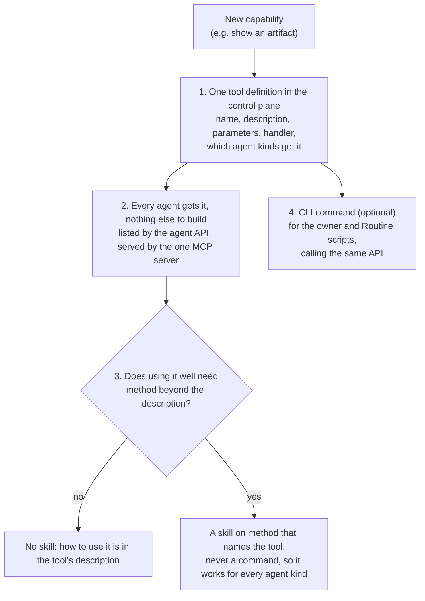
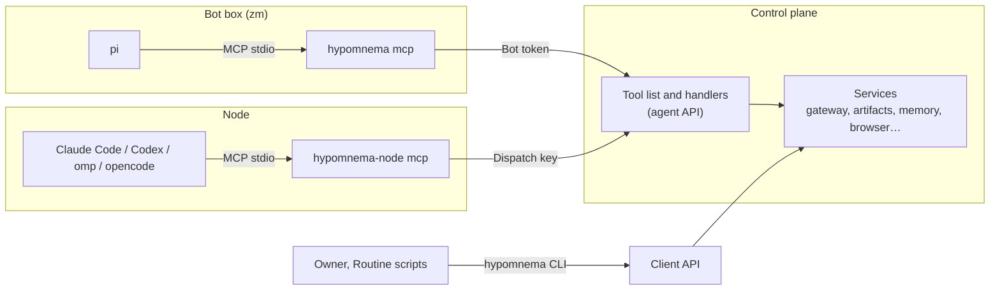

# A capability is one tool on the control plane, reaching every agent kind over MCP

Date: 2026-11-15. Status: accepted by the owner (issue [#492](https://github.com/kl3inIT/hypomnema/issues/492),
standard approved 2026-11-15; steps 1 and 2 merged in PRs #499 and #514). Adds to
[2026-11-09-coordinator-cli-and-skill.md](2026-11-09-coordinator-cli-and-skill.md), which keeps orchestration
(Runs, Tasks, answers) on the CLI and the coordinator skill; that record's "MCP stays possible later as another door
to the same API" is the door taken here for what every agent shares.

## Context

Until issue #492 a capability reached each agent kind its own way: a Bot ran `hypomnema web` or `hypomnema image`
through bash, taught by a skill; a worker got web tools from its node's MCP server; Claude Code used Anthropic's own
WebSearch; omp and opencode were configured to call the gateway from their own image tools. Each new capability had
to be built up to three times (a command, a tool, a skill), and a skill that named a command broke on the agent
kinds that lack it: `pages` tells the agent to run `hypomnema artifact show`, which a worker does not have.

Every reference that drives several CLIs does it once: OpenMausBot mounts its one `agents` MCP server into pi,
Codex, Claude Code and its ACP agents; OpenClaw gives its CLI backends the Gateway's tools through a loopback MCP
bridge; Hermes gives its Codex runtime its tools over a stdio MCP server; Omnigent relays its tools with
`serve-mcp`. All of them separate a tool (code the agent calls, switched per agent) from a skill (a document on
method). [Research](../research/2026-11-15-tools-and-skills-for-every-agent.md).

## Decision

A new capability that an agent uses is built in this order, and only here:

1. **One tool definition in the control plane**: name, description, parameters, the handler, and which agent kinds
   get it. The agent API lists it and refuses a call from an agent that was not given it.
2. **Every agent kind gets it through Hypomnema's one MCP server** (`internal/shared/toolsmcp`): a Bot's pi mounts
   it with pi's built-in MCP (`hypomnema mcp`, `direct` exposure; pi's default `codemode` since 2026-11-21, issue #1015), a worker's CLI with its own MCP configuration
   (`hypomnema-node mcp`). No per-CLI configuration and no node release for a new tool. A CLI's own tool for the
   same thing is turned off, unless the gateway itself answers it (Codex's `web.run`).
3. **A skill only for method**: how to do the work well (design a page, lay out a PDF), naming the tool. How to call
   the tool lives in its description. A skill never names a `hypomnema` command an agent might lack.
4. **A CLI command is optional**, a door to the same API for the owner and for Routine scripts, which have no MCP.
   No agent depends on it.

Orchestration stays as the 2026-11-09 record says: the coordinator's Runs, Tasks and answers are its CLI and its
role skill, which only a coordinator has.

## Alternatives considered

- **Each CLI's own tool pointed at the gateway** (what omp and opencode images did): one configuration dialect per
  CLI, broken by a CLI release; Claude Code and Codex cannot be pointed at all.
- **The `hypomnema` CLI for every agent**: a worker would need a token with a coordinator's rights, past any per-agent
  tool switch; no reference gives a sub-agent its parent's CLI (Hermes narrows a sub-agent's tools).
- **A pi extension for Bots**: a second implementation beside the MCP server, only for pi; OpenMausBot used one
  before pi had MCP.

## Consequences

- Capabilities that a Bot still reaches only through a command and a skill (`artifact`, `memory`, `superset`,
  `routines`) move to tools one by one, each in its own issue; until then a skill that names a command is given only
  to the agent kinds that have it.
- Out of scope: an Integration's own CLI (`gws`, `lark-cli`, `aws`), which every agent kind already reaches the same
  way, a script on its `PATH` running the launcher, its account chosen by the Connections it was given and its
  requests held by the service proxy ([decision](2026-11-11-service-proxy-in-the-control-plane.md)); OpenClaw
  likewise gives its agents Google's CLI with a skill.
- A tool's definitions cost tokens on every request with `direct` exposure (about 840 for the three of #492; a Bot
  uses `codemode` exposure since 2026-11-21, which declares one tool, issue #1015);
  a capability used often pays for itself against reading a skill and running commands.
- A tool's description is reviewed like a prompt: it is what teaches the agent.

## Sources

[docs/research/2026-11-15-tools-and-skills-for-every-agent.md](../research/2026-11-15-tools-and-skills-for-every-agent.md);
issue #492 and PRs #499, #514.
